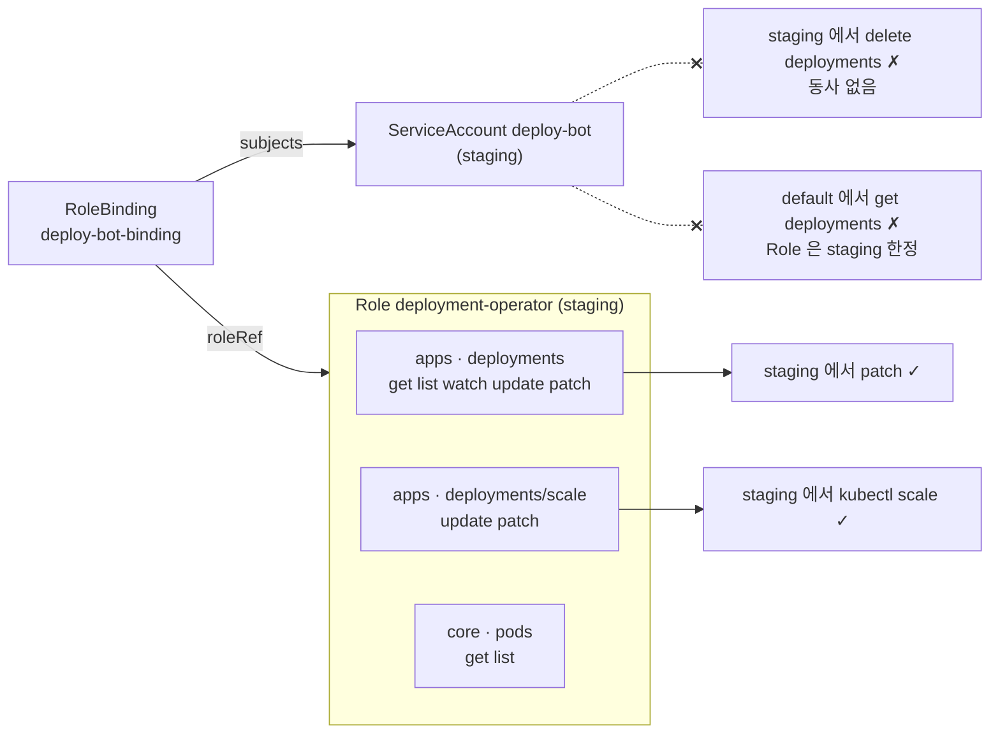

# q01 — Namespaced RBAC for a deployment operator · 풀이

← 문제: **[question.md](question.md)**

## 문제 (해석)

**원문**

> A deployment automation tool needs limited access to the `staging` namespace.
>
> 1. Create a ServiceAccount named `deploy-bot` in the `staging` namespace.
> 2. Create a Role named `deployment-operator` granting
>    - `get`, `list`, `watch`, `update` and `patch` on `deployments`
>    - `update` and `patch` on `deployments/scale`
>    - `get` and `list` on `pods`
> 3. Bind the Role to the ServiceAccount with a RoleBinding named `deploy-bot-binding`.
> 4. Verify that `deploy-bot` can scale a deployment in `staging` but **cannot** delete
>    deployments, and **cannot** read deployments in the `default` namespace.

**해석**

배포 자동화 도구가 `staging` 네임스페이스에 제한된 권한으로 접근해야 한다.

1. `staging` 네임스페이스에 ServiceAccount `deploy-bot` 을 만든다.
2. Role `deployment-operator` 를 만들어 다음을 허용한다.
   - `deployments` 에 대한 `get`, `list`, `watch`, `update`, `patch`
   - `deployments/scale` 에 대한 `update`, `patch`
   - `pods` 에 대한 `get`, `list`
3. RoleBinding `deploy-bot-binding` 으로 Role을 ServiceAccount에 연결한다.
4. `deploy-bot` 이 `staging` 의 deployment를 스케일할 수 있지만 **삭제할 수는 없고**, `default` 네임스페이스의 deployment는 **읽을 수 없음**을 확인한다.

## 모범 풀이

```bash
kubectl create namespace staging        # 이미 있으면 AlreadyExists — 무시하고 진행
kubectl -n staging create serviceaccount deploy-bot
```

`kubectl create role` 은 `--resource` 에 준 **모든 리소스에 같은 동사**를 줍니다. 이 문제는 리소스마다 동사가 다르므로(deployments 5개, scale 2개, pods 2개) yaml로 규칙 셋을 쓰는 것이 정확합니다.

```yaml
apiVersion: rbac.authorization.k8s.io/v1
kind: Role
metadata:
  name: deployment-operator
  namespace: staging
rules:
- apiGroups: ["apps"]
  resources: ["deployments"]
  verbs: ["get", "list", "watch", "update", "patch"]
- apiGroups: ["apps"]
  resources: ["deployments/scale"]
  verbs: ["update", "patch"]
- apiGroups: [""]
  resources: ["pods"]
  verbs: ["get", "list"]
```

```bash
kubectl apply -f role.yaml
kubectl -n staging create rolebinding deploy-bot-binding \
  --role=deployment-operator \
  --serviceaccount=staging:deploy-bot
```

**`apiGroups` 를 맞추는 것이 핵심입니다.** `deployments` 는 `apps` 그룹, `pods` 는 core 그룹(빈 문자열 `""`)입니다. 규칙 하나는 `apiGroups × resources × verbs` 의 **모든 조합**을 허용하므로, `apiGroups: ["", "apps"]` 와 `resources: ["pods", "deployments"]` 를 한 규칙에 적는 것 자체는 가능합니다. 다만 그러면 두 리소스가 같은 동사를 받게 되므로, 동사가 다른 이 문제에서는 규칙을 나눠야 합니다. 그룹이 기억나지 않으면:

```bash
kubectl api-resources | grep -E '^deployments|^pods'
```

`deployments/scale` 은 subresource라 별도 규칙이 필요합니다. `deployments` 만 허용하면 `kubectl scale` 이 거부됩니다.

### 그림 — Role 규칙과 확인 결과



1. 규칙은 리소스마다 동사가 달라서 세 개로 나눕니다. `deployments` 와 `deployments/scale` 은 `apps` 그룹, `pods` 는 core 그룹(`""`)입니다.
2. `kubectl scale` 은 `deployments/scale` 서브리소스를 고치므로 두 번째 규칙이 있어야 통과합니다.
3. `delete` 는 어느 규칙에도 없으니 거부되고, Role·RoleBinding 이 `staging` 에만 있으니 `default` 의 deployment 도 읽지 못합니다.

## 검증

```bash
SA=system:serviceaccount:staging:deploy-bot

kubectl -n staging auth can-i update deployments --subresource=scale --as=$SA   # yes
kubectl -n staging auth can-i patch deployments --as=$SA          # yes
kubectl -n staging auth can-i delete deployments --as=$SA         # no
kubectl -n default auth can-i get deployments --as=$SA            # no

# 실제로 스케일해 보기 (Deployment web 은 setup 이 만들어 둔 것)
kubectl -n staging scale deploy web --replicas=3 --as=$SA
```

**`auth can-i update deployments/scale` 로 확인하면 안 됩니다.** `can-i` 는 두 번째 인자의 `/` 뒤를
서브리소스가 아니라 **리소스 이름**으로 읽습니다. 그래서 위 명령은 "`scale` 이라는 이름의 deployment를
update할 수 있나"를 묻게 되고, `deployments` 에 `update` 가 있으니 scale 규칙이 없어도 `yes` 가 나옵니다.
서브리소스는 반드시 `--subresource=scale` 로 지정합니다(`pods --subresource=log` 도 같은 방식).

## 오답 원인 / 배운 점

- **왜 틀렸나**:
- **기억할 것**: `deployments` = `apps` 그룹, `pods` = core(`""`) 그룹. 규칙 하나 안의 리소스는 모두 같은 동사를 받으므로 동사가 다르면 규칙을 나눈다. 서브리소스 권한 확인은 `auth can-i <verb> <resource> --subresource=<sub>`.
- **헷갈리는 지점**: `scale` 은 subresource(`deployments/scale`)라 따로 열어야 `kubectl scale` 이 동작합니다. Role은 네임스페이스 한정이므로 다른 네임스페이스는 자동으로 막힙니다.

## 참고 문서

- 검색어: `RBAC`
- https://kubernetes.io/docs/reference/access-authn-authz/rbac/

---

[↑ 문항 목록](../README.md) · [← 문제로](question.md) · [다음 문제 q02 →](../q02_kubeadm_cluster_upgrade/question.md)
