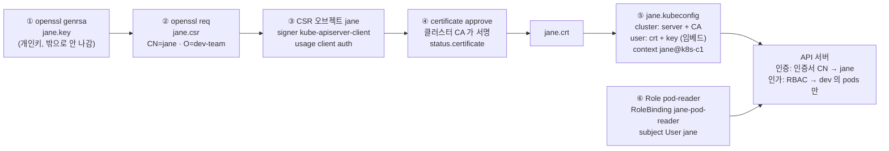

# q04 — Create a kubeconfig for a certificate-based user · 풀이

← 문제: **[question.md](question.md)**

## 문제 (해석)

**원문**

> A new operator `jane` must reach the cluster with her own client certificate.
>
> 1. Generate a 2048-bit RSA key `/root/jane.key` and a CSR `/root/jane.csr` with subject
>    `CN=jane`, `O=dev-team`.
> 2. Submit it as a CertificateSigningRequest `jane` — signer
>    `kubernetes.io/kube-apiserver-client`, usage `client auth`, one day of validity. Approve
>    it and save the issued certificate to `/root/jane.crt`.
> 3. Build a standalone kubeconfig `/root/jane.kubeconfig`: cluster `k8s-c1` with the admin
>    kubeconfig's endpoint and CA, user `jane`, current context `jane@k8s-c1`, certs embedded.
> 4. Grant `jane` `get`, `list` and `watch` on `pods` in `dev` with a Role `pod-reader` and a
>    RoleBinding `jane-pod-reader`.
> 5. With only `/root/jane.kubeconfig`, show `jane` lists pods in `dev` and not in `default`.

**해석**

새 운영자 `jane` 이 본인 클라이언트 인증서로 클러스터에 접근해야 한다.

1. 2048비트 RSA 키 `/root/jane.key` 와 subject가 `CN=jane`, `O=dev-team` 인 CSR `/root/jane.csr` 을 만든다.
2. 이것을 CertificateSigningRequest `jane` 으로 제출한다. signer는 `kubernetes.io/kube-apiserver-client`, usage는 `client auth`, 유효기간은 1일. 승인하고 발급된 인증서를 `/root/jane.crt` 로 저장한다.
3. 독립 kubeconfig `/root/jane.kubeconfig` 를 만든다. cluster `k8s-c1`(admin kubeconfig와 같은 API 서버 주소·CA), user `jane`, 현재 컨텍스트는 `jane@k8s-c1`. 인증서는 파일에 임베드한다.
4. Role `pod-reader` 와 RoleBinding `jane-pod-reader` 로 `dev` 네임스페이스의 `pods` 에 대한 `get`, `list`, `watch` 를 `jane` 에게 부여한다.
5. `/root/jane.kubeconfig` 만 써서 `jane` 이 `dev` 의 파드는 조회하고 `default` 의 파드는 조회하지 못함을 보인다.

## 모범 풀이

**1) 키와 CSR**

```bash
openssl genrsa -out /root/jane.key 2048
openssl req -new -key /root/jane.key -out /root/jane.csr -subj "/CN=jane/O=dev-team"
```

**2) CSR 오브젝트 제출·승인**

`request` 는 CSR 파일 전체를 base64로 인코딩한 값이며 **줄바꿈이 없어야** 합니다(`-w 0`).

```bash
cat /root/jane.csr | base64 -w 0
```

```yaml
apiVersion: certificates.k8s.io/v1
kind: CertificateSigningRequest
metadata:
  name: jane
spec:
  request: <위 출력 한 줄>
  signerName: kubernetes.io/kube-apiserver-client
  expirationSeconds: 86400
  usages:
  - client auth
```

YAML 파일을 따로 만들지 않고 한 번에 넣어도 됩니다.

```bash
cat <<EOF | kubectl apply -f -
apiVersion: certificates.k8s.io/v1
kind: CertificateSigningRequest
metadata:
  name: jane
spec:
  request: $(base64 -w 0 < /root/jane.csr)
  signerName: kubernetes.io/kube-apiserver-client
  expirationSeconds: 86400
  usages:
  - client auth
EOF
```

```bash
kubectl apply -f jane-csr.yaml       # 파일로 만들었다면
kubectl get csr jane                 # CONDITION Pending
kubectl certificate approve jane     # CONDITION Approved,Issued
kubectl get csr jane -o jsonpath='{.status.certificate}' | base64 -d > /root/jane.crt
```

승인 직후 `status.certificate` 가 비어 있으면 서명 컨트롤러가 아직 발급 전이라 빈 파일이 생깁니다. `get csr jane` 이 `Approved,Issued` 인지 보고 저장하고, `openssl x509 -in /root/jane.crt -noout -subject` 로 내용이 있는지 확인합니다. `expirationSeconds` 는 signer가 지키는 요청값이라 최소 600초이며, 실제 만료일은 `openssl x509 -noout -enddate` 로 확인할 수 있습니다.

**3) kubeconfig**

```bash
KC=/root/jane.kubeconfig
API=$(kubectl config view --minify -o jsonpath='{.clusters[0].cluster.server}')
# admin kubeconfig 에 들어 있는 CA 를 그대로 꺼낸다 (--raw 가 없으면 DATA+OMITTED 로 가려짐)
kubectl config view --raw --minify -o jsonpath='{.clusters[0].cluster.certificate-authority-data}' \
  | base64 -d > /root/k8s-c1-ca.crt

kubectl config set-cluster k8s-c1 --server=$API \
  --certificate-authority=/root/k8s-c1-ca.crt --embed-certs=true --kubeconfig=$KC
kubectl config set-credentials jane \
  --client-certificate=/root/jane.crt --client-key=/root/jane.key --embed-certs=true --kubeconfig=$KC
kubectl config set-context jane@k8s-c1 --cluster=k8s-c1 --user=jane --kubeconfig=$KC
kubectl config use-context jane@k8s-c1 --kubeconfig=$KC
```

문제는 CA를 "admin kubeconfig의 CA"로 지정합니다. 컨트롤 플레인 노드라면 `/etc/kubernetes/pki/ca.crt` 와 같은 파일이지만, 워커나 점프 호스트에는 그 파일이 없으므로 위처럼 admin kubeconfig에서 꺼내는 방법이 어디서나 통합니다. `--minify` 는 현재 컨텍스트(admin)의 클러스터 하나만 남겨 `clusters[0]` 이 확실히 그 클러스터가 되게 합니다.

**4) RBAC**

```bash
kubectl -n dev create role pod-reader --verb=get,list,watch --resource=pods
kubectl -n dev create rolebinding jane-pod-reader --role=pod-reader --user=jane
```

**인증서는 권한을 하나도 주지 않습니다.** 인증서가 하는 일은 "나는 jane 이다"를 증명하는 인증(authentication)까지이고, 무엇을 할 수 있는지는 RBAC이 따로 정합니다. 4단계를 빼면 3단계까지 완벽해도 모든 요청이 `Forbidden` 입니다. 그리고 이름은 인증서에서 옵니다 — **`CN` 이 사용자 이름, `O` 가 그룹**입니다. 그래서 RoleBinding의 `--user=jane` 이 CSR의 `CN=jane` 과 한 글자라도 다르면 연결되지 않습니다. `--group=dev-team` 으로 묶을 수도 있습니다.

`--embed-certs=true` 를 빼면 kubeconfig에 파일 경로만 기록되어, 파일을 다른 곳으로 옮기면 바로 깨집니다.

### 그림 — 키에서 kubeconfig, RBAC까지 이어지는 흐름



1. 개인키(`jane.key`)는 처음부터 끝까지 내 쪽에만 있습니다. 클러스터에 보내는 것은 공개키와 subject가 담긴 CSR뿐입니다.
2. CSR 오브젝트를 승인하면 클러스터 CA가 서명한 인증서가 `status.certificate` 에 base64로 실립니다. 이것을 풀어 `jane.crt` 로 저장합니다.
3. kubeconfig의 cluster 항목은 "어느 서버를, 어느 CA로 믿을지", user 항목은 "나를 어떤 인증서와 키로 증명할지"를 담습니다. context가 둘을 묶습니다.
4. API 서버는 먼저 인증서를 검증해 사용자 이름(CN `jane`)과 그룹(O `dev-team`)을 얻고, 그 다음 RBAC으로 허용 여부를 봅니다. ⑥이 없으면 인증은 통과해도 모든 요청이 `Forbidden` 입니다.

## 검증

```bash
openssl x509 -in /root/jane.crt -noout -subject       # subject=CN=jane, O=dev-team

kubectl --kubeconfig=/root/jane.kubeconfig -n dev get pods       # a04-web 목록 출력
kubectl --kubeconfig=/root/jane.kubeconfig -n default get pods
# Error from server (Forbidden): pods is forbidden: User "jane" cannot list resource "pods" ... in the namespace "default"

kubectl --kubeconfig=/root/jane.kubeconfig auth whoami            # Username jane, Groups [dev-team system:authenticated]

kubectl auth can-i list pods -n dev --as=jane          # yes
kubectl auth can-i list pods -n default --as=jane      # no
kubectl config current-context --kubeconfig=/root/jane.kubeconfig   # jane@k8s-c1
```

## 오답 원인 / 배운 점

- **왜 틀렸나**:
- **기억할 것**: 인증서 = 인증(누구인가), RBAC = 인가(무엇을 할 수 있나). 둘 다 있어야 동작한다. `CN`=user, `O`=group.
- **헷갈리는 지점**: `set-cluster` 는 서버를 믿기 위한 `--certificate-authority`(클러스터 CA)를, `set-credentials` 는 나를 증명할 `--client-certificate` 와 `--client-key` 를 받습니다. CA 자리에 `jane.crt` 같은 엉뚱한 파일을 넣으면 `x509: certificate signed by unknown authority`, 인증서와 키 짝이 안 맞으면 `tls: private key does not match public key` 가 납니다. 또 `kubectl config` 계열은 `--kubeconfig` 없이 쓰면 조용히 `~/.kube/config` 를 고쳐 admin 설정을 망칩니다.

## 참고 문서

- 검색어: `certificate signing requests`
- https://kubernetes.io/docs/reference/access-authn-authz/certificate-signing-requests/

## 복습 기록

| 날짜 | 결과 | 메모 |
|---|---|---|
|  |  |  |
