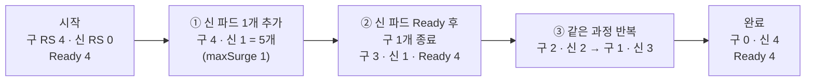
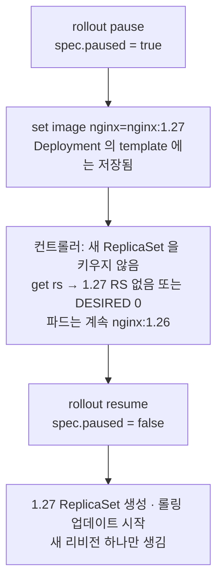

# q05 — Rolling update, pause and roll back a Deployment · 풀이

← 문제: **[question.md](question.md)**

## 문제 (해석)

**원문**

> Namespace `apps` serves a web tier that must never drop below its declared capacity
> during an update.
>
> 1. Create a Deployment `web` in `apps` with 4 replicas of `nginx:1.25`, then set its
>    strategy to `RollingUpdate` with `maxSurge: 1` and `maxUnavailable: 0`.
> 2. Roll it out to `nginx:1.26` and make `bump to 1.26` appear as the change cause in the
>    rollout history.
> 3. Pause the rollout, change the image to `nginx:1.27`, and show that no new ReplicaSet is
>    scaled up while paused. Then resume and wait for the rollout to finish.
> 4. Print the revision history, inspect revision 1, then roll back to the revision running
>    `nginx:1.25`.
> 5. Confirm the running image and that the rollout is complete.

**해석**

`apps` 네임스페이스의 웹 계층은 업데이트 중에도 선언한 용량 아래로 내려가면 안 된다.

1. `apps` 에 `nginx:1.25` 4 레플리카짜리 Deployment `web` 을 만들고, 전략을 `maxSurge: 1`, `maxUnavailable: 0` 인 `RollingUpdate` 로 설정한다.
2. `nginx:1.26` 으로 롤아웃하고, rollout history에 change cause가 `bump to 1.26` 으로 보이게 한다.
3. 롤아웃을 pause하고 이미지를 `nginx:1.27` 로 바꾼 뒤, pause 상태에서는 새 ReplicaSet이 스케일업되지 않음을 보인다. 그 다음 resume하고 롤아웃이 끝날 때까지 기다린다.
4. 리비전 히스토리를 출력하고 리비전 1을 들여다본 뒤, `nginx:1.25` 를 돌리던 리비전으로 롤백한다.
5. 현재 이미지와 롤아웃 완료 상태를 확인한다.

## 모범 풀이

```bash
kubectl create namespace apps
kubectl -n apps create deploy web --image=nginx:1.25 --replicas=4
kubectl -n apps patch deploy web -p \
  '{"spec":{"strategy":{"type":"RollingUpdate","rollingUpdate":{"maxSurge":1,"maxUnavailable":0}}}}'
```

`maxUnavailable: 0` + `maxSurge: 1` 은 "새 파드 하나를 먼저 띄워 Ready가 된 뒤에야 낡은 파드 하나를 죽인다"는 뜻입니다. Ready 파드 수가 4 미만으로 절대 내려가지 않습니다. 둘을 모두 0으로 두면 교체할 방법이 없어 롤아웃이 영구히 멈추므로 API가 거부합니다.

```bash
kubectl -n apps set image deploy/web nginx=nginx:1.26
kubectl -n apps annotate deploy/web kubernetes.io/change-cause="bump to 1.26" --overwrite
kubectl -n apps rollout status deploy/web
```

**컨테이너 이름은 Deployment 이름이 아닙니다.** `kubectl create deploy web --image=nginx:1.25` 가 만드는 컨테이너 이름은 이미지에서 딴 `nginx` 입니다. 그래서 `set image deploy/web web=nginx:1.26` 은 그 컨테이너를 못 찾습니다. 이름이 확실치 않으면 먼저 확인하거나 와일드카드를 씁니다.

```bash
kubectl -n apps get deploy web -o jsonpath='{.spec.template.spec.containers[*].name}'
kubectl -n apps set image deploy/web '*=nginx:1.26'     # 모든 컨테이너
```

`--record` 는 deprecated 되어 도움말과 레퍼런스에서 빠졌습니다(쓰면 경고가 나오고 언제 없어질지 모릅니다). change cause는 `kubernetes.io/change-cause` 어노테이션으로 직접 넣습니다. 이 어노테이션은 Deployment에 붙으면 현재 리비전의 ReplicaSet으로 복사되어 `rollout history` 의 CHANGE-CAUSE 열에 나옵니다.

**pause / resume**

```bash
kubectl -n apps rollout pause deploy/web
kubectl -n apps set image deploy/web nginx=nginx:1.27
kubectl -n apps get rs -o wide        # 1.27 ReplicaSet이 없거나 DESIRED 0
kubectl -n apps rollout resume deploy/web
kubectl -n apps rollout status deploy/web
```

pause 중에는 파드 템플릿 변경이 오브젝트에는 저장되지만 컨트롤러가 새 ReplicaSet을 스케일업하지 않습니다. 여러 항목을 한 번에 바꿔서 롤아웃을 한 번만 돌리고 싶을 때 쓰는 기능입니다.

### 그림 1 — maxSurge 1 · maxUnavailable 0 으로 한 칸씩 바뀌는 모습



1. `maxSurge: 1` 이라 레플리카 4 위에 파드를 **한 개까지만** 더 띄울 수 있습니다. 그래서 먼저 새 파드 하나가 뜨고 잠시 5개가 됩니다.
2. `maxUnavailable: 0` 이라 Ready 파드가 4 아래로 내려가면 안 됩니다. 새 파드가 Ready 가 된 뒤에야 낡은 파드 하나를 지웁니다.
3. 이 "하나 올리고 하나 내리기"를 네 번 반복하면 끝납니다. 새 파드가 Ready 가 안 되면(이미지 오류 등) 낡은 파드가 그대로 남아 서비스는 유지되고 롤아웃만 멈춥니다.

### 그림 2 — pause 중에 무엇이 저장되고 무엇이 멈추는가



1. pause 는 Deployment 에 `paused: true` 표시만 합니다. 이후의 `set image`, `set resources` 같은 변경은 오브젝트에 그대로 저장됩니다.
2. 컨트롤러는 paused 인 Deployment 의 템플릿 변경을 롤아웃하지 않으므로 파드는 계속 1.26 입니다. 이 상태를 `get rs -o wide` 로 보여 주는 것이 3단계의 요구입니다.
3. resume 하면 그동안 쌓인 변경이 **한 번의 롤아웃, 한 개의 리비전**으로 반영됩니다. 그 뒤 `--to-revision=1` 롤백은 1.25 템플릿을 새 리비전 번호로 다시 기록합니다.

**히스토리와 롤백**

```bash
kubectl -n apps rollout history deploy/web
kubectl -n apps rollout history deploy/web --revision=1     # 1.25 확인
kubectl -n apps rollout undo deploy/web --to-revision=1
```

`undo` 를 리비전 번호 없이 쓰면 직전 리비전으로 돌아갑니다. 롤백도 새 리비전 번호를 받습니다 — 리비전 1로 돌아가면 그 내용이 리비전 4 등으로 다시 기록됩니다.

## 검증

```bash
kubectl -n apps rollout status deploy/web
# deployment "web" successfully rolled out

kubectl -n apps get deploy web -o jsonpath='{.spec.template.spec.containers[0].image}'
# nginx:1.25

kubectl -n apps get deploy web -o jsonpath='{.spec.strategy.rollingUpdate}'
# {"maxSurge":1,"maxUnavailable":0}

kubectl -n apps rollout history deploy/web     # CHANGE-CAUSE에 bump to 1.26 이 남아 있음
kubectl -n apps get rs                          # 현재 리비전만 DESIRED 4, 나머지 0
```

## 오답 원인 / 배운 점

- **왜 틀렸나**:
- **기억할 것**: `kubectl set image deploy/X <컨테이너이름>=<이미지>` — 가운데는 **컨테이너 이름**이고 Deployment 이름과 같지 않다.
- **헷갈리는 지점**: `rollout pause` 는 롤아웃만 멈춥니다. 파드를 멈추거나 트래픽을 끊지 않습니다. 그리고 `rollout undo`(직전 리비전)와 `rollout undo --to-revision=N`(지정 리비전)을 섞어 쓰면 엉뚱한 버전으로 갑니다. `rollout history --revision=N` 으로 먼저 내용을 확인하는 습관이 안전합니다.

## 참고 문서

- 검색어: `rolling back a deployment`
- https://kubernetes.io/docs/concepts/workloads/controllers/deployment/

---

[↑ 문항 목록](../README.md) · [← 문제로](question.md) · [다음 문제 q06 →](../q06_configmap_secret_injection/question.md)
