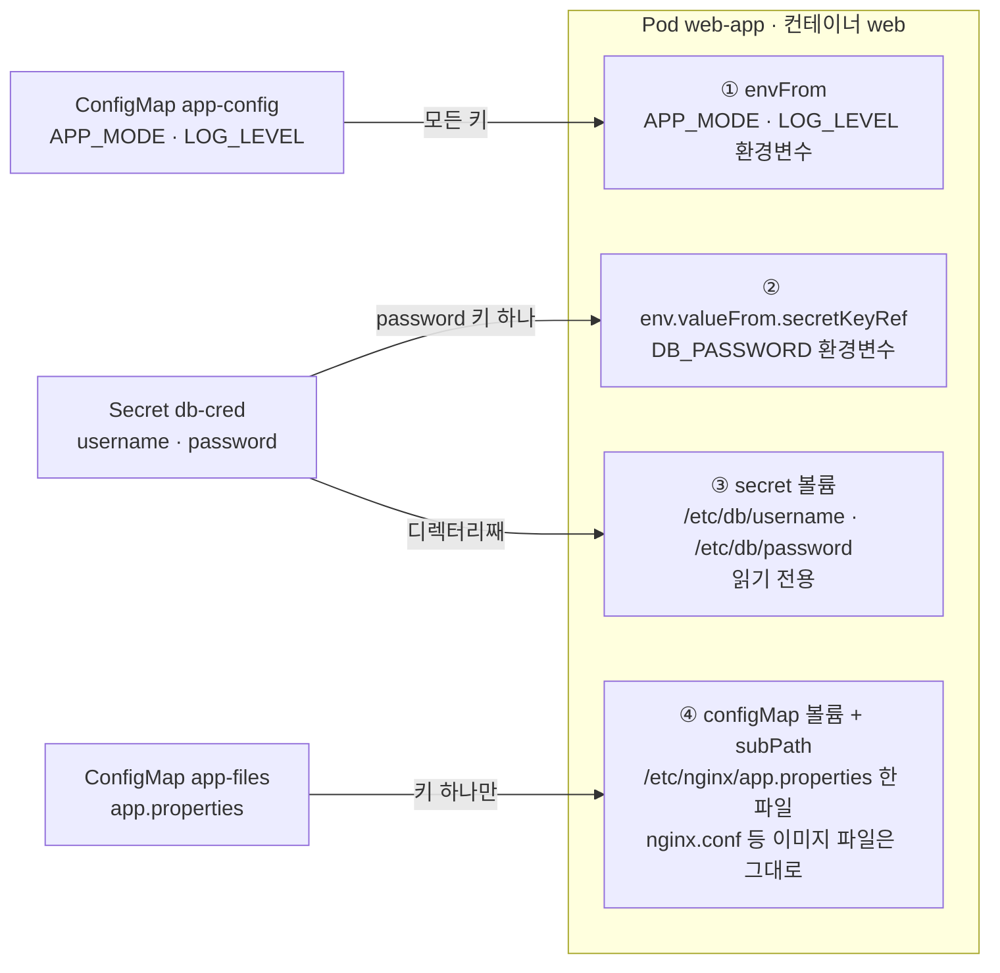

# q06 — Configure an application with a ConfigMap and Secret · 풀이

← 문제: **[question.md](question.md)**

## 문제 (해석)

**원문**

> An application in namespace `web` takes its settings from the cluster, not from its image.
>
> 1. Create a ConfigMap `app-config` with `APP_MODE=production` and `LOG_LEVEL=warn`.
> 2. Create a ConfigMap `app-files` with key `app.properties` = `timeout=30\nretries=3`.
> 3. Create a generic Secret `db-cred` with `username=appuser` and `password=S3cr3t!`.
> 4. Create a Pod `web-app` running `nginx:1.27` that
>    - receives every key of `app-config` as an environment variable in one block
>    - receives only the `password` key of `db-cred` as the variable `DB_PASSWORD`
>    - mounts `db-cred` read-only at `/etc/db`
>    - mounts `app.properties` at `/etc/nginx/app.properties` without hiding the image's own
>      files in `/etc/nginx`
> 5. Show the variables and the mounted files from inside the container, and state in one
>    line why the `/etc/nginx/app.properties` mount will not see a later edit of `app-files`.

**해석**

`web` 네임스페이스의 애플리케이션은 설정을 이미지가 아니라 클러스터에서 받아야 한다.

1. `APP_MODE=production`, `LOG_LEVEL=warn` 을 담은 ConfigMap `app-config` 을 만든다.
2. 키 `app.properties` = `timeout=30\nretries=3` 인 ConfigMap `app-files` 를 만든다.
3. `username=appuser`, `password=S3cr3t!` 를 담은 generic Secret `db-cred` 을 만든다.
4. `nginx:1.27` 을 실행하는 Pod `web-app` 을 만들어 다음을 충족시킨다.
   - `app-config` 의 모든 키를 한 블록으로 환경변수로 받는다
   - `db-cred` 의 `password` 키만 `DB_PASSWORD` 변수로 받는다
   - `db-cred` 을 `/etc/db` 에 읽기 전용으로 마운트한다
   - `app.properties` 를 `/etc/nginx/app.properties` 에 마운트하되 `/etc/nginx` 에 있는 이미지 원래 파일을 가리지 않는다
5. 컨테이너 안에서 변수와 마운트된 파일을 확인하고, `/etc/nginx/app.properties` 마운트가 이후 `app-files` 수정을 반영하지 않는 이유를 한 줄로 적는다.

## 모범 풀이

namespace `web` 은 setup 이 만들어 둡니다(문제도 이미 있다고 가정합니다). 없으면 `kubectl create namespace web` 부터 실행합니다.

```bash
kubectl -n web create configmap app-config \
  --from-literal=APP_MODE=production --from-literal=LOG_LEVEL=warn

printf 'timeout=30\nretries=3\n' > app.properties
kubectl -n web create configmap app-files --from-file=app.properties

kubectl -n web create secret generic db-cred \
  --from-literal=username=appuser --from-literal='password=S3cr3t!'
```

`password=S3cr3t!` 는 반드시 작은따옴표로 감쌉니다. `!` 는 bash의 history expansion 문자라 따옴표 없이 쓰면 셸이 먼저 건드립니다.

```yaml
apiVersion: v1
kind: Pod
metadata:
  name: web-app
  namespace: web
spec:
  containers:
  - name: web
    image: nginx:1.27
    envFrom:
    - configMapRef:
        name: app-config
    env:
    - name: DB_PASSWORD
      valueFrom:
        secretKeyRef:
          name: db-cred
          key: password
    volumeMounts:
    - name: db
      mountPath: /etc/db
      readOnly: true
    - name: files
      mountPath: /etc/nginx/app.properties
      subPath: app.properties
  volumes:
  - name: db
    secret:
      secretName: db-cred
  - name: files
    configMap:
      name: app-files
```

### 그림 — ConfigMap·Secret 이 파드로 들어가는 네 갈래



1. `envFrom.configMapRef` 는 `app-config` 의 **모든 키**를 키 이름 그대로 환경변수로 넣습니다. 키를 하나씩 나열하지 않아도 됩니다.
2. `env[].valueFrom.secretKeyRef` 는 Secret 의 **키 하나**를 원하는 이름(`DB_PASSWORD`)의 변수로 넣습니다. ①·② 모두 컨테이너가 시작할 때 한 번 읽으므로 나중에 값이 바뀌어도 재시작 전에는 반영되지 않습니다.
3. `secret` 볼륨을 `/etc/db` 에 디렉터리째 마운트하면 키마다 파일이 하나씩 생기고, 내용은 base64 가 풀린 평문입니다. 이 방식은 Secret 이 바뀌면 kubelet 이 파일도 갱신합니다.
4. `app-files` 는 `subPath: app.properties` 로 **파일 하나만** `/etc/nginx` 안에 끼워 넣습니다. 그래서 `/etc/nginx` 의 이미지 파일이 가려지지 않지만, 대신 ConfigMap 을 고쳐도 이 파일은 갱신되지 않습니다(5단계의 답).

네 가지 주입 방식이 각각 다릅니다.

| 방식 | 범위 | 이름 바꾸기 | 갱신 반영 |
|---|---|---|---|
| `envFrom.configMapRef` | ConfigMap의 모든 키 | 접두사만 (`prefix`) | 안 됨 (재시작 필요) |
| `env[].valueFrom.secretKeyRef` | 키 하나 | 가능 (`DB_PASSWORD`) | 안 됨 (재시작 필요) |
| volume 마운트 (디렉터리) | 모든 키가 각각 파일 | 가능 (`items`) | 됨 (kubelet 동기화 주기만큼 지연, 보통 1분 안팎) |
| volume 마운트 + `subPath` | 키 하나가 파일 하나 | 가능 | **안 됨** |

**`subPath` 마운트는 ConfigMap이 바뀌어도 갱신되지 않습니다.** 이게 이 문제의 함정입니다. 일반 볼륨 마운트는 kubelet이 심볼릭 링크를 갈아끼워 갱신을 전파하지만, `subPath` 는 볼륨 안의 특정 경로를 컨테이너의 한 파일에 직접 bind mount하므로 갈아끼울 링크가 없습니다. 그런데도 `subPath` 를 쓰는 이유는, `mountPath: /etc/nginx` 로 디렉터리째 마운트하면 그 디렉터리의 이미지 파일이 전부 가려지기 때문입니다. 여기서는 `nginx.conf` 까지 사라져 nginx가 `open() "/etc/nginx/nginx.conf" failed` 로 기동하지 못하고 CrashLoopBackOff에 빠집니다.

`envFrom` 은 키 이름을 그대로 환경변수 이름으로 씁니다. 점(`.`)과 `-` 는 원래 허용되는 문자이고, 1.34부터는 `=` 를 뺀 출력 가능한 ASCII가 거의 다 허용됩니다. 그래서 `app.properties` 키를 `envFrom` 으로 넣으면 건너뛰어지는 게 아니라 **`app.properties` 라는 이름의 환경변수**가 조용히 생깁니다. 셸에서는 참조하기도 어려운 쓸모없는 변수이므로, 파일용 데이터는 별도 ConfigMap으로 분리했습니다. 키 이름 앞에 공통 접두사를 붙이고 싶으면 `envFrom[].prefix` 를 씁니다.

## 검증

```bash
kubectl -n web exec web-app -- env | grep -E 'APP_MODE|LOG_LEVEL|DB_PASSWORD'
# APP_MODE=production / LOG_LEVEL=warn / DB_PASSWORD=S3cr3t!
kubectl -n web exec web-app -- ls /etc/db             # password  username
kubectl -n web exec web-app -- cat /etc/db/username   # appuser (base64 가 디코딩된 평문)
kubectl -n web exec web-app -- cat /etc/nginx/app.properties   # timeout=30 / retries=3
kubectl -n web exec web-app -- ls /etc/nginx          # nginx.conf, conf.d, mime.types … 옆에 app.properties
```

5단계의 한 줄 답: **`subPath` 마운트는 볼륨 안의 파일 하나를 컨테이너에 직접 bind mount 하므로, kubelet 이 ConfigMap 갱신 때 심볼릭 링크를 바꿔도 컨테이너에 보이는 파일은 그대로다(갱신하려면 파드를 다시 만든다).**

## 오답 원인 / 배운 점

- **왜 틀렸나**:
- **기억할 것**: `subPath` 로 마운트한 ConfigMap/Secret 파일은 갱신되지 않는다. 갱신이 필요하면 디렉터리로 마운트한다.
- **헷갈리는 지점**: `envFrom` 은 **리스트**(`configMapRef` 가 항목)이고 `env` 는 항목마다 `valueFrom.configMapKeyRef` / `secretKeyRef` 입니다. `envFrom` 아래에 `secretKeyRef` 를 쓰거나 `env` 아래에 `configMapRef` 를 쓰면 파싱 에러입니다. 또 Secret은 base64로 저장되지만 그건 인코딩일 뿐 암호화가 아닙니다.

## 참고 문서

- 검색어: `configure pod configmap`
- https://kubernetes.io/docs/tasks/configure-pod-container/configure-pod-configmap/

## 복습 기록

| 날짜 | 결과 | 메모 |
|---|---|---|
|  |  |  |
