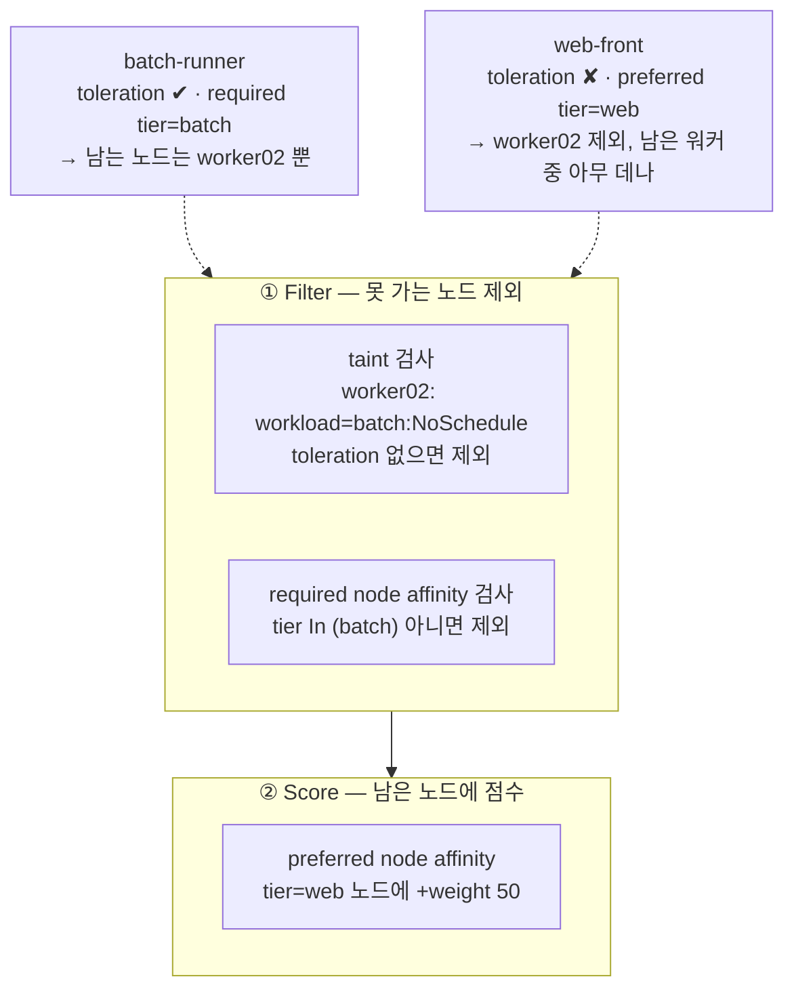
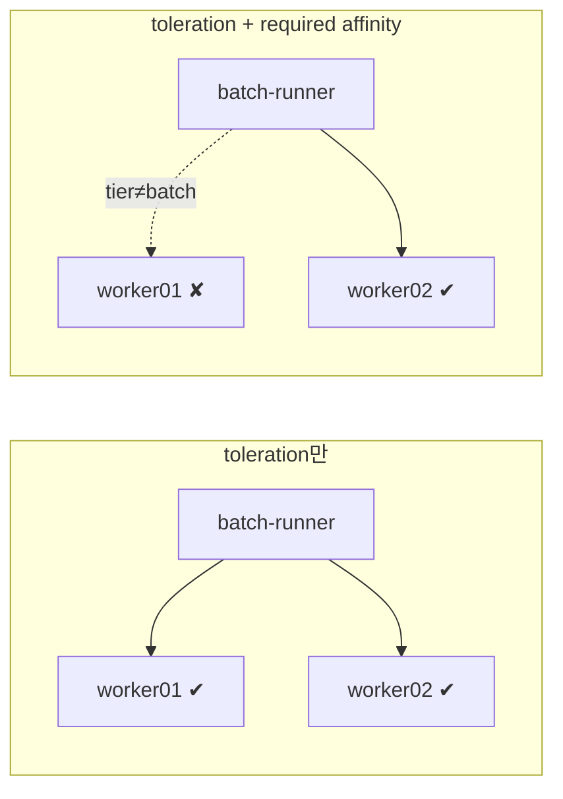

# q07 — Place pods with taints, tolerations and node affinity · 풀이

← 문제: **[question.md](question.md)**

## 문제 (해석)

**원문**

> Batch jobs must be kept off the general worker pool and confined to one dedicated node.
>
> 1. Taint node `worker02` with `workload=batch:NoSchedule` and label it `tier=batch`.
> 2. Create a Pod `batch-runner` in `default` running `busybox:1.36` with command
>    `sleep 3600`, which tolerates that taint and can be scheduled **only** onto nodes
>    labelled `tier=batch`. Use node affinity, not `nodeSelector`.
> 3. Create a Pod `web-front` running `nginx:1.27` that prefers nodes labelled `tier=web`
>    with weight 50 but must still schedule when no such node exists.
> 4. Confirm where each pod landed, then state in one line why giving `batch-runner` only
>    the toleration would not have been enough.
> 5. Remove the taint from `worker02` and show it is gone.

**해석**

배치 작업은 일반 워커 풀에서 떼어내 전용 노드 한 대에 몰아야 한다.

1. 노드 `worker02` 에 `workload=batch:NoSchedule` taint를 걸고 `tier=batch` 라벨을 붙인다.
2. `default` 에 `busybox:1.36` 이미지로 `sleep 3600` 을 실행하는 Pod `batch-runner` 를 만든다. 이 파드는 그 taint를 tolerate하면서 `tier=batch` 라벨이 있는 노드에**만** 스케줄될 수 있어야 한다. `nodeSelector` 가 아니라 node affinity를 쓴다.
3. `nginx:1.27` 을 실행하는 Pod `web-front` 를 만든다. `tier=web` 라벨 노드를 weight 50으로 선호하지만, 그런 노드가 없어도 스케줄은 되어야 한다.
4. 각 파드가 어디에 떨어졌는지 확인하고, `batch-runner` 에 toleration만 줬다면 왜 부족했는지 한 줄로 적는다.
5. `worker02` 의 taint를 제거하고 없어진 것을 확인한다.

## 모범 풀이

```bash
kubectl taint node worker02 workload=batch:NoSchedule
kubectl label node worker02 tier=batch
```

```yaml
apiVersion: v1
kind: Pod
metadata:
  name: batch-runner
spec:
  tolerations:
  - key: workload
    operator: Equal
    value: batch
    effect: NoSchedule
  affinity:
    nodeAffinity:
      requiredDuringSchedulingIgnoredDuringExecution:
        nodeSelectorTerms:
        - matchExpressions:
          - key: tier
            operator: In
            values: ["batch"]
  containers:
  - name: runner
    image: busybox:1.36
    command: ["sleep", "3600"]
```

골격은 `kubectl run ... --dry-run=client -o yaml` 로 뽑고 `tolerations` 와 `affinity` 만 손으로 넣는 것이 빠릅니다.

```bash
kubectl run batch-runner --image=busybox:1.36 --dry-run=client -o yaml --command -- sleep 3600 > batch-runner.yaml
# tolerations / affinity 추가 후
kubectl apply -f batch-runner.yaml
```

`web-front` 는 toleration 없이 preferred affinity만 씁니다.

```yaml
apiVersion: v1
kind: Pod
metadata:
  name: web-front
spec:
  affinity:
    nodeAffinity:
      preferredDuringSchedulingIgnoredDuringExecution:
      - weight: 50
        preference:
          matchExpressions:
          - key: tier
            operator: In
            values: ["web"]
  containers:
  - name: web
    image: nginx:1.27
```

```bash
kubectl apply -f web-front.yaml
kubectl get pod batch-runner web-front -o wide     # 4단계: NODE 열 확인
```

`tier=web` 라벨 노드가 없으니 선호 점수는 아무 노드도 받지 못하고, `web-front` 는 다른 기준으로 점수가 높은 노드에 갑니다. toleration이 없으므로 taint가 걸린 `worker02` 와 컨트롤 플레인 노드에는 가지 않습니다.

### 그림 1 — 스케줄러가 노드를 거르는 순서



1. 스케줄러는 먼저 **Filter** 단계에서 파드가 갈 수 없는 노드를 뺍니다. taint를 tolerate하지 못하는 노드와 required affinity를 만족하지 않는 노드가 여기서 빠집니다.
2. `batch-runner` 는 toleration 덕분에 `worker02` 가 Filter를 통과하고, required affinity 때문에 `tier=batch` 가 아닌 노드는 모두 빠집니다. 남는 노드가 `worker02` 하나뿐이라 반드시 거기로 갑니다.
3. `web-front` 는 toleration이 없어 `worker02` 가 Filter에서 빠집니다. preferred affinity는 **Score** 단계의 가산점일 뿐이라, `tier=web` 노드가 없어도 남은 노드 중 하나에 스케줄됩니다.

### 그림 2 — toleration만 줬을 때와 affinity까지 줬을 때



1. toleration만 있으면 `worker02` 의 거부가 풀릴 뿐이라, taint 없는 `worker01` 도 여전히 후보입니다. 어디로 갈지는 점수에 달려 있습니다.
2. required affinity가 붙어야 `worker01` 이 후보에서 빠지고 `worker02` 로만 갑니다. 이것이 4단계에서 한 줄로 적을 답입니다.

**toleration은 허가일 뿐 유인이 아닙니다.** taint는 "이 노드는 나를 tolerate하지 않는 파드를 받지 않는다"는 노드 쪽 거부 장치이고, toleration은 그 거부를 면제받는 것뿐입니다. toleration만 있는 파드는 `worker02` 에 갈 수 **있게** 되었을 뿐이고, 스케줄러는 조건을 만족하는 아무 노드에나 보냅니다. 특정 노드로 **끌어당기려면** `nodeSelector` 나 node affinity가 따로 필요합니다. 그래서 전용 노드 패턴은 항상 taint + toleration + affinity 세 개가 한 묶음입니다.

4단계의 한 줄 답: **"toleration은 taint가 걸린 worker02 에 갈 수 있게 허락할 뿐, taint 없는 다른 노드로 가는 것을 막지 않는다."**

required와 preferred의 구조가 다릅니다.

| | 구조 | 만족하는 노드가 없으면 |
|---|---|---|
| `required...` | `nodeSelectorTerms` 리스트 (OR), 각 term의 `matchExpressions` 는 AND | 파드가 `Pending` |
| `preferred...` | `weight` + `preference` 쌍의 리스트 | 점수만 잃고 다른 노드에 스케줄됨 |

이름 뒤의 `IgnoredDuringExecution` 은 **이미 실행 중인 파드는 노드 라벨이 나중에 바뀌어도 쫓겨나지 않는다**는 뜻입니다. 반대로 taint의 `NoExecute` effect는 실행 중인 파드까지 축출합니다(`tolerationSeconds` 로 유예 가능).

**taint 제거**(5단계)는 끝에 하이픈을 붙입니다.

```bash
kubectl taint node worker02 workload=batch:NoSchedule-   # 이 effect만 제거
kubectl taint node worker02 workload-                    # 이 키의 모든 taint 제거
kubectl describe node worker02 | grep -A2 Taints         # Taints: <none>
```

taint를 지워도 `NoSchedule` 은 원래 실행 중인 파드를 건드리지 않으므로 `batch-runner` 는 그대로 Running입니다. 문제는 taint만 지우라고 했으니 `tier=batch` 라벨은 남겨 둡니다.

## 검증

```bash
kubectl describe node worker02 | grep -i -A2 taints   # workload=batch:NoSchedule
kubectl get node -L tier                              # worker02 의 TIER 열이 batch
kubectl get pod batch-runner web-front -o wide
# batch-runner → worker02, web-front → worker02 가 아닌 워커 (둘 다 Running)
kubectl describe node worker02 | grep -i taints       # 제거 후 Taints: <none>
# 컨트롤 플레인 노드 taint 가 있으면 web-front 는 거기에도 가지 않음
```

`batch-runner` 가 `Pending` 이면 이벤트 문장이 원인을 알려줍니다. `didn't match Pod's node affinity/selector` 는 라벨 문제, `had untolerated taint` 는 toleration 문제입니다.

```bash
kubectl describe pod batch-runner | tail -5
```

## 오답 원인 / 배운 점

- **왜 틀렸나**:
- **기억할 것**: toleration은 "갈 수 있게" 해줄 뿐이고 "가게" 만들지 않는다. 전용 노드는 taint + toleration + affinity 세 개가 필요하다.
- **헷갈리는 지점**: `nodeSelector` 는 `spec.nodeSelector` 아래 단순 맵이고, node affinity는 `spec.affinity.nodeAffinity` 아래 `matchExpressions` 구조입니다. affinity는 `In`, `NotIn`, `Exists`, `DoesNotExist`, `Gt`, `Lt` 를 쓸 수 있고 nodeSelector는 완전 일치만 됩니다. 그리고 required는 `nodeSelectorTerms`, preferred는 `preference` — 필드 이름이 다릅니다.

## 참고 문서

- 검색어: `taints and tolerations`
- https://kubernetes.io/docs/concepts/scheduling-eviction/taint-and-toleration/

## 복습 기록

| 날짜 | 결과 | 메모 |
|---|---|---|
|  |  |  |
