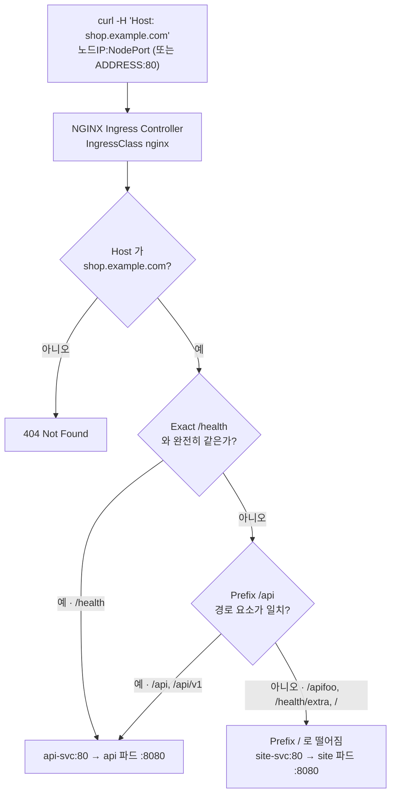

# q09 — Route traffic with an Ingress · 풀이

← 문제: **[question.md](question.md)**

## 문제 (해석)

**원문**

> Two applications in namespace `web` must share one hostname.
>
> 1. Create Deployments `site` and `api` in `web`, 2 replicas each, image
>    `registry.k8s.io/e2e-test-images/echoserver:2.5`, container port 8080.
> 2. Expose each with a ClusterIP Service on port 80 targeting 8080, named `site-svc` and
>    `api-svc`.
> 3. Find the IngressClass available in this cluster and note its name.
> 4. Create an Ingress `shop-ingress` in `web` for host `shop.example.com` on that class:
>    `/` and everything below it → `site-svc:80`, `/api` and everything below → `api-svc:80`.
> 5. Add a rule routing exactly `/health` to `api-svc:80`; `/health/extra` must not match.
> 6. Verify all three paths with `curl` and a `Host` header.
> 7. State in one line what happens if `pathType` is left out of a rule.

**해석**

`web` 네임스페이스의 두 애플리케이션이 호스트 이름 하나를 공유해야 한다.

1. `web` 에 Deployment `site` 와 `api` 를 각각 2 레플리카, 이미지 `registry.k8s.io/e2e-test-images/echoserver:2.5`, 컨테이너 포트 8080으로 만든다.
2. 각각 포트 80에서 8080으로 넘기는 ClusterIP Service `site-svc`, `api-svc` 로 노출한다.
3. 이 클러스터에 있는 IngressClass를 찾아 이름을 적는다.
4. `web` 에 호스트 `shop.example.com` 용 Ingress `shop-ingress` 를 그 클래스로 만든다. `/` 와 그 하위는 `site-svc:80`, `/api` 와 그 하위는 `api-svc:80` 으로 보낸다.
5. 정확히 `/health` 경로만 `api-svc:80` 으로 보내는 규칙을 추가한다. `/health/extra` 는 여기에 매칭되지 않아야 한다.
6. `curl` 과 `Host` 헤더로 세 경로를 모두 확인한다.
7. 규칙에서 `pathType` 을 빼면 어떻게 되는지 한 줄로 적는다.

## 모범 풀이

```bash
IMG=registry.k8s.io/e2e-test-images/echoserver:2.5
kubectl -n web create deploy site --image=$IMG --replicas=2 --port=8080
kubectl -n web create deploy api  --image=$IMG --replicas=2 --port=8080
kubectl -n web expose deploy site --name=site-svc --port=80 --target-port=8080
kubectl -n web expose deploy api  --name=api-svc  --port=80 --target-port=8080

kubectl get ingressclass
# NAME    CONTROLLER                     PARAMETERS   AGE
# nginx   nginx.org/ingress-controller   <none>       30d      ← 예시. 이름은 클러스터마다 다르다
```

3단계는 이 출력의 NAME 을 그대로 쓰는 것입니다. 이 실습 환경의 컨트롤러는 F5 NGINX Ingress Controller(`nginx.org/ingress-controller`)이고,
2026년 3월에 은퇴한 kubernetes/ingress-nginx(`k8s.io/ingress-nginx`)가 아닙니다. 표준 필드만 쓰면 어느 컨트롤러에서나 같게 동작합니다.

명령형으로 한 번에 만들 수 있습니다. `--rule` 의 경로 끝에 `*` 를 붙이면 `pathType: Prefix`, 붙이지 않으면 `Exact` 가 됩니다.

```bash
kubectl -n web create ingress shop-ingress --class=nginx \
  --rule='shop.example.com/api*=api-svc:80' \
  --rule='shop.example.com/health=api-svc:80' \
  --rule='shop.example.com/*=site-svc:80'
```

같은 결과의 yaml입니다.

```yaml
apiVersion: networking.k8s.io/v1
kind: Ingress
metadata:
  name: shop-ingress
  namespace: web
spec:
  ingressClassName: nginx
  rules:
  - host: shop.example.com
    http:
      paths:
      - path: /api
        pathType: Prefix
        backend:
          service:
            name: api-svc
            port:
              number: 80
```

나머지 두 경로도 같은 모양입니다. `/health` 는 `pathType: Exact` + `api-svc`, `/` 는 `pathType: Prefix` + `site-svc` 입니다.

**`pathType` 은 필수 필드입니다.** `networking.k8s.io/v1` 에서는 생략하면 기본값이 채워지는 게 아니라 검증 에러로 거부됩니다(`spec.rules[0].http.paths[0].pathType: Required value`). extensions/v1beta1 시절의 예제를 그대로 베끼면 여기서 막힙니다.

| pathType | 의미 | `/api/v1` 매칭 |
|---|---|---|
| `Prefix` | 경로를 `/` 로 나눈 요소 단위 접두 일치 | `/api` 가 매칭됨 |
| `Exact` | 완전 일치, 대소문자 구분 | 매칭 안 됨 |
| `ImplementationSpecific` | 해석을 컨트롤러에 맡김 (정규식 등은 컨트롤러별 어노테이션이 있어야 함) | 컨트롤러에 따름 |

`Prefix` 는 문자열 접두가 아니라 **경로 요소 단위**입니다. `/api` 는 `/api/v1` 과 `/api` 에 매칭되지만 `/apifoo` 에는 매칭되지 않습니다.

경로 여러 개가 동시에 매칭되면 **가장 긴 것이 이깁니다**. 길이가 같으면 `Exact` 가 `Prefix` 보다 우선합니다. 그래서 `/` 규칙과 `/api` 규칙이 함께 있어도 `/api/v1` 은 `api-svc` 로 갑니다. yaml에 적은 순서는 이 판정에 영향이 없습니다. 백엔드 구조도 v1에서 바뀌어 `serviceName`/`servicePort` 가 아니라 `service.name` + `service.port.number`(이름을 쓰려면 `service.port.name`)입니다.

### 경로별로 어느 Service 로 가는가



1. 요청은 컨트롤러 Service `nginx-ingress` 를 거쳐 NGINX Ingress Controller 파드에 도착합니다. 이 실습 환경은 NodePort 라
   `<노드IP>:<NodePort>` 로 보냅니다.
2. 먼저 Host 를 봅니다. `shop.example.com` 이 아니면 이 Ingress 의 규칙은 하나도 적용되지 않고 404 가 돌아옵니다. 그래서 `curl` 에
   `Host` 헤더가 꼭 필요합니다.
3. Host 가 맞으면 세 경로 중 **가장 길게 일치하는 것**을 고릅니다. `/health` 는 `Exact /health` 와 `Prefix /` 둘 다에 맞지만 더 긴
   `/health` 가 이겨 `api-svc` 로 갑니다.
4. `/health/extra` 는 `Exact` 라 `/health` 와 맞지 않고, `/api` 와도 다르므로 남은 `Prefix /` 에 걸려 `site-svc` 로 갑니다. 5단계가
   요구하는 "매칭되면 안 된다"는 바로 이 동작입니다. `/apifoo` 도 경로 요소가 `/api` 와 다르므로 `site-svc` 로 갑니다.
5. 각 Service 는 포트 80 으로 받아 `targetPort` 8080 인 echoserver 파드로 넘깁니다. 경로는 바뀌지 않고 그대로 전달됩니다.

## 검증

```bash
kubectl -n web describe ingress shop-ingress
# Rules 표에 세 경로와 백엔드가, Backend에 파드 IP:8080이 보여야 한다
# 백엔드가 <error: endpoints "api-svc" not found> 면 Service/셀렉터 문제
kubectl -n web get ingress shop-ingress -o jsonpath='{range .spec.rules[0].http.paths[*]}{.path}{" "}{.pathType}{" "}{.backend.service.name}{"\n"}{end}'
# /api Prefix api-svc
# /health Exact api-svc
# / Prefix site-svc

# 컨트롤러 주소: ADDRESS 가 있으면 그 IP:80, 비어 있으면 노드IP:NodePort
IP=$(kubectl -n web get ingress shop-ingress -o jsonpath='{.status.loadBalancer.ingress[0].ip}')
if [ -n "$IP" ]; then URL=http://$IP; else
  NP=$(kubectl -n nginx-ingress get svc nginx-ingress -o jsonpath='{.spec.ports[?(@.name=="http")].nodePort}')
  NODE=$(kubectl get nodes -o jsonpath='{.items[0].status.addresses[?(@.type=="InternalIP")].address}')
  URL=http://$NODE:$NP
fi

# echoserver 는 응답에 처리한 파드 이름(Hostname)을 적어 준다 → site-… / api-… 로 구분
for p in / /api/v1 /health /health/extra; do
  printf '%-15s ' "$p"; curl -s -H 'Host: shop.example.com' "$URL$p" | grep -m1 -i '^hostname'
done
# /               Hostname: site-xxxxx
# /api/v1         Hostname: api-xxxxx
# /health         Hostname: api-xxxxx
# /health/extra   Hostname: site-xxxxx   ← Exact 에 안 걸리고 / Prefix 로 떨어짐
```

7단계 답: `pathType` 을 빼면 `networking.k8s.io/v1` 검증에서 `pathType: Required value` 로 Ingress 생성이 거부된다.

## 오답 원인 / 배운 점

- **왜 틀렸나**:
- **기억할 것**: `pathType` 은 생략할 수 없다. `kubectl create ingress` 에서 경로 끝의 `*` 가 `Prefix`, 없으면 `Exact`.
- **헷갈리는 지점**: `ingressClassName`(spec 필드)과 옛 `kubernetes.io/ingress.class` 어노테이션을 혼동하는 것. 새로 만드는 Ingress 에 둘을 같이 쓰면 API 서버가 `can not be set when the class field is also set` 으로 거부하므로 `ingressClassName` 만 씁니다. Ingress는 **네임스페이스 리소스**이므로 다른 네임스페이스의 Service를 백엔드로 지목할 수 없다는 점도 자주 놓칩니다.

## 참고 문서

- 검색어: `ingress path types`
- https://kubernetes.io/docs/concepts/services-networking/ingress/
- https://kubernetes.io/docs/concepts/services-networking/ingress-controllers/

## 복습 기록

| 날짜 | 결과 | 메모 |
|---|---|---|
|  |  |  |
