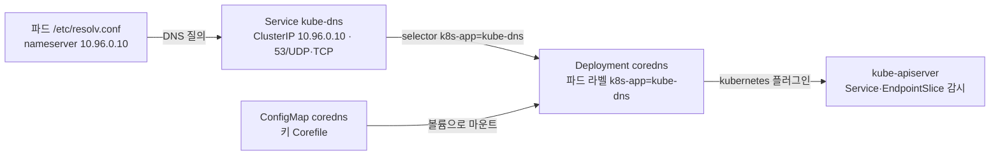
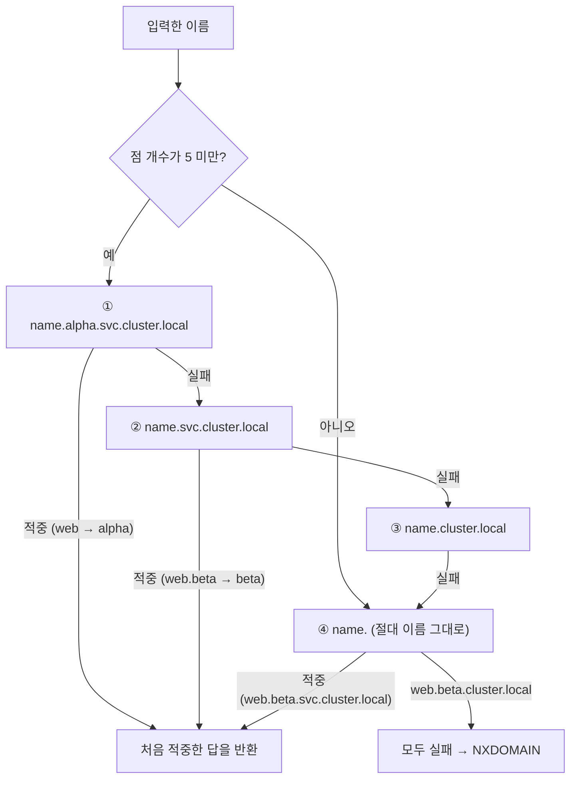

# q10 — Service discovery with CoreDNS · 풀이

← 문제: **[question.md](question.md)**

## 문제 (해석)

**원문**

> Two namespaces expose a Service of the same name and clients keep reaching the wrong one.
>
> 1. Create namespaces `alpha` and `beta`. In each, create a Deployment `web` running
>    `nginx:1.27` and a ClusterIP Service `web` on port 80.
> 2. Report which Deployment provides cluster DNS in `kube-system`, which Service fronts it,
>    and which ConfigMap holds its Corefile.
> 3. From a debug pod in `alpha`, resolve `web`, `web.beta`, `web.beta.svc.cluster.local` and
>    `web.beta.cluster.local`. Record which one fails.
> 4. Print that pod's `/etc/resolv.conf` and explain why a bare `web` resolves to `alpha`.
> 5. Create a Pod `no-dns` in `alpha` that does not use cluster DNS at all, and show that
>    `web` no longer resolves inside it.
> 6. Write the FQDN a client uses to reach one specific pod behind a headless Service.

**해석**

두 네임스페이스가 같은 이름으로 Service를 노출하고 있어 클라이언트가 계속 엉뚱한 쪽에 닿는다.

1. 네임스페이스 `alpha` 와 `beta` 를 만든다. 각각에 `nginx:1.27` 을 실행하는 Deployment `web` 과 포트 80인 ClusterIP Service `web` 을 만든다.
2. `kube-system` 에서 클러스터 DNS를 제공하는 Deployment, 그 앞의 Service, Corefile을 담은 ConfigMap을 각각 보고한다.
3. `alpha` 의 디버그 파드에서 `web`, `web.beta`, `web.beta.svc.cluster.local`, `web.beta.cluster.local` 을 조회한다. 어느 것이 실패하는지 기록한다.
4. 그 파드의 `/etc/resolv.conf` 를 출력하고, 그 내용으로부터 왜 그냥 `web` 이 `alpha` 의 Service로 해석되는지 설명한다.
5. `alpha` 에 클러스터 DNS를 전혀 쓰지 않는 Pod `no-dns` 를 만들고, 그 안에서는 `web` 이 해석되지 않음을 보인다.
6. headless Service 뒤의 특정 파드 하나에 접속할 때 쓰는 FQDN을 적는다.

## 모범 풀이

```bash
for ns in alpha beta; do
  kubectl create namespace $ns
  kubectl -n $ns create deploy web --image=nginx:1.27
  kubectl -n $ns expose deploy web --port=80
done
```

**DNS 구성 요소의 이름이 서로 다릅니다.**

```bash
kubectl -n kube-system get deploy coredns          # Deployment 이름은 coredns
kubectl -n kube-system get svc kube-dns            # Service 이름은 kube-dns
kubectl -n kube-system get cm coredns -o yaml      # Corefile은 coredns ConfigMap 안
kubectl -n kube-system get pods -l k8s-app=kube-dns
```

### 그림 1 — 클러스터 DNS 를 이루는 세 오브젝트



1. 파드의 `nameserver` 는 CoreDNS 파드가 아니라 **Service `kube-dns` 의 ClusterIP** 입니다. kubelet 이 `--cluster-dns`(설정 파일의 `clusterDNS`) 값을 파드의 `resolv.conf` 에 적습니다.
2. Service `kube-dns` 는 라벨 `k8s-app=kube-dns` 로 Deployment `coredns` 의 파드를 고릅니다. 그래서 이름은 달라도 파드 라벨 검색은 `-l k8s-app=kube-dns` 입니다.
3. Deployment `coredns` 는 ConfigMap `coredns` 의 `Corefile` 키를 파일로 마운트해 설정으로 읽고, `kubernetes` 플러그인이 API 서버에서 Service 와 EndpointSlice 를 받아 응답합니다. 2번 답은 Deployment `coredns`, Service `kube-dns`, ConfigMap `coredns` 입니다.

CoreDNS가 kube-dns를 대체했지만 Service 이름은 하위 호환을 위해 `kube-dns` 로 남았습니다. 파드의 `nameserver` 는 이 Service의 ClusterIP(보통 `.10`)입니다. Corefile은 `coredns` ConfigMap의 `Corefile` 키에 있고, 여기서 `kubernetes cluster.local` 플러그인 블록이 클러스터 도메인을 정합니다.

**조회 결과**

```bash
kubectl -n alpha run dns -it --rm --restart=Never \
  --image=registry.k8s.io/e2e-test-images/jessie-dnsutils:1.3 -- sh
nslookup web                            # alpha 의 Service ClusterIP
nslookup web.beta                       # beta 의 Service ClusterIP
nslookup web.beta.svc.cluster.local     # beta 의 Service ClusterIP
nslookup web.beta.cluster.local         # NXDOMAIN — 실패
cat /etc/resolv.conf
# nameserver 10.96.0.10
# search alpha.svc.cluster.local svc.cluster.local cluster.local
# options ndots:5
```

디버그 이미지는 공식 문서(Debugging DNS Resolution)의 dnsutils 이미지를 씁니다. **busybox 의 `nslookup` 은
점이 든 이름에 search 도메인을 붙이지 않기 때문입니다.** busybox 로 `nslookup web.beta` 를 하면 `web.beta.` 만
물어서 DNS가 정상이어도 NXDOMAIN 이 나오고, 네 이름 중 둘이 실패한 것처럼 보입니다. busybox 밖에 없다면
`wget -qO- -T 2 http://web.beta` 처럼 libc 리졸버를 쓰는 명령으로 확인합니다. 이런 명령은 search 를 적용합니다.

`search` 목록이 전부를 설명합니다. 점 개수가 `ndots:5` 미만인 이름은 절대 이름으로 시도하기 **전에** search 도메인을 앞에서부터 하나씩 붙여 봅니다.

| 입력 | 실제로 조회되는 순서 | 결과 |
|---|---|---|
| `web` | `web.alpha.svc.cluster.local` → 적중 | alpha (첫 search가 자기 네임스페이스라서) |
| `web.beta` | `web.beta.alpha.svc.cluster.local`(실패) → `web.beta.svc.cluster.local` → 적중 | beta |
| `web.beta.svc.cluster.local` | 점 4개 < 5 이므로 search를 먼저 붙여 실패한 뒤 절대 이름으로 적중 | beta |
| `web.beta.cluster.local` | search 조합 전부 실패, 절대 이름에도 레코드 없음 | **NXDOMAIN** |

### 그림 2 — `ndots:5` 와 search 목록이 이름을 펼치는 순서 (`alpha` 파드 기준)



1. 네 이름 모두 점이 5개보다 적으므로 search 목록을 먼저 붙입니다. 목록의 **첫 항목이 파드 자신의 namespace** 라서 `web` 은 ①에서 바로 `alpha` 의 Service 로 적중합니다. 4번 답이 이것입니다.
2. `web.beta` 는 ①(`web.beta.alpha.svc.cluster.local`)에서 실패하고 ②(`web.beta.svc.cluster.local`)에서 적중합니다.
3. `web.beta.svc.cluster.local` 은 ①~③을 모두 헛돌고 ④ 절대 이름으로 적중합니다. 답은 맞지만 질의가 세 번 낭비되므로, 성능이 중요하면 끝에 점을 붙인 `web.beta.svc.cluster.local.` 을 씁니다.
4. `web.beta.cluster.local` 은 어느 단계에서도 레코드가 없어 NXDOMAIN 입니다. 3번에서 기록할 실패는 이것 하나입니다.

마지막이 실패하는 이유는 클러스터 도메인 아래 Service 레코드가 `svc` 서브도메인에만 있기 때문입니다. 정식 형식은 `<svc>.<ns>.svc.cluster.local` 이고 `svc` 를 빼면 존재하지 않는 이름입니다. 파드 레코드는 `pod` 서브도메인을 씁니다.

**클러스터 DNS를 쓰지 않는 파드**

```bash
kubectl apply -f - <<'YAML'
apiVersion: v1
kind: Pod
metadata:
  name: no-dns
  namespace: alpha
spec:
  dnsPolicy: Default          # 클러스터 DNS가 아니라 노드의 resolv.conf 를 물려받음
  containers:
  - name: c
    image: busybox:1.36
    command: ["sleep", "3600"]
YAML
kubectl -n alpha wait pod no-dns --for=condition=Ready --timeout=60s
```

`kubectl run` 에는 `dnsPolicy` 옵션이 없으므로 매니페스트로 만들거나 `kubectl run no-dns --image=busybox:1.36 --dry-run=client -o yaml -- sleep 3600` 으로 뼈대를 뽑아 `dnsPolicy: Default` 한 줄을 넣습니다. **이름에 속지 않도록 주의합니다.** `dnsPolicy` 를 지정하지 않았을 때의 기본값은 `ClusterFirst` 이고, 값 `Default` 는 "노드 DNS"를 뜻합니다.

| dnsPolicy | 동작 |
|---|---|
| `ClusterFirst` | 기본값. 클러스터 DNS로 보내고, 클러스터 도메인이 아니면 업스트림으로 넘김 |
| `ClusterFirstWithHostNet` | `hostNetwork: true` 파드가 클러스터 DNS를 쓰려면 반드시 이것 |
| `Default` | **노드의** `/etc/resolv.conf` 를 그대로 물려받음 (클러스터 DNS 없음) |
| `None` | 아무것도 물려받지 않고 `dnsConfig` 로 직접 지정 (`dnsConfig` 필수) |

`hostNetwork: true` 를 주면서 `dnsPolicy` 를 그대로 두면 조용히 노드 DNS를 쓰게 되어 서비스 이름이 안 풀립니다. 실무에서 가장 자주 만나는 DNS 사고입니다.

**headless Service의 개별 파드 FQDN**: `<hostname>.<service>.<namespace>.svc.cluster.local`. 6번 답은 이것입니다.

- 이 레코드는 파드의 `spec.hostname` 과 `spec.subdomain`(= headless Service 이름)이 있을 때 생깁니다. StatefulSet 은 `hostname` 을 파드 이름(`db-0`)으로, `subdomain` 을 `serviceName` 으로 자동으로 채우므로 `db-0.db.<namespace>.svc.cluster.local` 이 됩니다. 이름이 재시작 후에도 바뀌지 않아 실제로 쓸모가 있습니다.
- `hostname`·`subdomain` 이 없는 일반 파드도 Service 뒤에 있으면 `<ip-를-대시로>.<service>.<namespace>.svc.cluster.local`(예: `10-244-1-5.web.alpha.svc.cluster.local`)로 조회됩니다. 다만 IP 가 바뀌면 이름도 바뀌므로 "특정 파드에 안정적으로 닿는" 답으로는 부족합니다.
- `<ip-를-대시로>.<namespace>.pod.cluster.local` 은 Service 와 무관한 파드 레코드입니다. Corefile 의 `pods insecure` 옵션이 IP 모양만 보고 답을 만들어 주는 것이라 headless Service 의 답이 아닙니다.

## 검증

```bash
kubectl -n alpha exec no-dns -- cat /etc/resolv.conf     # nameserver가 노드 것
kubectl -n alpha exec no-dns -- nslookup web             # 실패
kubectl -n alpha exec no-dns -- nslookup web.alpha.svc.cluster.local   # 역시 실패
kubectl -n kube-system logs -l k8s-app=kube-dns --tail=20
kubectl -n kube-system get endpointslice -l kubernetes.io/service-name=kube-dns   # CoreDNS 파드 IP
kubectl get svc -n alpha web -o jsonpath='{.spec.clusterIP}'
```

## 오답 원인 / 배운 점

- **왜 틀렸나**:
- **기억할 것**: Service FQDN은 `<svc>.<ns>.svc.cluster.local`. `svc` 를 빼면 해석되지 않는다. Deployment는 `coredns`, Service는 `kube-dns`.
- **헷갈리는 지점**: 짧은 이름이 되는 이유가 "쿠버네티스가 알아서"가 아니라 `resolv.conf` 의 `search` 첫 항목이 자기 네임스페이스이기 때문입니다. 그래서 같은 이름의 Service가 여러 네임스페이스에 있으면 짧은 이름은 항상 자기 것을 가리킵니다. 다른 네임스페이스를 노릴 때는 최소 `<svc>.<ns>` 까지 써야 합니다.

## 참고 문서

- 검색어: `dns for services and pods`
- https://kubernetes.io/docs/concepts/services-networking/dns-pod-service/

---

[↑ 문항 목록](../README.md) · [← 문제로](question.md) · [다음 문제 q11 →](../q11_pv_pvc_static_provisioning/question.md)
