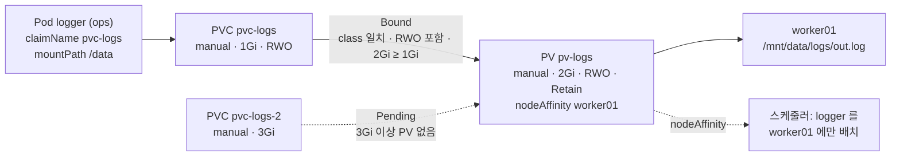

# q11 — Static PersistentVolume provisioning · 풀이

← 문제: **[question.md](question.md)**

## 문제 (해석)

**원문**

> This cluster has no dynamic provisioner, so the volume must be prepared by hand.
>
> 1. On `worker01`, create the directory `/mnt/data/logs`.
> 2. Create a PersistentVolume `pv-logs`: 2Gi, `ReadWriteOnce`, `storageClassName: manual`,
>    reclaim policy `Retain`, backed by `hostPath` `/mnt/data/logs`, and pinned to node
>    `worker01` with node affinity so that every pod using it runs there.
> 3. In namespace `ops`, create a PersistentVolumeClaim `pvc-logs` requesting 1Gi
>    `ReadWriteOnce` from storage class `manual`, and confirm it binds to `pv-logs`.
> 4. Create a Pod `logger` in `ops` running `busybox:1.36` with command
>    `sh -c 'while true; do date >> /data/out.log; sleep 5; done'`, mounting the claim at
>    `/data`. Show the file being written on the node.
> 5. Create a second claim `pvc-logs-2` in `ops` requesting 3Gi from `manual`, and state in
>    one line why it stays `Pending`.

**해석**

이 클러스터에는 동적 프로비저너가 없어 볼륨을 손으로 준비해야 한다.

1. `worker01` 에 디렉터리 `/mnt/data/logs` 를 만든다.
2. PersistentVolume `pv-logs` 를 만든다. 용량 2Gi, 액세스 모드 `ReadWriteOnce`, `storageClassName: manual`, 반환 정책 `Retain`, 스토리지는 `hostPath` `/mnt/data/logs`. node affinity로 노드 `worker01` 에 고정해 이 PV를 쓰는 파드가 항상 그 노드에 뜨게 한다.
3. `ops` 네임스페이스에 스토리지 클래스 `manual` 에서 1Gi `ReadWriteOnce` 를 요청하는 PersistentVolumeClaim `pvc-logs` 를 만들고, `pv-logs` 에 바인딩되는지 확인한다.
4. `ops` 에 `busybox:1.36` 으로 `sh -c 'while true; do date >> /data/out.log; sleep 5; done'` 를 실행하는 Pod `logger` 를 만들어 클레임을 `/data` 에 마운트한다. 노드에서 파일이 쓰이는 것을 보인다.
5. `ops` 에 `manual` 에서 3Gi를 요청하는 두 번째 클레임 `pvc-logs-2` 를 만들고, 왜 `Pending` 으로 남는지 한 줄로 적는다.

## 모범 풀이

```bash
# worker01 에서
mkdir -p /mnt/data/logs
```

```yaml
apiVersion: v1
kind: PersistentVolume
metadata: { name: pv-logs }
spec:
  capacity: { storage: 2Gi }
  accessModes: ["ReadWriteOnce"]
  persistentVolumeReclaimPolicy: Retain
  storageClassName: manual
  hostPath: { path: /mnt/data/logs }
  nodeAffinity:                     # 이 PV를 쓰는 파드는 worker01 에만 스케줄된다
    required:
      nodeSelectorTerms:
      - matchExpressions:
        - key: kubernetes.io/hostname
          operator: In
          values: ["worker01"]
---
apiVersion: v1
kind: PersistentVolumeClaim
metadata: { name: pvc-logs, namespace: ops }
spec:
  accessModes: ["ReadWriteOnce"]
  storageClassName: manual
  resources:
    requests: { storage: 1Gi }
---
apiVersion: v1
kind: Pod
metadata: { name: logger, namespace: ops }
spec:
  containers:
  - name: logger
    image: busybox:1.36
    command: ["sh", "-c", "while true; do date >> /data/out.log; sleep 5; done"]
    volumeMounts:
    - { name: logs, mountPath: /data }
  volumes:
  - name: logs
    persistentVolumeClaim: { claimName: pvc-logs }
```

### 그림 — PVC 바인딩과 노드 고정



1. 파드는 PV를 직접 모르고 PVC 이름(`claimName pvc-logs`)만 적습니다.
2. `pvc-logs` 는 class `manual` 이 같고, 요청한 `RWO` 가 PV의 모드에 들어 있고, PV 2Gi가 요청 1Gi 이상이라 `pv-logs` 와 `Bound` 가 됩니다. 바인딩되면 2Gi 전체를 차지합니다.
3. `pvc-logs-2` 는 3Gi를 원하지만 `manual` 에 그만한 PV가 없고, `pv-logs` 는 이미 바인딩되어 있어 `Pending` 에 머뭅니다.
4. PV의 `nodeAffinity` 를 보고 스케줄러가 `logger` 를 worker01 에 놓으므로, 컨테이너의 `/data/out.log` 가 worker01 의 `/mnt/data/logs/out.log` 로 쌓입니다.

**바인딩에는 세 조건이 동시에 맞아야 합니다.**

| 조건 | 기준 |
|---|---|
| 액세스 모드 | PVC가 요청한 모드가 PV가 제공하는 모드 목록에 **포함**되어야 한다 |
| `storageClassName` | 두 값이 **문자열로 정확히 일치**해야 한다 |
| 용량 | PV의 `capacity` ≥ PVC의 `requests.storage` |

용량은 같지 않아도 되고 PV가 크면 됩니다. 다만 바인딩되면 PVC는 PV 전체를 차지합니다 — 2Gi PV에 1Gi를 요청해 바인딩하면 남은 1Gi를 다른 클레임이 쓸 수 없습니다. 그래서 `pvc-logs-2` 는 3Gi를 만족하는 PV가 없어 `Pending` 입니다. 용량이 맞았더라도 `pv-logs` 는 이미 `pvc-logs` 에 `Bound` 라 다른 PVC와 바인딩되지 않습니다(PV와 PVC는 1:1). 그리고 `manual` 이라는 StorageClass 객체가 없으니 동적으로 만들어지지도 않습니다.

5번 한 줄 답: **`manual` 클래스에 3Gi 이상인 `Available` PV가 없고(`pv-logs` 는 2Gi이며 이미 `pvc-logs` 에 바인딩됨), `manual` 은 프로비저너가 없어 새 PV를 만들어 주지도 않기 때문이다.**

**`storageClassName` 을 생략하는 것과 `""` 로 두는 것은 다릅니다.** 필드를 아예 쓰지 않으면 클러스터의 **기본 StorageClass**가 적용되고, 기본 클래스가 있으면 동적 프로비저닝이 일어나 방금 만든 `pv-logs` 를 무시한 새 볼륨이 생깁니다. `storageClassName: ""` 는 "클래스를 쓰지 않겠다"는 명시적 선언이라 클래스가 없는 PV에만 바인딩됩니다. 정적 프로비저닝 문제에서 클래스 이름을 맞추거나 양쪽 모두 `""` 로 두는 것이 핵심입니다.

```bash
kubectl get storageclass          # (default) 표시가 붙은 클래스가 있는지 확인
```

**hostPath PV는 특정 노드의 로컬 디렉터리인데, PV 자체는 그 사실을 모릅니다.** `nodeAffinity` 없이 만들면 스케줄러는 `logger` 를 아무 노드에나 보내고, 컨테이너 런타임은 그 노드에 빈 `/mnt/data/logs` 를 만들어 거기에 씁니다. 그러면 파드는 정상인데 worker01에서는 파일이 안 보입니다. PV의 `spec.nodeAffinity` 를 주면 스케줄러가 이 PV를 쓰는 파드를 worker01에만 놓습니다. `local` 볼륨 타입은 `nodeAffinity` 가 **필수**이고, hostPath는 선택이지만 노드가 여럿이면 사실상 필수입니다. (파드 쪽 `nodeSelector` 로 고정해도 되지만, PV에 붙여 두면 이 PV를 쓰는 모든 파드에 자동으로 적용됩니다.)

## 검증

```bash
kubectl get pv pv-logs
# NAME     CAPACITY  ACCESS MODES  RECLAIM POLICY  STATUS  CLAIM          STORAGECLASS
# pv-logs  2Gi       RWO           Retain          Bound   ops/pvc-logs   manual

kubectl -n ops get pvc
# pvc-logs    Bound     pv-logs   2Gi   RWO   manual      # CAPACITY는 PV의 2Gi로 표시
# pvc-logs-2  Pending                         manual

kubectl -n ops describe pvc pvc-logs-2 | tail -5
# Events: Warning  ProvisioningFailed  ...  storageclass.storage.k8s.io "manual" not found
# (맞는 PV가 없어 동적 프로비저닝을 시도했지만 manual 이라는 StorageClass 객체가 없다는 뜻)

kubectl -n ops exec logger -- tail -3 /data/out.log
kubectl -n ops get pod logger -o wide           # NODE 가 worker01 이어야 한다
kubectl get pv pv-logs -o jsonpath='{.spec.nodeAffinity}{"\n"}'
tail -3 /mnt/data/logs/out.log                  # worker01 에서 — 같은 줄이 보인다
```

## 오답 원인 / 배운 점

- **왜 틀렸나**:
- **기억할 것**: 바인딩 조건은 accessModes 포함 + storageClassName 완전 일치 + PV capacity ≥ PVC request, 세 개 전부. 노드 로컬 PV(hostPath/local)는 PV에 `nodeAffinity` 를 붙여야 파드가 데이터가 있는 노드로 간다.
- **헷갈리는 지점**: `storageClassName` 을 **생략**하면 기본 StorageClass가 끼어들어 동적 프로비저닝이 되고, `""` 로 두면 클래스 없는 PV만 노립니다. 둘이 전혀 다릅니다. 그리고 PVC가 `Pending` 일 때 원인은 항상 `kubectl describe pvc` 의 Events에 문장으로 적혀 있으니 추측하지 말고 읽습니다.

## 참고 문서

- 검색어: `configure persistent volume storage`
- https://kubernetes.io/docs/tasks/configure-pod-container/configure-persistent-volume-storage/

---

[↑ 문항 목록](../README.md) · [← 문제로](question.md) · [다음 문제 q12 →](../q12_access_modes_reclaim_policy/question.md)
