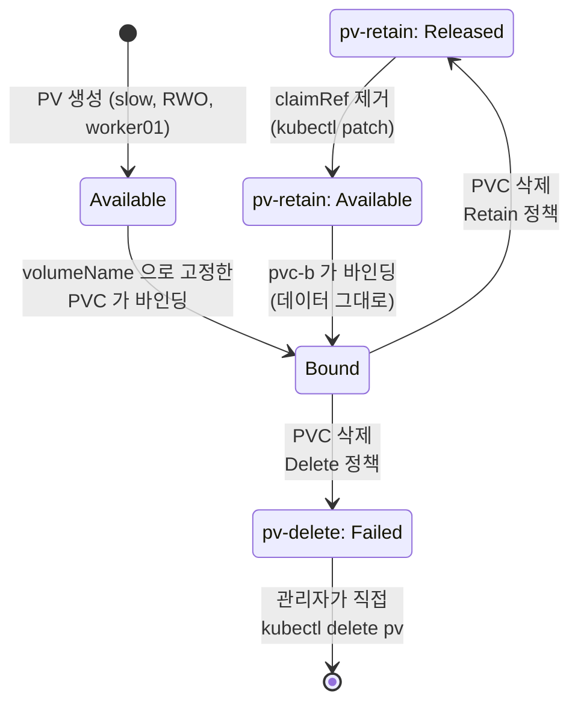

# q12 — Access modes and reclaim policy · 풀이

← 문제: **[question.md](question.md)**

## 문제 (해석)

**원문**

> A claim was deleted by mistake and its volume must be reused without losing the data.
>
> 1. Create two PersistentVolumes in class `slow`, both 1Gi, `ReadWriteOnce` and pinned to
>    node `worker01` with node affinity: `pv-retain` with reclaim policy `Retain` on
>    `hostPath` `/mnt/data/retain`, and `pv-delete` with reclaim policy `Delete` on
>    `hostPath` `/mnt/data/delete`.
> 2. In namespace `ops`, create a claim `pvc-a` that is guaranteed to bind to `pv-retain`
>    (not merely to any matching volume), write a file to it from a Pod `writer`
>    (`busybox:1.36`), then delete the Pod and the claim.
> 3. Report the `STATUS` of `pv-retain` now, bring it back to `Available` without deleting
>    the PV, and prove with a new claim `pvc-b` and a Pod `reader` that the file survived.
> 4. Bind a claim `pvc-d` to `pv-delete`, delete the claim, and report the `STATUS` of
>    `pv-delete` together with the event that explains it.
> 5. Create a claim `pvc-rwx` in `ops` requesting `ReadWriteMany` from class `slow` and state
>    in one line why it does not bind.

**해석**

클레임을 실수로 삭제했고, 데이터를 잃지 않고 그 볼륨을 다시 써야 한다.

1. 클래스 `slow` 에 1Gi `ReadWriteOnce` PersistentVolume 두 개를 만들고 둘 다 node affinity로
   노드 `worker01` 에 고정한다. `pv-retain` 은 반환 정책 `Retain`, hostPath `/mnt/data/retain`.
   `pv-delete` 는 반환 정책 `Delete`, hostPath `/mnt/data/delete`.
2. `ops` 네임스페이스에 (조건이 맞는 아무 볼륨이 아니라) **반드시** `pv-retain` 에 바인딩되는
   클레임 `pvc-a` 를 만들고, Pod `writer`(`busybox:1.36`)로 파일을 하나 쓴 뒤 파드와 클레임을 삭제한다.
3. 이제 `pv-retain` 의 `STATUS` 를 보고한다. PV를 삭제하지 않고 `Available` 로 되돌린 뒤, 새 클레임
   `pvc-b` 와 Pod `reader` 로 파일이 살아 있음을 증명한다.
4. 클레임 `pvc-d` 를 `pv-delete` 에 바인딩하고 클레임을 삭제한 뒤, `pv-delete` 의 `STATUS` 와 그
   이유를 설명하는 이벤트를 보고한다.
5. `ops` 에 클래스 `slow` 에서 `ReadWriteMany` 를 요청하는 클레임 `pvc-rwx` 를 만들고, 왜 바인딩되지
   않는지 한 줄로 적는다.

## 모범 풀이

**1) PV 두 개** — hostPath는 노드 로컬이므로 `nodeAffinity` 로 worker01에 고정합니다(q11 참고).

```yaml
apiVersion: v1
kind: PersistentVolume
metadata:
  name: pv-retain
spec:
  capacity: { storage: 1Gi }
  accessModes: ["ReadWriteOnce"]
  persistentVolumeReclaimPolicy: Retain
  storageClassName: slow
  hostPath: { path: /mnt/data/retain }
  nodeAffinity:
    required:
      nodeSelectorTerms:
      - matchExpressions:
        - { key: kubernetes.io/hostname, operator: In, values: ["worker01"] }
---
apiVersion: v1
kind: PersistentVolume
metadata:
  name: pv-delete
spec:
  capacity: { storage: 1Gi }
  accessModes: ["ReadWriteOnce"]
  persistentVolumeReclaimPolicy: Delete
  storageClassName: slow
  hostPath: { path: /mnt/data/delete }
  nodeAffinity:
    required:
      nodeSelectorTerms:
      - matchExpressions:
        - { key: kubernetes.io/hostname, operator: In, values: ["worker01"] }
```

**2) 특정 PV에 묶기 — `spec.volumeName`**

두 PV는 클래스·용량·모드가 똑같습니다. 조건만 맞춘 PVC는 둘 중 **아무 쪽에나** 바인딩될 수 있으므로,
"반드시 `pv-retain`"을 보장하려면 PVC의 `volumeName` 으로 미리 지정합니다(pre-binding).
클래스·용량·모드 조건은 여전히 맞아야 합니다.

```bash
kubectl -n ops apply -f - <<'EOF'
apiVersion: v1
kind: PersistentVolumeClaim
metadata: { name: pvc-a }
spec:
  storageClassName: slow
  volumeName: pv-retain          # 이 PV에만 바인딩된다
  accessModes: ["ReadWriteOnce"]
  resources: { requests: { storage: 1Gi } }
---
apiVersion: v1
kind: Pod
metadata: { name: writer }
spec:
  containers:
  - name: writer
    image: busybox:1.36
    command: ["sh", "-c", "echo keepme > /data/f.txt; sleep 3600"]
    volumeMounts: [{ name: v, mountPath: /data }]
  volumes:
  - name: v
    persistentVolumeClaim: { claimName: pvc-a }
EOF

kubectl -n ops wait --for=condition=Ready pod/writer --timeout=60s
kubectl -n ops delete pod writer
kubectl -n ops delete pvc pvc-a
kubectl get pv pv-retain        # STATUS: Released
```

**3) Released → Available**

**`Retain` PV는 PVC를 지워도 `Available` 로 돌아가지 않고 `Released` 에 머무릅니다.** 그리고 `Released` 상태로는 새 클레임이 바인딩되지 않습니다. 이유는 PV의 `spec.claimRef` 가 이미 삭제된 PVC(이름 + UID)를 그대로 가리키고 있어서, 컨트롤러가 "이 볼륨은 아직 임자가 있다"고 보기 때문입니다. 데이터를 지키려는 정책이므로 사람이 직접 판단해 참조를 끊어 줘야 합니다.

```bash
kubectl get pv pv-retain -o jsonpath='{.spec.claimRef}'      # 삭제된 ops/pvc-a 가 남아 있다
kubectl patch pv pv-retain -p '{"spec":{"claimRef":null}}'
kubectl get pv pv-retain        # STATUS: Available
```

`kubectl edit pv pv-retain` 으로 `claimRef` 블록을 지워도 같습니다. hostPath 디렉터리는 건드리지
않았으므로 새 클레임이 파일을 그대로 이어받습니다. `pvc-b` 도 `volumeName: pv-retain` 으로 고정합니다
(그렇지 않으면 아직 `Available` 인 `pv-delete` 에 붙을 수 있습니다).

```bash
kubectl -n ops apply -f - <<'EOF'
apiVersion: v1
kind: PersistentVolumeClaim
metadata: { name: pvc-b }
spec:
  storageClassName: slow
  volumeName: pv-retain
  accessModes: ["ReadWriteOnce"]
  resources: { requests: { storage: 1Gi } }
---
apiVersion: v1
kind: Pod
metadata: { name: reader }
spec:
  containers:
  - name: reader
    image: busybox:1.36
    command: ["sh", "-c", "cat /data/f.txt; sleep 3600"]
    volumeMounts: [{ name: v, mountPath: /data }]
  volumes:
  - name: v
    persistentVolumeClaim: { claimName: pvc-b }
EOF
kubectl -n ops wait --for=condition=Ready pod/reader --timeout=60s
kubectl -n ops logs reader        # keepme
```

**4) `Delete` 정책인데 PV가 사라지지 않는다 — `Failed`**

```bash
# pvc-a 와 같은 모양에 이름 pvc-d, volumeName: pv-delete 로 만든 뒤
kubectl -n ops delete pvc pvc-d
kubectl get pv pv-delete          # STATUS: Failed   CLAIM: ops/pvc-d
kubectl describe pv pv-delete | tail -3
# Warning  VolumeFailedDelete  ...  host_path deleter only supports /tmp/.+ but received provided /mnt/data/delete
```

`Delete` 는 "PV 오브젝트를 지운다"가 아니라 **"볼륨 플러그인에게 실제 스토리지를 지우라고 시킨 뒤
PV를 지운다"** 입니다. 손으로 만든 hostPath PV의 deleter는 `/tmp/...` 경로만 지원하므로 삭제가
실패하고, PV는 사라지지 않고 **`Failed`** 가 됩니다. 동적 프로비저닝된 CSI 볼륨이라면 드라이버가 실제
볼륨과 PV를 함께 지웁니다. `Failed` PV는 내용을 확인한 뒤 `kubectl delete pv pv-delete` 로 직접
정리하고, 노드의 디렉터리도 필요하면 직접 지웁니다.

**반환 정책**

| 정책 | PVC 삭제 후 | 비고 |
|---|---|---|
| `Retain` | PV는 `Released` 로 남고 데이터 보존 | `claimRef` 를 비워야 재사용 가능 |
| `Delete` | 플러그인이 실제 볼륨을 지우고 PV도 삭제 | 동적 프로비저닝의 기본값. 삭제를 못 하는 플러그인(정적 hostPath 등)이면 `Failed` |
| `Recycle` | 볼륨을 `rm -rf` 로 비우고 `Available` 로 | **deprecated** — 쓰지 않는다 |

**액세스 모드**

| 모드 | 약어 | 의미 |
|---|---|---|
| `ReadWriteOnce` | RWO | **노드 하나**에서 읽기·쓰기 |
| `ReadOnlyMany` | ROX | 여러 노드에서 읽기 전용 |
| `ReadWriteMany` | RWX | 여러 노드에서 읽기·쓰기 |
| `ReadWriteOncePod` | RWOP | **파드 하나**에서만 읽기·쓰기 |

**5) RWX 요청**

```bash
kubectl -n ops apply -f - <<'EOF'
apiVersion: v1
kind: PersistentVolumeClaim
metadata: { name: pvc-rwx }
spec:
  storageClassName: slow
  accessModes: ["ReadWriteMany"]
  resources: { requests: { storage: 1Gi } }
EOF
kubectl -n ops get pvc pvc-rwx      # Pending
```

한 줄 답: **`slow` 클래스에 `ReadWriteMany` 를 제공하는 PV가 없어서(`pv-delete` 는 RWO 이고 `pv-retain` 은 이미 `pvc-b` 에 Bound) 바인딩되지 않는다.** PVC가 요청한 모드는 PV의 `accessModes` 목록에 포함되어야 하며, 모드는 다운그레이드되지 않습니다(RWO PV가 RWX 요청을 받아주지 않습니다).

이벤트 문구는 상황에 따라 다릅니다. `slow` 라는 StorageClass 오브젝트가 클러스터에 없으면, 맞는 PV를 못 찾은 컨트롤러가 동적 프로비저닝을 시도하다 `ProvisioningFailed ... storageclass.storage.k8s.io "slow" not found` 를 남깁니다. `no persistent volumes available for this claim and no storage class is set` 은 `storageClassName` 이 빈 문자열인 PVC에서 나오는 문구입니다. 어느 쪽이든 근본 원인은 모드가 맞는 PV가 없다는 것입니다.

### 그림 — PVC 삭제 이후 두 PV의 갈림길



1. 두 PV는 같은 클래스·용량·모드로 `Available` 에서 시작합니다. 그래서 PVC는 `volumeName` 으로 원하는 PV를 집어야 합니다.
2. PVC가 지워지면 PV의 `persistentVolumeReclaimPolicy` 에 따라 길이 갈립니다.
3. `Retain` 인 `pv-retain` 은 `Released` 에 머뭅니다. `claimRef` 가 옛 PVC를 가리키고 있어 새 PVC가 붙지 않습니다.
4. `claimRef` 를 지우면 `Available` 이 되고, `pvc-b` 가 바인딩되면 hostPath에 남은 파일을 그대로 읽습니다.
5. `Delete` 인 `pv-delete` 는 hostPath deleter가 `/tmp/` 밖의 경로를 지우지 못해 `Failed` 가 됩니다. 자동으로 사라지지 않으므로 관리자가 직접 정리합니다.

## 검증

```bash
kubectl get pv
# pv-retain  1Gi  RWO  Retain  Bound   ops/pvc-b  slow
# pv-delete  1Gi  RWO  Delete  Failed  ops/pvc-d  slow

kubectl -n ops logs reader                         # keepme — 데이터가 살아 있다
kubectl describe pv pv-delete | grep -i failed     # VolumeFailedDelete ... /tmp/.+

kubectl -n ops get pvc pvc-rwx
# pvc-rwx   Pending   ...   slow
kubectl -n ops describe pvc pvc-rwx | tail -4      # ProvisioningFailed ... storageclass.storage.k8s.io "slow" not found
```

## 오답 원인 / 배운 점

- **왜 틀렸나**:
- **기억할 것**: 같은 조건의 PV가 여러 개면 PVC의 `volumeName` 으로 고정한다. `Retain` PV는 PVC 삭제 후 `Released` 에 머물고, `spec.claimRef` 를 비워야(`kubectl patch pv X -p '{"spec":{"claimRef":null}}'`) `Available` 이 된다. `Delete` 정책이라도 플러그인이 삭제를 못 하면 PV는 `Failed` 로 남는다.
- **헷갈리는 지점**: `ReadWriteOnce` 는 "파드 하나"가 아니라 **"노드 하나"** 입니다. 같은 노드에 뜬 파드 여러 개는 RWO 볼륨을 동시에 마운트할 수 있습니다. 파드 하나로 제한하려면 `ReadWriteOncePod` 를 씁니다. 또 `Released` 와 `Available` 을 눈으로 구분하지 않고 넘어가면 새 PVC가 왜 `Pending` 인지 못 찾습니다.

## 참고 문서

- 검색어: `persistent volumes reclaiming`
- https://kubernetes.io/docs/concepts/storage/persistent-volumes/
- https://kubernetes.io/docs/concepts/storage/persistent-volumes/#reserving-a-persistentvolume

## 복습 기록

| 날짜 | 결과 | 메모 |
|---|---|---|
|  |  |  |
