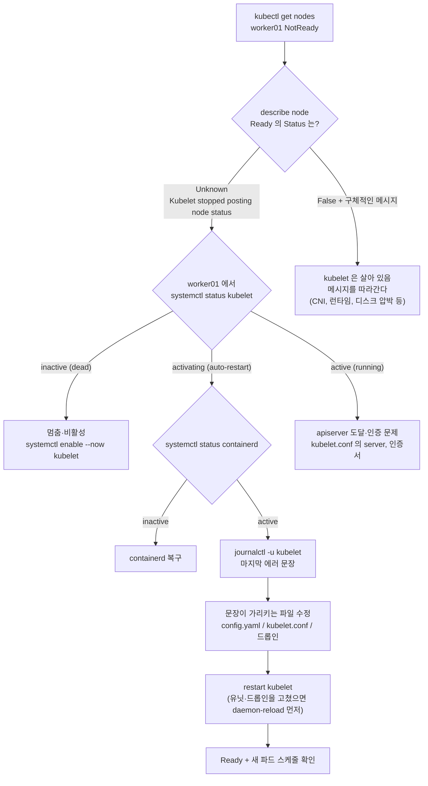

# q13 — Recover a NotReady node · 풀이

← 문제: **[question.md](question.md)**

## 문제 (해석)

**원문**

> Node `worker01` reports `NotReady` and its pods are stuck in `Terminating` or `Pending`.
>
> 1. From the control plane, identify which node condition is failing and what the kubelet
>    last reported as the reason and message.
> 2. On `worker01`, report whether the kubelet unit is running and read its last 50 log lines.
> 3. Report the state of the container runtime on that node.
> 4. Identify the root cause and repair it so the node returns to `Ready`.
> 5. Confirm the node is `Ready` and that a new pod can be scheduled onto it.
> 6. Write down the order in which you narrowed the cause, one line per step.
> 7. Name one situation in which the kubelet is healthy and running but the node still
>    reports `NotReady`.

**해석**

노드 `worker01` 이 `NotReady` 이고 그 위의 파드가 `Terminating` 또는 `Pending` 에서 멈춰 있다.

1. 컨트롤 플레인에서 어느 node condition이 실패했는지, kubelet이 마지막으로 보고한 reason과 message가 무엇인지 확인한다.
2. `worker01` 에서 kubelet 유닛이 돌고 있는지 보고하고 마지막 로그 50줄을 읽는다.
3. 그 노드의 컨테이너 런타임 상태를 보고한다.
4. 근본 원인을 찾아 수리해 노드를 `Ready` 로 되돌린다.
5. 노드가 `Ready` 이고 새 파드가 그 노드에 스케줄되는지 확인한다.
6. 원인을 좁혀 간 순서를 한 단계씩 한 줄로 적는다.
7. kubelet은 정상 실행 중인데도 노드가 `NotReady` 인 상황 하나를 든다.

## 모범 풀이

**순서가 답입니다.** 위에서 아래로, 각 단계에서 다음 단계가 필요한지 판단합니다.

**1) 컨트롤 플레인 — 무엇이 실패했는가**

```bash
kubectl get nodes
kubectl describe node worker01 | grep -A12 Conditions
kubectl get node worker01 -o jsonpath='{range .status.conditions[*]}{.type}={.status}  {.reason}: {.message}{"\n"}{end}'
```

`Ready=Unknown` 에 `reason: NodeStatusUnknown`, `message: Kubelet stopped posting node status` 면 kubelet이 아예 보고를 못 하는 것(프로세스 죽음, apiserver 도달 불가)입니다. `Ready=False` 에 구체적인 message가 있으면 kubelet은 살아 있고 자기 문제를 보고하는 중입니다. **이 구분이 2단계와 3단계 중 어디를 먼저 볼지 결정합니다.**

**2) 노드 — kubelet, 3) 노드 — 런타임**

```bash
ssh worker01; sudo -i
systemctl status kubelet     # active / inactive(dead) / activating(auto-restart)
journalctl -u kubelet -n 50 --no-pager
journalctl -u kubelet -f     # 재시작하면서 실시간으로 보기

systemctl status containerd
crictl info | head -20
crictl ps
```

**4) 로그 문장으로 원인을 고정합니다**

| journalctl 에 보이는 것 | 원인 | 조치 |
|---|---|---|
| `Unit kubelet.service ... inactive (dead)` | 서비스가 꺼짐 / disable됨 | `systemctl enable --now kubelet` |
| `failed to load Kubelet config file`, yaml 파싱 오류 | `/var/lib/kubelet/config.yaml` 손상 | 파일 수정 → `systemctl restart kubelet` |
| `failed to run Kubelet: running with swap on is not supported` | swap이 켜짐 | `swapoff -a`, `/etc/fstab` 의 swap 줄 주석 |
| `dial tcp <IP>:6443: connect: connection refused` | apiserver 주소 오류 또는 컨트롤 플레인 다운 | `/etc/kubernetes/kubelet.conf` 의 `server:` 확인 |
| `Unauthorized`, `x509: certificate has expired` | kubelet 클라이언트 인증서 만료 | `kubeadm` 으로 재발급 / `kubelet.conf` 교체 |
| `unknown flag: --xyz` | 유닛 드롭인의 인자 오류 | `systemctl cat kubelet` 로 드롭인(`10-kubeadm.conf`) 위치를 찾아 수정 |
| `container runtime is down`, `connect: no such file or directory` (sock) | containerd 다운 또는 소켓 경로 오류 | `systemctl restart containerd` |
| `Network plugin returns error: cni plugin not initialized` | CNI 미설치·손상 | CNI DaemonSet 파드 상태 확인 |

봐야 할 파일이 네 개이고, 수리 후 재시작은 순서가 있습니다.

```bash
cat /var/lib/kubelet/config.yaml                           # kubelet 설정 (staticPodPath 등)
cat /etc/kubernetes/kubelet.conf                           # apiserver 접속용 kubeconfig
systemctl cat kubelet                                      # 유닛 + 드롭인의 실제 경로와 내용 (패키지에 따라 /etc/systemd/... 또는 /usr/lib/systemd/...)
cat /var/lib/kubelet/kubeadm-flags.env                     # 추가 인자

systemctl daemon-reload        # 유닛 파일·드롭인을 고쳤으면 필수
systemctl restart kubelet
systemctl is-enabled kubelet   # enabled 인지 확인 (재부팅 후에도 살아야 한다)
journalctl -u kubelet -n 20 --no-pager
```

`config.yaml` 같은 kubelet 설정 파일만 고친 경우 `daemon-reload` 는 필요 없지만, **유닛 파일이나 드롭인을 고쳤다면 `daemon-reload` 없이 `restart` 하면 systemd가 예전 내용을 그대로 씁니다.** 고쳤는데 왜 안 되냐는 상황의 절반이 이것입니다.

이 문제의 `setup.sh` 로 만든 환경이라면 다음처럼 보입니다.

```bash
kubectl get node worker01 -o jsonpath='{range .status.conditions[*]}{.type}={.status}  {.reason}: {.message}{"\n"}{end}'
# Ready=Unknown  NodeStatusUnknown: Kubelet stopped posting node status.

systemctl status kubelet
#   Loaded: loaded (...; enabled; ...)
#   Active: activating (auto-restart) (Result: exit-code) ...   ← 켜졌다가 바로 죽기를 반복
journalctl -u kubelet -n 50 --no-pager | grep -iE 'error|fail'
# ... "command failed" err="failed to construct kubelet dependencies: unable to load client CA file
#     /etc/kubernetes/pki/ca.crtx: ... open /etc/kubernetes/pki/ca.crtx: no such file or directory"
systemctl is-active containerd    # active — 런타임은 정상
```

로그가 가리키는 파일을 찾아 경로를 고칩니다. `clientCAFile` 은 kubelet 설정 파일에 있습니다.

```bash
grep -rn 'ca.crtx' /var/lib/kubelet/config.yaml /var/lib/kubelet/kubeadm-flags.env
ls /etc/kubernetes/pki/                           # ca.crt 만 있다
cp /var/lib/kubelet/config.yaml /root/kubelet-config.yaml.bak
vi /var/lib/kubelet/config.yaml                   # clientCAFile: /etc/kubernetes/pki/ca.crt
systemctl restart kubelet                         # 유닛 파일이 아니므로 daemon-reload 는 필요 없다
systemctl is-active kubelet                       # 잠시 뒤 다시 확인해도 active 여야 한다
```

`systemctl restart kubelet` 만 반복하면 같은 오류로 계속 죽습니다. kubelet 이 `activating (auto-restart)` 를 반복할 때는 재시작이 아니라 **로그 문장이 가리키는 파일**을 고쳐야 합니다.

**6) 좁혀 간 순서 (답안 예시)**

```text
1. describe node: Ready=Unknown, "Kubelet stopped posting node status" → kubelet 이 보고를 못 함, 노드로 간다
2. systemctl status kubelet: activating (auto-restart) → 프로세스가 켜졌다 죽기를 반복
3. systemctl status containerd / crictl info: 정상 → 런타임은 원인이 아님
4. journalctl -u kubelet: "unable to load client CA file /etc/kubernetes/pki/ca.crtx" → 설정 파일 경로 오류
5. /var/lib/kubelet/config.yaml 의 clientCAFile 수정 → restart kubelet → Ready
```

### 그림 — NotReady 노드를 좁혀 가는 순서



1. 컨트롤 플레인에서 `Ready` 의 값이 첫 갈림길입니다. `Unknown` 은 kubelet 의 보고가 끊긴 것이라 노드로 가서 kubelet 을 보고, `False` 는 kubelet 이 살아서 다른 문제를 알리는 것이라 메시지를 따라갑니다(7번 답이 이쪽입니다).
2. 노드에서는 `systemctl status kubelet` 의 `Active:` 줄로 다시 갈립니다. `inactive (dead)` 는 누가 멈춘 것이고, `activating (auto-restart)` 는 켜지자마자 죽는 것이고, `active (running)` 인데도 보고가 끊겼다면 apiserver 에 닿지 못하거나 인증에 실패하는 것입니다.
3. 켜졌다 죽기를 반복하면 런타임부터 배제합니다. containerd 가 살아 있다면 원인은 kubelet 자신의 설정이고, `journalctl` 의 마지막 에러 문장이 고칠 파일과 줄을 알려 줍니다. 이 문제는 `config.yaml` 의 `clientCAFile` 경로 오타입니다.
4. 설정 파일만 고쳤으면 `restart` 로 충분하고, 유닛 파일이나 드롭인을 고쳤으면 `daemon-reload` 가 먼저입니다. 마지막으로 노드가 `Ready` 이고 스케줄러가 새 파드를 그 노드에 배치하는지까지 확인합니다.

**7) kubelet이 정상인데 NotReady인 경우**: **CNI가 깨진 경우**입니다. kubelet은 정상 실행 중이지만 네트워크 플러그인을 초기화하지 못하면 `Ready=False` 에 `container runtime network not ready: NetworkReady=false ... cni plugin not initialized` 를 보고합니다. 이때 고칠 대상은 kubelet이 아니라 CNI DaemonSet입니다.

```bash
kubectl -n kube-system get pods -o wide | grep -Ei 'calico|flannel|cilium|weave'
ls /etc/cni/net.d/                    # 설정 파일이 비어 있으면 CNI 미설치
```

## 검증

```bash
kubectl get nodes -w                   # worker01  Ready  <none>  ...  v1.35.0
kubectl describe node worker01 | grep -E 'Ready|Taints'
# Ready  True  KubeletReady  kubelet is posting ready status
# Taints: <none>            ← unreachable/not-ready taint가 사라져야 한다
kubectl run probe --image=nginx:1.27 \
  --overrides='{"spec":{"nodeSelector":{"kubernetes.io/hostname":"worker01"}}}'
kubectl get pod probe -o wide                   # worker01 에서 Running — 스케줄러가 배치했다
kubectl get pods -A -o wide | grep worker01     # 기존 파드가 Terminating 을 벗어남
kubectl delete pod probe                         # 확인용 파드 정리
```

"스케줄될 수 있는지"는 `nodeName` 으로 확인하면 안 됩니다. `nodeName` 을 직접 채우면 **스케줄러를
건너뛰어** 남아 있는 `not-ready`/`unreachable` taint나 cordon 상태를 전혀 검사하지 않습니다.
`nodeSelector`(또는 node affinity)로 노드를 지정해야 스케줄러가 실제로 판단합니다.

## 오답 원인 / 배운 점

- **왜 틀렸나**:
- **기억할 것**: describe node의 Conditions → `systemctl status kubelet` → `journalctl -u kubelet -n 50 --no-pager` → containerd → 설정 파일. 추측하지 않고 로그 문장을 읽는다.
- **헷갈리는 지점**: `Ready=Unknown`(kubelet이 보고를 못 함)과 `Ready=False`(kubelet이 문제를 보고 중)는 원인이 다른 쪽에 있습니다. 그리고 `systemctl restart kubelet` 이 만능이 아닙니다 — 설정 파일이 문법적으로 깨졌으면 재시작해도 `activating (auto-restart)` 를 반복할 뿐이고, 유닛을 고친 뒤라면 `daemon-reload` 가 먼저입니다.

## 참고 문서

- 검색어: `troubleshooting clusters kubelet`
- https://kubernetes.io/docs/tasks/debug/debug-cluster/

## 복습 기록

| 날짜 | 결과 | 메모 |
|---|---|---|
|  |  |  |
