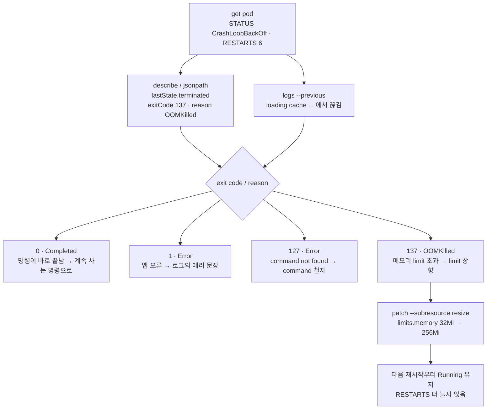

# q14 — Diagnose a CrashLoopBackOff pod · 풀이

← 문제: **[question.md](question.md)**

## 문제 (해석)

**원문**

> Pod `broken-app` in namespace `dev` is in `CrashLoopBackOff`.
>
> 1. Report its restart count, the last exit code and the termination reason of the failing
>    container.
> 2. Read the output of the instance that crashed, not of the one currently starting.
> 3. From the exit code, name the most likely cause before changing anything.
> 4. Repair the pod so it stays `Running`.
> 5. For exit codes 0, 1, 127 and 137 write the usual cause, one line each.
> 6. State in one line how you distinguish `CrashLoopBackOff` from `ImagePullBackOff` without
>    reading any logs.

**해석**

`dev` 네임스페이스의 Pod `broken-app` 이 `CrashLoopBackOff` 상태다.

1. 재시작 횟수와, 실패하는 컨테이너의 마지막 종료 코드·종료 이유를 보고한다.
2. 지금 기동 중인 인스턴스가 아니라 **죽은** 인스턴스의 출력을 읽는다.
3. 아무것도 바꾸기 전에 종료 코드로부터 가장 가능성 높은 원인을 짚는다.
4. 파드가 `Running` 을 유지하도록 수리한다.
5. 종료 코드 0, 1, 127, 137의 통상적인 원인을 각각 한 줄로 적는다.
6. 로그를 읽지 않고 `CrashLoopBackOff` 와 `ImagePullBackOff` 를 구분하는 방법을 한 줄로 적는다.

## 모범 풀이

setup 으로 만든 환경에서는 컨테이너 이름이 `app` 이고, 원인은 메모리 limit 부족(OOMKilled, 137)입니다. 아래 풀이는 이 환경 기준이지만 진단 순서는 어떤 CrashLoop 에서도 같습니다.

**1) 상태를 숫자로 확정합니다**

```bash
kubectl -n dev get pod broken-app
# broken-app   0/1   CrashLoopBackOff   6 (2m ago)   11m
kubectl -n dev describe pod broken-app
# Last State: Terminated / Reason: OOMKilled / Exit Code: 137
# Restart Count: 6
# Events: Back-off restarting failed container app in pod broken-app_dev(...)
kubectl -n dev get pod broken-app \
  -o jsonpath='{.status.containerStatuses[0].restartCount}{" "}{.status.containerStatuses[0].lastState.terminated.exitCode}{" "}{.status.containerStatuses[0].lastState.terminated.reason}{"\n"}'
# 6 137 OOMKilled
```

`state` 는 지금, `lastState` 는 직전에 죽은 인스턴스입니다. `CrashLoopBackOff` 는 그 자체로 원인이 아니라 "컨테이너가 죽어서 재시작을 지수적으로 미루는 중"이라는 상태 이름일 뿐입니다. 원인은 항상 `lastState.terminated` 에 있습니다.

**2) 죽은 인스턴스의 로그**

```bash
kubectl -n dev logs broken-app --previous
kubectl -n dev logs broken-app --previous --tail=50
kubectl -n dev logs broken-app -c app --previous           # 컨테이너가 여러 개면 -c 필수
# broken-app starting
# loading cache (48MB) ...                ← 여기서 끊겼다. "cache loaded" 가 없다
kubectl -n dev get events --sort-by=.lastTimestamp | tail -15
```

OOM killer 는 프로세스를 SIGKILL 로 즉시 죽이므로 앱이 에러 메시지를 남길 틈이 없습니다. 로그가 **에러 없이 중간에 끊겨 있으면** 외부에서 죽인 것(OOM, probe)을 먼저 의심합니다.

**`--previous` 를 습관으로 붙입니다.** `--previous` 없이 치면 결과가 타이밍에 따라 달라집니다. CrashLoopBackOff로 **대기 중일 때**는 새 컨테이너가 아직 없어서 kubelet이 직전 종료 인스턴스의 로그를 대신 돌려줍니다. 하지만 재시작 직후 **새 인스턴스가 떠 있는 순간**에 치면 방금 시작한 인스턴스의 (보통 거의 빈) 로그가 나옵니다. `--previous` 는 언제 쳐도 "마지막으로 죽은 인스턴스"를 가리키므로 결과가 흔들리지 않습니다.

**3) 종료 코드로 원인 좁히기 (5번의 답 포함)**

| Exit code | describe의 Reason | 의미 | 확인·조치 |
|---|---|---|---|
| 0 | `Completed` (그런데 RESTARTS 증가) | 포그라운드 프로세스가 없어 명령이 즉시 끝남 | 계속 사는 명령으로 바꾸거나 Job/CronJob으로 만든다 |
| 1 / 2 | `Error` | 애플리케이션 자체 오류 — 설정 누락, 잘못된 인자, 필수 env 없음 | `logs --previous` 의 에러 문장 |
| 127 | `Error` | command not found — 이미지에 그 실행 파일이 없음 | `command`/`args` 철자, 이미지에 셸이 있는지 |
| 137 | `OOMKilled` (외부 SIGKILL 이면 `Error`) | SIGKILL(128+9). 대개 메모리 limit 초과 | `resources.limits.memory` 상향 또는 앱 사용량 축소 |
| 143 | `Error` | SIGTERM(128+15) — 외부에서 종료 요청 | probe 실패로 kubelet이 죽였는지 확인 |

`OOMKilled` 인지 확인하는 가장 확실한 방법은 exit code가 아니라 `Reason` 필드입니다. 137은 외부 SIGKILL일 수도 있지만 cgroup OOM killer가 죽인 경우에만 `Reason: OOMKilled` 가 찍힙니다.

liveness probe가 원인일 수도 있습니다. 이때는 Events에 `Liveness probe failed:` 가 반복되고 컨테이너는 정상인데 계속 죽습니다.

```bash
kubectl -n dev describe pod broken-app | grep -i -A3 'liveness\|readiness'
```

**4) 수리**

아무것도 바꾸기 전에 이 환경에서 내릴 결론(3번): **exit 137 + `Reason: OOMKilled` → 메모리 limit(32Mi) 이 앱이 쓰는 양보다 작다.**

```bash
kubectl -n dev get pod broken-app -o jsonpath='{.spec.containers[0].resources}{"\n"}'
# {"limits":{"memory":"32Mi"},"requests":{"memory":"16Mi"}}
```

Pod의 대부분 필드는 불변입니다. 이미지는 제자리에서 바꿀 수 있고, 1.35부터(GA) CPU·메모리 request/limit도 `resize` 서브리소스로 제자리에서 바꿀 수 있습니다. `command`, `env`, 볼륨은 안 되므로 다시 만들어야 합니다.

```bash
# 137(OOMKilled)이면 파드를 다시 만들지 않고 메모리 limit 만 올린다 (1.35 GA) — 이 환경의 정답
kubectl -n dev patch pod broken-app --subresource resize --patch \
  '{"spec":{"containers":[{"name":"app","resources":{"limits":{"memory":"256Mi"}}}]}}'

kubectl -n dev set image pod/broken-app 'app=<올바른이미지>'          # 이미지만 문제면

kubectl -n dev get pod broken-app -o yaml > /tmp/broken-app.yaml   # 그 외에는 다시 만든다
# status, metadata의 uid/resourceVersion/creationTimestamp 제거 후 수정
kubectl -n dev replace --force -f /tmp/broken-app.yaml              # delete + create 를 한 번에
```

`--subresource resize` 없이 `kubectl edit`/`patch` 로 `resources` 를 바꾸면 여전히 거부됩니다.
request 16Mi / limit 256Mi 는 여전히 Burstable 이라 QoS 가 바뀌지 않으므로 resize 가 허용됩니다. 새 limit 은 컨테이너가 다음에 다시 시작할 때 적용되므로, 백오프 대기 시간(최대 5분)만큼 기다려야 `Running` 이 될 수 있습니다. 바로 확인하고 싶으면 `replace --force` 로 다시 만들어도 됩니다(RESTARTS 가 0 부터 다시 셉니다).
resize로 QoS 클래스가 바뀌는 변경(예: Burstable → Guaranteed)은 할 수 없습니다(자세한 것은 C-q14).

### 그림 — CrashLoopBackOff 진단 순서



1. `get pod` 의 `CrashLoopBackOff` 는 "죽어서 재시작을 미루는 중"이라는 상태 이름일 뿐이고, 원인은 아닙니다. RESTARTS 가 올라가고 있다는 것만 확인합니다.
2. 원인의 1차 증거는 `lastState.terminated` 의 `exitCode` 와 `reason` 입니다. 2차 증거는 죽은 인스턴스의 출력(`logs --previous`)입니다.
3. 종료 코드로 갈래를 고릅니다. 이 환경은 137 + `OOMKilled` 이고, 로그가 에러 없이 끊긴 것도 외부에서 SIGKILL 당했다는 사실과 맞습니다.
4. 메모리 limit 은 1.35 부터 `resize` 서브리소스로 파드를 지우지 않고 올릴 수 있습니다. 다음 재시작부터 새 limit 으로 떠서 `Running` 을 유지합니다.

Deployment가 관리하는 파드라면 파드를 지우지 말고 Deployment를 고칩니다. 파드만 지우면 같은 문제의 파드가 즉시 다시 생깁니다.

**6) 두 상태의 구분** — `kubectl -n dev get pods` 의 STATUS와 RESTARTS만 봐도 됩니다.

`ImagePullBackOff` / `ErrImagePull` 은 **컨테이너가 한 번도 시작하지 못한** 상태라 `RESTARTS` 가 0이고 `lastState` 가 비어 있습니다. Events에 `Failed to pull image` / `manifest unknown` 이 찍힙니다. `CrashLoopBackOff` 는 컨테이너가 실행된 뒤 종료된 것이라 `RESTARTS` 가 올라가고 종료 코드가 남습니다. 즉 **RESTARTS 숫자와 `lastState` 존재 여부**로 로그 없이 구분됩니다.

## 검증

```bash
kubectl -n dev get pod broken-app -w
# broken-app   1/1   Running   0   ...      ← RESTARTS가 더 늘지 않아야 한다
#                                              (resize 로 제자리 수정했다면 0 이 아니라 기존 숫자에서 멈춘다)
kubectl -n dev logs broken-app --tail=20             # 정상 기동 로그
kubectl -n dev get pod broken-app -o jsonpath='{.status.containerStatuses[0].state}{"\n"}'
# {"running":{"startedAt":"..."}}
kubectl -n dev describe pod broken-app | grep -A3 'Last State'   # 새 종료 기록 없음
kubectl -n dev get pod broken-app -o jsonpath='{.spec.containers[0].resources.limits.memory}{"\n"}'
# 256Mi
kubectl -n dev logs broken-app --tail=5                          # cache loaded, serving
```

## 오답 원인 / 배운 점

- **왜 틀렸나**:
- **기억할 것**: 죽은 컨테이너의 로그는 `kubectl logs <pod> --previous`. `--previous` 없이 치면 타이밍에 따라 새로 뜬 인스턴스의 빈 로그를 볼 수 있다.
- **헷갈리는 지점**: `state` 와 `lastState` 를 섞어 보는 것. 원인은 `lastState.terminated` 에 있습니다. 그리고 exit code 0에 RESTARTS가 증가하는 경우를 "정상 종료"로 오독하기 쉽습니다 — 이건 포그라운드 프로세스가 없어서 명령이 바로 끝난 것이고, `restartPolicy: Always` 가 계속 다시 띄우는 중입니다.

## 참고 문서

- 검색어: `debug running pods`
- https://kubernetes.io/docs/tasks/debug/debug-application/debug-pods/

## 복습 기록

| 날짜 | 결과 | 메모 |
|---|---|---|
|  |  |  |
