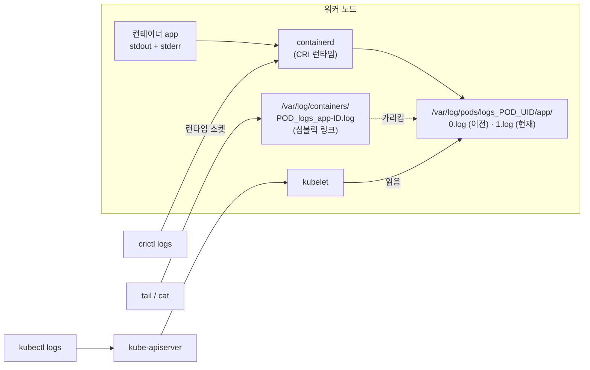
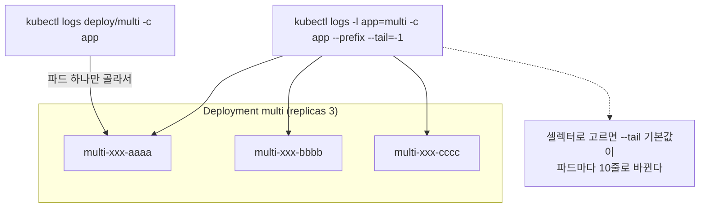

# q16 — Read and evaluate container output streams · 풀이

← 문제: **[question.md](question.md)**

## 문제 (해석)

**원문**

> Deployment `multi` in `logs` runs 3 replicas of containers `app` and `shipper`.
>
> 1. Print the output of `app` alone, then the output of both containers of one pod at once
>    with each line tagged by container.
> 2. Print the last 20 lines of `app` with timestamps, then only the last 5 minutes of it.
> 3. Follow `app` live, and print the output of the previous instance of `app` after a restart.
> 4. Print the output for the whole Deployment, then for all three pods, and state in one line
>    why those two are not the same.
> 5. On the node, locate the on-disk log file of one of these containers and read the same
>    output with `crictl` instead of `kubectl`.
> 6. State in one line how `shipper` must be declared so that it starts before `app` and keeps
>    running for the life of the pod.

**해석**

`logs` 네임스페이스의 Deployment `multi` 는 3 레플리카를 돌리고, 각 파드는 애플리케이션 컨테이너 `app` 과 로그 수집기 `shipper` 를 갖고 있다.

1. `app` 의 출력만 출력하고, 이어서 한 파드의 두 컨테이너 출력을 한 번에, 각 줄에 컨테이너 이름을 붙여서 출력한다.
2. `app` 의 마지막 20줄을 타임스탬프와 함께 출력하고, 이어서 최근 5분 동안 생긴 줄만 출력한다.
3. `app` 을 실시간으로 따라가고, 재시작 후에는 이전 인스턴스의 출력을 출력한다.
4. Deployment 전체에 대해 출력하고, 이어서 파드 3개 전부에 대해 출력한 뒤, 이 둘이 같지 않은 이유를 한 줄로 적는다.
5. 노드에서 이 컨테이너 중 하나의 디스크상 로그 파일을 찾고, `kubectl` 대신 `crictl` 로 같은 출력을 읽는다.
6. `shipper` 가 `app` 보다 먼저 시작해 파드가 사는 동안 계속 돌게 하려면 어떻게 선언해야 하는지 한 줄로 적는다.

## 모범 풀이

```bash
POD=$(kubectl -n logs get pod -l app=multi -o jsonpath='{.items[0].metadata.name}')

kubectl -n logs logs $POD -c app
kubectl -n logs logs $POD --all-containers=true --prefix       # 줄마다 [pod/컨테이너] 접두

kubectl -n logs logs $POD -c app --tail=20 --timestamps
kubectl -n logs logs $POD -c app --since=5m
kubectl -n logs logs $POD -c app --since-time=2026-09-12T09:00:00Z

kubectl -n logs logs -f $POD -c app
kubectl -n logs logs $POD -c app --previous                    # 죽은 직전 인스턴스
```

**컨테이너가 둘 이상이면 `-c` 는 선택이 아닙니다.** 생략해도 에러가 나지 않는다는 것이 함정입니다. kubectl은 `kubectl.kubernetes.io/default-container` 어노테이션이 가리키는 컨테이너, 없으면 **첫 번째 컨테이너**를 조용히 골라 보여 주고, stderr에 `Defaulted container "app" out of: app, shipper` 한 줄만 남깁니다. 엉뚱한 컨테이너의 로그를 읽고 결론을 내리는 사고가 여기서 납니다.

**4) Deployment 로그와 모든 파드의 로그는 다릅니다**

```bash
kubectl -n logs logs deploy/multi -c app          # 파드 하나만 골라서 보여준다
kubectl -n logs logs -l app=multi -c app --prefix --tail=-1
```

`kubectl logs deploy/X` 는 워크로드를 대신 지목하는 편의 문법일 뿐이고, 내부적으로 그 Deployment의 파드 **하나**를 골라 그 로그를 보여줍니다. 3개 파드 전부를 보려면 **라벨 셀렉터** `-l` 를 써야 합니다. 그런데 `-l` 을 쓰면 `--tail` 기본값이 **파드마다 10줄**로 바뀝니다(이름으로 지정하면 전체). 전부 보려면 `--tail=-1` 을 줍니다. 또 `-l` 과 `-f` 로 5개를 넘는 파드를 **따라가려면** `--max-log-requests` 를 올려야 합니다(기본 5, 넘으면 에러).

**stdout과 stderr은 분리되지 않습니다.** kubelet은 컨테이너의 두 스트림을 한 로그 파일에 시간순으로 합쳐 기록하고, `kubectl logs` 에는 이를 나누는 옵션이 없습니다. 각 줄에 `stdout`/`stderr` 태그가 파일에는 들어 있지만 kubectl 출력에는 나오지 않습니다. 구분이 필요하면 애플리케이션이 다른 목적지로 써야 합니다. (v1.32 부터 알파 기능 게이트 `PodLogsQuerySplitStreams` 로 API 에 스트림을 고르는 옵션이 생겼지만 기본으로 꺼져 있고 kubectl 플래그도 없습니다.) 이 실습의 `app` 은 WARN/FATAL 을 stderr 로 쓰지만 `kubectl logs` 에서는 INFO 줄과 섞여 시간순으로 나옵니다.

**5) 노드에서 직접 읽기**

```bash
ls -l /var/log/containers/            # <pod>_<ns>_<container>-<id>.log 형태의 심볼릭 링크
ls -l /var/log/containers/ | grep "${POD}_logs_app"
ls -l /var/log/pods/logs_${POD}_*/app/
# 0.log  1.log — 파일 이름이 재시작 횟수다. 지금 인스턴스가 1.log, --previous 가 읽는 것이 0.log
tail -20 /var/log/pods/logs_${POD}_*/app/1.log
```

`$POD` 는 `k8s-c1` 에서 구한 값을 그대로 적습니다(노드 셸에는 변수가 없습니다). `/var/log/containers/*.log` 는 `/var/log/pods/<ns>_<pod>_<uid>/<컨테이너>/<재시작횟수>.log` 를 가리키는 심볼릭 링크이고, 그 파일이 실제 컨테이너 런타임 로그입니다. 각 줄은 `<RFC3339 타임스탬프> <stdout|stderr> <F|P> <내용>` 형식입니다.

```bash
PID=$(crictl pods -q --namespace logs --name "$POD")    # 파드 샌드박스 ID
crictl ps -a --pod "$PID"                               # app 2개(Running·Exited), shipper 1개
CID=$(crictl ps -q --pod "$PID" --name '^app$')         # 지금 돌고 있는 app
crictl logs $CID
crictl logs --tail 20 --timestamps $CID
crictl logs -p $CID                   # kubectl logs --previous 에 해당 (0.log)
```

`--name` 은 정규식이라 `app` 만 주면 노드의 다른 파드에 있는 `app`, `myapp` 같은 컨테이너도 걸립니다. 그래서 `--pod` 로 먼저 좁힙니다. `crictl` 은 apiserver를 거치지 않고 노드의 런타임 소켓에 직접 말합니다. **컨트롤 플레인이 죽어 `kubectl` 이 안 될 때 쓰는 도구**입니다(위처럼 `/var/log/pods` 를 직접 읽는 방법과 함께). 소켓 경로 경고가 나면 `--runtime-endpoint unix:///run/containerd/containerd.sock` 를 붙이거나 `/etc/crictl.yaml` 에 적어 둡니다.

**6) 사이드카 선언** — 네이티브 사이드카는 **`restartPolicy: Always` 를 가진 init container** 입니다.

```yaml
spec:
  initContainers:
  - name: shipper
    image: busybox:1.36
    restartPolicy: Always            # 이 한 줄이 사이드카로 만든다
    command: ["sh", "-c", "touch /var/log/app/out.log; tail -F /var/log/app/out.log"]
    volumeMounts: [{ name: applog, mountPath: /var/log/app }]
  containers:
  - name: app
    image: busybox:1.36
    command: ["sh", "-c", "while true; do date | tee -a /var/log/app/out.log; sleep 3; done"]
    volumeMounts: [{ name: applog, mountPath: /var/log/app }]
  volumes:
  - { name: applog, emptyDir: {} }
```

init container이므로 `app` 보다 **먼저** 시작하고, `restartPolicy: Always` 때문에 끝나기를 기다리지 않고 다음 컨테이너로 넘어가며 파드가 사는 동안 계속 돕니다. 종료 시에는 일반 컨테이너들이 먼저 끝난 뒤에 정리됩니다. 평범한 init container(`restartPolicy` 없음)로 두면 파드가 영원히 기동 중에 멈춥니다. 참고로 사이드카도 `-c shipper` 로 로그를 읽습니다 — `initContainers` 에 있어도 조회 방법은 같습니다. 네이티브 사이드카는 v1.29 부터 기본으로 켜져 있습니다. 지금 setup 의 `shipper` 는 `containers` 의 두 번째 항목이라 `app` 과 거의 동시에 시작할 뿐 먼저 시작한다는 보장이 없습니다.

### 그림 1 — 로그가 저장되는 곳과 읽는 세 가지 길



1. 컨테이너가 stdout 과 stderr 로 쓴 줄은 런타임이 **한 파일**에 시간순으로 모읍니다. 줄마다 `<시각> <stdout|stderr> <F|P> <내용>` 형식입니다.
2. 파일은 `/var/log/pods/<ns>_<pod>_<uid>/<컨테이너>/<재시작횟수>.log` 에 있습니다. `/var/log/containers/` 는 그 파일을 가리키는 링크 모음입니다.
3. `kubectl logs` 는 apiserver → kubelet 을 거쳐 이 파일을 읽습니다. 그래서 컨트롤 플레인이 죽으면 쓸 수 없습니다.
4. `crictl logs` 는 노드의 런타임 소켓으로 바로 묻고, `tail` 은 파일을 직접 읽습니다. 둘 다 apiserver 없이 됩니다.
5. `--previous`(`crictl logs -p`)는 번호가 하나 앞인 파일을 읽습니다. 재시작이 한 번도 없으면 읽을 파일이 없어 에러가 납니다.

### 그림 2 — `deploy/multi` 와 `-l app=multi` 의 차이



1. `deploy/multi` 는 "이 Deployment 의 파드 중 하나"를 가리키는 편의 문법입니다. 3개 중 하나의 로그만 나옵니다.
2. `-l app=multi` 는 셀렉터에 맞는 파드 전부의 로그를 이어 붙입니다. `--prefix` 를 줘야 어느 파드의 줄인지 보입니다(이 실습은 줄 안에도 파드 이름이 있습니다).
3. 셀렉터를 쓰면 `--tail` 기본값이 10 이 되므로 전체를 보려면 `--tail=-1` 을 줍니다. `-f` 로 따라갈 때는 스트림 수가 `--max-log-requests`(기본 5)를 넘지 않아야 합니다.
4. 4단계의 한 줄 답: **`deploy/multi` 는 파드 하나만 읽고, 3개 전부는 셀렉터 `-l` 로만 읽힌다.**

## 검증

```bash
kubectl -n logs logs $POD --all-containers --prefix --tail=5
# [pod/multi-xxxx/app] ...   그리고 [pod/multi-xxxx/shipper] forwarded: ...
kubectl -n logs logs $POD -c app --previous | tail -2    # ... FATAL ... config reload failed, exiting
kubectl -n logs logs -l app=multi -c app --prefix --tail=2 | grep -c '^\[pod/'  # 6 (3파드x2줄)
kubectl -n logs logs deploy/multi -c app --tail=2 | wc -l                       # 2 (파드 1개)
kubectl -n logs logs $POD -c app --timestamps --tail=3     # 각 줄 앞에 RFC3339 시각
# 노드에서 ($POD 는 k8s-c1 에서 구한 이름)
crictl ps -a --pod $(crictl pods -q --namespace logs --name "$POD")   # app Running + Exited, shipper Running
crictl logs --tail 5 $(crictl ps -q --pod $(crictl pods -q --namespace logs --name "$POD") --name '^app$')
```

## 오답 원인 / 배운 점

- **왜 틀렸나**:
- **기억할 것**: `kubectl logs deploy/X` 는 파드 **하나**만 본다. 전부 보려면 `-l <셀렉터>`, 그리고 이때 기본 `--tail` 은 파드당 10줄이다. `-c` 를 빼면 에러 없이 기본(첫 번째) 컨테이너가 선택된다.
- **헷갈리는 지점**: `--previous`(직전에 죽은 인스턴스)와 `--since`(시간 범위)는 목적이 다릅니다. 재시작한 파드의 사고 원인은 `--since` 로는 안 나옵니다. 그리고 `-c` 는 로그를 읽을 컨테이너 선택이고 `--all-containers` 는 전부라서, 둘을 같이 주면 `--all-containers=true should not be specified with container name` 에러가 납니다. `/var/log/containers` 는 링크, 실체는 `/var/log/pods` 입니다.

## 참고 문서

- 검색어: `logging architecture`
- https://kubernetes.io/docs/concepts/cluster-administration/logging/

---

[↑ 문항 목록](../README.md) · [← 문제로](question.md) · [다음 문제 q17 →](../q17_static_pod_manifest_error/question.md)
