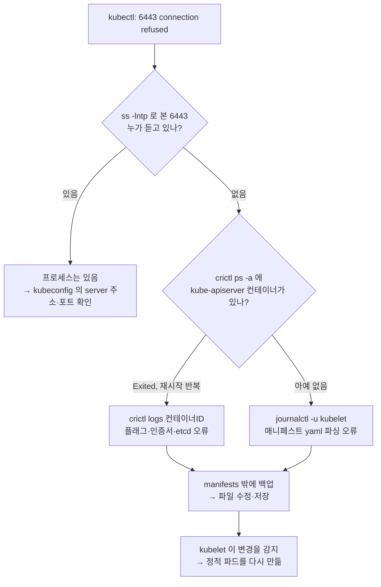

# q17 — Control plane down from a static pod manifest error · 풀이

← 문제: **[question.md](question.md)**

## 문제 (해석)

**원문**

> Every `kubectl` command on `cp01` fails with `connection refused` on port 6443. A colleague
> edited a control plane manifest shortly before.
>
> 1. Confirm the API server is not listening and that this is not a kubeconfig problem.
> 2. Without using `kubectl`, list the control plane containers and identify which one is not
>    running.
> 3. Read that container's output and quote the exact error.
> 4. Back the manifest up, then repair it so the API server comes back. Do not run
>    `kubectl apply` and do not restart the kubelet.
> 5. Confirm the API server answers and all four control plane static pods are running, and
>    state in one line the mechanism that restarted the pod.

**해석**

`cp01` 에서 모든 `kubectl` 명령이 포트 6443에 대해 `connection refused` 로 실패한다. 조금 전에 동료가 컨트롤 플레인 매니페스트를 수정했다.

1. API 서버가 리스닝하지 않는 것과, 이것이 kubeconfig 문제가 아님을 확인한다.
2. `kubectl` 없이 컨트롤 플레인 컨테이너를 나열하고 어느 것이 돌지 않는지 찾는다.
3. 그 컨테이너의 출력을 읽고 정확한 에러를 인용한다.
4. 매니페스트를 백업한 뒤 수리해 API 서버를 복구한다. `kubectl apply` 를 쓰지 않고 kubelet도 재시작하지 않는다.
5. API 서버가 응답하고 컨트롤 플레인 정적 파드 4개가 모두 실행 중임을 확인하고, 파드를 다시 띄운 메커니즘을 한 줄로 적는다.

## 모범 풀이

**1) kubeconfig 문제가 아님을 먼저 배제합니다**

```bash
kubectl get nodes
# The connection to the server 10.0.0.10:6443 was refused - did you specify ...
ss -lntp | grep 6443                      # 아무것도 리스닝하지 않음
curl -k https://localhost:6443/healthz    # Connection refused
```

`connection refused` 는 "그 주소에 아무도 없다"는 뜻입니다. 인증서·사용자 같은 kubeconfig 문제라면 연결은 되고 `Unauthorized`, `x509`, `Forbidden` 같은 응답이 옵니다. 다만 kubeconfig의 `server` 주소나 포트가 틀려도 refused가 나므로, **`ss` 로 이 노드의 6443에 실제로 아무것도 없는지 확인하는 것이 결정적**입니다. 6443이 비어 있으면 파일이 아니라 프로세스를 봐야 합니다.

**2) kubectl 없이 보기**

```bash
crictl ps -a | grep -E 'kube-apiserver|etcd|controller-manager|scheduler'
# kube-apiserver ... Exited (1)  또는 목록에 아예 없음
crictl pods
journalctl -u kubelet -n 100 --no-pager | grep -i -E 'apiserver|manifest|static'
systemctl status kubelet        # kubelet 자체는 보통 active 다
```

`crictl` 은 apiserver를 거치지 않고 노드의 containerd 소켓에 직접 말하므로 컨트롤 플레인이 죽어도 동작합니다. 소켓 경고가 나오면 `crictl --runtime-endpoint unix:///run/containerd/containerd.sock ps -a` 처럼 엔드포인트를 명시합니다.

**3) 컨테이너 출력**

```bash
CID=$(crictl ps -a -q --name kube-apiserver | head -1)
crictl logs --tail 50 $CID
# 컨테이너가 생성조차 안 됐다면 yaml 파싱 실패다 — 그 에러는 kubelet 로그에 있다
journalctl -u kubelet --since "10 min ago" --no-pager | grep -i -E 'error|invalid|cannot'
```

이 문제의 `setup.sh` 로 만든 환경이라면 컨테이너는 생성되었다가 바로 종료되고, `crictl logs` 에 `Error: unknown flag: --authorization-modes` 가 나옵니다. 아래 표의 두 번째 줄 유형입니다.

**4) 수리 — 백업부터**

```bash
ls -l /etc/kubernetes/manifests/
# etcd.yaml  kube-apiserver.yaml  kube-controller-manager.yaml  kube-scheduler.yaml
cp /etc/kubernetes/manifests/kube-apiserver.yaml /root/kube-apiserver.yaml.bak
vi /etc/kubernetes/manifests/kube-apiserver.yaml
```

**백업은 선택이 아닙니다.** 매니페스트를 고치다 더 망가뜨리면 되돌릴 수 있는 원본이 클러스터 어디에도 없습니다(apiserver가 죽어 있으므로 etcd에서 꺼낼 수도 없습니다). 그리고 백업 파일을 `/etc/kubernetes/manifests/` **안에** 두면 안 됩니다 — kubelet이 `.bak` 도 매니페스트로 읽어 중복 파드를 띄우려 합니다. 반드시 디렉터리 밖(`/root` 등)에 둡니다.

| 로그에 보이는 것 | 원인 | 조치 |
|---|---|---|
| 컨테이너가 생성되지 않음, kubelet 로그에 yaml 파싱 오류 | 들여쓰기·문법 오류 | 문법 수정 |
| `unknown flag: --xyz`, `flag provided but not defined` | 커맨드 인자 철자 오류 | 인자 수정 |
| `dial tcp 127.0.0.1:2379: connect: connection refused` | `--etcd-servers` 주소 오류 또는 etcd가 죽음 | etcd 정적 파드부터 복구 |
| `open /etc/kubernetes/pki/xxx.crt: no such file or directory` | 인증서 경로 오류, 또는 hostPath 볼륨이 빠짐 | `volumes`/`volumeMounts` 경로 확인 |
| `listen tcp :6443: bind: address already in use` | `--secure-port` 가 다른 것과 충돌 | 6443으로 원복 |
| 기동했다가 CrashLoop | `--service-cluster-ip-range` 등 값이 잘못됨 | 값 원복 |

**파일을 저장하면 끝입니다.** kubelet이 `/etc/kubernetes/manifests/` 를 감시하다가 변경을 감지해 정적 파드를 알아서 다시 만듭니다. `kubectl apply` 를 할 수도 없고(apiserver가 죽어 있음) 할 필요도 없으며, kubelet 재시작도 필요 없습니다. 감시 대상 디렉터리는 `/var/lib/kubelet/config.yaml` 의 `staticPodPath` 로 정해집니다. 변경 감지가 일어나지 않는 것처럼 보이면 파일을 밖으로 옮겼다 되돌려 강제로 이벤트를 만듭니다.

```bash
grep staticPodPath /var/lib/kubelet/config.yaml     # /etc/kubernetes/manifests
mv /etc/kubernetes/manifests/kube-apiserver.yaml /root/
sleep 20
crictl ps -a | grep apiserver          # 컨테이너가 사라진 것 확인
mv /root/kube-apiserver.yaml /etc/kubernetes/manifests/
```

### 그림 — kubectl 없이 원인을 찾는 순서



1. `ss` 로 6443 이 비어 있는지부터 봅니다. 무언가 듣고 있다면 API 서버는 살아 있고 kubeconfig 쪽 문제입니다.
2. 비어 있으면 컨테이너 런타임에 직접 묻습니다. 컨테이너가 있는데 죽는다면 그 출력(`crictl logs`)에 답이 있고, 컨테이너가 아예 없다면 kubelet 이 파일을 읽지 못한 것이라 kubelet journal 에 답이 있습니다.
3. 어느 쪽이든 고치는 곳은 매니페스트 파일 하나입니다. 저장하면 kubelet 이 감지해 파드를 다시 만들므로 `kubectl apply` 도 kubelet 재시작도 하지 않습니다. 이것이 5번에서 적을 메커니즘입니다.

## 검증

```bash
watch crictl ps                 # kube-apiserver 가 Running 으로 올라온다
ss -lntp | grep 6443            # kube-apiserver 가 리스닝
kubectl get --raw /healthz      # ok
kubectl get nodes               # 응답이 돌아온다
kubectl -n kube-system get pods -o wide | grep cp01
# etcd / kube-apiserver / kube-controller-manager / kube-scheduler -cp01 모두 Running
kubectl -n kube-system get pod kube-apiserver-cp01 \
  -o jsonpath='{.metadata.ownerReferences[0].kind}{"\n"}'   # Node ← 미러 파드라서
```

## 오답 원인 / 배운 점

- **왜 틀렸나**:
- **기억할 것**: 정적 파드는 kubelet이 `/etc/kubernetes/manifests/` 를 감시하다 파일 변경만으로 재생성한다. 파일을 고치고 저장하면 끝 — `kubectl apply` 도 kubelet 재시작도 필요 없다.
- **헷갈리는 지점**: `connection refused`(아무도 안 듣는다 = 프로세스 문제)와 `Unauthorized`/`x509`(연결은 됐다 = 인증·kubeconfig 문제)를 구분하지 않고 kubeconfig부터 뒤지는 것. 그리고 백업 파일을 `manifests/` 안에 두면 kubelet이 그것까지 파드로 띄우려 합니다. 미러 파드는 `kubectl delete` 로 지워도 kubelet이 즉시 되살립니다 — 실제 삭제는 파일을 옮기는 것입니다.

## 참고 문서

- 검색어: `create static pod`
- https://kubernetes.io/docs/tasks/configure-pod-container/static-pod/

## 복습 기록

| 날짜 | 결과 | 메모 |
|---|---|---|
|  |  |  |
