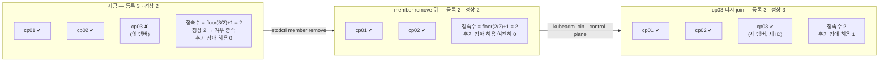
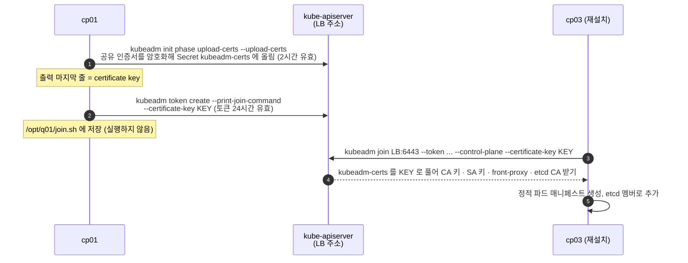

# q01 — Verify and operate a highly-available control plane · 풀이

← 문제: **[question.md](question.md)**

## 문제 (해석)

**원문**

> Cluster `k8s-c3` runs a stacked HA control plane on `cp01`, `cp02` and `cp03`. `cp03` died
> and was rebuilt from scratch without running `kubeadm reset`, so its old etcd member is still
> registered. The rebuilt `cp03` must come back.
>
> 1. From `cp01`, print the etcd member list and the health of every member with `etcdctl`,
>    using the etcd server certificates. Write the number of registered members, how many are
>    healthy, and how many **additional** member failures the cluster tolerates today to
>    `/opt/q01/quorum.txt`.
> 2. Remove the stale `cp03` member from etcd, and the old `cp03` Node object if it still
>    exists, so the rebuilt machine can join again.
> 3. On `cp01`, produce a join command that `cp03` can use to join **as a control plane
>    node**, including a freshly uploaded certificate key. Write it to `/opt/q01/join.sh` —
>    do not run it.
> 4. Write to `/opt/q01/upgrade.txt` which `kubeadm` subcommand upgrades `cp01` and which one
>    upgrades `cp02` and `cp03`.
> 5. Confirm `cp01` and `cp02` are `Ready` and every remaining etcd member answers an
>    endpoint health check.

**해석**

`k8s-c3` 클러스터는 `cp01`, `cp02`, `cp03` 으로 된 stacked HA 컨트롤 플레인이다. `cp03` 이 죽어서
`kubeadm reset` 없이 새로 설치되었기 때문에, 예전 etcd 멤버가 아직 등록되어 있다. 재설치된 `cp03` 을
다시 넣어야 한다.

1. `cp01` 에서 etcd 서버 인증서로 `etcdctl` member list와 모든 멤버의 health를 출력한다. 등록된 멤버
   수, 그중 정상인 수, 지금 **추가로** 견딜 수 있는 멤버 장애 수를 `/opt/q01/quorum.txt` 에 적는다.
2. etcd에서 낡은 `cp03` 멤버를 제거하고, 예전 `cp03` Node 오브젝트가 남아 있으면 그것도 지워서
   재설치된 머신이 다시 join할 수 있게 한다.
3. `cp01` 에서 `cp03` 이 **컨트롤 플레인 노드로** join할 수 있는 명령을 만든다. 새로 업로드한
   certificate key를 포함해야 한다. `/opt/q01/join.sh` 에 적고 실행하지는 않는다.
4. `cp01` 을 올리는 `kubeadm` 하위 명령과 `cp02`, `cp03` 을 올리는 하위 명령을
   `/opt/q01/upgrade.txt` 에 적는다.
5. `cp01` 과 `cp02` 가 `Ready` 이고, 남은 etcd 멤버가 모두 endpoint health에 응답하는지 확인한다.

## 모범 풀이

**1) etcd 멤버와 health.** etcd는 static pod이므로 호스트의 인증서 경로를 그대로 씁니다. 매번
플래그를 붙이는 대신 환경 변수로 한 번 지정해 두면 빠릅니다(etcd 3.4부터 `ETCDCTL_API=3` 은 기본값).

```bash
export ETCDCTL_ENDPOINTS=https://127.0.0.1:2379 \
       ETCDCTL_CACERT=/etc/kubernetes/pki/etcd/ca.crt \
       ETCDCTL_CERT=/etc/kubernetes/pki/etcd/server.crt \
       ETCDCTL_KEY=/etc/kubernetes/pki/etcd/server.key

etcdctl member list -w table
# ID                NAME  ...  PEER ADDRS                  CLIENT ADDRS
# 8e9e05c52164694d  cp01  ...  https://192.168.100.11:2380 https://192.168.100.11:2379
# 2a1f...           cp02  ...
# 91bc3c398fb3c146  cp03  ...  https://192.168.100.13:2380 ...     ← 아직 등록되어 있다

etcdctl endpoint health --cluster -w table
# cp01, cp02 : true
# cp03       : false  (context deadline exceeded)
```

호스트에 `etcdctl` 이 없으면 etcd 파드 안에서 같은 명령을 실행합니다
(`kubectl -n kube-system exec etcd-cp01 -- etcdctl --endpoints=... --cacert=... ... member list`).

정족수는 `floor(N/2)+1` 입니다. 등록 멤버가 3개면 정족수는 2이고, 지금 정상인 멤버가 딱 2개이므로
**한 대만 더 죽어도 쓰기가 멈춥니다.** 추가로 견딜 수 있는 장애는 0개입니다.

```bash
echo "members: 3, healthy: 2, additional failures tolerated: 0" > /opt/q01/quorum.txt
```

**2) 낡은 멤버 제거.** `kubeadm reset` 을 했다면 reset이 자기 etcd 멤버를 지웠겠지만, reset 없이
재설치했기 때문에 예전 멤버가 남아 있습니다. 이 상태로 join하면 새 `cp03` 을 etcd 멤버로 추가하는
단계에서 실패합니다(같은 이름·peer URL의 멤버가 이미 있고, 죽은 멤버가 정족수 계산에도 끼어 있습니다).

```bash
etcdctl member remove 91bc3c398fb3c146       # member list 의 cp03 ID
etcdctl member list -w table                  # cp01, cp02 두 개만 남는다
kubectl delete node cp03 --ignore-not-found
```

멤버가 2개가 되어도 정족수는 2라서 견딜 수 있는 장애는 여전히 0개입니다. `cp03` 이 다시 들어와
3개가 되어야 장애 1개를 견딥니다. 그래서 HA etcd는 항상 홀수로 맞춥니다 — 짝수는 정족수를 올리지 않으면서
고장 날 대상만 늘립니다.

**3) join 명령.** 두 가지가 각각 따로 만료된다는 점이 핵심입니다. bootstrap token은 24시간,
`kubeadm-certs` Secret에 올라간 certificate key는 **2시간**이면 사라집니다. 그래서 둘 다 새로 만듭니다.
`token create` 에 `--certificate-key` 를 주면 컨트롤 플레인용 join 명령 전체를 한 번에 출력합니다.

```bash
KEY=$(kubeadm init phase upload-certs --upload-certs | tail -1)   # 마지막 줄이 새 certificate key
kubeadm token create --print-join-command --certificate-key "$KEY" > /opt/q01/join.sh
cat /opt/q01/join.sh
# kubeadm join 192.168.100.10:6443 --token <token> \
#   --discovery-token-ca-cert-hash sha256:<hash> --control-plane --certificate-key <key>
```

`--control-plane` 을 빼면 워커로 들어갑니다. `--certificate-key` 를 빼면 컨트롤 플레인끼리 공유해야
하는 인증서(CA 키, service account 키 등)를 받지 못해 join이 실패합니다. 인증서를 손으로 미리 복사해 둔
경우만 예외입니다.

**4) 업그레이드 주체.** 첫 컨트롤 플레인만 `apply` 이고, 나머지는 `node` 입니다.

```bash
cat > /opt/q01/upgrade.txt <<'EOF'
cp01: kubeadm upgrade apply v1.35.x
cp02, cp03: kubeadm upgrade node
EOF
```

클러스터 수준 설정(ClusterConfiguration, 애드온 등)은 첫 노드의 `apply` 가 이미 바꿨으므로, 나머지
컨트롤 플레인 노드는 자기 정적 파드 매니페스트와 kubelet 설정만 맞추는 `upgrade node` 를 씁니다.

### 그림 1 — 정족수는 "등록된 멤버 수" 로 계산한다



1. 죽은 멤버도 등록되어 있는 한 정족수 계산에 들어갑니다. 3개 중 2개만 살아 있으면 정족수 2를 겨우 채우는 상태라 한 대만 더 죽어도 쓰기가 멈춥니다. 1번 답은 `3, 2, 0` 입니다.
2. 낡은 멤버를 지워 2개가 되어도 정족수는 2라서 장애 허용은 여전히 0입니다. 2개짜리 etcd 는 1개짜리보다 안전하지 않습니다.
3. `cp03` 이 새 멤버(새 ID)로 다시 들어와 3개가 되어야 한 대 장애를 견딥니다.

### 그림 2 — 컨트롤 플레인 join 에 필요한 것



1. 컨트롤 플레인은 CA 키, 서비스 어카운트 키 같은 인증서를 서로 공유해야 합니다. `upload-certs` 가 이것을 암호화해서 클러스터에 잠깐 올려 두고, 풀 수 있는 키(certificate key)를 출력합니다.
2. 토큰은 "클러스터에 들어와도 되는가"를, certificate key 는 "공유 인증서를 받을 수 있는가"를 증명합니다. 둘의 유효 시간이 달라서(24시간, 2시간) 둘 다 새로 만듭니다.
3. `--control-plane` 이 없으면 워커로 들어가고, `--certificate-key` 가 없으면 인증서를 받지 못해 컨트롤 플레인 join 이 실패합니다.
4. 옛 `cp03` 멤버가 남아 있으면 마지막 단계(etcd 멤버 추가)에서 실패합니다. 그래서 2번(멤버 제거)을 3번보다 먼저 합니다.

## 검증

```bash
kubectl get nodes -l node-role.kubernetes.io/control-plane
# cp01 Ready control-plane / cp02 Ready control-plane

etcdctl endpoint health --cluster -w table     # 남은 두 멤버 모두 true, ERROR 열이 비어 있어야 한다
etcdctl member list -w table                   # cp03 없음

cat /opt/q01/quorum.txt /opt/q01/join.sh /opt/q01/upgrade.txt
kubectl get --raw='/readyz?verbose' | tail -5  # 모든 check 가 ok
kubectl -n kube-system get secret kubeadm-certs   # upload-certs 직후에만 존재
```

## 오답 원인 / 배운 점

- **왜 틀렸나**:
- **기억할 것**: `kubeadm reset` 없이 재설치한 컨트롤 플레인은 etcd에 죽은 멤버를 남긴다 — `etcdctl member remove <ID>` 후에 다시 join한다. certificate key는 2시간, bootstrap token은 24시간 뒤 만료되며, `kubeadm token create --print-join-command --certificate-key $(kubeadm init phase upload-certs --upload-certs | tail -1)` 한 줄로 컨트롤 플레인 join 명령이 나온다.
- **헷갈리는 지점**: 정족수는 "등록된 멤버 수" 기준입니다. 3개 중 1개가 죽어 있으면 정상 2개로 정족수 2를 겨우 채우는 상태라 추가 장애를 하나도 못 견딥니다. 첫 노드는 `kubeadm upgrade apply <version>`, 두 번째 이후 컨트롤 플레인과 워커는 `kubeadm upgrade node` 입니다. 그리고 멤버 2개짜리 etcd는 단일 노드보다 안전하지 않습니다.

## 참고 문서

- 검색어: `creating highly available clusters with kubeadm`, `operating etcd clusters`
- https://kubernetes.io/docs/setup/production-environment/tools/kubeadm/high-availability/
- https://kubernetes.io/docs/tasks/administer-cluster/configure-upgrade-etcd/
- https://kubernetes.io/docs/tasks/administer-cluster/kubeadm/kubeadm-upgrade/

---

[↑ 문항 목록](../README.md) · [← 문제로](question.md) · [다음 문제 q02 →](../q02_node_prerequisites_containerd/question.md)
