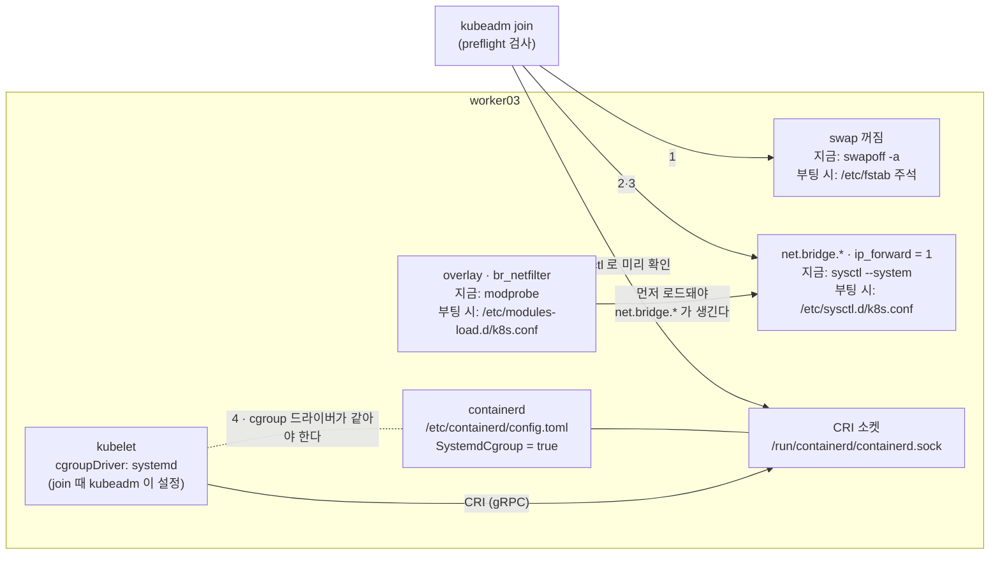

# q02 — Prepare a node for joining a cluster · 풀이

← 문제: **[question.md](question.md)**

## 문제 (해석)

**원문**

> `worker03` has containerd, kubelet, kubeadm and kubectl installed but has never joined a
> cluster. Bring it to a state where `kubeadm join` would succeed. Do **not** run the join.
>
> 1. Disable swap so that it stays off after a reboot.
> 2. Load the `overlay` and `br_netfilter` kernel modules and make them load at boot.
> 3. Set `net.bridge.bridge-nf-call-iptables=1`, `net.bridge.bridge-nf-call-ip6tables=1`
>    and `net.ipv4.ip_forward=1` persistently, and apply them without rebooting.
> 4. Configure containerd to use the `systemd` cgroup driver, then restart it.
> 5. Verify the CRI endpoint `unix:///run/containerd/containerd.sock` answers, and hold
>    the `kubelet`, `kubeadm` and `kubectl` packages at their current version so an
>    `apt upgrade` cannot move them.
> 6. Write the cgroup driver reported by containerd to `/opt/q02/cgroup.txt`.

**해석**

`worker03` 에는 containerd, kubelet, kubeadm, kubectl이 설치되어 있지만 클러스터에 join한 적이
없다. `kubeadm join` 이 성공할 수 있는 상태로 만든다. join은 실행하지 **않는다**.

1. 재부팅 후에도 swap이 꺼져 있게 만든다.
2. `overlay` 와 `br_netfilter` 커널 모듈을 로드하고 부팅 시에도 로드되게 한다.
3. `net.bridge.bridge-nf-call-iptables=1`, `net.bridge.bridge-nf-call-ip6tables=1`,
   `net.ipv4.ip_forward=1` 을 영구 설정하고 재부팅 없이 적용한다.
4. containerd가 `systemd` cgroup 드라이버를 쓰게 설정하고 재시작한다.
5. CRI 엔드포인트 `unix:///run/containerd/containerd.sock` 가 응답하는지 확인하고,
   `kubelet`, `kubeadm`, `kubectl` 패키지를 현재 버전에 고정해 `apt upgrade` 가 못 움직이게 한다.
6. containerd가 보고하는 cgroup 드라이버를 `/opt/q02/cgroup.txt` 에 적는다.

## 모범 풀이

**1) swap.** 현재 세션과 영구 설정 두 곳을 모두 건드려야 합니다.

```bash
swapoff -a
sed -i '/\sswap\s/s/^/#/' /etc/fstab
# systemd 가 만든 swap 유닛이 있는 배포판은 이것도 필요하다
systemctl list-units --type=swap --all
systemctl mask <name>.swap
```

**2) 모듈**

```bash
cat <<'EOF' >/etc/modules-load.d/k8s.conf
overlay
br_netfilter
EOF
modprobe overlay
modprobe br_netfilter
```

**3) sysctl**

```bash
cat <<'EOF' >/etc/sysctl.d/k8s.conf
net.bridge.bridge-nf-call-iptables  = 1
net.bridge.bridge-nf-call-ip6tables = 1
net.ipv4.ip_forward                 = 1
EOF
sysctl --system
```

`br_netfilter` 를 먼저 로드하지 않으면 `net.bridge.*` 키 자체가 존재하지 않아
`sysctl --system` 이 `cannot stat /proc/sys/net/bridge/...` 로 실패합니다. 순서가 있습니다.

**4) containerd cgroup 드라이버.** 여기가 이 문제의 핵심입니다. 설정 키 경로를 외워서 붙여넣지
말고, 현재 containerd가 만들어주는 기본 설정을 받아 그 안에서 고칩니다. containerd 2.x는 플러그인
이름이 `io.containerd.grpc.v1.cri` 에서 `io.containerd.cri.v1.runtime` 으로 바뀌었기 때문에
외운 경로가 틀리면 아무 효과 없이 조용히 무시됩니다.

```bash
mkdir -p /etc/containerd
containerd config default > /etc/containerd/config.toml
grep -n 'SystemdCgroup' /etc/containerd/config.toml
sed -i 's/SystemdCgroup = false/SystemdCgroup = true/' /etc/containerd/config.toml
systemctl restart containerd
```

kubeadm은 v1.22부터 kubelet의 `cgroupDriver` 를 `systemd` 로 설정합니다. 이 값은 join할 때
`/var/lib/kubelet/config.yaml` 에 쓰이므로, join 전인 지금은 그 파일이 아직 없습니다. 그래서 맞춰야
할 쪽은 containerd입니다. 두 쪽이 다르면 systemd와 kubelet이 각자 cgroup을 관리하게 되어, 리소스
압박이 올 때 노드가 불안정해질 수 있습니다. 즉시 에러가 안 나므로 찾기 어렵습니다.

`containerd config default` 로 파일을 새로 만드는 이유가 하나 더 있습니다. Docker 저장소의
`containerd.io` 패키지가 깔아 주는 `/etc/containerd/config.toml` 에는 `disabled_plugins = ["cri"]` 가
들어 있어서, 그대로 두면 CRI 소켓이 응답하지 않고 kubeadm preflight가 실패합니다. 기본 설정으로
덮어쓰면 이 줄도 사라집니다.

**5) 엔드포인트 확인과 패키지 고정**

```bash
crictl --runtime-endpoint unix:///run/containerd/containerd.sock version
apt-mark hold kubelet kubeadm kubectl
apt-mark showhold
```

**6)**

```bash
crictl info | grep -i systemdCgroup     # true
mkdir -p /opt/q02
echo systemd > /opt/q02/cgroup.txt
```

`crictl` 은 설정 파일(`/etc/crictl.yaml`)이 없으면 기본 엔드포인트 목록을 차례로 시도하면서 경고를
출력합니다. 경고가 거슬리면 `--runtime-endpoint unix:///run/containerd/containerd.sock` 을 붙이거나
`crictl config --set runtime-endpoint=unix:///run/containerd/containerd.sock` 으로 저장해 둡니다.

### 그림 — `kubeadm join` 이 확인하는 것과 각 항목의 "지금 / 부팅 시" 설정



1. kubelet 은 swap 이 켜져 있으면 기본 설정으로는 시작하지 않고, `kubeadm join` 의 preflight 도 swap 을 경고합니다. `swapoff -a` 는 지금만 끄므로 `/etc/fstab` 의 swap 줄을 주석 처리해야 재부팅 뒤에도 꺼져 있습니다.
2. `net.bridge.bridge-nf-call-iptables` 같은 키는 `br_netfilter` 모듈이 로드되어야 `/proc/sys/net/bridge/` 아래에 생깁니다. 그래서 모듈을 먼저 올리고 sysctl 을 적용합니다. 부팅 때도 `modules-load.d` 가 sysctl 적용보다 먼저 돌아 같은 순서가 지켜집니다.
3. preflight 는 `/proc/sys/net/ipv4/ip_forward` 가 1 인지 검사합니다. 1 이 아니면 join 이 에러로 멈춥니다.
4. kubelet 과 containerd 는 같은 cgroup 드라이버를 써야 합니다. kubeadm 이 kubelet 쪽을 `systemd` 로 정하므로 containerd 의 `SystemdCgroup = true` 를 맞추고 재시작합니다.
5. kubelet 은 CRI 소켓으로 containerd 와 대화합니다. `crictl` 도 같은 CRI 클라이언트라서, join 전에 소켓이 응답하는지 미리 확인할 수 있습니다.

## 검증

```bash
swapon --show                    # 출력이 비어 있어야 한다
grep -v '^\s*#' /etc/fstab | grep -w swap      # 출력이 비어 있어야 한다 (재부팅 뒤에도 꺼짐)
lsmod | grep -E 'br_netfilter|overlay'
cat /etc/modules-load.d/k8s.conf # overlay, br_netfilter
sysctl net.ipv4.ip_forward net.bridge.bridge-nf-call-iptables net.bridge.bridge-nf-call-ip6tables   # 모두 = 1
systemctl is-active containerd   # active
crictl info | grep -i cgroup     # SystemdCgroup: true
apt-mark showhold                # kubeadm kubectl kubelet
cat /opt/q02/cgroup.txt          # systemd
```

## 오답 원인 / 배운 점

- **왜 틀렸나**:
- **기억할 것**: `containerd config default > /etc/containerd/config.toml` 로 기본 설정을 생성한 뒤 `SystemdCgroup = true` 로 바꾸고 재시작한다. 경로를 기억에서 타이핑하지 않는다.
- **헷갈리는 지점**: `swapoff -a` 는 지금만 끄고 `/etc/fstab` 주석은 다음 부팅부터 적용됩니다. 둘 중 하나만 하면 채점 시점에는 통과하고 재부팅 후 kubelet이 죽습니다. `br_netfilter` 로드는 sysctl 설정보다 먼저여야 합니다.

## 참고 문서

- 검색어: `container runtimes`
- https://kubernetes.io/docs/setup/production-environment/container-runtimes/
- https://kubernetes.io/docs/setup/production-environment/tools/kubeadm/install-kubeadm/

## 복습 기록

| 날짜 | 결과 | 메모 |
|---|---|---|
|  |  |  |
