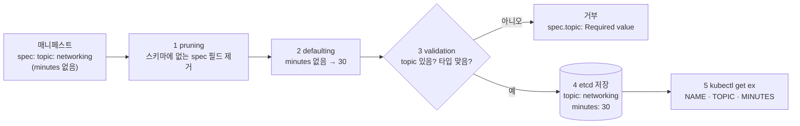

# q03 — Install a CRD and create a custom resource · 풀이

← 문제: **[question.md](question.md)**

## 문제 (해석)

**원문**

> A training team wants to track drills as first-class Kubernetes objects.
>
> 1. Create a CustomResourceDefinition with group `training.example.com`, version `v1`,
>    scope `Namespaced`, kind `Exercise`, plural `exercises`, singular `exercise` and
>    short name `ex`.
> 2. The schema must accept `spec.topic` (string, **required**) and `spec.minutes`
>    (integer, default `30`). Any other field under `spec` must not be stored.
> 3. Add two additional printer columns so `kubectl get exercises` shows `TOPIC`
>    (`.spec.topic`) and `MINUTES` (`.spec.minutes`).
> 4. In namespace `cka`, create an `Exercise` named `networkpolicy-drill` with
>    `topic: networking` and no `minutes` field.
> 5. Write the API group/version that serves this resource, and the value `minutes` ended
>    up with, to `/opt/q03/crd.txt`.

**해석**

교육팀이 훈련 항목을 쿠버네티스 오브젝트로 관리하려 한다.

1. group `training.example.com`, version `v1`, scope `Namespaced`, kind `Exercise`,
   plural `exercises`, singular `exercise`, short name `ex` 인 CustomResourceDefinition을 만든다.
2. 스키마는 `spec.topic`(string, **필수**)과 `spec.minutes`(integer, 기본값 `30`)를 받아야 한다.
   `spec` 아래 그 외 필드는 저장되지 않아야 한다.
3. `kubectl get exercises` 가 `TOPIC`(`.spec.topic`)과 `MINUTES`(`.spec.minutes`)를 보여주도록
   additional printer column 두 개를 추가한다.
4. `cka` 네임스페이스에 `Exercise` `networkpolicy-drill` 을 만든다. `topic: networking`,
   `minutes` 필드는 넣지 않는다.
5. 이 리소스를 서비스하는 API group/version과 `minutes` 가 최종적으로 가진 값을
   `/opt/q03/crd.txt` 에 적는다.

## 모범 풀이

CRD는 imperative 생성 명령이 없습니다. yaml을 직접 씁니다. `metadata.name` 은 반드시
`<plural>.<group>` 형식이어야 하고 다르면 API server가 거부합니다.

```yaml
apiVersion: apiextensions.k8s.io/v1
kind: CustomResourceDefinition
metadata:
  name: exercises.training.example.com
spec:
  group: training.example.com
  scope: Namespaced
  names: {plural: exercises, singular: exercise, kind: Exercise, shortNames: ["ex"]}
  versions:
  - name: v1
    served: true
    storage: true
    schema:
      openAPIV3Schema:
        type: object
        properties:
          spec:
            type: object
            required: ["topic"]
            properties:
              topic:
                type: string
              minutes:
                type: integer
                default: 30
    additionalPrinterColumns:
    - {name: TOPIC,   type: string,  jsonPath: .spec.topic}
    - {name: MINUTES, type: integer, jsonPath: .spec.minutes}
```

```bash
kubectl apply -f crd.yaml
kubectl wait --for=condition=Established crd/exercises.training.example.com --timeout=30s
kubectl get ns cka                       # Setup 이 만들어 둔다. 없으면 kubectl create ns cka
kubectl -n cka apply -f - <<'EOF'
apiVersion: training.example.com/v1
kind: Exercise
metadata:
  name: networkpolicy-drill
spec:
  topic: networking
EOF
```

**`apiextensions.k8s.io/v1` 은 structural schema를 강제합니다.** 모든 단계에 `type` 을 적어야
하고, 스키마에 없는 필드는 저장 전에 **잘려 나갑니다**(pruning). 문제가 "그 외 필드는 저장되지 않아야
한다"고 한 것은 이 기본 동작을 그대로 두라는 뜻입니다. `x-kubernetes-preserve-unknown-fields: true` 를
넣으면 반대로 모르는 필드를 저장하니 넣지 않습니다.

`default: 30` 도 스키마가 해 주는 일입니다. `minutes` 를 빼고 만들면 API server가 요청을 받아 저장하기
전에 30을 채우므로 `kubectl get` 에는 30이 보입니다.

### 그림 — `Exercise` 생성 요청이 API server를 지나는 과정



1. 스키마에 없는 `spec` 아래 필드는 저장 전에 잘려 나갑니다. 단, 지금 kubectl 은 기본값이 `--validate=strict`
   라서 모르는 필드를 넣으면 잘라내기 전에 `unknown field "spec.xxx"` 로 거부합니다. `--validate=false`
   (또는 `warn`)로 보내야 경고 없이(또는 경고만 내고) 조용히 잘리는 모습을 볼 수 있습니다.
2. 비어 있는 `minutes` 에는 스키마의 `default: 30` 이 채워집니다. 그래서 `crd.txt` 에 적을 값은 30입니다.
3. `required: ["topic"]` 과 `type` 을 검사합니다. `topic` 이 없거나 `minutes: "30"` 처럼 타입이 틀리면 여기서 거부됩니다.
4. 통과한 오브젝트만 etcd에 저장됩니다. `kubectl get ex -o yaml` 로 보면 `minutes: 30` 이 실제로 들어 있습니다.
5. `additionalPrinterColumns` 의 `jsonPath` 가 저장된 값을 읽어 열로 보여 줍니다. 열을 직접 정의하면 기본 `AGE` 열은 빠지고 `NAME` 만 자동으로 붙습니다.

## 검증

```bash
kubectl api-resources --api-group=training.example.com
# NAME        SHORTNAMES   APIVERSION                  NAMESPACED   KIND
# exercises   ex           training.example.com/v1     true         Exercise

kubectl -n cka get ex
# NAME                  TOPIC        MINUTES
# networkpolicy-drill   networking   30

# 필수 필드 검증이 걸리는지 확인
kubectl -n cka create -f - <<'EOF'
apiVersion: training.example.com/v1
kind: Exercise
metadata: {name: bad}
spec: {}
EOF
# Error ... spec.topic: Required value

# 모르는 필드가 잘리는지 확인 (strict 검사를 끄고 보낸다)
kubectl -n cka apply --validate=false -f - <<'EOF'
apiVersion: training.example.com/v1
kind: Exercise
metadata: {name: prune-test}
spec: {topic: x, level: hard}
EOF
kubectl -n cka get ex prune-test -o jsonpath='{.spec}{"\n"}'   # {"minutes":30,"topic":"x"}  ← level 없음
kubectl -n cka delete ex prune-test

printf 'training.example.com/v1\nminutes=30\n' > /opt/q03/crd.txt
cat /opt/q03/crd.txt
```

## 오답 원인 / 배운 점

- **왜 틀렸나**:
- **기억할 것**: CRD의 `metadata.name` 은 `<plural>.<group>` 이어야 한다. 그리고 `v1` CRD는 스키마에 없는 필드를 저장 전에 잘라낸다(지금 kubectl 은 strict 검사로 먼저 거부한다).
- **헷갈리는 지점**: `kubectl get crd` 는 CRD 정의를, `kubectl get exercises` 는 그 정의로 만든 인스턴스를 보여줍니다. 정의가 있어도 `kubectl api-resources` 에 안 나오면 API server가 아직 discovery를 갱신하지 않은 것이니 몇 초 뒤 다시 확인합니다. `served: true` 와 `storage: true` 는 다른 뜻이고, storage는 버전 중 정확히 하나만 true여야 합니다.

## 참고 문서

- 검색어: `custom resource definition versioning`
- https://kubernetes.io/docs/tasks/extend-kubernetes/custom-resources/custom-resource-definitions/
- https://kubernetes.io/docs/tasks/extend-kubernetes/custom-resources/custom-resource-definition-versioning/

---

[↑ 문항 목록](../README.md) · [← 문제로](question.md) · [다음 문제 q04 →](../q04_crictl_container_runtime/question.md)
