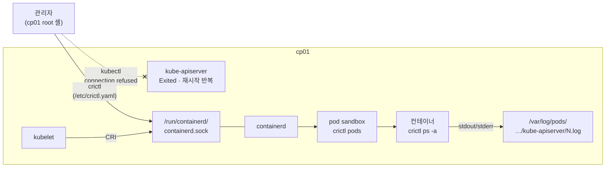

# q04 — Inspect the container runtime with crictl · 풀이

← 문제: **[question.md](question.md)**

## 문제 (해석)

**원문**

> `kubectl` on `cp01` is unusable — the API server is not answering. Work at the runtime
> level with `crictl`.
>
> 1. Write `/etc/crictl.yaml` so `crictl` needs no flags: runtime and image endpoint
>    `unix:///run/containerd/containerd.sock`, timeout `10`, debug off.
> 2. List **all** pod sandboxes on the node, including those that are not ready, and write
>    the count to `/opt/q04/sandboxes.txt`.
> 3. Find the `kube-apiserver` container, including exited ones. Write its container ID and
>    state to `/opt/q04/apiserver.txt`.
> 4. Write the last 20 log lines of that container to `/opt/q04/apiserver.log`.
> 5. From `crictl inspect`, write the container's log path on the host to
>    `/opt/q04/logpath.txt`.
> 6. List the images on the node and remove the ones no container references.

**해석**

`cp01` 의 `kubectl` 이 동작하지 않는다 — API server가 응답하지 않는다. `crictl` 로 런타임
수준에서 작업한다.

1. `crictl` 이 플래그 없이 동작하도록 `/etc/crictl.yaml` 을 작성한다. runtime/image 엔드포인트는
   `unix:///run/containerd/containerd.sock`, timeout `10`, debug는 끈다.
2. 노드의 **모든** pod sandbox를 ready가 아닌 것까지 포함해 나열하고 개수를
   `/opt/q04/sandboxes.txt` 에 적는다.
3. 종료된 것까지 포함해 `kube-apiserver` 컨테이너를 찾는다. 컨테이너 ID와 상태를
   `/opt/q04/apiserver.txt` 에 적는다.
4. 그 컨테이너의 마지막 로그 20줄을 `/opt/q04/apiserver.log` 에 적는다.
5. `crictl inspect` 로 그 컨테이너의 호스트 로그 경로를 찾아 `/opt/q04/logpath.txt` 에 적는다.
6. 노드의 이미지를 나열하고 어떤 컨테이너도 참조하지 않는 이미지를 제거한다.

## 모범 풀이

**1) 설정 파일.** 이걸 만들지 않으면 `crictl` 이 엔드포인트를 순서대로 찔러보면서 매번
deprecation 경고를 뱉습니다. 시험에서는 시간 낭비입니다.

```bash
cat <<'EOF' >/etc/crictl.yaml
runtime-endpoint: unix:///run/containerd/containerd.sock
image-endpoint: unix:///run/containerd/containerd.sock
timeout: 10
debug: false
EOF
crictl version
```

**2) sandbox 목록.** `crictl pods` 는 sandbox(= 파드), `crictl ps` 는 컨테이너입니다. 둘의 기본값이
**다릅니다.** `crictl pods` 는 필터가 없으면 Ready와 NotReady sandbox를 **전부** 보여주고 `-a`
플래그 자체가 없습니다. 반면 `crictl ps` 는 기본이 Running 컨테이너만이라 `-a` 가 필요합니다.

```bash
crictl pods                          # STATE 열에 Ready / NotReady 가 섞여 나온다
crictl pods --state notready         # NotReady 만 보고 싶을 때
crictl pods -q | wc -l > /opt/q04/sandboxes.txt
```

**3) 컨테이너 찾기**

```bash
crictl ps -a --name kube-apiserver
# CONTAINER  IMAGE  CREATED  STATE   NAME             ATTEMPT  POD ID  POD
# 3f2a1c...         2 m ago  Exited  kube-apiserver   4        9b1...  kube-apiserver-cp01
```

`--name` 은 정규식 부분 일치입니다. ID는 앞 12자만 써도 됩니다. 목록은 최근에 만든 것이 위에 옵니다.

```bash
mkdir -p /opt/q04
CID=$(crictl ps -a -q --name kube-apiserver | head -1)          # 가장 최근 시도
STATE=$(crictl inspect -o go-template --template '{{.status.state}}' "$CID")
echo "$CID $STATE" > /opt/q04/apiserver.txt                     # 예: 3f2a1c... CONTAINER_EXITED
```

`crictl inspect` 의 JSON에서 상태는 `.status.state` 에 있습니다. `-o go-template` 으로 그 값만 꺼내면
`grep` 으로 JSON을 자르다 엉뚱한 `"state"` 줄을 잡는 실수를 피할 수 있습니다. `crictl ps -a` 의 STATE
열(`Exited`, `Running`)을 그대로 적어도 됩니다.

**4~5) 로그와 로그 경로**

```bash
crictl logs --tail 20 "$CID" > /opt/q04/apiserver.log 2>&1      # kube-apiserver 는 stderr 로 로그를 쓴다
crictl inspect "$CID" | grep -i logPath
# "logPath": "/var/log/pods/kube-system_kube-apiserver-cp01_<uid>/kube-apiserver/4.log"
crictl inspect -o go-template --template '{{.status.logPath}}' "$CID" > /opt/q04/logpath.txt
```

`2>&1` 을 빼면 안 됩니다. `crictl logs` 는 컨테이너의 stdout은 stdout으로, stderr는 stderr로 그대로
내보내는데, kube-apiserver 같은 컨트롤 플레인 컴포넌트는 로그를 stderr에 씁니다. 리다이렉트를 `>` 만
하면 화면에는 로그가 보이는데 파일은 비어 있습니다.

`crictl logs <ID>` 는 **그 컨테이너 ID 한 개**의 로그입니다. 재시작할 때마다 새 컨테이너(새 ID,
ATTEMPT +1)가 생기므로, 방금 죽은 이전 시도가 궁금하면 `crictl logs -p <ID>`(= 같은 디렉터리의
`<ATTEMPT-1>.log`)를 보거나 위 `logPath` 디렉터리의 `3.log`, `2.log` 를 직접 읽습니다. kubelet이 오래된
종료 컨테이너를 정리해도 로그 파일이 남아 있는 동안은 이렇게 읽을 수 있습니다. 파일조차 없으면
`journalctl -u kubelet` 으로 sandbox 생성 실패까지 올라갑니다.

```bash
ls /var/log/pods/kube-system_kube-apiserver-cp01_*/kube-apiserver/
cat /var/log/pods/kube-system_kube-apiserver-cp01_*/kube-apiserver/3.log
```

**6) 이미지 정리**

```bash
crictl images
crictl rmi --prune        # 어떤 컨테이너(종료된 것 포함)도 참조하지 않는 이미지만 삭제
```

`--prune` 은 "지금 컨테이너 기록이 남아 있는가"만 봅니다. 정적 파드 컨테이너 기록이 정리된 뒤에
prune하면 그 이미지도 지워지고, 레지스트리에 접근할 수 없는 노드에서는 정적 파드를 다시 띄우지
못하게 됩니다. 장애 중인 컨트롤 플레인 노드에서는 목록을 먼저 확인하고 지웁니다.

### 그림 — kubectl 은 막혔는데 crictl 은 왜 되나



1. `kubectl` 은 API 서버에 말하므로 API 서버가 죽으면 아무것도 할 수 없습니다. `crictl` 은 API 서버를 거치지 않고 kubelet 과 같은 CRI 소켓(`containerd.sock`)으로 containerd 에 직접 묻습니다. `/etc/crictl.yaml` 은 이 소켓 주소를 적어 두는 파일입니다.
2. containerd 안에서 파드 하나는 sandbox 하나(`crictl pods`)이고, 그 안에 컨테이너(`crictl ps`)가 있습니다. 컨테이너가 죽고 다시 뜰 때마다 같은 sandbox 안에 새 컨테이너 ID 가 생기고 ATTEMPT 가 1 늘어납니다.
3. 컨테이너가 stdout/stderr 로 쓴 내용은 containerd 가 `/var/log/pods/.../<ATTEMPT>.log` 파일로 남깁니다. `crictl logs` 와 `crictl inspect` 의 `logPath` 는 이 파일을 가리키므로, 컨테이너가 이미 종료돼도 파일이 남아 있는 동안은 로그를 읽을 수 있습니다.

## 검증

```bash
crictl info | head -5             # 플래그 없이 동작하고 경고가 없어야 한다
crictl pods | head                # NotReady sandbox 도 기본으로 보인다
cat /opt/q04/apiserver.txt        # ID + Exited/Running
wc -l /opt/q04/apiserver.log      # 20
cat /opt/q04/logpath.txt          # /var/log/pods/kube-system_kube-apiserver-cp01_.../kube-apiserver/N.log
crictl images | wc -l             # prune 전보다 줄어든다
```

## 오답 원인 / 배운 점

- **왜 틀렸나**:
- **기억할 것**: `crictl` 은 API server를 거치지 않고 kubelet이 쓰는 CRI 소켓에 직접 말한다. 그래서 컨트롤 플레인이 죽어 `kubectl` 이 안 될 때 쓸 수 있는 도구다(노드의 `/var/log/pods` 를 직접 읽는 방법도 있다). `crictl ps` 는 기본이 Running만이라 `-a` 를 붙이고, `crictl pods` 는 기본으로 전부 보여 주며 `-a` 가 없다(좁히려면 `--state notready`).
- **헷갈리는 지점**: `crictl ps` = 컨테이너, `crictl pods` = sandbox. `docker ps` 와 이름이 같아 보이지만 `crictl rm` 은 컨테이너, `crictl rmp` 는 sandbox를 지웁니다. 그리고 `crictl logs <ID>` 는 그 ID 한 개의 로그이므로, 이전 크래시 원인은 `crictl logs -p` 나 `/var/log/pods/.../<N>.log` 에서 봐야 합니다.

## 참고 문서

- 검색어: `debugging kubernetes nodes with crictl`
- https://kubernetes.io/docs/tasks/debug/debug-cluster/crictl/

## 복습 기록

| 날짜 | 결과 | 메모 |
|---|---|---|
|  |  |  |
