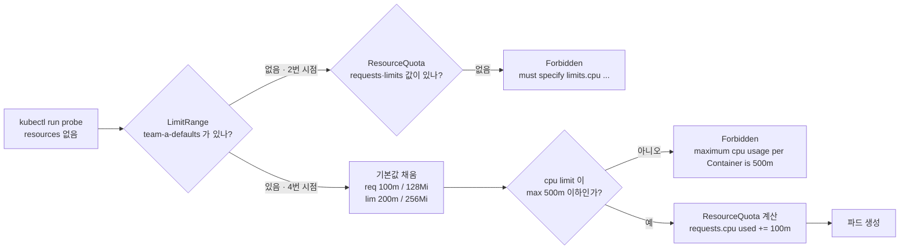

# q06 — Constrain a namespace with ResourceQuota and LimitRange · 풀이

← 문제: **[question.md](question.md)**

## 문제 (해석)

**원문**

> Namespace `team-a` must be capped, and its users must not have to write resource fields
> by hand.
>
> 1. Create namespace `team-a` and a ResourceQuota named `team-a-quota` with
>    `requests.cpu: "1"`, `requests.memory: 1Gi`, `limits.cpu: "2"`,
>    `limits.memory: 2Gi`, `pods: "10"`, `configmaps: "5"`.
> 2. Try to create a pod named `probe` with image `nginx:1.27` and **no** resource fields.
>    Write the exact rejection message to `/opt/q06/rejected.txt`.
> 3. Create a LimitRange named `team-a-defaults` for `Container` with
>    `defaultRequest` cpu `100m` / memory `128Mi`, `default` cpu `200m` /
>    memory `256Mi`, and `max` cpu `500m`.
> 4. Create `probe` again, still with no resource fields, and show the values it was given.
> 5. Show the quota's used-versus-hard figures and confirm `requests.cpu` used is `100m`.

**해석**

`team-a` 네임스페이스에 상한을 걸어야 하고, 사용자가 리소스 필드를 직접 쓰지 않아도 되게 해야 한다.

1. 네임스페이스 `team-a` 와 ResourceQuota `team-a-quota` 를 만든다. `requests.cpu: "1"`,
   `requests.memory: 1Gi`, `limits.cpu: "2"`, `limits.memory: 2Gi`, `pods: "10"`,
   `configmaps: "5"`.
2. 이미지 `nginx:1.27`, 리소스 필드 **없는** 파드 `probe` 를 만들어 본다. 거부 메시지를 그대로
   `/opt/q06/rejected.txt` 에 적는다.
3. `Container` 대상 LimitRange `team-a-defaults` 를 만든다. `defaultRequest` cpu `100m` /
   memory `128Mi`, `default` cpu `200m` / memory `256Mi`, `max` cpu `500m`.
4. 여전히 리소스 필드 없이 `probe` 를 다시 만들고, 주입된 값을 확인한다.
5. 쿼터의 used 대 hard 수치를 보이고 `requests.cpu` used가 `100m` 인지 확인한다.

## 모범 풀이

```bash
kubectl create namespace team-a
kubectl -n team-a create quota team-a-quota \
  --hard=requests.cpu=1,requests.memory=1Gi,limits.cpu=2,limits.memory=2Gi,pods=10,configmaps=5
```

**2) 거부를 먼저 직접 보는 것이 이 문제의 목적입니다.**

```bash
kubectl -n team-a run probe --image=nginx:1.27
```

```
Error from server (Forbidden): pods "probe" is forbidden: failed quota: team-a-quota:
must specify limits.cpu for: probe; limits.memory for: probe;
requests.cpu for: probe; requests.memory for: probe
```

쿼터가 `requests.*` 나 `limits.*` 를 하나라도 제한하면, **그 항목을 명시하지 않은 파드는 전부
거부됩니다.** 쿼터는 쓰지 않은 값을 0으로 보지 않고 "계산할 수 없음"으로 보기 때문입니다.
이것이 두 오브젝트를 같이 쓰는 이유이고, 시험에서 가장 자주 나오는 함정입니다.

**3) LimitRange 로 기본값을 채웁니다.**

```yaml
apiVersion: v1
kind: LimitRange
metadata:
  name: team-a-defaults
  namespace: team-a
spec:
  limits:
  - type: Container
    defaultRequest:          # requests 가 없을 때 채워지는 값
      cpu: 100m
      memory: 128Mi
    default:                 # limits 가 없을 때 채워지는 값
      cpu: 200m
      memory: 256Mi
    max:
      cpu: 500m
```

```bash
kubectl apply -f limitrange.yaml
kubectl -n team-a run probe --image=nginx:1.27      # 이제 통과한다
```

`default` 가 limit, `defaultRequest` 가 request입니다. 이름이 직관과 반대로 느껴지는 부분이라
자주 뒤집습니다. `max` 는 기본값을 주는 것이 아니라 **검증**입니다 — cpu limit이 `500m` 을 넘는
파드는 쿼터에 여유가 있어도 LimitRange가 거부합니다.

LimitRange는 admission 시점에만 동작합니다. 이미 떠 있는 파드에 소급 적용되지 않으므로,
순서를 거꾸로 해서 파드를 먼저 만들었다면 다시 만들어야 합니다.

### 그림 — `probe` 생성 요청이 거치는 어드미션



1. LimitRange 는 쿼터보다 먼저 동작해서, 비어 있는 requests·limits 를 `defaultRequest`·`default` 로 채웁니다.
2. 2번 시점에는 LimitRange 가 없으므로 파드가 빈 값으로 쿼터에 도착하고, 쿼터는 계산할 수 없는 파드라서 거부합니다.
3. 4번 시점에는 값이 채워진 채로 도착합니다. LimitRange 가 `max` 를 검사하고, 통과하면 쿼터가 used 에 `100m` 을 더하고 파드가 만들어집니다.
4. 같은 흐름에서 `limits.cpu: 900m` 을 직접 쓴 파드는 기본값 단계를 지나도 `max` 검사에서 거부됩니다. 검증 마지막의 `big` 파드가 이 경우입니다.

## 검증

```bash
kubectl -n team-a get pod probe \
  -o jsonpath='{.spec.containers[0].resources}{"\n"}'
# {"limits":{"cpu":"200m","memory":"256Mi"},"requests":{"cpu":"100m","memory":"128Mi"}}

kubectl -n team-a describe quota team-a-quota
# Resource         Used   Hard
# configmaps       1      5
# limits.cpu       200m   2
# limits.memory    256Mi  2Gi
# pods             1      10
# requests.cpu     100m   1
# requests.memory  128Mi  1Gi

# max 검증이 실제로 걸리는지 확인 — kubectl run 에는 --limits/--requests 플래그가 없다
kubectl -n team-a apply -f - <<'EOF'
apiVersion: v1
kind: Pod
metadata: { name: big }
spec:
  containers:
  - name: big
    image: nginx:1.27
    resources: { limits: { cpu: 900m } }
EOF
# Error ... maximum cpu usage per Container is 500m, but limit is 900m
```

`kubectl run` 의 `--requests`/`--limits` 는 오래전에 제거되었습니다. 리소스가 필요한 파드는 yaml을
쓰거나, Deployment라면 `kubectl set resources` 를 씁니다.

## 오답 원인 / 배운 점

- **왜 틀렸나**:
- **기억할 것**: 쿼터가 `requests`/`limits` 를 제한하면 리소스를 안 쓴 파드는 거부된다. LimitRange의 `default`/`defaultRequest` 가 그것을 메운다. 두 오브젝트는 한 쌍으로 쓴다.
- **헷갈리는 지점**: `default` = limits 기본값, `defaultRequest` = requests 기본값. `max`/`min` 은 기본값이 아니라 거부 기준입니다. 또 쿼터 항목 이름은 `requests.cpu` 이지만 `cpu` 라고만 써도 같은 뜻이고, `count/deployments.apps` 처럼 오브젝트 개수도 제한할 수 있습니다.

## 참고 문서

- 검색어: `resource quotas`
- https://kubernetes.io/docs/concepts/policy/resource-quotas/
- https://kubernetes.io/docs/concepts/policy/limit-range/

---

[↑ 문항 목록](../README.md) · [← 문제로](question.md) · [다음 문제 q07 →](../q07_priorityclass_preemption/question.md)
