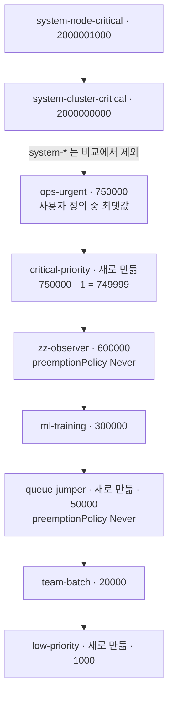
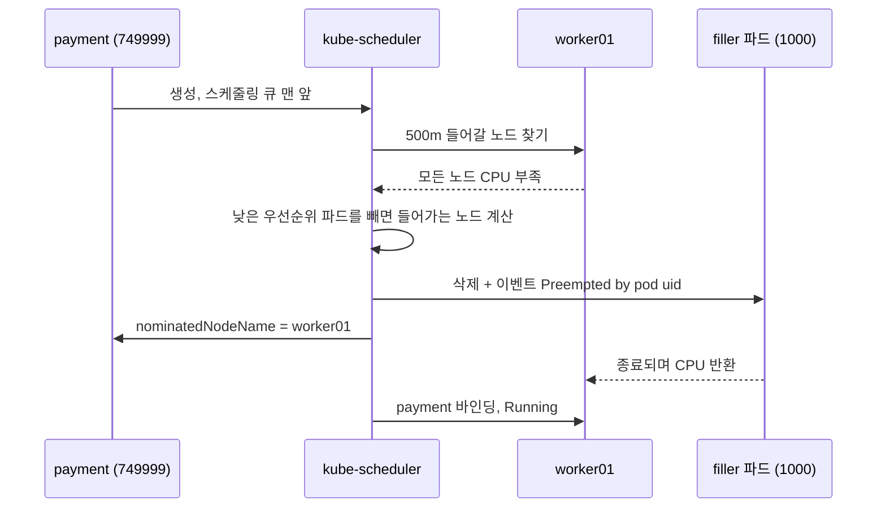

# q07 — Pod priority and preemption · 풀이

← 문제: **[question.md](question.md)**

## 문제 (해석)

**원문**

> Namespace `sched` runs batch filler work that must yield to payment processing. Other
> teams have already created user-defined PriorityClasses in this cluster, all with values
> above `10000`.
>
> 1. Create three PriorityClasses, none of them `globalDefault`:
>    - `critical-priority`, description `payment path`, whose value is **one less than the
>      highest user-defined PriorityClass that already exists** (ignore the built-in
>      `system-*` classes)
>    - `low-priority`, value `1000`
>    - `queue-jumper`, value `50000`, which must **never** evict another pod
> 2. In `sched`, create deployment `filler` with image `nginx:1.27`, priority class
>    `low-priority` and each container requesting `cpu: 400m`, with enough replicas that the
>    cluster's allocatable CPU is exhausted and at least one replica stays `Pending`.
> 3. Create pod `payment` in `sched` with image `nginx:1.27`, priority class
>    `critical-priority`, requesting `cpu: 500m`.
> 4. Show that `payment` becomes scheduled and that a `filler` pod was preempted. Write the
>    event message naming the preemptor to `/opt/q07/preempt.txt`.
> 5. Write to `/opt/q07/never.txt` what `queue-jumper` still gains from its high value,
>    given that it cannot preempt.

**해석**

`sched` 네임스페이스에서 배치 채우기 작업이 결제 처리에 자리를 양보해야 한다. 이 클러스터에는 다른
팀이 만든 사용자 정의 PriorityClass가 이미 있고, 값은 모두 `10000` 보다 크다.

1. PriorityClass 세 개를 만든다. 어느 것도 `globalDefault` 가 아니다.
   - `critical-priority`, description `payment path`, 값은 **이미 존재하는 사용자 정의
     PriorityClass 중 가장 큰 값보다 1 작게** (내장 `system-*` 클래스는 제외)
   - `low-priority`, value `1000`
   - `queue-jumper`, value `50000`, 다른 파드를 **절대** evict하지 않아야 한다
2. `sched` 에 deployment `filler` 를 만든다. image `nginx:1.27`, priority class `low-priority`,
   각 컨테이너가 `cpu: 400m` 을 요청하고, 클러스터 allocatable CPU가 고갈되어 최소 한 replica가
   `Pending` 으로 남을 만큼 replica를 준다.
3. `sched` 에 파드 `payment` 를 만든다. image `nginx:1.27`, priority class
   `critical-priority`, `cpu: 500m` 요청.
4. `payment` 가 스케줄되고 `filler` 파드 하나가 preempt되었음을 보인다. preemptor를 지목하는
   이벤트 메시지를 `/opt/q07/preempt.txt` 에 적는다.
5. `queue-jumper` 가 preempt를 못 하는데도 높은 value로부터 얻는 것이 무엇인지
   `/opt/q07/never.txt` 에 적는다.

## 모범 풀이

**1) 기존 최댓값부터 구합니다 — 새 클래스를 만들기 전에**

"이미 존재하는" 값이 기준이므로, `queue-jumper`(50000)처럼 이번에 만들 클래스가 섞이기 전에 먼저
계산합니다. 내장 `system-cluster-critical`(20억)과 `system-node-critical` 은 제외합니다.

```bash
kubectl get priorityclass --sort-by=.value
# NAME                      VALUE        GLOBAL-DEFAULT
# team-batch                20000        false
# ml-training               300000       false
# zz-observer               600000       false
# ops-urgent                750000       false
# system-cluster-critical   2000000000   false
# system-node-critical      2000001000   false

kubectl get pc -o jsonpath='{range .items[*]}{.metadata.name}{" "}{.value}{"\n"}{end}' \
  | grep -v '^system-' | sort -k2 -n | tail -1
# ops-urgent 750000        → critical-priority = 749999
```

```yaml
apiVersion: scheduling.k8s.io/v1
kind: PriorityClass
metadata:
  name: critical-priority
value: 749999                   # 위에서 구한 최댓값 - 1 (환경마다 다르다)
globalDefault: false
description: "payment path"
---
apiVersion: scheduling.k8s.io/v1
kind: PriorityClass
metadata:
  name: low-priority
value: 1000
globalDefault: false
---
apiVersion: scheduling.k8s.io/v1
kind: PriorityClass
metadata:
  name: queue-jumper
value: 50000
globalDefault: false
preemptionPolicy: Never
```

PriorityClass는 네임스페이스가 없는 클러스터 범위 오브젝트입니다. `-n` 을 붙여도 무시됩니다.
yaml 대신 명령 한 줄씩으로도 됩니다(`--global-default` 는 기본 false).

```bash
kubectl create priorityclass critical-priority --value=749999 --description="payment path"
kubectl create priorityclass low-priority --value=1000
kubectl create priorityclass queue-jumper --value=50000 --preemption-policy=Never
```

### 그림 1 — 값 순서와 기준값



1. `system-*` 두 개를 빼면 맨 위는 `ops-urgent`(750000)이므로 `critical-priority` 는 `749999` 입니다.
2. `queue-jumper`(50000)는 이번에 만드는 클래스라 기준에 넣지 않습니다. 만들기 전에 최댓값을 구해 두면 헷갈릴 일이 없습니다.
3. 이름순 마지막인 `zz-observer` 는 최댓값이 아닙니다. `--sort-by=.value` 로 값 기준 정렬을 봐야 합니다.

**2) filler — 매니페스트 하나로, 한 번에**

replica 수는 클러스터 크기에 따라 다릅니다. 워커의 allocatable CPU에서 이미 요청된 양을 빼고,
`400m` 로 나눈 몫보다 하나 이상 많게 잡습니다(컨트롤 플레인은 taint 때문에 보통 제외).

```bash
kubectl get nodes -o custom-columns=NAME:.metadata.name,CPU:.status.allocatable.cpu
kubectl describe nodes | grep -A5 'Allocated resources'     # 노드별 이미 요청된 cpu
# 예: 워커 2대 × 2000m, 이미 약 500m 요청 → 여유 약 3500m → 400m 파드 8개까지 → replicas 9
```

```bash
kubectl create namespace sched
kubectl -n sched create deploy filler --image=nginx:1.27 --replicas=9 \
  --dry-run=client -o yaml > filler.yaml
vi filler.yaml     # 파드 템플릿에 priorityClassName 과 resources 를 넣는다
```

```yaml
    spec:
      priorityClassName: low-priority
      containers:
      - name: nginx
        image: nginx:1.27
        resources:
          requests:
            cpu: 400m
```

```bash
kubectl apply -f filler.yaml
kubectl -n sched get pods -l app=filler      # 하나 이상 Pending 이어야 다음 단계가 의미 있다
```

`create deploy` → `set resources` → `patch priorityClassName` 처럼 나눠 바꾸면 매번 롤아웃이 일어나
리비전이 3개 생깁니다. 게다가 중간 리비전 파드는 priority class가 없어 우선순위 0이라, CPU가 모자란
상태에서 새 파드(1000)에게 선점당하며 뒤엉킵니다. `kubectl run` / `create deploy` 에는
`--priority-class-name` 플래그가 없으므로, dry-run yaml에 한 번에 넣는 것이 깔끔합니다.

**3) payment**

```yaml
apiVersion: v1
kind: Pod
metadata:
  name: payment
  namespace: sched
spec:
  priorityClassName: critical-priority
  containers:
  - name: web
    image: nginx:1.27
    resources:
      requests:
        cpu: 500m
```

**4) preemption 확인**

**preempt는 `Pending` 인 파드가 있을 때만 일어납니다.** 스케줄러가 `payment` 를 놓을 노드를
찾지 못하면, 그 노드에서 자신보다 우선순위가 낮은 파드를 골라 삭제하고 자리를 만듭니다. 그래서
2번에서 실제로 CPU를 고갈시켜 `Pending` 상태를 만들어야 하며, 여유가 남아 있으면 아무 일도
일어나지 않아 4번을 증명할 수 없습니다. 피해자 파드에는 종료 전에 이벤트가 남습니다.

```bash
kubectl -n sched get events --field-selector reason=Preempted
# LAST SEEN   TYPE     REASON      OBJECT                       MESSAGE
# 20s         Normal   Preempted   pod/filler-6d9c...-x7k2p     Preempted by pod 3f1c...-... on node worker01

kubectl -n sched get pod payment -o jsonpath='{.metadata.uid}{"\n"}'   # 메시지의 uid 와 같아야 한다
kubectl -n sched get events --field-selector reason=Preempted \
  -o jsonpath='{.items[-1:].message}{"\n"}' > /opt/q07/preempt.txt
```

최근 버전의 스케줄러는 메시지에 preemptor 를 이름이 아니라 **파드 UID** 로 적습니다. 그래서
`payment` 의 `metadata.uid` 와 맞춰 봐야 "preemptor 를 지목하는 메시지"임을 확인할 수 있습니다.
쫓겨난 `filler` 파드는 Deployment 가 곧바로 다시 만들고, 그 새 파드는 자리가 없어 `Pending` 이 됩니다.
노드에 남은 여유가 100m 보다 작으면 `500m` 을 만들기 위해 `filler` 두 개가 함께 밀려날 수도 있습니다.

### 그림 2 — 선점이 일어나는 순서



1. `payment` 는 우선순위가 높아 스케줄링 큐 맨 앞에서 심사받지만, 어느 노드에도 `500m` 이 남아 있지 않습니다.
2. 스케줄러는 자신보다 우선순위가 낮은 파드(`filler`, 1000)를 빼면 들어갈 수 있는 노드를 고르고, 최소한의 피해자를 삭제합니다.
3. 피해자에게 `Preempted` 이벤트가 남고, `payment` 에는 `nominatedNodeName` 이 붙어 그 자리를 예약합니다.
4. 피해자가 graceful 종료로 CPU 를 돌려주면 `payment` 가 바인딩되어 `Running` 이 됩니다. `queue-jumper` 처럼 `preemptionPolicy: Never` 인 파드는 2단계를 건너뛰고 1단계에서 기다리기만 합니다.

**5) queue-jumper** — `preemptionPolicy: Never` 는 우선순위를 없애는 것이 아닙니다. 그 파드는
**스케줄링 큐에서는 여전히 앞자리**를 차지해 낮은 우선순위 파드보다 먼저 심사받습니다. 다만 자리가
없으면 남을 쫓아내지 않고 `Pending` 으로 기다립니다. 즉 "새치기는 하지만 쫓아내지는 않는다"가 답입니다. 반대로 자기보다 높은 우선순위 파드에게는
여전히 선점당할 수 있습니다.

```bash
echo "higher position in the scheduling queue (scheduled before lower-priority pending pods), but it waits instead of evicting" > /opt/q07/never.txt
```

## 검증

```bash
kubectl get priorityclass --sort-by=.value
# low-priority 1000 / queue-jumper 50000 / critical-priority <기존 최댓값-1> ...

kubectl -n sched get pod payment -o wide          # Running, 노드 배정됨
kubectl -n sched get pods -l app=filler           # 하나 이상이 Pending 으로 밀려난다
kubectl -n sched get pod payment \
  -o jsonpath='{.spec.priority}{"\n"}'            # critical-priority 의 값 (admission 이 채워 넣는다)
kubectl -n sched get deploy filler -o jsonpath='{.metadata.generation}{"\n"}'   # 1 — 한 번에 만들었다
cat /opt/q07/preempt.txt /opt/q07/never.txt
```

## 오답 원인 / 배운 점

- **왜 틀렸나**:
- **기억할 것**: preempt는 고우선순위 파드가 `Pending` 으로 막혔을 때만 발동한다. 클러스터에 여유가 있으면 우선순위는 아무것도 하지 않는다. "기존 최댓값 - 1" 같은 값은 `system-*` 를 빼고, 새 클래스를 만들기 **전에** 계산한다.
- **헷갈리는 지점**: `preemptionPolicy: Never` 와 낮은 value는 다릅니다 — 전자는 큐 우선권은 유지하고 축출만 포기합니다. 그리고 `globalDefault: true` 는 클러스터 전체에서 단 하나만 허용되고, `priorityClassName` 을 안 쓴 파드에만 적용되며, 이미 존재하는 파드의 priority는 바뀌지 않습니다. `spec.priority` 는 직접 쓰지 않습니다 — admission이 클래스에서 복사합니다.

## 참고 문서

- 검색어: `pod priority and preemption`
- https://kubernetes.io/docs/concepts/scheduling-eviction/pod-priority-preemption/

---

[↑ 문항 목록](../README.md) · [← 문제로](question.md) · [다음 문제 q08 →](../q08_gateway_api_httproute/question.md)
