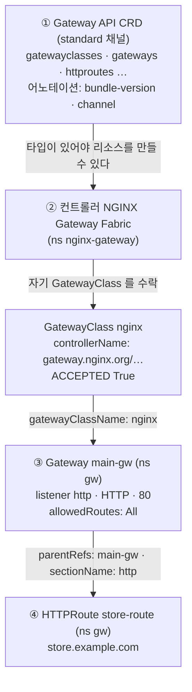
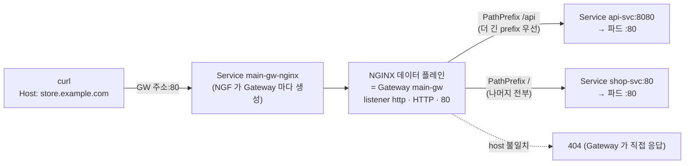

# q08 — Expose a service with the Gateway API · 풀이

← 문제: **[question.md](question.md)**

## 문제 (해석)

**원문**

> The cluster has an NGINX Gateway controller installed, registered as GatewayClass `nginx`.
>
> 1. Make sure the Gateway API **standard** CRDs are installed at a version the controller
>    supports (install them if missing), confirm `gateway.networking.k8s.io/v1` is served and
>    that GatewayClass `nginx` is `Accepted`, and write the installed bundle version and
>    channel to `/opt/q08/gateway-api.txt`.
> 2. In namespace `gw`, create deployment/service `shop-svc` (`nginx:1.27`, service port
>    `80`) and deployment/service `api-svc` (`nginx:1.27`, service port `8080` to container
>    port `80`).
> 3. Create a `Gateway` named `main-gw` in `gw` using gatewayClassName `nginx`, with one
>    listener named `http`, protocol `HTTP`, port `80`, accepting HTTPRoutes **from all
>    namespaces**.
> 4. Create an `HTTPRoute` named `store-route` in `gw` attached to `main-gw`, for hostname
>    `store.example.com`, routing `PathPrefix` `/api` to `api-svc:8080` and `PathPrefix`
>    `/` to `shop-svc:80`.
> 5. Confirm the Gateway listener is `Programmed` and that the HTTPRoute reports
>    `Accepted=True` and `ResolvedRefs=True`.

**해석**

클러스터에 NGINX Gateway 컨트롤러가 설치되어 있고 GatewayClass `nginx` 로 등록되어 있다.

1. Gateway API **standard** CRD가 컨트롤러가 지원하는 버전으로 설치되어 있는지 확인하고(없으면
   설치), `gateway.networking.k8s.io/v1` 이 서비스되며 GatewayClass `nginx` 가 `Accepted` 인지
   확인한 뒤, 설치된 번들 버전과 채널을 `/opt/q08/gateway-api.txt` 에 적는다.
2. `gw` 네임스페이스에 deployment/service `shop-svc`(`nginx:1.27`, service port `80`)와
   `api-svc`(`nginx:1.27`, service port `8080` → container port `80`)를 만든다.
3. `gw` 에 gatewayClassName `nginx` 인 `Gateway` `main-gw` 를 만든다. listener 한 개,
   이름 `http`, protocol `HTTP`, port `80`, HTTPRoute를 **모든 네임스페이스에서** 받는다.
4. `gw` 에 `main-gw` 에 붙는 `HTTPRoute` `store-route` 를 만든다. hostname
   `store.example.com`, `PathPrefix` `/api` → `api-svc:8080`, `PathPrefix` `/` → `shop-svc:80`.
5. Gateway listener가 `Programmed` 이고 HTTPRoute가 `Accepted=True`, `ResolvedRefs=True`
   인지 확인한다.

## 모범 풀이

**1) CRD 확인·설치.** Gateway API는 쿠버네티스에 내장되어 있지 않습니다. CRD가 없으면
`kubectl get gateway` 가 `the server doesn't have a resource type "gateway"` 를 냅니다. CRD에는
번들 버전과 채널이 어노테이션으로 붙어 있어서 무엇이 깔렸는지 바로 읽을 수 있습니다.

```bash
kubectl get crd | grep gateway.networking.k8s.io
kubectl get crd gateways.gateway.networking.k8s.io -o jsonpath=\
'{.metadata.annotations.gateway\.networking\.k8s\.io/bundle-version}{" "}{.metadata.annotations.gateway\.networking\.k8s\.io/channel}{"\n"}' \
  | tee /opt/q08/gateway-api.txt
# v1.x.y standard          ← 이 레포의 setup.sh 로 만든 환경이면 v1.6.1 standard
```

없거나 컨트롤러가 요구하는 버전보다 낮으면 설치합니다. 버전은 **컨트롤러 문서가 지원한다고 적은
버전**에 맞춥니다(최신이 항상 맞는 것은 아닙니다). CRD가 커서 클라이언트 측 apply는 어노테이션 크기
제한에 걸릴 수 있으므로 `--server-side` 로 적용합니다.

```bash
kubectl apply --server-side -f \
  https://github.com/kubernetes-sigs/gateway-api/releases/download/<version>/standard-install.yaml
kubectl api-resources --api-group=gateway.networking.k8s.io
kubectl get gatewayclass nginx
# NAME    CONTROLLER                                   ACCEPTED
# nginx   gateway.nginx.org/nginx-gateway-controller   True
```

standard 채널에는 GatewayClass / Gateway / HTTPRoute / GRPCRoute / ReferenceGrant 처럼 GA·beta에
올라온 타입이 들어 있습니다. 아직 실험 단계인 타입(TCPRoute, UDPRoute 등)은 `experimental-install.yaml`
쪽이고, 어느 타입이 standard로 올라왔는지는 릴리스마다 다르니 릴리스 노트로 확인합니다.

**2) 백엔드**

```bash
kubectl create namespace gw
kubectl -n gw create deploy shop-svc --image=nginx:1.27
kubectl -n gw expose deploy shop-svc --port=80
kubectl -n gw create deploy api-svc --image=nginx:1.27
kubectl -n gw expose deploy api-svc --port=8080 --target-port=80
```

**3~4) Gateway 와 HTTPRoute**

```yaml
apiVersion: gateway.networking.k8s.io/v1
kind: Gateway
metadata: {name: main-gw, namespace: gw}
spec:
  gatewayClassName: nginx
  listeners:
  - name: http
    protocol: HTTP
    port: 80
    allowedRoutes:
      namespaces:
        from: All
---
apiVersion: gateway.networking.k8s.io/v1
kind: HTTPRoute
metadata: {name: store-route, namespace: gw}
spec:
  parentRefs:
  - name: main-gw
    sectionName: http          # listener 의 이름. 포트가 아니다
  hostnames:
  - store.example.com
  rules:
  - matches:
    - path: {type: PathPrefix, value: /api}
    backendRefs:
    - {name: api-svc, port: 8080}
  - matches:
    - path: {type: PathPrefix, value: /}
    backendRefs:
    - {name: shop-svc, port: 80}
```

**`allowedRoutes.namespaces.from` 의 기본값은 `Same` 입니다.** 즉 아무것도 안 쓰면 Gateway와
같은 네임스페이스의 route만 붙습니다. 다른 네임스페이스의 HTTPRoute는 에러 없이 그냥 무시되고,
route의 `status.parents[].conditions` 에 `Accepted=False, reason: NotAllowedByListeners` 로만
남습니다. 문제가 "모든 네임스페이스"라고 했으니 `from: All` 을 명시해야 합니다.

`backendRefs[].port` 는 **Service의 포트**입니다. 컨테이너 포트가 아닙니다. 여기가 틀리면
`ResolvedRefs` 가 False가 되거나 트래픽이 503으로 떨어집니다.

경로 우선순위는 Ingress와 마찬가지로 **가장 긴 경로가 먼저**입니다. Gateway API는 동점일 때의
순서까지 스펙에 정해 두었습니다 — Exact 경로 > 더 긴 Prefix > 메서드 일치 > 헤더 매치 수 > 쿼리 매치 수.
그래서 `/api` 와 `/` 의 순서를 yaml에서 신경 쓸 필요가 없습니다.

### 설치 계층 — 무엇이 먼저 있어야 하나



1. CRD 가 먼저입니다. CRD 가 없으면 `kubectl get gateway` 부터 "resource type 없음" 에러가 나고, 컨트롤러도 감시할 타입이 없어 뜨지 못합니다. 번들 버전과 채널은 CRD 의 어노테이션에서 읽습니다.
2. 컨트롤러가 떠서 자기 `controllerName` 과 같은 GatewayClass 를 찾아 `Accepted=True` 로 표시합니다. 이 상태가 1번에서 확인할 전제입니다.
3. Gateway 는 `gatewayClassName` 으로 그 GatewayClass 를 가리키고, 컨트롤러가 실제 NGINX 데이터 플레인을 띄우면 `Programmed=True` 가 됩니다.
4. HTTPRoute 는 `parentRefs` 로 Gateway 의 listener 에 붙습니다. 붙었는지는 route 의 `Accepted`, backend 가 맞는지는 `ResolvedRefs` 로 봅니다.

### 트래픽 흐름



1. 요청은 Gateway 주소의 80 포트로 들어와 `main-gw-nginx` Service 를 거쳐 NGINX 데이터 플레인에 닿습니다. NodePort 설치라 클러스터 밖에서는 `<노드IP>:<NodePort>` 로 같은 곳에 들어옵니다.
2. listener `http` 에 붙은 route 중 Host 가 `store.example.com` 인 `store-route` 가 선택됩니다. Host 가 다르면 맞는 route 가 없어 Gateway 가 404 를 돌려줍니다.
3. 경로가 `/api` 로 시작하면 `api-svc` 의 Service 포트 8080 으로 가고, Service 가 파드의 80 으로 넘깁니다. `backendRefs.port` 에 컨테이너 포트 80 을 쓰면 틀립니다.
4. 그 밖의 경로는 모두 `/` 규칙에 걸려 `shop-svc:80` 으로 갑니다. yaml 에서 규칙 순서가 바뀌어도 더 긴 prefix 인 `/api` 가 먼저 매칭됩니다.

## 검증

```bash
kubectl -n gw get gateway main-gw
# NAME      CLASS   ADDRESS        PROGRAMMED   AGE
# main-gw   nginx   10.96.12.34    True

kubectl -n gw get httproute store-route -o yaml | grep -A8 'conditions:'
# type: Accepted      status: "True"   reason: Accepted
# type: ResolvedRefs  status: "True"   reason: ResolvedRefs

ADDR=$(kubectl -n gw get gateway main-gw -o jsonpath='{.status.addresses[0].value}')
curl -s -H 'Host: store.example.com' http://$ADDR/ | grep -o '<title>.*</title>'   # Welcome to nginx! (shop-svc)
curl -s -o /dev/null -w '%{http_code}\n' -H 'Host: store.example.com' http://$ADDR/api/   # 404 — api-svc 의 nginx 에 /api 파일이 없어서
kubectl -n gw logs deploy/api-svc --tail=1        # 방금 보낸 "GET /api/" 가 찍혀 있으면 api-svc 로 간 것
curl -s -o /dev/null -w '%{http_code}\n' http://$ADDR/                # 404 (host 불일치 — Gateway 가 직접 응답)
# 주소에 닿지 않는 랩이면: kubectl -n gw get svc main-gw-nginx 로 NodePort 확인 → <노드IP>:<NodePort> 로 같은 curl
```

두 백엔드가 같은 `nginx:1.27` 이라 응답 본문으로는 구분되지 않습니다. `/api/` 는 api-svc 의 nginx 가 파일을
못 찾아 404 를 내므로, 어느 쪽으로 갔는지는 **백엔드 파드의 access 로그**로 확인합니다. Gateway 가 낸 404(맞는
route 없음)와 백엔드가 낸 404 는 로그가 찍히는 곳이 다릅니다.

## 오답 원인 / 배운 점

- **왜 틀렸나**:
- **기억할 것**: Gateway API CRD는 별도 설치(컨트롤러가 지원하는 버전의 `standard-install.yaml`, `--server-side`)가 필요하고, listener의 `allowedRoutes.namespaces.from` 기본값은 `Same` 이다.
- **헷갈리는 지점**: 상태 조건 세 개가 각각 다른 문제를 가리킵니다 — Gateway의 `Programmed` 는 컨트롤러가 실제로 프록시를 설정했다는 뜻, route의 `Accepted` 는 listener가 route를 받아들였다는 뜻, `ResolvedRefs` 는 backendRef가 실제 Service/포트로 해석되었다는 뜻입니다. 문제가 생기면 이 순서로 읽습니다. `parentRefs` 의 `sectionName` 은 listener **이름**이고 포트가 아닙니다.

## 참고 문서

- 검색어: `gateway api`
- https://kubernetes.io/docs/concepts/services-networking/gateway/
- https://gateway-api.sigs.k8s.io/guides/

---

[↑ 문항 목록](../README.md) · [← 문제로](question.md) · [다음 문제 q09 →](../q09_networkpolicy_ingress_egress/question.md)
