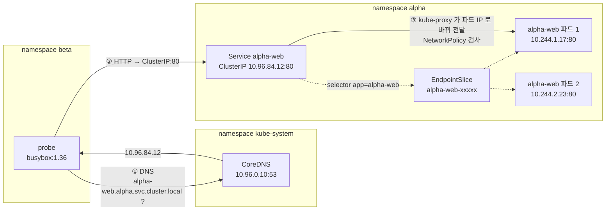

# q10 — Verify pod-to-pod connectivity across namespaces · 풀이

← 문제: **[question.md](question.md)**

## 문제 (해석)

**원문**

> A team claims pods in one namespace cannot talk to a service in another. Prove or
> disprove it.
>
> 1. In namespace `alpha`, create deployment `alpha-web` (`nginx:1.27`, 2 replicas) and
>    expose it as a ClusterIP service `alpha-web` on port `80`.
> 2. In namespace `beta`, create a long-running pod named `probe` using image
>    `busybox:1.36` that does not restart.
> 3. From `probe`, resolve `alpha-web` using its **short name** and then its FQDN. Write
>    both results and the resolved ClusterIP to `/opt/q10/dns.txt`.
> 4. Write the pod IPs currently backing the service, read from the EndpointSlice, to
>    `/opt/q10/endpoints.txt`, then show an HTTP request from `probe` actually succeeding.
> 5. Write to `/opt/q10/triage.txt` the one decisive command for each of the three layers
>    that can break this: DNS, Service/EndpointSlice, NetworkPolicy.

**해석**

한 팀이 자기 네임스페이스의 파드가 다른 네임스페이스의 서비스에 못 닿는다고 주장한다. 사실인지
확인한다.

1. `alpha` 네임스페이스에 deployment `alpha-web`(`nginx:1.27`, replica 2)를 만들고 포트 `80`
   ClusterIP 서비스 `alpha-web` 으로 노출한다.
2. `beta` 네임스페이스에 `busybox:1.36` 이미지로 재시작하지 않고 계속 도는 파드 `probe` 를 만든다.
3. `probe` 에서 `alpha-web` 을 **짧은 이름**으로, 이어서 FQDN으로 해석한다. 두 결과와 해석된
   ClusterIP를 `/opt/q10/dns.txt` 에 적는다.
4. 현재 서비스를 받치는 파드 IP를 EndpointSlice에서 읽어 `/opt/q10/endpoints.txt` 에 적고,
   `probe` 에서 HTTP 요청이 실제로 성공하는 것을 보인다.
5. 이 경로를 깨뜨릴 수 있는 세 계층(DNS, Service/EndpointSlice, NetworkPolicy)에 대해 각각
   결정적인 명령 하나를 `/opt/q10/triage.txt` 에 적는다.

## 모범 풀이

```bash
kubectl create namespace alpha
kubectl create namespace beta
mkdir -p /opt/q10                     # 답안 디렉터리 (없을 때를 대비)
kubectl -n alpha create deploy alpha-web --image=nginx:1.27 --replicas=2
kubectl -n alpha expose deploy alpha-web --port=80
kubectl -n beta run probe --image=busybox:1.36 --restart=Never --command -- sleep 86400
```

`busybox` 를 그냥 `kubectl run` 하면 즉시 종료해 `CrashLoopBackOff` 가 됩니다. `sleep` 을
줘야 조사용 파드로 쓸 수 있습니다. "재시작하지 않는" 파드이므로 `--restart=Never` 로
`restartPolicy: Never` 를 줍니다(기본값은 `Always`).

**3) DNS.** 짧은 이름은 실패하고 FQDN은 성공합니다. 이것이 정상 동작입니다.

```bash
kubectl -n beta exec probe -- nslookup alpha-web
# ** server can't find alpha-web.beta.svc.cluster.local: NXDOMAIN
# ** server can't find alpha-web.svc.cluster.local: NXDOMAIN      (search 목록의 이름마다 한 줄)

kubectl -n beta exec probe -- nslookup alpha-web.alpha.svc.cluster.local
# Name: alpha-web.alpha.svc.cluster.local
# Address: 10.96.84.12
```

파드의 `/etc/resolv.conf` 의 `search` 목록은 **자기 네임스페이스**만 담습니다. `beta` 의 파드는
`alpha-web.beta.svc.cluster.local` 을 먼저 시도하고 없으니 NXDOMAIN을 받습니다. 그래서
네임스페이스를 넘을 때는 최소한 `alpha-web.alpha` 까지는 써야 합니다 — `search` 에
`svc.cluster.local` 이 있으므로 이 형태로도 해석됩니다. "다른 네임스페이스에 못 닿는다"는
신고의 대부분이 실제로는 이 한 줄입니다.

단, `probe` 같은 busybox 파드에서 `nslookup alpha-web.alpha` 로 확인하면 NXDOMAIN 이 납니다. busybox 의
`nslookup` 은 점이 든 이름에 search 를 붙이지 않기 때문입니다. `wget http://alpha-web.alpha` 는 libc 리졸버가
search 를 적용하므로 됩니다. busybox 의 `nslookup` 으로는 FQDN 이나 점 없는 이름만 조회합니다.

답안 파일에는 두 조회 결과와 ClusterIP 를 함께 남깁니다. 짧은 이름 조회는 실패하므로 종료 코드가 1 이고 에러가 stderr 로 나오니 `2>&1` 로 같이 담습니다.

```bash
{
  echo "### short name: alpha-web"
  kubectl -n beta exec probe -- nslookup alpha-web 2>&1
  echo "### FQDN: alpha-web.alpha.svc.cluster.local"
  kubectl -n beta exec probe -- nslookup alpha-web.alpha.svc.cluster.local 2>&1
  echo "### ClusterIP: $(kubectl -n alpha get svc alpha-web -o jsonpath='{.spec.clusterIP}')"
} > /opt/q10/dns.txt
cat /opt/q10/dns.txt
```

해석된 주소가 `kubectl -n alpha get svc alpha-web` 의 `CLUSTER-IP` 와 같은지 눈으로 확인합니다.

```bash
kubectl -n beta exec probe -- cat /etc/resolv.conf
# search beta.svc.cluster.local svc.cluster.local cluster.local
# nameserver 10.96.0.10
# options ndots:5
```

**4) EndpointSlice.** `Endpoints` 는 레거시이고 실제 데이터는 EndpointSlice입니다.

```bash
kubectl -n alpha get endpointslice -l kubernetes.io/service-name=alpha-web \
  -o jsonpath='{range .items[*].endpoints[*]}{.addresses[0]}{"\n"}{end}' \
  | tee /opt/q10/endpoints.txt
# 10.244.1.17
# 10.244.2.23

kubectl -n alpha get pod -l app=alpha-web -o wide    # 같은 IP 두 개인지 대조

kubectl -n beta exec probe -- wget -qO- --timeout=3 http://alpha-web.alpha/ | head -4
# <!DOCTYPE html>
# <html>
# <head>
# <title>Welcome to nginx!</title>
```

`kubectl create deploy` 는 파드에 `app=alpha-web` 라벨을 붙이고, `kubectl expose` 는 그 라벨을 Service 의 selector 로 씁니다. 그래서 EndpointSlice 의 IP 와 `-l app=alpha-web` 파드 IP 가 같아야 합니다.

**5) 3계층 triage.** 증상이 같아도 원인 계층이 다르므로 순서대로 하나씩 끊어 봅니다.

```bash
cat > /opt/q10/triage.txt <<'EOF'
DNS:              kubectl -n beta exec probe -- nslookup alpha-web.alpha.svc.cluster.local
Service/EPSlice:  kubectl -n alpha get endpointslice -l kubernetes.io/service-name=alpha-web
NetworkPolicy:    kubectl get netpol -n alpha -o yaml ; kubectl get netpol -n beta -o yaml
EOF
```

`<<'EOF'` 처럼 따옴표를 붙이면 셸이 안의 내용을 해석하지 않고 글자 그대로 씁니다.

ClusterIP로는 붙는데 이름으로 안 붙으면 DNS, 이름은 해석되는데 연결이 안 되고
EndpointSlice가 비어 있으면 selector/포트 불일치, EndpointSlice에 IP가 있는데도 timeout이면
NetworkPolicy입니다. NetworkPolicy는 **양쪽** 네임스페이스를 봐야 합니다 — 목적지의 ingress
정책과 출발지의 egress 정책이 모두 막을 수 있습니다.

### 그림 1 — `probe` 에서 nginx 까지 요청이 거치는 세 계층



1. **① DNS** — `probe` 는 `/etc/resolv.conf` 의 `nameserver`(CoreDNS)에 이름을 묻습니다. search 목록이 `beta.svc.cluster.local` 로 시작하므로 짧은 이름 `alpha-web` 은 `alpha-web.beta.svc.cluster.local` 로 바뀌어 NXDOMAIN 이 됩니다. FQDN 으로 물어야 ClusterIP 를 받습니다.
2. **② Service** — 받은 ClusterIP 로 HTTP 를 보냅니다. ClusterIP 는 실제 파드가 아니라 가상 IP 이고, 뒤에 어떤 파드가 있는지는 Service 의 selector 로 만들어진 EndpointSlice 가 정합니다. EndpointSlice 가 비어 있으면 이름은 해석되는데 연결이 거부되거나 타임아웃됩니다.
3. **③ 파드로 전달** — 노드의 kube-proxy 가 ClusterIP 를 EndpointSlice 의 파드 IP 중 하나로 바꿔 보냅니다. 이때 `alpha` 의 ingress 정책이나 `beta` 의 egress 정책이 막고 있으면 타임아웃이 납니다.
4. 그래서 진단은 ① → ② → ③ 순서로 한 계층씩 끊어 봅니다. 5번의 `triage.txt` 가 각 계층을 확인하는 명령 하나씩입니다.

## 검증

```bash
kubectl -n alpha get svc alpha-web
# NAME        TYPE        CLUSTER-IP     PORT(S)
# alpha-web   ClusterIP   10.96.84.12    80/TCP

kubectl -n alpha get endpointslice -l kubernetes.io/service-name=alpha-web
# NAME              ADDRESSTYPE   PORTS   ENDPOINTS
# alpha-web-abcde   IPv4          80      10.244.1.17,10.244.2.23

kubectl -n beta exec probe -- wget -qO- --timeout=3 http://alpha-web.alpha.svc.cluster.local/ \
  | grep -o '<title>.*</title>'      # <title>Welcome to nginx!</title>
kubectl -n beta get pod probe        # Running, RESTARTS 0
```

## 오답 원인 / 배운 점

- **왜 틀렸나**:
- **기억할 것**: 파드의 DNS `search` 목록에는 자기 네임스페이스만 들어간다. 네임스페이스를 넘으면 `<svc>.<ns>` 이상을 써야 한다.
- **헷갈리는 지점**: `kubectl get endpoints` 와 `kubectl get endpointslice` 는 다른 오브젝트입니다. EndpointSlice가 실제 데이터 소스이고 `-l kubernetes.io/service-name=<svc>` 로 찾습니다. 서비스 이름으로 직접 `get endpointslice <name>` 하면 없다고 나옵니다 — 이름에 랜덤 접미사가 붙기 때문입니다. 그리고 `ndots:5` 때문에 점이 5개 미만인 이름은 search 도메인을 먼저 붙여 시도하므로, FQDN 끝에 점을 찍은 `...cluster.local.` 이 가장 확실합니다.

## 참고 문서

- 검색어: `dns for services and pods`
- https://kubernetes.io/docs/concepts/services-networking/dns-pod-service/
- https://kubernetes.io/docs/tasks/administer-cluster/dns-debugging-resolution/

## 복습 기록

| 날짜 | 결과 | 메모 |
|---|---|---|
|  |  |  |
