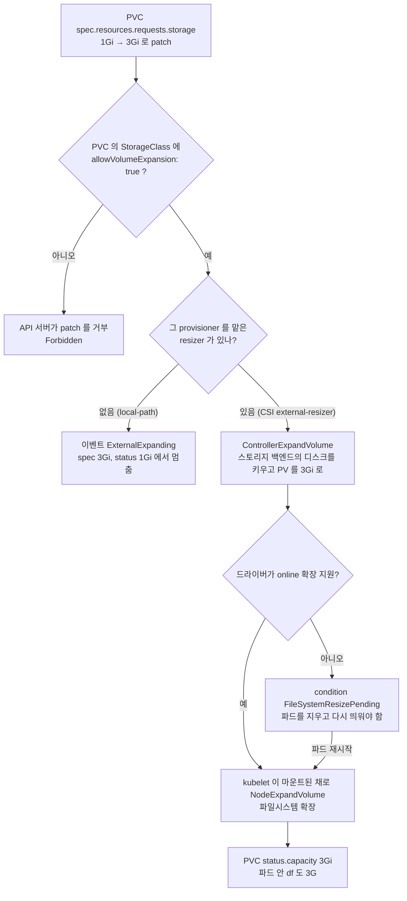

# q11 — Dynamic provisioning and volume expansion · 풀이

← 문제: **[question.md](question.md)**

## 문제 (해석)

**원문**

> The cluster has one StorageClass, which is the default and does not allow expansion. Its
> CSI driver supports online volume expansion.
>
> 1. Create a StorageClass named `fast-expand` reusing the **same provisioner** as the
>    existing default class, with `allowVolumeExpansion: true`,
>    `volumeBindingMode: WaitForFirstConsumer` and `reclaimPolicy: Delete`.
> 2. Make `fast-expand` the cluster default and make sure the previous default class is no
>    longer marked as default.
> 3. In namespace `store`, create PVC `data-pvc` requesting `1Gi`, access mode
>    `ReadWriteOnce`, from `fast-expand`. Create pod `writer` (`nginx:1.27`) mounting it at
>    `/data`.
> 4. Expand `data-pvc` to `3Gi` and confirm both the PVC `status.capacity` and the
>    filesystem inside `writer` report the new size.
> 5. Write to `/opt/q11/pending.txt` the PVC condition you would see if the driver could
>    only expand offline, and what you would do about it.

**해석**

클러스터에 StorageClass가 하나 있고, 그것이 default이며 확장을 허용하지 않는다. 그 클래스의
CSI 드라이버는 온라인 볼륨 확장을 지원한다.

1. 기존 default 클래스와 **동일한 provisioner** 를 쓰는 StorageClass `fast-expand` 를 만든다.
   `allowVolumeExpansion: true`, `volumeBindingMode: WaitForFirstConsumer`,
   `reclaimPolicy: Delete`.
2. `fast-expand` 를 클러스터 default로 만들고, 이전 default 클래스는 default 표시를 없앤다.
3. `store` 네임스페이스에 `fast-expand` 에서 `1Gi`, access mode `ReadWriteOnce` PVC `data-pvc` 를
   만든다. 그것을 `/data` 에 마운트하는 파드 `writer`(`nginx:1.27`)를 만든다.
4. `data-pvc` 를 `3Gi` 로 확장하고, PVC의 `status.capacity` 와 `writer` 내부 파일시스템이 모두
   새 크기를 보고하는지 확인한다.
5. 드라이버가 offline 확장만 지원할 때 보이는 PVC condition과 그때 할 조치를
   `/opt/q11/pending.txt` 에 적는다.

## 모범 풀이

**1) provisioner 를 추측하지 말고 기존 클래스에서 읽어옵니다.** `parameters` 도 함께 복사하면
"같은 종류의 디스크"가 보장됩니다.

```bash
kubectl get sc
# NAME                   PROVISIONER             RECLAIMPOLICY   VOLUMEBINDINGMODE      ALLOWVOLUMEEXPANSION   AGE
# local-path (default)   rancher.io/local-path   Delete          WaitForFirstConsumer   false                  5m
kubectl get sc local-path -o yaml        # provisioner, parameters 확인
```

```yaml
apiVersion: storage.k8s.io/v1
kind: StorageClass
metadata:
  name: fast-expand
  annotations:
    storageclass.kubernetes.io/is-default-class: "true"
provisioner: rancher.io/local-path      # 기존 default 와 동일하게 (실제 시험에선 ebs.csi.aws.com 등)
# parameters:                           # 기존 클래스에 parameters 가 있으면 그대로 복사
#   type: gp3
reclaimPolicy: Delete
allowVolumeExpansion: true
volumeBindingMode: WaitForFirstConsumer
```

**확장은 드라이버가 해 주는 일입니다.** `rancher.io/local-path` 같은 hostPath 기반 프로비저너는
확장을 지원하지 않습니다. `allowVolumeExpansion: true` 라면 PVC 패치 자체는 받아 주지만 실제로 늘려 줄
컨트롤러가 없어서 `status.capacity` 가 1Gi에 머물고, `df` 는 볼륨이 아니라 노드 디스크 크기를
보여 줍니다. 이 레포의 Setup 이 바로 이 경우라서 4번은 패치까지만 확인할 수 있습니다. 끝까지 늘어나는
것을 보려면 확장을 지원하는 CSI 드라이버(EBS, Longhorn, TopoLVM 등)가 필요합니다.

**2) default 는 하나만** 남깁니다. 1.26 이후로는 default가 둘이어도 PVC가 거부되거나 멈추지 않고
**가장 최근에 만든 default 클래스**가 쓰입니다. 하지만 어느 클래스가 쓰일지 헷갈리지 않도록 하나만
남기는 것이 원칙이고, 이 문제도 그것을 요구합니다.

```bash
kubectl apply -f sc.yaml
kubectl patch sc local-path \
  -p '{"metadata":{"annotations":{"storageclass.kubernetes.io/is-default-class":"false"}}}'
kubectl get sc      # (default) 표시가 fast-expand 에만 붙어야 한다
```

**3) PVC 와 파드**

```yaml
apiVersion: v1
kind: PersistentVolumeClaim
metadata: {name: data-pvc, namespace: store}
spec:
  storageClassName: fast-expand
  accessModes: ["ReadWriteOnce"]
  resources:
    requests:
      storage: 1Gi
---
apiVersion: v1
kind: Pod
metadata: {name: writer, namespace: store}
spec:
  containers:
  - name: web
    image: nginx:1.27
    volumeMounts:
    - {name: data, mountPath: /data}
  volumes:
  - name: data
    persistentVolumeClaim:
      claimName: data-pvc
```

`WaitForFirstConsumer` 라서 PVC는 파드가 뜰 때까지 `Pending` 입니다. 이건 정상입니다 —
스케줄러가 파드를 놓을 노드를 정한 뒤에 그 노드에 볼륨을 만들기 위한 동작입니다. PVC가
`Pending` 인 것만 보고 고장으로 판단하면 안 됩니다. `Immediate` 클래스라면 즉시 `Bound` 됩니다.

**4) 확장.** PVC의 `spec.resources.requests.storage` 만 키웁니다.

```bash
kubectl -n store patch pvc data-pvc -p '{"spec":{"resources":{"requests":{"storage":"3Gi"}}}}'
kubectl -n store get pvc data-pvc      # CAPACITY 가 3Gi 로 바뀔 때까지 기다린다
kubectl -n store exec writer -- df -h /data
```

### 그림 1 — PVC 확장이 끝나기까지



1. 확장은 PVC 의 `spec.resources.requests.storage` 를 키우는 것으로 시작합니다. 그 PVC 가 속한 StorageClass 에 `allowVolumeExpansion: true` 가 없으면 API 서버가 바로 거부합니다.
2. 허용되면 실제 일은 드라이버 쪽 resizer 가 합니다. local-path 처럼 resizer 가 없는 프로비저너는 `describe pvc` 에 `ExternalExpanding` 이벤트만 남고 `status.capacity` 가 그대로입니다. 이 레포의 Setup 환경이 여기서 멈춥니다.
3. CSI 드라이버라면 external-resizer 가 먼저 스토리지 쪽 디스크를 키우고 PV 크기를 바꿉니다(컨트롤러 단계).
4. 이어서 노드의 kubelet 이 파일시스템을 늘립니다(노드 단계). online 확장을 지원하면 파드가 떠 있는 채로 끝나고, 아니면 `FileSystemResizePending` 이 붙어 파드를 다시 띄울 때까지 기다립니다.
5. 노드 단계까지 끝나야 `status.capacity` 가 `3Gi` 가 되고 파드 안 `df` 도 커집니다. 문제 4번이 두 곳을 모두 확인하라는 이유입니다.

**5) offline 확장.** 컨트롤 플레인은 볼륨을 키웠지만 파일시스템은 아직 못 늘린 상태에서 PVC에
`FileSystemResizePending` condition이 붙고 message는 `Waiting for user to (re-)start a pod
to finish file system resize of volume on node` 입니다. 조치는 **파드를 삭제해서 다시 뜨게
하는 것**입니다. 마운트가 풀렸다 다시 걸릴 때 kubelet이 파일시스템을 늘립니다(ext4 는 `resize2fs`,
xfs 는 `xfs_growfs`). online 확장을 지원하는 드라이버는 이 단계가 없습니다.

```bash
cat > /opt/q11/pending.txt <<'TXT'
Condition: FileSystemResizePending
(Waiting for user to (re-)start a pod to finish file system resize of volume on node.)
Action: delete and recreate the pod writer that uses data-pvc, so kubelet expands
the filesystem when it mounts the volume again.
TXT
```

축소는 불가능합니다. `3Gi` 에서 `1Gi` 로 되돌리려 하면 API server가 `spec.resources.requests.storage:
Forbidden: ...` 로 거부합니다. 1.34부터 GA인 RecoverVolumeExpansionFailure 덕분에 **확장이 실패했을
때에 한해** 요청을 `status.capacity` 보다 큰 값까지는 낮출 수 있지만, 실제 용량 아래로는 여전히
거부됩니다. 에러 문구는 버전에 따라 다를 수 있으니 실제 출력을 읽습니다.

## 검증

```bash
kubectl get sc | grep -c '(default)'                 # 1
kubectl get sc fast-expand -o jsonpath='{.allowVolumeExpansion}{"\n"}'   # true

kubectl -n store get pvc data-pvc
# NAME       STATUS  VOLUME     CAPACITY  ACCESS MODES  STORAGECLASS
# data-pvc   Bound   pvc-9f1..  3Gi       RWO           fast-expand

kubectl -n store exec writer -- df -h /data | tail -1   # 크기가 3G 로 보인다
kubectl -n store describe pvc data-pvc | grep -A5 Conditions   # 비어 있으면 완료
cat /opt/q11/pending.txt                                 # FileSystemResizePending 과 파드 재시작
```

Setup 의 local-path 환경에서는 `CAPACITY` 가 `1Gi` 에 머물고 `spec` 만 `3Gi` 입니다. 이것은 풀이가
틀린 것이 아니라 프로비저너가 확장을 못 하는 것이므로 아래처럼 패치가 들어갔는지만 확인합니다.

```bash
kubectl -n store get pvc data-pvc -o jsonpath='{.spec.resources.requests.storage} {.status.capacity.storage}{"\n"}'
# 3Gi 1Gi
kubectl -n store describe pvc data-pvc | grep -i ExternalExpanding
```

## 오답 원인 / 배운 점

- **왜 틀렸나**:
- **기억할 것**: 확장은 PVC의 `spec.resources.requests.storage` 를 키우는 것이고, StorageClass에 `allowVolumeExpansion: true` 가 없으면 거부된다. 실제로 늘리는 것은 드라이버라서 확장을 지원하지 않는 프로비저너(local-path 등)에서는 끝나지 않는다. 실제 용량 아래로 줄이는 것은 불가능하다.
- **헷갈리는 지점**: `spec.resources.requests.storage` 는 요청, `status.capacity.storage` 는 실제 확보된 크기입니다. patch 직후에는 spec만 3Gi이고 status는 1Gi일 수 있으니 status를 봐야 확장이 끝난 것입니다. 그리고 `WaitForFirstConsumer` 클래스의 PVC가 `Pending` 인 것은 고장이 아니라 설계된 동작입니다.

## 참고 문서

- 검색어: `expanding persistent volumes claims`
- https://kubernetes.io/docs/concepts/storage/persistent-volumes/#expanding-persistent-volumes-claims
- https://kubernetes.io/docs/concepts/storage/storage-classes/

---

[↑ 문항 목록](../README.md) · [← 문제로](question.md) · [다음 문제 q12 →](../q12_csi_driver_volumemode/question.md)
