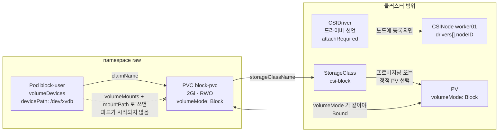

# q12 — Inspect CSI drivers and use a block volumeMode · 풀이

← 문제: **[question.md](question.md)**

## 문제 (해석)

**원문**

> A database is being migrated to raw block storage.
>
> 1. List the CSI drivers registered in the cluster. For each, write its name and whether
>    it requires attach (`spec.attachRequired`) to `/opt/q12/drivers.txt`.
> 2. Write to `/opt/q12/csinodes.txt` each node's name together with the driver-specific
>    node ID the CSI driver registered for it.
> 3. In namespace `raw`, create PVC `block-pvc`: `2Gi`, `ReadWriteOnce`, StorageClass
>    `csi-block`, `volumeMode: Block`.
> 4. Create pod `block-user` (`busybox:1.36`, kept alive) that consumes `block-pvc` as a
>    raw device at `/dev/xvdb`. Do **not** mount a filesystem.
> 5. From inside the pod, prove `/dev/xvdb` is a block device and write the proof to
>    `/opt/q12/proof.txt`.

**해석**

데이터베이스를 raw block 스토리지로 이전하는 중이다.

1. 클러스터에 등록된 CSI 드라이버를 나열한다. 각각의 이름과 attach 필요 여부
   (`spec.attachRequired`)를 `/opt/q12/drivers.txt` 에 적는다.
2. 각 노드 이름과 CSI 드라이버가 그 노드에 등록한 드라이버 고유 node ID를
   `/opt/q12/csinodes.txt` 에 적는다.
3. `raw` 네임스페이스에 PVC `block-pvc` 를 만든다. `2Gi`, `ReadWriteOnce`, StorageClass
   `csi-block`, `volumeMode: Block`.
4. `block-pvc` 를 `/dev/xvdb` 의 raw device로 쓰는 파드 `block-user`(`busybox:1.36`, 계속
   살아 있게)를 만든다. 파일시스템을 마운트하지 **않는다**.
5. 파드 안에서 `/dev/xvdb` 가 block device임을 증명하고 그 결과를 `/opt/q12/proof.txt` 에 적는다.

## 모범 풀이

**1~2) 드라이버와 노드 등록 정보.** `csidrivers` 는 클러스터 범위, `csinodes` 는 노드별
등록 상태입니다.

```bash
# 먼저 화면으로 확인
kubectl get csidrivers -o custom-columns=\
'NAME:.metadata.name,ATTACH:.spec.attachRequired,PODINFO:.spec.podInfoOnMount,MODES:.spec.volumeLifecycleModes'
# NAME              ATTACH   PODINFO   MODES
# ebs.csi.aws.com   true     false     [Persistent]

# 1) 답 파일 — 문제가 묻는 두 열만
kubectl get csidrivers -o custom-columns='NAME:.metadata.name,ATTACH_REQUIRED:.spec.attachRequired' \
  > /opt/q12/drivers.txt

# 2) 답 파일 — 노드 이름과 드라이버가 등록한 node ID
kubectl get csinodes -o custom-columns=\
'NODE:.metadata.name,DRIVER:.spec.drivers[*].name,NODEID:.spec.drivers[*].nodeID' \
  > /opt/q12/csinodes.txt
cat /opt/q12/csinodes.txt
# NODE           DRIVER            NODEID
# controlplane   <none>            <none>
# worker01       ebs.csi.aws.com   i-0a1b2c3d4e5f
```

`CSINode` 오브젝트는 kubelet 이 노드마다 만들고, 그 노드의 CSI node 플러그인이 kubelet 에 등록될 때
`spec.drivers[]` 에 이름과 `nodeID` 가 채워집니다. 드라이버 DaemonSet 이 컨트롤 플레인에 뜨지 않는 클러스터라면
컨트롤 플레인 노드 줄은 `<none>` 으로 나오는 것이 정상입니다.

`csinodes` 에 노드가 없거나 `drivers` 가 비어 있으면 그 노드에서 그 드라이버의 볼륨을 쓸 수
없습니다. PVC는 `Bound` 인데 파드가 `ContainerCreating` 에서 멈추고 이벤트에
`driver name ... not found in the list of registered CSI drivers` 가 나오는 경우, 원인은 그 노드에 CSI node
DaemonSet 파드가 안 떠 있는 것입니다.

**3~4) block 모드 PVC 와 파드**

```yaml
apiVersion: v1
kind: PersistentVolumeClaim
metadata: {name: block-pvc, namespace: raw}
spec:
  storageClassName: csi-block
  volumeMode: Block
  accessModes: ["ReadWriteOnce"]
  resources:
    requests:
      storage: 2Gi
---
apiVersion: v1
kind: Pod
metadata: {name: block-user, namespace: raw}
spec:
  containers:
  - name: app
    image: busybox:1.36
    command: ["sleep", "3600"]
    volumeDevices:                                    # volumeMounts 가 아니다
    - {name: raw-disk, devicePath: /dev/xvdb}         # mountPath 가 아니다
  volumes:
  - name: raw-disk
    persistentVolumeClaim:
      claimName: block-pvc
```

**`volumeMode: Block` 볼륨은 `volumeMounts` 로 쓸 수 없습니다.** 컨테이너 스펙에서
`volumeDevices` + `devicePath` 를 써야 합니다. 필드 이름이 둘 다 있고 형태가 비슷해 습관대로
`volumeMounts`/`mountPath` 를 쓰면 kubelet이 파드를 시작하지 못하고
`volume raw-disk has volumeMode Block, but is specified in volumeMounts` 같은 이벤트를 남깁니다. 반대로
`volumeMode: Filesystem`(기본값) 볼륨에 `volumeDevices` 를 쓰면 같은 식으로 거부됩니다.
둘은 PVC 쪽과 파드 쪽이 **짝을 맞춰야** 합니다.

`volumeMode` 는 PV/PVC 생성 이후에는 바꿀 수 없습니다. 잘못 만들었으면 지우고 다시 만듭니다.

### 그림 1 — Block 볼륨이 파드까지 오는 길



1. `CSIDriver` 는 "이런 드라이버가 있다"는 클러스터 범위 선언이고, 1번 답의 `attachRequired` 도 여기에 있습니다.
2. 드라이버의 node 플러그인이 각 노드의 kubelet 에 등록되면 그 노드의 `CSINode` 에 이름과 `nodeID` 가 채워집니다. 2번 답은 여기서 읽습니다.
3. PVC 는 `storageClassName: csi-block` 으로 StorageClass 를 고르고, 거기서 PV 가 만들어지거나(동적) 미리 있던 PV 가 골라집니다(정적).
4. PV 와 PVC 는 `volumeMode` 까지 같아야 바인딩됩니다. `Block` PVC 는 `Filesystem` PV 에 붙지 않고 `Pending` 으로 남습니다.
5. 파드는 `volumeDevices` + `devicePath` 로 PVC 를 받아 컨테이너 안에 `/dev/xvdb` 장치 파일을 얻습니다. 같은 PVC 를 `volumeMounts` 로 쓰면 파드가 `ContainerCreating` 에서 멈춥니다.

**5) 증명.** block device는 `stat` 이 `block special file` 로, `ls -l` 은 첫 글자를 `b` 로
보고합니다. 파일시스템이 없으니 `df` 에는 나타나지 않습니다.

```bash
kubectl -n raw exec block-user -- ls -l /dev/xvdb
# brw-rw---- 1 root disk 259, 0 ... /dev/xvdb      ← 맨 앞 b
kubectl -n raw exec block-user -- stat -c '%F %t:%T' /dev/xvdb
# block special file 103:0        (major:minor 는 16진수. 디바이스 종류마다 다르다 — loop 는 7:N)
kubectl -n raw exec block-user -- sh -c 'df -h | grep xvdb || echo "not a filesystem"'

# 답 파일 — 위 증명을 한 번에 저장 (exec 의 출력이 k8s-c1 쪽 파일로 들어간다)
kubectl -n raw exec block-user -- sh -c \
  'ls -l /dev/xvdb; stat -c "%n: %F" /dev/xvdb; test -b /dev/xvdb && echo "/dev/xvdb is a block device"' \
  > /opt/q12/proof.txt
cat /opt/q12/proof.txt
```

리다이렉트 `>` 는 `kubectl` 을 실행한 쪽(`k8s-c1`)의 셸이 처리하므로 파일은 컨테이너 안이 아니라 `k8s-c1` 의
`/opt/q12/proof.txt` 에 생깁니다. `sh -c '... > /opt/q12/proof.txt'` 처럼 따옴표 안에 넣으면 컨테이너 안에
쓰려다 실패합니다.

## 검증

```bash
kubectl -n raw get pvc block-pvc -o custom-columns=\
'NAME:.metadata.name,MODE:.spec.volumeMode,STATUS:.status.phase,CAP:.status.capacity.storage'
# NAME        MODE    STATUS  CAP
# block-pvc   Block   Bound   2Gi

kubectl -n raw get pod block-user            # Running
kubectl get pv -o custom-columns='NAME:.metadata.name,MODE:.spec.volumeMode'
# PV 쪽도 Block 이어야 바인딩된다
```

## 오답 원인 / 배운 점

- **왜 틀렸나**:
- **기억할 것**: `volumeMode: Block` 은 파드에서 `volumeDevices` + `devicePath` 로 쓴다. `volumeMounts` + `mountPath` 는 `Filesystem` 전용이다.
- **헷갈리는 지점**: `csidrivers` 는 "이 드라이버가 클러스터에 있다"는 선언이고, `csinodes` 는 "이 노드에서 그 드라이버가 실제로 준비됐다"는 등록 기록입니다. 파드가 볼륨 때문에 안 뜨면 PVC가 `Bound` 인지 본 다음 `csinodes` 를 봅니다. 그리고 `accessModes` 와 `volumeMode` 는 전혀 다른 것입니다 — 앞은 몇 노드에서 동시에 쓸 수 있느냐, 뒤는 파일시스템이냐 raw 디바이스냐입니다.

## 참고 문서

- 검색어: `raw block volume support`
- https://kubernetes.io/docs/concepts/storage/persistent-volumes/#raw-block-volume-support
- https://kubernetes.io/docs/concepts/storage/volumes/#csi

---

[↑ 문항 목록](../README.md) · [← 문제로](question.md) · [다음 문제 q13 →](../q13_metrics_server_resource_usage/question.md)
