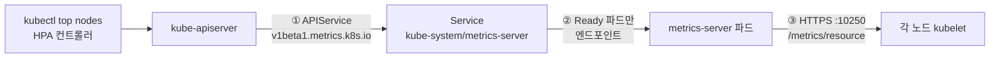

# q13 — Restore metrics-server and analyse resource usage · 풀이

← 문제: **[question.md](question.md)**

## 문제 (해석)

**원문**

> `kubectl top nodes` fails on this cluster. An HPA in namespace `prod` is stuck showing
> `<unknown>` as a consequence.
>
> 1. Write the exact error `kubectl top nodes` prints to `/opt/q13/error.txt`.
> 2. Determine whether the fault is the APIService registration, the metrics-server pod, or
>    the connection from metrics-server to the kubelets. Write which one, and the command
>    that decided it, to `/opt/q13/cause.txt`.
> 3. Fix it so that `kubectl top nodes` and `kubectl top pods -A` both return numbers.
>    Do not delete the metrics-server Deployment.
> 4. Write the name of the pod using the most memory in namespace `prod` to
>    `/opt/q13/top-mem.txt`.
> 5. For deployment `api` in `prod`, write the per-container CPU usage to
>    `/opt/q13/api-containers.txt`.

**해석**

이 클러스터에서 `kubectl top nodes` 가 실패한다. 그 결과로 `prod` 네임스페이스의 HPA가
`<unknown>` 에 멈춰 있다.

1. `kubectl top nodes` 가 출력하는 에러를 그대로 `/opt/q13/error.txt` 에 적는다.
2. 문제가 APIService 등록인지, metrics-server 파드인지, metrics-server에서 kubelet으로 가는
   연결인지 판단한다. 어느 것인지와 그것을 판단한 명령을 `/opt/q13/cause.txt` 에 적는다.
3. `kubectl top nodes` 와 `kubectl top pods -A` 가 모두 숫자를 반환하게 고친다. metrics-server
   Deployment를 삭제하지 않는다.
4. `prod` 네임스페이스에서 메모리를 가장 많이 쓰는 파드 이름을 `/opt/q13/top-mem.txt` 에 적는다.
5. `prod` 의 deployment `api` 에 대해 컨테이너별 CPU 사용량을 `/opt/q13/api-containers.txt` 에 적는다.

## 모범 풀이

`kubectl top` 은 `metrics.k8s.io` 라는 **aggregated API** 를 통과합니다. 따라서 끊길 수 있는
지점이 세 군데이고, 순서대로 좁히는 것이 풀이의 본체입니다.

**1단계 — 증상을 기록합니다.**

```bash
mkdir -p /opt/q13
kubectl top nodes
# error: Metrics API not available
kubectl top nodes 2> /opt/q13/error.txt     # 에러는 stderr 로 나오므로 2> 로 받는다
cat /opt/q13/error.txt
```

**2단계 — APIService 등록부터 봅니다.** 여기가 `False` 면 위 메시지가 그대로 나옵니다.

```bash
kubectl get apiservices | grep metrics
# v1beta1.metrics.k8s.io   kube-system/metrics-server   False (MissingEndpoints)
kubectl describe apiservice v1beta1.metrics.k8s.io | tail -5
```

**3단계 — 파드 상태.** `MissingEndpoints` 면 파드가 Ready가 아니라는 뜻입니다.

```bash
kubectl -n kube-system get pods -l k8s-app=metrics-server
# metrics-server-7d8f...   0/1   Running   0   12m      ← Running 이지만 Ready 가 아니다
kubectl -n kube-system describe pod -l k8s-app=metrics-server | grep -A5 Events
# Readiness probe failed: HTTP probe failed with statuscode: 500
```

**4단계 — 로그.** Running인데 Ready가 아니면 로그가 답을 줍니다.

```bash
kubectl -n kube-system logs -l k8s-app=metrics-server --tail=20
# E ... scraper.go: unable to fully scrape metrics from node worker01:
#   unable to fetch metrics from node worker01: Get "https://10.0.1.21:10250/metrics/resource":
#   x509: cannot validate certificate for 10.0.1.21 because it doesn't contain any IP SANs
```

원인은 세 번째 지점 — **metrics-server가 kubelet의 서버 인증서를 검증하지 못하는 것**입니다.
APIService는 등록되어 있고(2단계) 파드도 떠 있지만(3단계), 로그가 kubelet 접속 실패를 가리킵니다.
판단한 명령과 함께 2번 답을 적습니다.

```bash
cat > /opt/q13/cause.txt <<'EOF'
connection from metrics-server to the kubelets
kubectl -n kube-system logs -l k8s-app=metrics-server --tail=20
EOF
```

kubeadm이 만드는 kubelet serving 인증서는 자체 서명이고 노드 IP를 SAN에 담지 않기 때문에
기본 설정으로는 항상 이 에러가 납니다. 그래서 metrics-server 공식 배포본에도
`--kubelet-insecure-tls` 를 넣으라는 안내가 있습니다.

| 증상 | 실제 원인 | 조치 |
|---|---|---|
| `Metrics API not available`, apiservice `False (MissingEndpoints)` | 파드가 Ready 아님 | 파드 로그로 내려간다 |
| `get apiservices` 에 `v1beta1.metrics.k8s.io` 가 아예 없음 | metrics-server 미설치 / APIService 오브젝트 삭제 | components.yaml 재적용 |
| apiservice `False (ServiceNotFound)` | Service `metrics-server` 가 없음 | Service 복구 (components.yaml 재적용) |
| apiservice `False (FailedDiscoveryCheck)` | 엔드포인트는 있으나 API 서버가 파드에 닿지 못함 (포트·인증서·네트워크) | Service `targetPort`·파드 포트, 컨트롤 플레인→파드 통신 확인 |
| 로그에 `x509 ... doesn't contain any IP SANs` | kubelet serving 인증서 검증 실패 | `--kubelet-insecure-tls` 추가 (또는 `serverTLSBootstrap: true` + CSR 승인) |
| 로그에 `dial tcp ...:10250: i/o timeout` | 노드 10250 차단, NetworkPolicy, hostNetwork 필요 | 방화벽/정책 수정 |
| `no metrics known for node` 만 반복 | 아직 수집 주기(기본 15s) 전 | 잠시 대기 |
| 파드가 Pending | 컨트롤 플레인 taint 미허용 | toleration 또는 노드 여유 확보 |

**5단계 — 수정.** Deployment의 컨테이너 args에 플래그를 추가합니다.

```bash
kubectl -n kube-system patch deploy metrics-server --type=json \
  -p='[{"op":"add","path":"/spec/template/spec/containers/0/args/-","value":"--kubelet-insecure-tls"}]'

kubectl -n kube-system rollout status deploy metrics-server
```

`kubectl -n kube-system edit deploy metrics-server` 로 `args` 에 한 줄 넣어도 같습니다.
수집 주기가 있으니 적용 후 15~30초 기다린 다음 확인합니다.

**4~5번 문항 — 사용량 조회**

```bash
kubectl top pod -n prod --sort-by=memory                 # 큰 값부터, 머리글 다음 첫 줄이 답
kubectl top pod -n prod --sort-by=memory --no-headers | head -1 | awk '{print $1}' > /opt/q13/top-mem.txt

kubectl -n prod get deploy api -o jsonpath='{.spec.selector.matchLabels}{"\n"}'   # {"app":"api"}
kubectl top pod -n prod -l app=api --containers          # POD / NAME(컨테이너) / CPU / MEMORY
kubectl top pod -n prod -l app=api --containers > /opt/q13/api-containers.txt
```

deployment에는 `--containers` 를 바로 쓸 수 없으므로 deployment의 selector로 파드를 고릅니다.

`--sort-by` 값은 `cpu` 또는 `memory` 이고, `kubectl top pod` 은 기본적으로 파드 합계를
보여주므로 사이드카가 있는 파드의 범인을 찾을 때는 `--containers` 가 필요합니다.

### 그림 — `kubectl top` 이 지나가는 길과 세 점검 지점



1. ① `kubectl get apiservices | grep metrics` 로 봅니다. 오브젝트가 없으면 미설치, `ServiceNotFound` 면 Service 문제입니다. 이 문제처럼 `MissingEndpoints` 면 ②로 내려갑니다.
2. ② `kubectl -n kube-system get pods -l k8s-app=metrics-server` 로 봅니다. `0/1 Running` 은 Readiness probe가 실패하는 상태라 Service 엔드포인트에 들어가지 못합니다. metrics-server는 kubelet 수집에 한 번도 성공하지 못하면 Ready가 되지 않으므로, 원인은 ③에 있을 수 있습니다.
3. ③ 파드 로그에서 kubelet 접속 에러를 봅니다. `x509` 면 kubelet 인증서 검증 실패이고 `--kubelet-insecure-tls` 로 고칩니다. `i/o timeout` 이면 10250 포트로 가는 길이 막힌 것입니다.

## 검증

```bash
kubectl get apiservices v1beta1.metrics.k8s.io
# NAME                     SERVICE                      AVAILABLE   AGE
# v1beta1.metrics.k8s.io   kube-system/metrics-server   True

kubectl -n kube-system get pods -l k8s-app=metrics-server   # 1/1 Running

kubectl top nodes
# NAME       CPU(cores)  CPU%  MEMORY(bytes)  MEMORY%
# cp01       212m        10%   1433Mi         37%

kubectl top pods -A | head
kubectl get --raw /apis/metrics.k8s.io/v1beta1/nodes | head -c 200
kubectl -n prod get hpa           # TARGETS 가 <unknown> 에서 실제 퍼센트로 바뀐다

cat /opt/q13/error.txt            # error: Metrics API not available
cat /opt/q13/cause.txt
cat /opt/q13/top-mem.txt          # 파드 이름 한 단어 (setup 대로라면 cache-...)
cat /opt/q13/api-containers.txt   # api 파드마다 app·log-agent 두 줄
```

## 오답 원인 / 배운 점

- **왜 틀렸나**:
- **기억할 것**: `kubectl top` 이 실패하면 `kubectl get apiservices | grep metrics` → 파드 Ready 여부 → 파드 로그 순서로 내려간다. kubeadm 클러스터의 전형적 원인은 kubelet 인증서 검증이고 해법은 `--kubelet-insecure-tls` 다.
- **헷갈리는 지점**: `Metrics API not available` 은 metrics-server가 없을 때와 있는데 Ready가 아닐 때 모두 같은 문구로 나옵니다. 두 경우를 갈라주는 것은 `kubectl get apiservices` 의 reason입니다 — 오브젝트가 없으면 미설치, `MissingEndpoints` 면 파드 문제입니다. 그리고 파드가 `Running` 이라도 `0/1` 이면 Service endpoint에 들어가지 않으므로 "Running"만 보고 정상 판단하면 안 됩니다.

## 참고 문서

- 검색어: `resource metrics pipeline`
- https://kubernetes.io/docs/tasks/debug/debug-cluster/resource-metrics-pipeline/
- https://kubernetes.io/docs/tasks/debug/debug-cluster/resource-usage-monitoring/

---

[↑ 문항 목록](../README.md) · [← 문제로](question.md) · [다음 문제 q14 →](../q14_gateway_traffic_not_routed/question.md)
