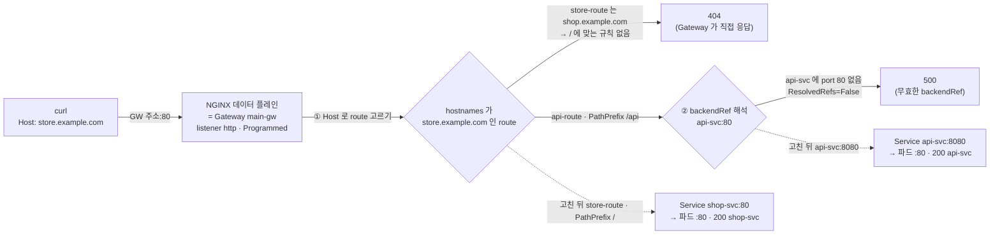

# q14 — Gateway accepts traffic but nothing reaches the backend · 풀이

← 문제: **[question.md](question.md)**

## 문제 (해석)

**원문**

> In namespace `gw`, Gateway `main-gw` has an address and its `http` listener is
> `Programmed`. Services `shop-svc` (port `80`) and `api-svc` (port `8080`) are Running with
> healthy endpoints. Two HTTPRoutes are meant to serve host `store.example.com` through that
> listener: `store-route` sends `/` to `shop-svc`, and `api-route` sends `/api` to `api-svc`.
> But `curl -H 'Host: store.example.com' http://<gw-address>/` returns `404` and `/api`
> returns `500`.
>
> Fix the routing. Do **not** change the Gateway's listener configuration and do not change
> either Service.
>
> 1. Write the `Accepted` and `ResolvedRefs` conditions of both HTTPRoutes, with their
>    reasons, to `/opt/q14/conditions.txt`.
> 2. Decide for each of the two failing paths whether the fault is route attachment,
>    hostname matching, or backend resolution.
> 3. Repair the routes so `/` reaches `shop-svc` and `/api` reaches `api-svc`.
> 4. Verify both paths return `200` from the correct backend.
> 5. Write the root cause of each symptom in one line each to `/opt/q14/cause.txt`, plus the
>    status code you would expect instead if `api-svc` were valid but had no ready endpoints.

**해석**

`gw` 네임스페이스의 Gateway `main-gw` 는 주소를 가지고 있고 `http` listener는 `Programmed` 다.
서비스 `shop-svc`(port `80`)와 `api-svc`(port `8080`)는 Running이고 endpoint도 정상이다.
HTTPRoute 두 개가 그 listener로 호스트 `store.example.com` 을 서비스해야 한다 — `store-route` 는
`/` 를 `shop-svc` 로, `api-route` 는 `/api` 를 `api-svc` 로 보낸다. 그런데
`curl -H 'Host: store.example.com' http://<gw-address>/` 는 `404`, `/api` 는 `500` 이다.

라우팅을 고친다. Gateway의 listener 설정과 두 Service는 **바꾸지 않는다**.

1. 두 HTTPRoute의 `Accepted` 와 `ResolvedRefs` condition을 reason과 함께
   `/opt/q14/conditions.txt` 에 적는다.
2. 실패하는 두 경로 각각에 대해 원인이 route 부착인지, hostname 매칭인지, backend 해석인지 판단한다.
3. `/` 는 `shop-svc` 로, `/api` 는 `api-svc` 로 가도록 route를 고친다.
4. 두 경로가 올바른 backend에서 `200` 을 반환하는지 확인한다.
5. 두 증상의 근본 원인을 각각 한 줄로 `/opt/q14/cause.txt` 에 적고, `api-svc` 가 유효하지만
   ready endpoint가 하나도 없었다면 대신 어떤 상태 코드를 기대하는지도 적는다.

## 모범 풀이

Gateway API 문제는 **status condition 이 어디서 끊겼는지** 읽는 것이 전부입니다. 404와 500은
서로 다른 단계의 실패이므로 하나의 원인으로 묶어 생각하면 안 됩니다.

**1단계 — Gateway 쪽은 이미 정상임을 확인해 조사 범위를 줄입니다.**

```bash
kubectl -n gw get gateway main-gw -o jsonpath='{.status.listeners[0].attachedRoutes}{"\n"}'
# 2  ← 두 route 모두 listener 에 붙어 있다. 0 이면 부착(parentRefs/allowedRoutes) 문제
```

**2단계 — 두 HTTPRoute 의 condition 을 읽습니다.**

```bash
for r in store-route api-route; do
  echo "== $r"
  kubectl -n gw get httproute $r -o jsonpath=\
'{range .status.parents[0].conditions[*]}{.type}={.status} ({.reason}) {.message}{"\n"}{end}'
done | tee /opt/q14/conditions.txt
# == store-route
# Accepted=True (Accepted)
# ResolvedRefs=True (ResolvedRefs)
# == api-route
# Accepted=True (Accepted)
# ResolvedRefs=False (BackendNotFound) ... port 80 ...   ← reason 문자열은 구현마다 다를 수 있다
```

`store-route` 는 condition이 **전부 True** 인데도 404입니다. condition은 "설정이 유효한가"만
말하고 "요청이 이 route에 매칭되는가"는 말해 주지 않기 때문입니다. 반면 `api-route` 의
`ResolvedRefs=False` 는 backendRef 하나가 해석되지 않는다는 뜻입니다. reason 문자열은
구현체마다 다르므로(`BackendNotFound`, `UnsupportedValue` 등) **message 를 읽습니다.**

**3단계 — 실제 매니페스트에서 두 결함을 찾습니다.**

```bash
kubectl -n gw get httproute store-route api-route -o yaml
```

```yaml
# store-route
spec:
  hostnames:
  - shop.example.com          # (A) 요청 Host 는 store.example.com  →  404
  rules:
  - matches:
    - path: {type: PathPrefix, value: /}
    backendRefs:
    - {name: shop-svc, port: 80}
---
# api-route
spec:
  hostnames:
  - store.example.com
  rules:
  - matches:
    - path: {type: PathPrefix, value: /api}
    backendRefs:              # matches 와 형제 키다. path 와 같은 깊이로 쓰면 거부된다
    - name: api-svc
      port: 80                # (B) api-svc 는 8080 만 노출  →  500
```

- **404 의 원인 (hostname 매칭)**: `store-route` 의 `hostnames` 가 `shop.example.com` 이라
  `Host: store.example.com` 의 `/` 요청과 매칭되는 route가 없습니다. 매칭되는 route가 없으면
  Gateway는 404를 냅니다. `/api` 요청은 hostname이 맞는 `api-route` 에 매칭되므로 404가 아니라
  다음 단계(backend)까지 갑니다 — 두 증상이 동시에 나타나는 이유입니다.
- **500 의 원인 (backend 해석)**: `backendRefs.port` 는 **Service의 port** 여야 합니다.
  `api-svc` 는 `8080` 만 노출하므로 `80` 은 없는 포트이고 backendRef가 무효가 됩니다.
  Gateway API 스펙은 **무효한 backendRef로 가야 할 요청에 500을 반드시(MUST) 반환**하도록
  정합니다. 컨테이너 포트(80)와 서비스 포트(8080)를 혼동해서 생기는 대표적 실수입니다.

| 증상 / condition | 원인 | 조치 |
|---|---|---|
| `attachedRoutes` 0, `Accepted=False (NotAllowedByListeners)` | listener의 `allowedRoutes.namespaces.from` 이 route 네임스페이스를 막음 | route를 같은 ns로 옮기거나 listener 허용(여기선 금지) |
| `Accepted=False (NoMatchingParent)` | `parentRefs` 의 name 또는 `sectionName` 오타 | parentRefs 수정 |
| `Accepted=False (NoMatchingListenerHostname)` | route hostname이 listener hostname과 교집합 없음 | hostname 수정 |
| 모든 condition True + **404** | 요청 Host/경로가 route의 `hostnames`·`matches` 와 불일치 | hostname 또는 path 수정 |
| `ResolvedRefs=False` + **500** | backendRef의 Service 이름·포트가 없음, 또는 다른 ns 참조에 ReferenceGrant 없음(`RefNotPermitted`) | 이름·포트 수정, ReferenceGrant 생성 |
| 모든 condition True + **503** | backendRef는 유효하지만 Service에 ready endpoint가 없음 | `kubectl get endpointslice -l kubernetes.io/service-name=<svc>` |

### 요청이 어디서 끊기나



1. 요청은 Gateway 주소의 80 포트로 들어와 listener `http` 에 닿습니다. listener 는 `Programmed` 이고 두 route 모두 붙어 있으므로(`attachedRoutes` 2) 여기까지는 문제가 없습니다.
2. 데이터 플레인은 먼저 Host 헤더로 route 를 고릅니다. `store.example.com` 을 가진 route 는 `api-route` 하나뿐이고 그 route 에는 `/api` 규칙만 있습니다. 그래서 `/` 는 맞는 규칙이 없어 Gateway 가 404 를 직접 돌려줍니다. 백엔드 파드 로그에는 아무것도 찍히지 않습니다.
3. `/api` 는 `api-route` 에 매칭되어 backendRef 단계까지 갑니다. 그런데 `api-svc:80` 은 존재하지 않는 Service 포트라 backendRef 가 무효이고, 스펙대로 500 이 나옵니다.
4. `store-route` 의 hostname 을 `store.example.com` 으로, `api-route` 의 포트를 `8080` 으로 고치면 점선 경로가 됩니다. 두 route 가 같은 Host 아래에서 합쳐지고, 더 긴 prefix 인 `/api` 가 먼저 매칭됩니다.

**4단계 — 수정.**

```bash
kubectl -n gw patch httproute store-route --type=json \
  -p='[{"op":"replace","path":"/spec/hostnames/0","value":"store.example.com"}]'
kubectl -n gw patch httproute api-route --type=json \
  -p='[{"op":"replace","path":"/spec/rules/0/backendRefs/0/port","value":8080}]'
```

`port` 값은 문자열이 아니라 정수여야 합니다. `"8080"` 으로 주면 스키마 검증에서 거부됩니다.

같은 listener·같은 hostname에 route가 둘 붙으면 구현이 규칙을 합쳐서 매칭합니다. 경로는
**가장 긴 prefix 우선**이므로 `/api/...` 는 `api-route`, 나머지는 `store-route` 로 갑니다.

**5번 답**: 원인은 위 두 줄이고, `api-svc` 가 유효한데 ready endpoint만 없었다면 스펙이 권고(SHOULD)하는
응답은 **503** 입니다. 즉 404(매칭 route 없음) → 500(backendRef 무효) → 503(endpoint 없음) 순서로
실패 단계가 깊어집니다. 503 은 MUST 가 아니라 SHOULD 라서 구현체에 따라 다른 5xx 가 나올 수도 있습니다.

```bash
cat > /opt/q14/cause.txt <<'EOF'
/    404: store-route hostnames was shop.example.com, so no route matched Host store.example.com for / (hostname matching)
/api 500: api-route backendRef pointed to api-svc port 80, but the Service only exposes 8080 (backend resolution, ResolvedRefs=False)
valid api-svc with no ready endpoints: 503
EOF
```

2번은 파일로 남기라는 요구가 없지만 `cause.txt` 의 괄호 안에 판단을 함께 적어 두면 채점자가 바로 확인할 수 있습니다.

## 검증

```bash
ADDR=$(kubectl -n gw get gateway main-gw -o jsonpath='{.status.addresses[0].value}')

curl -s -w ' %{http_code}\n' -H 'Host: store.example.com' http://$ADDR/      # shop-svc 200
curl -s -w ' %{http_code}\n' -H 'Host: store.example.com' http://$ADDR/api   # api-svc 200
# 주소에 닿지 않는 랩이면: kubectl -n gw get svc main-gw-nginx 로 NodePort 확인 → <노드IP>:<NodePort> 로 같은 curl

for r in store-route api-route; do
  kubectl -n gw get httproute $r -o jsonpath=\
'{range .status.parents[0].conditions[*]}{.type}={.status}{" "}{end}{"\n"}'
done
# Accepted=True ResolvedRefs=True  (두 줄 모두)

kubectl -n gw get gateway main-gw -o jsonpath='{.status.listeners[0].attachedRoutes}{"\n"}'  # 2
```

이 레포의 setup.sh 로 만든 백엔드는 어떤 경로든 `200` 과 자기 이름을 돌려주므로, 응답 본문(`shop-svc` / `api-svc`)이 4번의
"올바른 backend" 확인이 됩니다. 시험장처럼 두 백엔드가 똑같은 기본 nginx 라면 `/api` 는 백엔드가 파일을 못 찾아 404 를 내므로,
어느 쪽으로 갔는지는 `kubectl -n gw logs deploy/api-svc --tail=1` 처럼 **백엔드 파드의 access 로그**로 확인합니다.

## 오답 원인 / 배운 점

- **왜 틀렸나**:
- **기억할 것**: HTTPRoute의 모든 condition이 True인데도 404가 나오면 `hostnames` 또는 path match가 요청과 안 맞는 것이다. condition은 "설정이 유효한가"만 말하고 "요청이 매칭되는가"는 말해주지 않는다.
- **헷갈리는 지점**: 상태 코드가 실패 단계를 알려 줍니다 — 404는 매칭되는 route가 없음(호스트/경로), 500은 route는 맞았지만 backendRef가 무효(이름·포트·ReferenceGrant), 503은 backendRef는 유효하지만 ready endpoint가 없음. 그리고 `backendRefs.port` 는 Service의 `port` 이며 `targetPort` 나 컨테이너 포트가 아닙니다.

## 참고 문서

- 검색어: `httproute`
- https://kubernetes.io/docs/concepts/services-networking/gateway/
- https://gateway-api.sigs.k8s.io/reference/api-types/httproute/
- https://gateway-api.sigs.k8s.io/guides/http-routing/

---

[↑ 문항 목록](../README.md) · [← 문제로](question.md) · [다음 문제 q15 →](../q15_cni_pod_containercreating/question.md)
