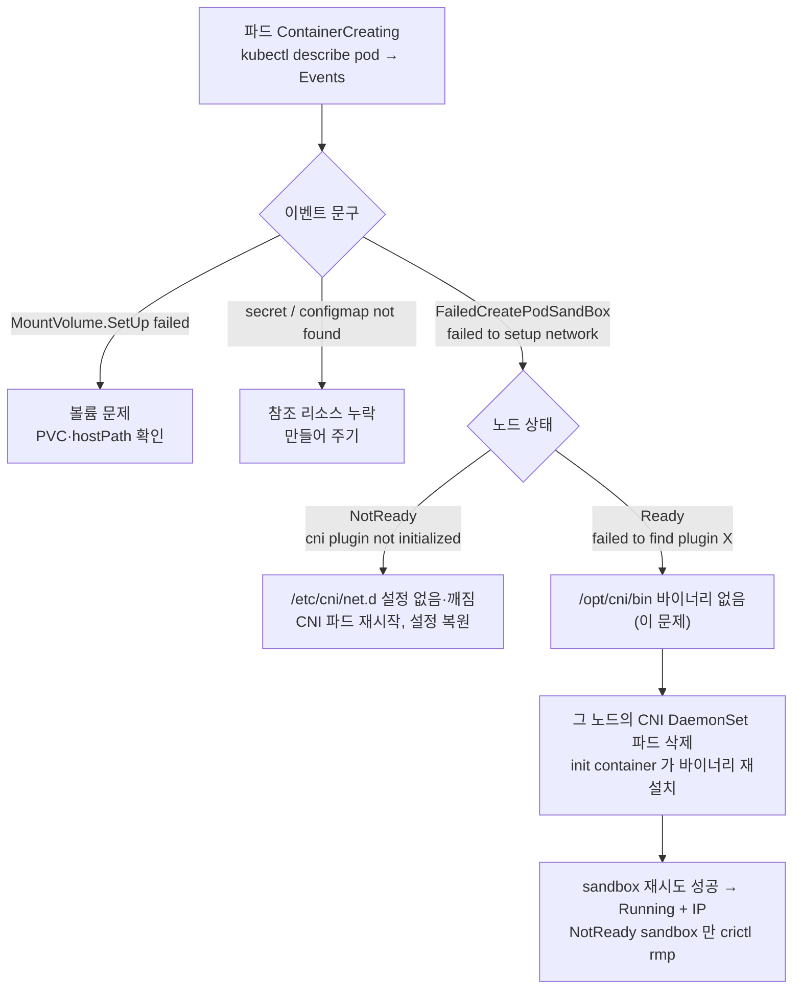

# q15 — Pods stuck in ContainerCreating after a CNI failure · 풀이

← 문제: **[question.md](question.md)**

## 문제 (해석)

**원문**

> Every pod scheduled to `worker01` is stuck in `ContainerCreating`. Pods on `worker02`
> start normally. `worker01` reports `Ready`. Deployment `apps/web` has 4 replicas and only
> the ones on `worker02` have an IP.
>
> 1. Write the pod event that explains the failure to `/opt/q15/event.txt`.
> 2. From `worker01`, check the runtime and the CNI state. Write the path of the CNI
>    configuration directory and what you found there to `/opt/q15/cni.txt`.
> 3. Identify the cause and write it to `/opt/q15/cause.txt`.
> 4. Repair it so every `apps/web` pod reaches `Running` with a pod IP.
> 5. Clean up any sandbox left behind by the failed attempts.

**해석**

`worker01` 에 스케줄된 모든 파드가 `ContainerCreating` 에서 멈춘다. `worker02` 의 파드는 정상적으로
시작한다. `worker01` 은 `Ready` 로 보고된다. deployment `apps/web` 는 replica가 4이고
`worker02` 에 있는 것만 IP를 가진다.

1. 실패를 설명하는 파드 이벤트를 `/opt/q15/event.txt` 에 적는다.
2. `worker01` 에서 런타임과 CNI 상태를 확인한다. CNI 설정 디렉터리 경로와 거기서 발견한 것을
   `/opt/q15/cni.txt` 에 적는다.
3. 원인을 찾아 `/opt/q15/cause.txt` 에 적는다.
4. 모든 `apps/web` 파드가 pod IP를 가진 `Running` 이 되도록 고친다.
5. 실패한 시도가 남긴 sandbox를 정리한다.

## 모범 풀이

`ContainerCreating` 은 kubelet이 **sandbox 를 만들다가** 막힌 상태입니다. 이미지 pull 문제라면
`ImagePullBackOff` 가 되고, 프로세스 문제라면 `CrashLoopBackOff` 가 됩니다.
`ContainerCreating` 이 오래 유지되는 원인은 거의 CNI, 볼륨 마운트, 또는 secret/configmap 누락
셋 중 하나입니다.

**1단계 — 이벤트가 어느 쪽인지 즉시 갈라줍니다.**

```bash
kubectl -n apps get pods -l app=web -o wide          # worker01 쪽만 IP 가 비어 있다
kubectl -n apps describe pod <worker01의 web 파드> | grep -A10 Events
```

```
Warning  FailedCreatePodSandBox  kubelet
  Failed to create pod sandbox: rpc error: code = Unknown desc = failed to setup network
  for sandbox "9b1c...": plugin type="calico" failed (add): failed to find plugin "calico"
  in path [/opt/cni/bin]
```

이 문구가 나오면 볼륨도 secret도 아니고 **네트워크 플러그인**입니다. 볼륨 문제라면
`MountVolume.SetUp failed`, secret 누락이면 `secret "x" not found` 가 같은 자리에 나옵니다.
따옴표 안의 플러그인 이름은 클러스터의 CNI 에 따라 `calico`, `flannel`, `cilium-cni` 로 바뀝니다.

`/opt/q15/` 는 `worker01` 에 있습니다. 이벤트 한 줄은 `k8s-c1` 에서 복사해 두고, 노드에 들어가 적습니다.

```bash
kubectl -n apps get events --field-selector reason=FailedCreatePodSandBox | tail -1
# worker01 에서 (sudo -i 뒤)
echo 'Warning FailedCreatePodSandBox ... failed to find plugin "calico" in path [/opt/cni/bin]' > /opt/q15/event.txt
```

**2단계 — 노드로 내려가 두 디렉터리를 봅니다.** CNI는 설정과 바이너리, 두 조각이 필요합니다.

```bash
ls -l /etc/cni/net.d/          # 설정 (*.conf / *.conflist) — 10-calico.conflist 가 있다
ls -l /opt/cni/bin/            # 플러그인 바이너리 — calico, calico-ipam 이 없다
journalctl -u kubelet --since '-10min' | grep -i cni
systemctl is-active containerd
crictl info | grep -A3 NetworkReady    # status true — 런타임은 네트워크가 준비됐다고 본다
```

```bash
cat > /opt/q15/cni.txt <<'EOF'
/etc/cni/net.d — 10-calico.conflist 가 있다 (type "calico")
/opt/cni/bin   — calico 바이너리가 없다
EOF
echo 'CNI 플러그인 바이너리 /opt/cni/bin/calico 누락 (설정은 남아 있어 노드는 Ready)' > /opt/q15/cause.txt
```

**노드가 `Ready` 인 이유가 이 문제의 핵심입니다.** containerd는 `/etc/cni/net.d` 에서 읽을 수 있는
설정이 있으면 네트워크 준비 완료(`NetworkReady=true`)로 보고합니다. 바이너리는 sandbox를 실제로 만들 때
처음 찾기 때문에, **설정은 있고 바이너리만 없으면** 노드는 `Ready` 인 채 sandbox 생성만 실패합니다.
반대로 설정 디렉터리가 비면 `NetworkReady=false ... cni plugin not initialized` 가 되어 노드가
`NotReady` 로 바뀝니다(보통 수 초 안에). 노드 상태가 초록색이라는 것이 CNI가 동작한다는 증거는 아닙니다.

**3단계 — 원인 분류.** 증상 문구가 원인을 좁혀줍니다.

| 이벤트 / 로그 문구 | 원인 | 조치 |
|---|---|---|
| `cni plugin not initialized` / 노드가 `NotReady` with `NetworkPluginNotReady` | `/etc/cni/net.d` 가 비어 있거나 설정이 깨짐 | CNI DaemonSet 파드 재시작, 설정 복원 |
| `failed to find plugin "calico"`(또는 `flannel`, `cilium-cni`) | CNI 자체 바이너리 누락 | 그 노드의 CNI DaemonSet 파드 재시작 — init container가 다시 설치 |
| `failed to find plugin "bridge"`/`"loopback"`/`"host-local"` | 기본 플러그인 누락 — 보통 CNI DaemonSet이 아니라 `containernetworking-plugins`(흔히 `kubernetes-cni` 패키지)가 설치 | 정상 노드에서 복사하거나 패키지 재설치 |
| `failed to allocate for range 0: no IP addresses available in range` | 노드 IPAM 고갈 | `/var/lib/cni/networks/<net>/` 의 고아 임대 정리 |
| `error getting ClusterInformation: connection is unauthorized` | CNI 컨트롤러 RBAC/토큰 문제 | CNI 파드 로그 확인 |
| CNI 파드가 그 노드에만 없음 | taint 미허용 / nodeSelector | toleration 또는 라벨 수정 |
| 파드 CIDR 불일치 | CNI 설정의 subnet ≠ 노드 `podCIDR` | 설정 정합성 수정 |

여기서는 `/opt/cni/bin` 의 calico 바이너리가 지워진 경우입니다. 그 노드의 CNI 파드를 먼저 찾습니다.
operator로 설치한 Calico는 `calico-system`, 매니페스트로 설치한 것은 `kube-system` 에 있습니다.
flannel 은 `kube-flannel`, Cilium 은 `kube-system` 입니다.

```bash
kubectl get pods -A -o wide | grep -E 'calico-node|flannel|cilium' | grep worker01
kubectl -n calico-system logs <calico-node-on-worker01> -c install-cni --tail=20
```

**4단계 — 복구.** 그 노드의 CNI DaemonSet 파드를 다시 띄우면 init container(Calico 는 `install-cni`,
flannel 은 `install-cni-plugin`)가 `/opt/cni/bin` 의 바이너리를 다시 씁니다. 바이너리는 이 init
container 가 **파드가 시작할 때 한 번** 설치하므로, 파드가 이미 돌고 있으면 스스로 채워지지 않습니다.
CNI 파드는 `hostNetwork` 라서 CNI 가 고장 난 노드에서도 다시 뜹니다.

```bash
kubectl -n calico-system delete pod <calico-node-on-worker01>
kubectl -n calico-system get pods -o wide | grep worker01       # 새 파드가 Running

# 노드에서 채워졌는지 확인
ls -l /opt/cni/bin/ | grep calico
```

`ContainerCreating` 파드는 kubelet이 백오프를 두고 sandbox 생성을 계속 재시도하므로, 바이너리가
돌아오면 잠시 뒤 스스로 뜹니다. 기다릴 시간이 없으면 파드를 지워 Deployment가 새로 만들게 합니다.

```bash
kubectl -n apps delete pod -l app=web --field-selector spec.nodeName=worker01
```

**5단계 — 남은 sandbox 정리.** 실패한 시도나 지워진 파드의 sandbox 가 `NotReady` 로 남아 있을 수 있습니다.
**NotReady인 것만** 골라 지웁니다. 네트워크 설정 단계에서 실패한 sandbox 는 containerd 가 그 자리에서
치우는 경우가 많아 목록이 비어 있을 수도 있는데, 그러면 정리할 것이 없다는 뜻입니다(kubelet GC 도 결국 치웁니다).

```bash
crictl pods --state notready
crictl pods --state notready -q | xargs -r crictl rmp
```

`crictl rmp --all --force` 는 쓰지 않습니다. `--all` 은 **Ready인 sandbox까지 전부**, `--force` 는
실행 중인 것을 멈추고 지우므로 kube-proxy·CNI 파드를 포함한 그 노드의 모든 파드가 한꺼번에 내려갑니다.

### 그림 — ContainerCreating 원인을 이벤트로 가르기



1. 먼저 `describe pod` 의 이벤트로 볼륨, 참조 리소스, 네트워크 중 어느 쪽인지 가릅니다. `FailedCreatePodSandBox` 에 `failed to setup network` 가 붙으면 CNI 입니다.
2. CNI 라면 노드 상태로 설정과 바이너리를 가릅니다. 런타임은 `/etc/cni/net.d` 에 읽을 설정이 있는지만 보고 `NetworkReady` 를 정하므로, 설정이 없으면 노드가 `NotReady` 가 됩니다.
3. 설정은 있고 바이너리만 없으면 노드는 `Ready` 이고, sandbox 를 만들 때 비로소 `failed to find plugin` 이 납니다. 이 문제가 이 경우입니다.
4. 바이너리는 CNI DaemonSet 의 init container 가 파드 시작 때 설치하므로, 그 노드의 CNI 파드를 지워 다시 띄우면 채워집니다.
5. kubelet 이 sandbox 생성을 계속 재시도하므로 파드는 곧 `Running` 이 되고, 남은 `NotReady` sandbox 만 골라 정리합니다.

## 검증

```bash
kubectl -n apps get pods -l app=web -o wide
# 4개 모두 Running, IP 열이 채워져 있고 worker01/worker02 에 분산
kubectl -n calico-system get ds calico-node          # DESIRED == READY (flannel 이면 kube-flannel/kube-flannel-ds)

# worker02 의 파드에서 worker01 의 파드 IP 로 (노드 간 파드 통신)
kubectl -n apps exec <worker02의 web 파드> -- wget -qO- --timeout=3 http://<worker01 파드 IP>/ | head -2
```

노드에서:

```bash
ls /opt/cni/bin/ | grep calico                                              # calico, calico-ipam
crictl pods --state notready -q | wc -l                                     # 0
journalctl -u kubelet --since '-2min' | grep -c 'failed to find plugin'    # 0
```

## 오답 원인 / 배운 점

- **왜 틀렸나**:
- **기억할 것**: `ContainerCreating` 에서 멈추면 `describe pod` 의 `FailedCreatePodSandBox` 메시지를 읽는다. 그 한 줄이 CNI / 볼륨 / secret 중 어느 쪽인지, CNI라면 설정인지 바이너리인지까지 알려준다.
- **헷갈리는 지점**: 노드가 `Ready` 라도 CNI가 고장 나 있을 수 있습니다. 설정(`/etc/cni/net.d`)이 없으면 노드가 `NotReady`, 설정은 있는데 바이너리(`/opt/cni/bin`)가 없으면 `Ready` 인 채 sandbox만 실패합니다. `crictl rm` 은 컨테이너, `crictl rmp` 는 sandbox이고, `crictl rmp --all --force` 는 실행 중인 파드까지 지우므로 쓰지 않습니다.

## 참고 문서

- 검색어: `debug pods`
- https://kubernetes.io/docs/tasks/debug/debug-application/debug-pods/
- https://kubernetes.io/docs/concepts/extend-kubernetes/compute-storage-net/network-plugins/

## 복습 기록

| 날짜 | 결과 | 메모 |
|---|---|---|
|  |  |  |
