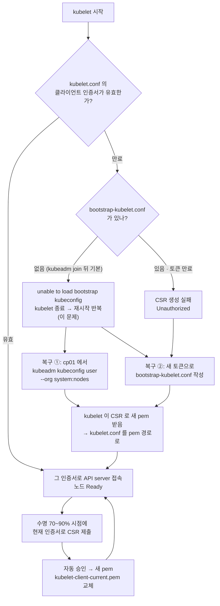

# q17 — Node lost after kubelet client certificate expiry · 풀이

← 문제: **[question.md](question.md)**

## 문제 (해석)

**원문**

> `worker02` went `NotReady`. Its kubelet service keeps restarting, and the kubelet journal
> complains about its client certificate. The control plane is healthy and every other node
> is fine.
>
> 1. On `worker02`, confirm the kubelet client certificate has expired and write its
>    `notAfter` date to `/opt/q17/expiry.txt`.
> 2. Determine whether `/etc/kubernetes/kubelet.conf` carries an embedded certificate or
>    points at a rotating file under `/var/lib/kubelet/pki`. Write which, and the path, to
>    `/opt/q17/identity.txt`.
> 3. Bring `worker02` back to `Ready` without reinstalling the node.
> 4. Approve any CertificateSigningRequest your fix creates, and show the node's new client
>    certificate expiry.
> 5. Write to `/opt/q17/why.txt` why running `kubeadm certs renew all` on the control plane
>    would not have fixed this.

**해석**

`worker02` 가 `NotReady` 가 되었다. kubelet 서비스는 계속 재시작되고, kubelet journal에는
클라이언트 인증서에 대한 오류가 남는다. 컨트롤 플레인은 정상이고 다른 노드는 모두 문제없다.

1. `worker02` 에서 kubelet 클라이언트 인증서가 만료되었음을 확인하고 `notAfter` 날짜를
   `/opt/q17/expiry.txt` 에 적는다.
2. `/etc/kubernetes/kubelet.conf` 가 인증서를 내장하고 있는지, `/var/lib/kubelet/pki` 아래의
   회전되는 파일을 가리키는지 판단한다. 어느 쪽인지와 그 경로를 `/opt/q17/identity.txt` 에 적는다.
3. 노드를 재설치하지 않고 `worker02` 를 `Ready` 로 되돌린다.
4. 수정 과정에서 생기는 CertificateSigningRequest를 승인하고, 노드의 새 클라이언트 인증서
   만료일을 보인다.
5. 컨트롤 플레인에서 `kubeadm certs renew all` 을 실행해도 이 문제가 해결되지 않는 이유를
   `/opt/q17/why.txt` 에 적는다.

## 모범 풀이

**1·2단계 — kubelet 이 무엇으로 인증하는지 먼저 확인합니다.** 두 가지 형태가 있고 조사 경로가
달라집니다.

```bash
systemctl status kubelet --no-pager | head -5      # activating (auto-restart) 를 오간다
grep -E 'client-certificate|client-key' /etc/kubernetes/kubelet.conf
```

```
# (A) 회전형 — kubeadm 기본값. pem 파일을 직접 읽으면 된다
client-certificate: /var/lib/kubelet/pki/kubelet-client-current.pem
# (B) 내장형 — 오래된 클러스터나 수동 설치. base64 를 풀어야 보인다
client-certificate-data: LS0tLS1CRUdJTi...
```

```bash
# (A) — current.pem 은 실제 파일(kubelet-client-<날짜>.pem)을 가리키는 심볼릭 링크다
ls -l /var/lib/kubelet/pki/
openssl x509 -in /var/lib/kubelet/pki/kubelet-client-current.pem -noout -enddate -subject
# notAfter=Aug 18 11:27:26 2026 GMT
# subject=O = system:nodes, CN = system:node:worker02

# (B)
grep client-certificate-data /etc/kubernetes/kubelet.conf | awk '{print $2}' \
  | base64 -d | openssl x509 -noout -enddate -subject

journalctl -u kubelet --since '-10min' | grep -iE 'expired|bootstrap|unauthorized'
# Part of the existing bootstrap client certificate in /etc/kubernetes/kubelet.conf is expired: 2026-08-18 11:27:26 +0000 UTC
# "command failed" err="failed to run Kubelet: unable to load bootstrap kubeconfig: stat /etc/kubernetes/bootstrap-kubelet.conf: no such file or directory"
```

답 파일은 이렇게 씁니다.

```bash
mkdir -p /opt/q17
openssl x509 -in /var/lib/kubelet/pki/kubelet-client-current.pem -noout -enddate > /opt/q17/expiry.txt
echo "rotating file: /var/lib/kubelet/pki/kubelet-client-current.pem (-> $(readlink -f /var/lib/kubelet/pki/kubelet-client-current.pem))" \
  > /opt/q17/identity.txt
```

kubelet 은 시작할 때 `kubelet.conf` 의 클라이언트 인증서가 아직 유효한지 먼저 봅니다. 만료됐으면 bootstrap
kubeconfig(`/etc/kubernetes/bootstrap-kubelet.conf`)로 새로 받으려 하는데, kubeadm 은 join 이 끝나면 그 파일을 지우므로
kubelet 이 곧바로 종료하고 systemd 가 다시 띄우기를 되풀이합니다. bootstrap 파일이 남아 있어도 그 안의 토큰은 보통
24시간 뒤 만료되므로, 이때는 CSR 을 만들다가 `Unauthorized` 로 실패합니다.

| 증상 | 원인 | 조치 |
|---|---|---|
| kubelet 재시작 반복, `client certificate ... is expired` + `unable to load bootstrap kubeconfig` | 클라이언트 인증서 만료, bootstrap 파일 없음 | 아래 재발급 |
| kubelet 재시작 반복, `cannot create certificate signing request: Unauthorized` | 인증서 만료 + bootstrap 토큰도 만료·삭제 | 새 토큰으로 bootstrap 다시 하거나 아래 재발급 |
| `x509: certificate signed by unknown authority` | CA 불일치 | `kubelet.conf` 의 `certificate-authority-data` 확인 |
| `connection refused` to :6443 | API server 다운 | 컨트롤 플레인 조사 |
| 노드 NotReady + `NetworkPluginNotReady` | CNI 문제 | q15 경로 |
| CSR이 `Pending` 으로 쌓임 | 자동 승인 미동작 | `kubectl certificate approve` |

**3단계 — 복구.** 자동 회전은 **만료 전에만** 동작합니다. kubelet은 수명의 약 70~90% 사이 임의의 시점에
새 인증서를 요청하는데, 그 요청 자체를 기존 인증서로 인증하기 때문입니다. 완전히 만료되면
스스로 회복할 수 없고, 이것이 이 문제의 핵심입니다. 그래서 **유효한 신원을 밖에서 넣어 줘야** 합니다.

가장 빠른 길은 컨트롤 플레인에서 kubeconfig를 직접 발급해 복사하는 것입니다(kubeadm 트러블슈팅 문서의 공식 절차).
조직과 CN이 정확해야 합니다. `O=system:nodes`, `CN=system:node:<노드이름>` 이 아니면 Node authorizer가 거부합니다.

```bash
# cp01 에서
kubeadm kubeconfig user --org system:nodes --client-name system:node:worker02 \
  > /tmp/worker02-kubelet.conf
grep server: /tmp/worker02-kubelet.conf      # worker02 의 원래 kubelet.conf 와 같은 주소인지 확인 (HA 라면 LB 주소)
scp /tmp/worker02-kubelet.conf worker02:/tmp/

# worker02 에서 — 지우기 전에 디렉터리 밖으로 백업한다
mkdir -p /root/q17-bak
cp -a /etc/kubernetes/kubelet.conf /var/lib/kubelet/pki/kubelet-client-* /root/q17-bak/
rm -f /var/lib/kubelet/pki/kubelet-client-*
cp /tmp/worker02-kubelet.conf /etc/kubernetes/kubelet.conf
systemctl restart kubelet
ls -l /var/lib/kubelet/pki/                  # 잠시 뒤 kubelet-client-current.pem 이 다시 생긴다
```

kubelet은 내장 인증서로 접속한 뒤 곧바로 새 인증서를 CSR로 받아
`/var/lib/kubelet/pki/kubelet-client-current.pem` 을 다시 만듭니다. 공식 절차는 그 파일이 생긴 뒤 `kubelet.conf` 의
`client-certificate-data`/`client-key-data` 를 파일 경로로 바꾸고 kubelet을 한 번 더 재시작하도록 안내합니다.
그래야 다음부터 회전된 인증서를 파일에서 읽습니다. 이 단계를 빼면 1년 뒤 내장 인증서가 만료될 때 같은 장애가 납니다.

```yaml
# /etc/kubernetes/kubelet.conf 의 users[0].user
    client-certificate: /var/lib/kubelet/pki/kubelet-client-current.pem
    client-key: /var/lib/kubelet/pki/kubelet-client-current.pem
```

```bash
systemctl restart kubelet
```

다른 방법으로 bootstrap을 다시 태울 수도 있습니다. `kubeadm token create --print-join-command` 로 토큰을 받아
`/etc/kubernetes/bootstrap-kubelet.conf` 를 만들고(`user.token:` 에 토큰, `server`/CA 는 기존 `kubelet.conf` 에서 복사),
`kubelet.conf` 와 만료된 pem을 치운 뒤 kubelet을 재시작하면 kubelet이 CSR을 제출해 새 `kubelet.conf` 와
`kubelet-client-current.pem` 을 **스스로 만듭니다.** 이렇게 만든 `kubelet.conf` 는 처음부터 회전형입니다.

**4단계 — CSR 승인과 새 만료일.** 둘 다 kubeadm 이 만든 자동 승인 규칙에 걸리므로 보통 이미 `Approved,Issued` 입니다.
위 방법이면 요청자가 `system:node:worker02`, bootstrap 방법이면 `system:bootstrap:<토큰ID>` 입니다. 남아 있으면 직접 승인합니다.

```bash
kubectl get csr
# NAME        SIGNERNAME                                    REQUESTOR              CONDITION
# csr-x7k2p   kubernetes.io/kube-apiserver-client-kubelet   system:node:worker02   Pending
kubectl certificate approve csr-x7k2p

# worker02 에서 새 만료일
openssl x509 -in /var/lib/kubelet/pki/kubelet-client-current.pem -noout -enddate
```

**5단계 — 답.** `kubeadm certs renew all` 은 컨트롤 플레인 노드의 인증서와 `admin.conf`,
`controller-manager.conf`, `scheduler.conf`(및 `super-admin.conf`)만 갱신합니다. kubelet 클라이언트 인증서는
kubelet의 회전 기능이 관리하는 대상이라 kubeadm이 손대지 않습니다.
그래서 `kubeadm certs check-expiration` 목록에는 `kubelet.conf` 가 **아예 없습니다**(kubelet이
`/var/lib/kubelet/pki` 의 인증서를 스스로 회전하도록 설정되어 있기 때문이라고 공식 문서가 설명합니다).
게다가 그 명령은 **컨트롤 플레인 노드에서** 도는 것이라 워커의 파일에 접근할 수도 없습니다.

```bash
cat > /opt/q17/why.txt <<'EOF'
kubeadm certs renew all only renews the control plane certificates and kubeconfigs on the node where it runs.
The worker's kubelet client certificate is managed by kubelet rotation (/var/lib/kubelet/pki), which kubeadm
does not renew, and rotation cannot work once the certificate has already expired.
EOF
```

### 그림 — kubelet 클라이언트 인증서의 수명과 복구 경로



1. 정상일 때는 왼쪽 위 고리만 돕니다. kubelet 은 인증서 수명의 70~90% 사이에 **현재 인증서로 인증해서** CSR 을 내고, 자동 승인된 새 인증서로 `kubelet-client-current.pem` 링크를 바꿉니다.
2. 이 고리가 한 번이라도 끊긴 채(노드가 오래 꺼져 있었거나 시계가 틀렸거나) 만료일을 넘기면, CSR 을 낼 신원 자체가 없어집니다. kubelet 은 bootstrap 파일로 넘어가려 하지만 kubeadm 은 join 뒤 그 파일을 지우므로 kubelet 이 종료됩니다.
3. 복구는 밖에서 유효한 신원을 넣어 주는 것입니다. ① 은 CA 가 있는 cp01 에서 노드 신원 kubeconfig 를 직접 발급하는 방법, ② 는 새 bootstrap 토큰을 주는 방법입니다. 어느 쪽이든 kubelet 이 다시 CSR 로 pem 을 받아 정상 고리로 돌아가고, ① 은 마지막에 `kubelet.conf` 를 pem 경로로 바꿔야 합니다.

## 검증

```bash
kubectl get nodes
# worker02   Ready   <none>   ...

openssl x509 -in /var/lib/kubelet/pki/kubelet-client-current.pem -noout -enddate -subject
# notAfter 가 약 1년 뒤, subject 에 CN=system:node:worker02

kubectl get csr | grep -c Pending          # 0
systemctl is-active kubelet                # active (재시작 반복이 멈췄다)
journalctl -u kubelet --since '-3min' | grep -ciE 'expired|unauthorized'   # 0
grep client-certificate: /etc/kubernetes/kubelet.conf   # 내장형이 아니라 pem 경로
kubectl logs -n kube-system <worker02의 파드>   # kubelet 10250 도 응답하는지 교차 확인
```

## 오답 원인 / 배운 점

- **왜 틀렸나**:
- **기억할 것**: kubelet의 인증서 자동 회전은 만료 **전에만** 동작한다. 완전히 만료되면 cp01 에서 `kubeadm kubeconfig user --org system:nodes` 로 신원을 새로 발급하거나 bootstrap 토큰으로 CSR을 다시 받아야 하고, `kubeadm certs renew` 는 워커의 kubelet 인증서를 갱신하지 않는다.
- **헷갈리는 지점**: 인증서가 두 종류입니다 — kubelet **client** 인증서(kubelet이 API server에 접속할 때 쓰는 신원, `kubelet-client-current.pem`)와 kubelet **serving** 인증서(API server나 metrics-server가 kubelet의 10250에 접속할 때 kubelet이 제시, `kubelet.crt`/`kubelet-server-current.pem`). client가 만료되면 노드가 NotReady가 되고, serving이 문제면 노드는 Ready입니다. kubeadm 기본 설정의 API server는 kubelet serving 인증서를 검증하지 않아 `kubectl logs`/`exec` 는 보통 그대로 되고, 인증서를 검증하는 metrics-server(`kubectl top`) 쪽에서 먼저 드러납니다. 증상이 다르므로 먼저 어느 쪽인지 가릅니다.

## 참고 문서

- 검색어: `certificate rotation kubelet`
- https://kubernetes.io/docs/tasks/tls/certificate-rotation/
- https://kubernetes.io/docs/tasks/administer-cluster/kubeadm/kubeadm-certs/
- https://kubernetes.io/docs/setup/production-environment/tools/kubeadm/troubleshooting-kubeadm/ (Kubelet client certificate rotation fails)

---

[↑ 문항 목록](../README.md) · [← 문제로](question.md)
