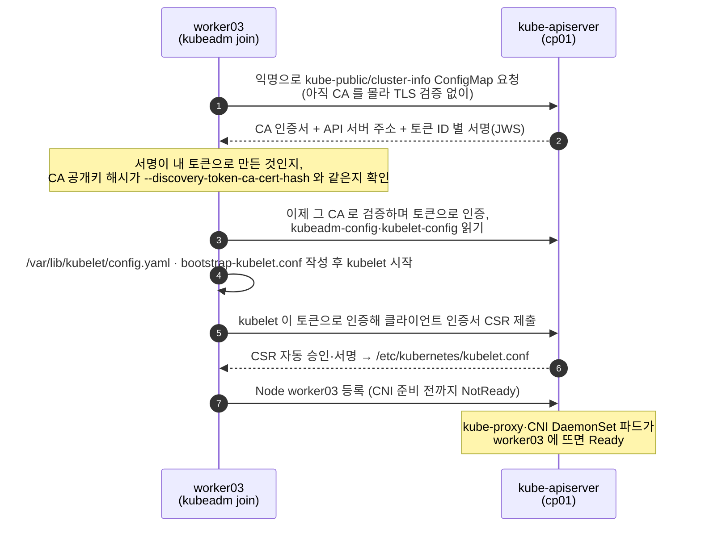

# q01 — Join a new worker node to the cluster · 풀이

← 문제: **[question.md](question.md)**

## 문제 (해석)

**원문**

> A freshly provisioned machine `worker03` has `kubeadm`, `kubelet` and `containerd`
> installed but has never joined a cluster. Bring it into the cluster as a worker.
>
> 1. On `worker03`, confirm the node prerequisites are met: swap disabled, the
>    `br_netfilter` module loaded, `net.ipv4.ip_forward` set to `1`, and containerd's
>    runc using `SystemdCgroup = true`. Fix anything that is wrong.
> 2. On `cp01`, list the existing bootstrap tokens. The old ones have expired — do not
>    reuse them.
> 3. Produce a valid join command on `cp01` without hand-assembling it.
> 4. Also compute the discovery CA certificate hash from `/etc/kubernetes/pki/ca.crt`
>    manually and confirm it matches the hash inside the join command.
> 5. Run the join on `worker03` and label the node
>    `node-role.kubernetes.io/worker=worker`.
> 6. Confirm `worker03` reaches `Ready` and that a test pod can be scheduled onto it.

**해석**

새로 준비된 머신 `worker03` 에 `kubeadm`, `kubelet`, `containerd` 는 설치되어 있으나 아직 어떤
클러스터에도 조인하지 않았다. 이 노드를 워커로 클러스터에 편입시킨다.

1. `worker03` 에서 노드 전제조건을 확인한다: swap 비활성, `br_netfilter` 모듈 로드,
   `net.ipv4.ip_forward` 가 `1`, containerd의 runc가 `SystemdCgroup = true`.
   잘못된 것은 고친다.
2. `cp01` 에서 기존 부트스트랩 토큰 목록을 본다. 기존 토큰은 만료되었으므로 재사용하지 않는다.
3. `cp01` 에서 join 명령을 손으로 조립하지 않고 만들어 낸다.
4. `/etc/kubernetes/pki/ca.crt` 로부터 discovery CA 인증서 해시를 직접 계산해서
   join 명령 안의 해시와 일치하는지 확인한다.
5. `worker03` 에서 join을 실행하고 노드에 `node-role.kubernetes.io/worker=worker`
   레이블을 붙인다.
6. `worker03` 이 `Ready` 가 되고 테스트 파드가 그 노드에 스케줄되는지 확인한다.

## 모범 풀이

**1) 전제조건** (worker03, root)

```bash
swapon --show                                         # 출력이 있으면 swap 이 켜져 있다
swapoff -a && sed -i -E '/^[^#].*[[:space:]]swap[[:space:]]/ s/^/#/' /etc/fstab   # fstab까지 고쳐야 재부팅 후에도 유지
lsmod | grep br_netfilter || modprobe br_netfilter
printf 'overlay\nbr_netfilter\n' > /etc/modules-load.d/k8s.conf   # 부팅 때도 로드 (overlay 는 containerd 용)
sysctl net.ipv4.ip_forward                            # 0이면 아래로 수정
printf 'net.ipv4.ip_forward=1\nnet.bridge.bridge-nf-call-iptables=1\n' > /etc/sysctl.d/k8s.conf
sysctl --system
grep -n SystemdCgroup /etc/containerd/config.toml     # false면 true로. 줄이 아예 없으면 아래 한 줄로 기본 설정부터 만든다
# containerd config default > /etc/containerd/config.toml
sed -i 's/SystemdCgroup = false/SystemdCgroup = true/' /etc/containerd/config.toml
systemctl restart containerd
containerd config dump | grep SystemdCgroup         # SystemdCgroup = true (실제로 적용된 값)
```

패키지로 설치한 containerd의 `/etc/containerd/config.toml` 은 없거나, CRI 플러그인을 끈
(`disabled_plugins = ["cri"]`) 최소 설정일 수 있습니다. 그러면 `SystemdCgroup` 줄이 없어 `sed` 가 아무것도
바꾸지 못하고, join은 preflight에서 `container runtime is not running` 으로 실패합니다. 그럴 때는 B-q02처럼
`containerd config default` 로 기본 설정을 만든 뒤 고칩니다.

**2~3) 토큰과 join 명령** (cp01, root)

```bash
kubeadm token list                                     # 기존 토큰 확인 (재사용하지 않는다)
kubeadm token create --print-join-command
# kubeadm join 10.0.0.10:6443 --token abcdef.0123456789abcdef \
#     --discovery-token-ca-cert-hash sha256:1a2b3c...
```

`--print-join-command` 는 토큰을 새로 만들면서 API 서버 주소와 CA 해시까지 채워 출력합니다.
해시를 외워서 적을 필요가 없습니다. 새 토큰의 기본 TTL 은 24시간입니다.

`kubeadm token list` 가 비어 있어도 이상한 것이 아닙니다. 부트스트랩 토큰은 `kube-system` 의
`bootstrap-token-<id>` Secret 이고, 만료되면 컨트롤러 매니저의 tokencleaner 가 지웁니다. 지워지기 전에 보이면
TTL 칸이 `<invalid>` 로 나옵니다. 어느 쪽이든 그 토큰으로는 join 할 수 없으니 새로 만듭니다.

**4) CA 해시 직접 계산** (cp01)

```bash
openssl x509 -in /etc/kubernetes/pki/ca.crt -pubkey -noout \
  | openssl pkey -pubin -outform der \
  | openssl dgst -sha256 -hex | sed 's/^.* //'
```

핵심은 **인증서 전체가 아니라 공개키(SubjectPublicKeyInfo)의 DER 인코딩**을 해싱한다는 점입니다.
`openssl x509 -in ca.crt -outform der | openssl dgst -sha256` 로 하면 전혀 다른 값이 나옵니다.

**5) 조인**

```bash
# worker03 에서 위에서 받은 명령을 그대로 실행
kubeadm join 10.0.0.10:6443 --token abcdef.0123456789abcdef \
  --discovery-token-ca-cert-hash sha256:1a2b3c...

# cp01 에서
kubectl label node worker03 node-role.kubernetes.io/worker=worker
```

조인 실패 시 `kubeadm reset -f` (와 `rm -rf /etc/cni/net.d/*`) 로 되돌린 뒤 원인을 고치고 다시 시도합니다.
그냥 재실행하면 preflight 에서 `/etc/kubernetes/kubelet.conf already exists` 같은 오류로 막힙니다.

전제조건을 하나 빼먹었을 때 어디서 드러나는지는 다릅니다.

| 빠뜨린 것 | 증상 |
|---|---|
| `ip_forward` = 0 | join preflight 가 `[ERROR FileContent--proc-sys-net-ipv4-ip_forward] ... contents are not set to 1` 로 바로 멈춘다 |
| swap 켜짐 | preflight 는 경고만 낼 수 있고, kubelet 이 기본값(`failSwapOn: true`)으로 시작을 거부해 join 이 kubelet 을 기다리다 시간 초과된다. `journalctl -u kubelet` 에 swap 관련 오류 |
| containerd 설정에 CRI 플러그인이 꺼짐 | preflight 의 `container runtime is not running` |
| `br_netfilter` 없음 | join 은 성공할 수 있다. 브리지를 지나는 파드 트래픽이 iptables 를 거치지 않아 Service 통신이 나중에 깨진다 |
| `SystemdCgroup = false` | join 은 성공할 수 있다. kubelet(systemd 드라이버)과 cgroup 관리 방식이 달라 노드가 불안정해진다 |

뒤의 두 가지는 join 만으로는 드러나지 않으므로 1) 에서 직접 확인하고 고치는 것이 이 문제의 요점입니다.

### 그림 — join 할 때 토큰과 CA 해시가 하는 일



1. 워커는 아직 클러스터 CA 를 모르므로, 처음에는 인증서 검증 없이 누구나 읽을 수 있는 `cluster-info` 를 받습니다. 그래서 받은 내용을 두 가지로 확인합니다.
2. 토큰 서명(JWS)은 "내 토큰의 비밀 부분을 아는 서버가 보낸 정보"인지를, CA 해시는 "내가 믿기로 한 바로 그 CA"인지를 확인합니다. 해시가 다르면 join 을 멈춥니다. 4) 에서 직접 계산한 값이 바로 이 비교 대상입니다.
3. 확인이 끝나면 그 CA 로 API 서버를 검증하면서 토큰으로 인증해 클러스터 설정을 읽고, 토큰은 kubelet 의 임시 자격 증명(`bootstrap-kubelet.conf`)이 됩니다. kubelet 은 이것으로 자기 인증서를 요청하고, 승인되면 정식 `kubelet.conf` 로 바꿉니다. 그래서 만료된 토큰으로는 이 과정 전체가 막힙니다.
4. Node 가 등록된 직후에는 네트워크 플러그인이 없어 `NotReady` 입니다. CNI·kube-proxy 파드가 새 노드에 뜨면 `Ready` 가 되므로, 검증에서 이 파드들을 함께 봅니다.

## 검증

```bash
kubectl get nodes -o wide
# worker03   Ready   worker   ...   v1.35.x

kubectl run t1 --image=nginx:1.27 \
  --overrides='{"apiVersion":"v1","spec":{"nodeSelector":{"kubernetes.io/hostname":"worker03"}}}'
kubectl get pod t1 -o wide          # NODE 칼럼이 worker03, STATUS Running (nodeName 은 스케줄러를 건너뛰므로 쓰지 않는다)

kubectl -n kube-system get pods -o wide | grep worker03
# kube-proxy / CNI 데몬셋 파드가 새 노드에 떠 있어야 한다

kubeadm token list                  # 새 토큰이 24h TTL로 보인다
```

## 오답 원인 / 배운 점

- **왜 틀렸나**:
- **기억할 것**: join 명령은 만들지 말고 `kubeadm token create --print-join-command` 로 받는다.
- **헷갈리는 지점**: `kubeadm token list` 에 보이는 것은 부트스트랩 토큰이고,
  `--certificate-key` 는 컨트롤 플레인 조인에만 쓰이는 별개의 값입니다
  (`kubeadm init phase upload-certs --upload-certs` 로 생성). 워커 조인에는 필요 없습니다.
  swap도 함정입니다 — `swapoff -a` 만 하고 `/etc/fstab` 을 그대로 두면 재부팅 후 kubelet이 다시 죽습니다.

## 참고 문서

- 검색어: `kubeadm join`
- https://kubernetes.io/docs/reference/setup-tools/kubeadm/kubeadm-join/

---

[↑ 문항 목록](../README.md) · [← 문제로](question.md) · [다음 문제 q02 →](../q02_kustomize_overlay_deploy/question.md)
