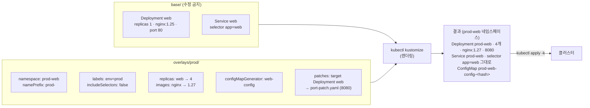

# q02 — Deploy an environment overlay with Kustomize · 풀이

← 문제: **[question.md](question.md)**

## 문제 (해석)

**원문**

> A base manifest set exists at `/opt/course/q02/base/` containing `deployment.yaml`
> (Deployment `web`, image `nginx:1.25`, 1 replica), `service.yaml` and
> `kustomization.yaml`.
>
> Build a production overlay at `/opt/course/q02/overlays/prod/` that, without editing
> any file under `base/`:
>
> 1. References the base.
> 2. Deploys into namespace `prod-web` (create the namespace).
> 3. Prefixes every resource name with `prod-`.
> 4. Adds the label `env: prod` to every resource.
> 5. Sets the `web` Deployment to 4 replicas.
> 6. Changes the image to `nginx:1.27`.
> 7. Adds a ConfigMap generated from literals `TIER=prod` and `LOG_LEVEL=warn`,
>    named `web-config`.
> 8. Patches the container port to `8080` using a patch with an explicit `target`.
>
> Render the overlay to stdout to review it **before** applying, then apply it.

**해석**

`/opt/course/q02/base/` 에 베이스 매니페스트가 있다. `deployment.yaml` (Deployment `web`,
이미지 `nginx:1.25`, 레플리카 1), `service.yaml`, `kustomization.yaml` 로 구성된다.

`base/` 아래 파일을 하나도 수정하지 않고 `/opt/course/q02/overlays/prod/` 에 프로덕션
오버레이를 만든다.

1. 베이스를 참조한다.
2. 네임스페이스 `prod-web` 에 배포한다 (네임스페이스를 만든다).
3. 모든 리소스 이름에 `prod-` 접두사를 붙인다.
4. 모든 리소스에 `env: prod` 레이블을 추가한다.
5. `web` Deployment의 레플리카를 4로 한다.
6. 이미지를 `nginx:1.27` 로 바꾼다.
7. 리터럴 `TIER=prod` 와 `LOG_LEVEL=warn` 로 생성되는 ConfigMap `web-config` 를 추가한다.
8. 명시적 `target` 을 가진 patch로 컨테이너 포트를 `8080` 으로 바꾼다.

적용 **전에** 오버레이를 stdout으로 렌더링해 확인한 뒤 적용한다.

## 모범 풀이

```bash
kubectl create namespace prod-web
mkdir -p /opt/course/q02/overlays/prod
```

`/opt/course/q02/overlays/prod/port-patch.yaml`:

```yaml
- op: replace
  path: /spec/template/spec/containers/0/ports/0/containerPort
  value: 8080
```

`/opt/course/q02/overlays/prod/kustomization.yaml`:

```yaml
apiVersion: kustomize.config.k8s.io/v1beta1
kind: Kustomization
namespace: prod-web
namePrefix: prod-
labels:
  - pairs:
      env: prod
    includeSelectors: false
resources:
  - ../../base
replicas:
  - name: web
    count: 4
images:
  - name: nginx
    newTag: "1.27"
configMapGenerator:
  - name: web-config
    literals:
      - TIER=prod
      - LOG_LEVEL=warn
patches:
  - target:
      kind: Deployment
      name: web
    path: port-patch.yaml
```

```bash
kubectl kustomize /opt/course/q02/overlays/prod     # 렌더만, 적용하지 않음
kubectl apply -k /opt/course/q02/overlays/prod
```

두 가지가 사람을 넘어뜨립니다. 첫째, 오버레이 안의 대상 이름은 **접두사가 붙기 전의 원래
이름**(`web`)으로 씁니다. 특히 `patches[].target.name` 을 `prod-web` 으로 쓰면 아무것도 매칭되지 않아
**에러 없이 패치가 빠지고** 포트가 80 그대로 렌더링됩니다(`replicas` 는 `prod-web` 으로 써도 잡히지만
헷갈리지 않게 원래 이름으로 통일합니다). 반면 `images[].name` 은 리소스 이름이 아니라 컨테이너
`image:` 에서 태그를 뺀 **이미지 이름**(`nginx`)입니다. 둘째, 구식 `commonLabels` 를 쓰면 레이블이
Deployment의 `selector.matchLabels` 와 Service의 `selector` 에도 함께 주입됩니다. 셀렉터는 불변
필드라서 이미 존재하는 Deployment에 apply하면 거부됩니다. 신형 `labels` 필드는 `includeSelectors` 가
기본 false라 메타데이터에만 붙습니다 — 그래서 `commonLabels` 대신 `labels` 를 쓰는 것이 안전합니다.

포트 패치는 `containerPort` 값만 바꿉니다. 이 값은 정보용이라 nginx는 여전히 80에서 듣고,
베이스 Service의 `targetPort: 80` 도 그대로입니다. 문제는 컨테이너 포트만 요구하므로 Service는
건드리지 않습니다.

### 그림 — base 와 overlay 가 합쳐지는 과정



1. `resources: ../../base` 가 base 의 Deployment·Service 를 읽어 옵니다. base 파일은 그대로 둡니다.
2. `replicas` 와 `patches.target` 은 리소스의 원래 이름 `web` 으로, `images` 는 이미지 이름 `nginx` 로 대상을 찾습니다.
3. `configMapGenerator` 가 ConfigMap `web-config` 를 새로 만들고, 여기에도 접두사·네임스페이스·레이블이 똑같이 붙습니다.
4. `namePrefix` 는 모든 리소스 이름 앞에 `prod-` 를 붙이고, `labels` 는 `metadata.labels` 에만 `env=prod` 를 붙여 셀렉터는 `app=web` 그대로 남습니다.
5. `kubectl kustomize` 는 결과를 화면에만 찍고, `kubectl apply -k` 가 같은 결과를 적용합니다. `namespace:` 는 Namespace를 만들지 않으므로 `prod-web` 은 미리 만들어 둡니다.

`configMapGenerator` 가 만드는 ConfigMap 이름에는 내용 해시 접미사가 붙어
`prod-web-config-k2fhh5bbhc` 같은 형태가 됩니다. 이는 의도된 동작입니다 — 내용이 바뀌면
이름이 바뀌어 파드가 롤아웃됩니다. 해시가 싫으면 `generatorOptions.disableNameSuffixHash: true`.

## 검증

```bash
kubectl -n prod-web get deploy,svc,cm
# deployment.apps/prod-web   4/4
# service/prod-web
# configmap/prod-web-config-<hash>

kubectl -n prod-web get deploy prod-web \
  -o jsonpath='{.spec.template.spec.containers[0].image}{"\n"}'   # nginx:1.27

kubectl -n prod-web get deploy prod-web \
  -o jsonpath='{.spec.template.spec.containers[0].ports[0].containerPort}{"\n"}'  # 8080

kubectl -n prod-web get deploy,svc,cm -l env=prod        # 3개 모두 나와야 한다
kubectl -n prod-web get deploy prod-web -o jsonpath='{.spec.selector.matchLabels}{"\n"}'   # env 키가 없어야 한다
kubectl kustomize /opt/course/q02/overlays/prod | grep -c 'env: prod'   # 3
```

## 오답 원인 / 배운 점

- **왜 틀렸나**:
- **기억할 것**: `replicas`·`patches.target` 의 이름은 베이스의 원래 리소스 이름(`web`), `images[].name` 은 이미지 이름(`nginx`)이다. 접두사 붙은 이름으로 target을 쓰면 패치가 조용히 빠진다.
- **헷갈리는 지점**: `kubectl kustomize <dir>` 는 렌더만 하고 클러스터를 건드리지 않습니다.
  `kubectl apply -k <dir>` 가 적용입니다. `-f` 와 `-k` 를 섞어 쓰면
  (`kubectl apply -f overlays/prod/`) kustomization.yaml을 일반 매니페스트로 읽으려다 실패합니다.

## 참고 문서

- 검색어: `kustomize declarative management`
- https://kubernetes.io/docs/tasks/manage-kubernetes-objects/kustomization/

## 복습 기록

| 날짜 | 결과 | 메모 |
|---|---|---|
|  |  |  |
