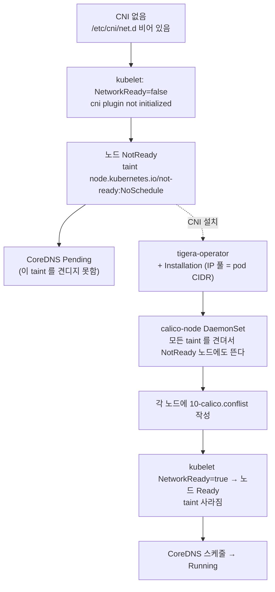
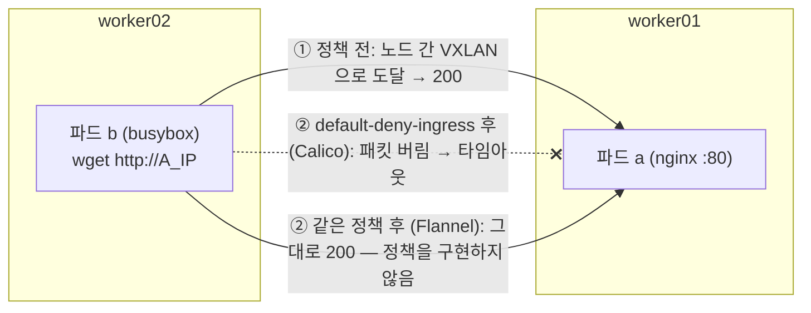

# q03 — Install a CNI plugin that enforces NetworkPolicy · 풀이

← 문제: **[question.md](question.md)**

## 문제 (해석)

**원문**

> Cluster `k8s-c4` was just built with kubeadm. Every node is `NotReady` and the CoreDNS
> pods are `Pending`. Two sets of CNI manifests are staged on the task host:
>
> - `/opt/course/q03/flannel/kube-flannel.yml`
> - `/opt/course/q03/calico/` — the Calico operator manifests and `custom-resources.yaml`
>
> 1. Find the pod CIDR the cluster was initialised with and write it to
>    `/opt/course/q03/podcidr.txt`.
> 2. Install the one CNI that satisfies **both** requirements: pods on different nodes can
>    reach each other, **and** NetworkPolicy is enforced. Use only the staged manifests (no
>    Helm), and make its IP pool match the cluster's pod CIDR.
> 3. Confirm every node is `Ready`, the CoreDNS pods are `Running`, and a CNI configuration
>    file exists under `/etc/cni/net.d/` on a worker node.
> 4. Prove pod-to-pod connectivity across nodes with two test pods pinned to different
>    nodes in namespace `cni-test`.
> 5. Prove enforcement: after a default-deny ingress policy is applied in `cni-test`, the
>    same request must fail.
> 6. State in one line why the other staged CNI would not satisfy the task.

**해석**

클러스터 `k8s-c4` 는 kubeadm으로 막 만들어졌다. 모든 노드가 `NotReady` 이고 CoreDNS 파드는
`Pending` 이다. 작업 호스트에 CNI 매니페스트 두 벌이 준비되어 있다.

- `/opt/course/q03/flannel/kube-flannel.yml`
- `/opt/course/q03/calico/` — Calico operator 매니페스트와 `custom-resources.yaml`

1. 클러스터를 초기화할 때 쓴 pod CIDR을 찾아 `/opt/course/q03/podcidr.txt` 에 쓴다.
2. 두 요구사항 — 서로 다른 노드의 파드끼리 통신되고, **NetworkPolicy가 실제로 적용됨** — 을 **모두**
   만족하는 CNI 하나를 설치한다. 준비된 매니페스트만 쓰고(Helm 금지), IP 풀을 클러스터 pod CIDR에 맞춘다.
3. 모든 노드가 `Ready`, CoreDNS 파드가 `Running` 이고, 워커 노드의 `/etc/cni/net.d/` 에 CNI 설정 파일이
   있는지 확인한다.
4. 네임스페이스 `cni-test` 에 서로 다른 노드에 고정한 테스트 파드 두 개로 노드 간 파드 통신을 증명한다.
5. `cni-test` 에 default-deny ingress 정책을 적용한 뒤 같은 요청이 실패함을 보여 적용 여부를 증명한다.
6. 준비된 다른 CNI가 왜 조건을 만족하지 못하는지 한 줄로 적는다.

## 모범 풀이

**증상 해석** — CNI가 없으면 kubelet이 `NetworkReady=false ... cni plugin not initialized` 를 보고해
노드가 `NotReady` 가 되고, 노드에 `node.kubernetes.io/not-ready:NoSchedule` taint가 붙습니다. CoreDNS는
이 taint를 견디지 못해 `Pending` 입니다. CNI만 설치하면 둘 다 풀립니다.

### 그림 1 — CNI 가 없을 때와 설치한 뒤



1. CNI 설정 파일이 `/etc/cni/net.d/` 에 없으면 kubelet 은 파드 네트워크를 만들 수 없어 `NetworkReady=false` 를 보고하고, 노드는 `NotReady` 가 되며 `not-ready:NoSchedule` taint 가 붙습니다.
2. CoreDNS Deployment 는 이 taint 를 견디는 toleration 이 없어 `Pending` 입니다. 반대로 `calico-node` 같은 CNI DaemonSet 은 모든 taint 를 견디도록 만들어져 있어 `NotReady` 노드에도 뜹니다.
3. `calico-node` 가 노드마다 CNI 설정 파일을 쓰면 kubelet 이 네트워크 준비 완료를 보고하고, 노드가 `Ready` 가 되어 taint 가 풀리고, CoreDNS 가 스케줄됩니다.

**1) pod CIDR 확인**

```bash
kubectl -n kube-system get cm kubeadm-config -o yaml | grep -i podSubnet
#     podSubnet: 10.244.0.0/16
kubectl get nodes -o jsonpath='{range .items[*]}{.metadata.name}{" "}{.spec.podCIDR}{"\n"}{end}'
# cp01 10.244.0.0/24 / worker01 10.244.1.0/24 ...   ← 노드별로 잘라 준 대역
echo 10.244.0.0/16 > /opt/course/q03/podcidr.txt
```

컨트롤 플레인 노드라면 `grep cluster-cidr /etc/kubernetes/manifests/kube-controller-manager.yaml` 로도
같은 값을 볼 수 있습니다.

**2) 어느 CNI인가 — Calico**

**Flannel은 NetworkPolicy를 적용하지 않습니다.** 노드 간 오버레이 네트워크만 제공합니다. API server는
CNI와 상관없이 NetworkPolicy 오브젝트를 받아 주므로, Flannel 클러스터에서도 정책은 "만들어지지만"
아무 효과가 없습니다. 두 조건을 모두 만족하는 것은 Calico입니다.

```bash
ls /opt/course/q03/calico/
# custom-resources.yaml  operator-crds.yaml  tigera-operator.yaml
#   (v3.30 부터 CRD 가 operator-crds.yaml 로 따로 나온다. 예전 버전은 tigera-operator.yaml 하나에 다 들어 있다)
kubectl create -f /opt/course/q03/calico/operator-crds.yaml      # CRD 먼저
kubectl create -f /opt/course/q03/calico/tigera-operator.yaml
kubectl -n tigera-operator rollout status deploy tigera-operator
```

**`apply` 가 아니라 `create`** 를 씁니다. CRD 묶음이 커서 `kubectl apply` 가 전체 내용을
`last-applied-configuration` 어노테이션에 저장하려다 크기 제한(`metadata.annotations: Too long`)에
걸립니다. `kubectl apply --server-side` 도 됩니다.

다음은 IP 풀입니다. `custom-resources.yaml` 의 기본 CIDR은 `192.168.0.0/16` 이라 이 클러스터
(`10.244.0.0/16`)와 다릅니다. 반드시 맞춘 뒤 적용합니다.

```bash
vi /opt/course/q03/calico/custom-resources.yaml
```

```yaml
apiVersion: operator.tigera.io/v1
kind: Installation
metadata:
  name: default
spec:
  calicoNetwork:
    ipPools:
    - name: default-ipv4-ippool
      blockSize: 26
      cidr: 10.244.0.0/16          # ← 192.168.0.0/16 을 클러스터 pod CIDR 로
      encapsulation: VXLANCrossSubnet
      natOutgoing: Enabled
      nodeSelector: all()
```

```bash
kubectl create -f /opt/course/q03/calico/custom-resources.yaml
watch kubectl get tigerastatus          # apiserver, calico, ippools, goldmane, whisker … 전부 AVAILABLE True 가 될 때까지
kubectl -n calico-system get pods -o wide
```

CIDR이 다르면 파드 IP가 컨트롤러와 kube-proxy가 아는 클러스터 대역(`--cluster-cidr`) 밖에서 나와
SNAT·라우팅 판단이 어긋납니다. operator가 불일치를 감지하면 `tigerastatus` 의 DEGRADED 열이 True 로 남고
메시지에 원인이 적힙니다. (Calico가 operator가 아닌 단일 매니페스트 `calico.yaml` 로 주어졌다면
`calico-node` DaemonSet의 환경 변수 `CALICO_IPV4POOL_CIDR` 의 주석을 풀고 값을 맞춥니다.)
`ipPools` 를 아예 지우면 operator 가 kubeadm-config 의 `podSubnet` 을 읽어 풀을 만들기도 하지만, 문제가
"IP 풀을 맞추라"고 했으니 값을 직접 적어 두는 편이 채점에 안전합니다.

**3) 확인**

```bash
kubectl get nodes                                       # 전부 Ready
kubectl -n kube-system get pods -l k8s-app=kube-dns     # Running
ssh worker01 ls /etc/cni/net.d/                         # 10-calico.conflist, calico-kubeconfig
```

**4) 노드 간 통신**

노드 이름은 클러스터마다 다르니 먼저 `kubectl get nodes` 로 확인합니다. 아래 `worker01`·`worker02` 는 예시입니다.

```bash
kubectl get nodes
kubectl create namespace cni-test
kubectl -n cni-test run a --image=nginx:1.27 \
  --overrides='{"spec":{"nodeSelector":{"kubernetes.io/hostname":"worker01"}}}'
kubectl -n cni-test run b --image=busybox:1.36 --restart=Never \
  --overrides='{"spec":{"nodeSelector":{"kubernetes.io/hostname":"worker02"}}}' -- sleep 3600
kubectl -n cni-test wait pod a b --for=condition=Ready --timeout=120s
kubectl -n cni-test get pods -o wide                    # a 는 worker01, b 는 worker02, IP 는 pod CIDR 안

A_IP=$(kubectl -n cni-test get pod a -o jsonpath='{.status.podIP}')
kubectl -n cni-test exec b -- wget -qO- --timeout=3 http://$A_IP | head -2   # nginx 응답
```

워커가 하나뿐이면 한쪽을 컨트롤 플레인에 둡니다. `nodeSelector` 로는 컨트롤 플레인의 `NoSchedule` taint 에
막히므로, 스케줄러를 거치지 않는 `"spec":{"nodeName":"cp01"}` 로 고정합니다(kubelet 은 `NoSchedule` 을 보지 않습니다).

**5) 정책이 실제로 적용되는지**

```bash
kubectl -n cni-test apply -f - <<'EOF'
apiVersion: networking.k8s.io/v1
kind: NetworkPolicy
metadata: { name: default-deny-ingress }
spec:
  podSelector: {}
  policyTypes: ["Ingress"]
EOF
kubectl -n cni-test exec b -- wget -qO- --timeout=3 http://$A_IP
# wget: download timed out   ← 같은 요청이 이제 막힌다
```

"정책 오브젝트가 만들어졌다"는 아무것도 증명하지 않습니다. **정책 전에는 되고, 정책 후에는 안 되는**
같은 요청을 보여야 적용이 증명됩니다. Flannel이었다면 5번의 요청이 그대로 성공합니다.

### 그림 2 — 같은 요청, 정책 전과 후



1. ①은 4번입니다. 서로 다른 노드의 파드끼리 닿는다는 것은 CNI 의 노드 간 경로(Calico 는 `custom-resources.yaml` 의 VXLAN 캡슐화)가 동작한다는 뜻입니다.
2. ②는 5번입니다. `podSelector: {}` + `policyTypes: [Ingress]` 정책이 `cni-test` 의 모든 파드를 격리하므로, Calico 는 `a` 로 들어오는 패킷을 버리고 `wget` 은 타임아웃이 납니다.
3. Flannel 은 같은 정책 오브젝트를 API server 가 받아 주기만 할 뿐 아무도 구현하지 않으므로 요청이 그대로 성공합니다. 그래서 "정책 전 성공 → 정책 후 실패"의 짝이 있어야 적용이 증명됩니다.

**6)** Flannel은 노드 간 통신은 되지만 NetworkPolicy를 구현하지 않아, 정책을 만들어도 아무것도 막지 않습니다.

## 검증

```bash
cat /opt/course/q03/podcidr.txt                         # 10.244.0.0/16
kubectl get nodes                                       # 전부 Ready
kubectl get tigerastatus                                # AVAILABLE True
kubectl get installation default -o jsonpath='{.spec.calicoNetwork.ipPools[0].cidr}{"\n"}'
# 10.244.0.0/16
kubectl -n cni-test get pods -o wide                    # 파드 IP 가 10.244.x.x
kubectl -n cni-test exec b -- wget -qO- --timeout=3 http://$A_IP   # (정책 적용 후) 실패
```

## 오답 원인 / 배운 점

- **왜 틀렸나**:
- **기억할 것**: NetworkPolicy 적용 여부는 CNI가 정한다 — Flannel은 적용하지 않고 Calico·Cilium은 적용한다. CNI의 IP 풀은 kubeadm의 `podSubnet`(= controller-manager `--cluster-cidr`)과 같아야 한다. 큰 CRD 묶음은 `kubectl create`(또는 `apply --server-side`)로 설치한다.
- **헷갈리는 지점**: 노드 `NotReady` + CoreDNS `Pending` 은 "CNI 없음"의 전형입니다. CNI 설치 직후 몇 분간은 `tigerastatus` 의 PROGRESSING 이 True 이니 기다립니다. 그리고 정책 검증은 "정책 전 성공 → 정책 후 실패"의 짝으로 해야 의미가 있습니다.

## 참고 문서

- 검색어: `network plugins`, `install calico`
- https://kubernetes.io/docs/concepts/extend-kubernetes/compute-storage-net/network-plugins/
- https://kubernetes.io/docs/setup/production-environment/tools/kubeadm/create-cluster-kubeadm/#pod-network
- https://docs.tigera.io/calico/latest/getting-started/kubernetes/self-managed-onprem/onpremises

## 복습 기록

| 날짜 | 결과 | 메모 |
|---|---|---|
|  |  |  |
