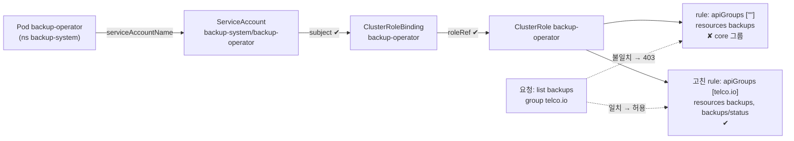
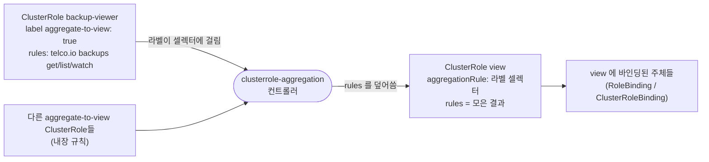

# q04 — Install and configure an operator · 풀이

← 문제: **[question.md](question.md)**

## 문제 (해석)

**원문**

> The manifest bundle for a backup operator is at `/opt/course/q04/operator.yaml`. It
> contains a Namespace, a CRD, a ServiceAccount, a ClusterRole, a ClusterRoleBinding and
> the controller Deployment.
>
> 1. Install the bundle. The operator must end up in namespace `backup-system`.
> 2. Report the full resource name, API group, version, short name and scope of the
>    custom resource the CRD registers.
> 3. The controller Deployment `backup-operator` comes up but its log repeatedly shows
>    `backups.telco.io is forbidden: cannot list resource "backups"`. Find the cause and
>    fix it. Do not grant `cluster-admin`.
> 4. Everyone bound to the built-in `view` ClusterRole must also be able to read `backups`.
>    Achieve this **without editing the `view` ClusterRole**, using a new ClusterRole named
>    `backup-viewer`.
> 5. Once the controller reconciles cleanly, create a `Backup` named `nightly` in namespace
>    `default` with `spec.schedule: "0 2 * * *"` and `spec.target: pvc/data-web-0`, and
>    show that the controller observed it.

**해석**

백업 오퍼레이터의 매니페스트 번들이 `/opt/course/q04/operator.yaml` 에 있다. Namespace, CRD,
ServiceAccount, ClusterRole, ClusterRoleBinding, 컨트롤러 Deployment가 들어 있다.

1. 번들을 설치한다. 오퍼레이터는 네임스페이스 `backup-system` 에 있어야 한다.
2. CRD가 등록하는 커스텀 리소스의 전체 리소스 이름, API 그룹, 버전, 짧은 이름, 스코프를 보고한다.
3. 컨트롤러 Deployment `backup-operator` 는 뜨지만 로그에
   `backups.telco.io is forbidden: cannot list resource "backups"` 가 반복된다.
   원인을 찾아 고친다. `cluster-admin` 을 부여하지 않는다.
4. 내장 `view` ClusterRole에 바인딩된 모든 주체가 `backups` 도 읽을 수 있어야 한다. **`view` ClusterRole을
   수정하지 않고** 새 ClusterRole `backup-viewer` 로 달성한다.
5. 컨트롤러가 정상 리컨사일하면, 네임스페이스 `default` 에 `spec.schedule: "0 2 * * *"`,
   `spec.target: pvc/data-web-0` 인 `Backup` `nightly` 를 만들고 컨트롤러가 그것을 인지했음을 보인다.

## 모범 풀이

**1) 설치와 확인**

```bash
kubectl apply -f /opt/course/q04/operator.yaml
kubectl -n backup-system get all,sa
kubectl get crd | grep telco
```

**2) 리소스 메타데이터**

```bash
kubectl api-resources | grep -i backup
# NAME      SHORTNAMES   APIVERSION        NAMESPACED   KIND
# backups   bk           telco.io/v1alpha1 true         Backup

kubectl explain backup --recursive | head -20
kubectl get crd backups.telco.io -o jsonpath='{.spec.scope}{"\n"}'   # Namespaced
```

CRD 오브젝트의 이름은 항상 `<plural>.<group>` 형태입니다 — `backups.telco.io`.
`kubectl api-resources` 가 스코프와 짧은 이름까지 한 줄로 보여 주므로 CRD yaml을 뒤지는 것보다 빠릅니다.

**3) 권한 문제 진단**

```bash
kubectl -n backup-system logs deploy/backup-operator --tail=20
kubectl -n backup-system get deploy backup-operator \
  -o jsonpath='{.spec.template.spec.serviceAccountName}{"\n"}'   # backup-operator

kubectl auth can-i list backups.telco.io -A \
  --as=system:serviceaccount:backup-system:backup-operator       # no

kubectl get clusterrole backup-operator -o yaml
kubectl get clusterrolebinding -o wide | grep backup-operator
# ROLE 이 ClusterRole/backup-operator 이고 SERVICEACCOUNTS 가 backup-system/backup-operator 인지
```

권한 문제는 두 곳 중 하나입니다. **바인딩**의 subject가 틀렸거나(네임스페이스를 `default` 로 적는 실수가
흔함), **ClusterRole** 의 규칙이 모자랍니다. 이 문제에서는 바인딩은 맞고, ClusterRole 이 틀렸습니다.

```yaml
# kubectl get clusterrole backup-operator -o yaml 의 rules
- apiGroups: [""]
  resources: ["events"]
  verbs: ["create", "patch"]
- apiGroups: [""]                      # ← backups 는 core 그룹이 아니다
  resources: ["backups", "backups/status"]
  verbs: ["get", "list", "watch", "update", "patch"]
```

`resources` 와 `verbs` 는 다 있는데 `apiGroups` 가 core 그룹 `""` 입니다. RBAC 규칙은 **그룹·리소스·동사가
모두** 맞아야 허용되므로, 이 규칙은 "core 그룹의 `backups`" 라는 존재하지 않는 리소스를 허용할 뿐입니다.
커스텀 리소스는 CRD 의 `spec.group`(`telco.io`)을 써야 합니다. 거부 메시지 끝의 `in API group "telco.io"` 가
바로 그 힌트입니다.

```bash
# 방법 1: 편집기로 두 번째 규칙의 apiGroups 를 ["telco.io"] 로 고친다
kubectl edit clusterrole backup-operator

# 방법 2: 같은 수정을 한 줄로 (rules[1] 이 backups 규칙인지 먼저 확인)
kubectl patch clusterrole backup-operator --type=json \
  -p='[{"op":"replace","path":"/rules/1/apiGroups","value":["telco.io"]}]'

kubectl auth can-i list backups.telco.io -A \
  --as=system:serviceaccount:backup-system:backup-operator       # yes
kubectl auth can-i patch backups.telco.io --subresource=status -n default \
  --as=system:serviceaccount:backup-system:backup-operator       # yes
```

컨트롤러는 리컨사일 루프를 위해 `list` 와 `watch` 가 동시에 필요하고, 상태를 쓰려면
`backups/status` 서브리소스 권한이 따로 필요합니다. 이 번들은 동사와 서브리소스는 이미 갖추고 있어서
그룹만 고치면 됩니다.

ClusterRole을 고쳤으면 파드를 재시작할 필요는 원칙적으로 없습니다(RBAC은 요청 시점에 평가).
이 실습의 컨트롤러도 10초마다 다시 list 하므로 곧 `cache synced` 줄이 찍힙니다. 다만 실제 컨트롤러는
실패한 채로 긴 백오프에 들어가 있는 경우가 많으니, 로그가 바뀌지 않으면
`kubectl -n backup-system rollout restart deploy/backup-operator` 로 다시 띄웁니다.

### 그림 — 권한이 어디서 끊겼나



1. 파드는 `serviceAccountName` 에 적힌 SA 로 API 서버에 요청합니다. 그래서 먼저 Deployment 에서 SA 이름을 확인합니다.
2. ClusterRoleBinding 은 그 SA 를 subject 로 갖고 있고 roleRef 도 맞습니다. 여기가 틀렸다면 `kubectl get clusterrolebinding -o wide` 의 SERVICEACCOUNTS 열에서 드러납니다.
3. 요청은 "그룹 `telco.io` 의 `backups` 를 list" 입니다. 규칙의 `apiGroups` 가 `""` 이면 리소스 이름이 같아도 일치하지 않아 403 이 납니다.
4. `apiGroups` 를 `telco.io` 로 고치면 같은 규칙이 요청과 일치하고, `kubectl auth can-i` 가 `yes` 로 바뀝니다.

**4) `view` 를 고치지 않고 넓히기 — ClusterRole 집계(aggregation)**

내장 `view`, `edit`, `admin` 은 **집계 ClusterRole** 입니다. 자기 rules를 직접 들고 있는 것이 아니라
`aggregationRule` 의 라벨 셀렉터에 걸리는 ClusterRole들의 rules를 컨트롤러가 모아서 채웁니다. 그래서
`rbac.authorization.k8s.io/aggregate-to-view: "true"` 라벨을 단 ClusterRole을 하나 만들면 그 권한이
`view` 안으로 흘러 들어갑니다. operator가 흔히 `*-viewer`/`*-editor` 롤을 이렇게 배포합니다.

```yaml
apiVersion: rbac.authorization.k8s.io/v1
kind: ClusterRole
metadata:
  name: backup-viewer
  labels:
    rbac.authorization.k8s.io/aggregate-to-view: "true"
rules:
- apiGroups: ["telco.io"]
  resources: ["backups"]
  verbs: ["get", "list", "watch"]
```

```bash
kubectl apply -f backup-viewer.yaml
kubectl get clusterrole view -o yaml | grep -B2 -A3 backups     # 몇 초 안에 view 에 나타난다
```

`view` 를 직접 편집하면 안 되는 이유는 그 `rules` 가 **집계 컨트롤러 소유**이기 때문입니다. 손으로 넣은
규칙은 다음 동기화에서 바로 덮어써집니다. 같은 원리로 직접 만든 집계 ClusterRole에도 `rules` 를 손으로
쓰지 않습니다(`aggregationRule` + `rules: []`). 라벨은 **집계당할 쪽**(`backup-viewer`)에 달고, 셀렉터는
**집계하는 쪽**에 있습니다. 방향을 뒤집으면 rules가 영원히 비어 있습니다.

### 그림 — 라벨 하나로 `view` 가 넓어지는 과정



1. `view` 는 `aggregationRule.clusterRoleSelectors` 에 `aggregate-to-view: "true"` 셀렉터만 들고 있습니다.
2. kube-controller-manager 안의 집계 컨트롤러가 그 라벨을 단 ClusterRole 들의 rules 를 모아 `view.rules` 를 통째로 다시 씁니다. 그래서 `view` 를 손으로 고쳐도 곧 되돌아갑니다.
3. `backup-viewer` 에 라벨을 달면 그 규칙이 `view` 에 합쳐지고, `view` 에 이미 바인딩된 주체들은 바인딩을 하나도 바꾸지 않아도 `backups` 를 읽게 됩니다.

**5) 커스텀 리소스 생성**

```yaml
# nightly.yaml
apiVersion: telco.io/v1alpha1
kind: Backup
metadata:
  name: nightly
  namespace: default
spec:
  schedule: "0 2 * * *"
  target: pvc/data-web-0
```

```bash
kubectl apply -f nightly.yaml
kubectl get bk nightly
# NAME      SCHEDULE    TARGET           PHASE       AGE
# nightly   0 2 * * *   pvc/data-web-0   Scheduled   15s     ← PHASE 는 컨트롤러가 채운다
kubectl -n backup-system logs deploy/backup-operator --tail=5
# ... Reconciling Backup default/nightly
# ... Backup default/nightly scheduled
```

"컨트롤러가 인지했다"는 증거는 두 가지입니다. 사용자는 `spec` 만 썼는데 **`status` 가 채워졌다**는 것,
그리고 **컨트롤러 로그에 그 오브젝트 이름이 찍혔다**는 것입니다. `status` 는 CRD 에 `subresources.status`
가 켜져 있으면 `kubectl apply` 로는 바뀌지 않으므로 컨트롤러가 썼다는 확실한 증거가 됩니다. PHASE 가
비어 있으면 컨트롤러가 아직 못 봤거나(10초 주기) `backups/status` 권한이 없는 것입니다.

## 검증

```bash
kubectl -n backup-system get pods          # backup-operator  1/1 Running, RESTARTS 안 늘어남
kubectl -n backup-system logs deploy/backup-operator --since=1m | grep -i forbidden   # 결과 없음
# --tail 로 보면 고치기 전에 찍힌 forbidden 줄이 남아 있을 수 있어 최근 1분만 본다
kubectl -n backup-system logs deploy/backup-operator | grep 'cache synced'           # 고친 뒤 한 번 찍힌다

kubectl get backups                        # NAME=nightly
kubectl get bk nightly -o jsonpath='{.status.phase}{"\n"}'   # Scheduled — 짧은 이름으로도 조회된다

kubectl -n backup-system logs deploy/backup-operator | grep nightly
# Reconciling Backup default/nightly
# Backup default/nightly scheduled

# view 에 묶인 주체가 backups 를 읽을 수 있는지
kubectl create serviceaccount viewer-test -n default
kubectl create rolebinding viewer-test --clusterrole=view --serviceaccount=default:viewer-test -n default
kubectl auth can-i list backups.telco.io -n default --as=system:serviceaccount:default:viewer-test   # yes
kubectl auth can-i delete backups.telco.io -n default --as=system:serviceaccount:default:viewer-test # no
```

## 오답 원인 / 배운 점

- **왜 틀렸나**:
- **기억할 것**: 커스텀 리소스 권한은 `apiGroups` 에 CRD의 그룹을 써야 한다. core 그룹(`""`)이 아니다. 권한 오류는 ClusterRole의 규칙과 ClusterRoleBinding의 subject를 둘 다 본다. 내장 `view`/`edit`/`admin` 을 넓힐 때는 `aggregate-to-view` 등의 라벨을 단 새 ClusterRole을 만든다.
- **헷갈리는 지점**: `kubectl get crd backups.telco.io` 는 **정의**를 보여 주고
  `kubectl get backups` 는 **인스턴스**를 보여 줍니다. CRD가 지워졌는데 `get backups` 가
  "the server doesn't have a resource type" 을 내면 정의 문제, 빈 목록을 내면 인스턴스 문제입니다.
  그리고 CRD를 삭제하면 그 타입의 모든 커스텀 리소스가 함께 삭제됩니다 — 되돌릴 수 없습니다.

## 참고 문서

- 검색어: `custom resources operator pattern`
- https://kubernetes.io/docs/concepts/extend-kubernetes/operator/
- https://kubernetes.io/docs/reference/access-authn-authz/rbac/#aggregated-clusterroles

---

[↑ 문항 목록](../README.md) · [← 문제로](question.md) · [다음 문제 q05 →](../q05_statefulset_daemonset_selfheal/question.md)
