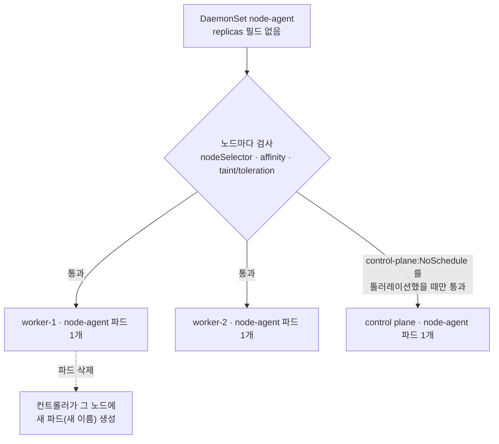
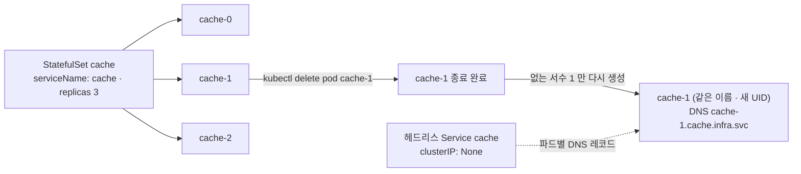

# q05 — Self-healing with StatefulSet and DaemonSet · 풀이

← 문제: **[question.md](question.md)**

## 문제 (해석)

**원문**

> In namespace `infra`:
>
> 1. Create a DaemonSet `node-agent` running `busybox:1.36` with the command
>    `sh -c 'while true; do sleep 30; done'`. It must run on **every** node including
>    control plane nodes.
> 2. Create a StatefulSet `cache` with 3 replicas of `redis:7.2`, governed by an existing
>    headless Service named `cache`, container port 6379.
> 3. Delete the pod `cache-1` and record what the controller recreates — the pod name and
>    whether the ordinal is preserved.
> 4. Delete the `node-agent` pod on one worker node and record how quickly it returns.
> 5. In one line each, state which object the DaemonSet controller reconciles against and
>    what the StatefulSet guarantees that a Deployment does not.

**해석**

네임스페이스 `infra` 에서:

1. `busybox:1.36` 을 `sh -c 'while true; do sleep 30; done'` 명령으로 실행하는 DaemonSet
   `node-agent` 를 만든다. 컨트롤 플레인 노드를 포함해 **모든** 노드에서 실행되어야 한다.
2. `redis:7.2` 3 레플리카의 StatefulSet `cache` 를 만든다. 기존 헤드리스 Service `cache` 가
   관리하고, 컨테이너 포트는 6379다.
3. 파드 `cache-1` 을 삭제하고 컨트롤러가 무엇을 재생성하는지 기록한다 — 파드 이름과 서수가
   유지되는지 여부.
4. 워커 노드 하나의 `node-agent` 파드를 삭제하고 얼마나 빨리 돌아오는지 기록한다.
5. DaemonSet 컨트롤러가 무엇을 기준으로 리컨사일하는지, StatefulSet이 Deployment와 달리
   무엇을 보장하는지 각각 한 줄로 적는다.

## 모범 풀이

**1)·2) DaemonSet 과 StatefulSet 생성**

```yaml
# q05.yaml
apiVersion: apps/v1
kind: DaemonSet
metadata:
  name: node-agent
  namespace: infra
spec:
  selector:
    matchLabels:
      app: node-agent
  template:
    metadata:
      labels:
        app: node-agent
    spec:
      tolerations:                       # 컨트롤 플레인에 뜨게 하려면 필수
        - key: node-role.kubernetes.io/control-plane
          operator: Exists
          effect: NoSchedule
      containers:
        - name: agent
          image: busybox:1.36
          command: ["sh", "-c", "while true; do sleep 30; done"]
---
apiVersion: apps/v1
kind: StatefulSet
metadata:
  name: cache
  namespace: infra
spec:
  serviceName: cache                     # 헤드리스 서비스 이름. 빠뜨리면 파드별 DNS 레코드가 안 생긴다
  replicas: 3
  selector:
    matchLabels:
      app: cache
  template:
    metadata:
      labels:
        app: cache
    spec:
      containers:
        - name: redis
          image: redis:7.2
          ports:
            - containerPort: 6379
```

```bash
kubectl -n infra get svc cache -o wide      # 먼저 헤드리스(CLUSTER-IP None)와 selector 를 확인
kubectl apply -f q05.yaml
kubectl -n infra rollout status ds node-agent
kubectl -n infra rollout status sts cache   # cache-0 → cache-1 → cache-2 순서로 뜬다
```

StatefulSet 의 `selector`·파드 라벨은 기존 Service `cache` 의 selector(`app=cache`)와 맞춰야
헤드리스 DNS(`cache-0.cache.infra.svc.cluster.local`)가 파드를 가리킵니다.

컨트롤 플레인 톨러레이션이 이 문제의 실제 함정입니다. 톨러레이션 없이 만들면 워커에만 뜨는데,
`kubectl get ds` 의 DESIRED 칼럼도 워커 수에 맞춰 나오므로 겉보기에 정상으로 보입니다.
노드 수와 대조해야 발견됩니다. 실습 클러스터의 노드에 다른 테인트가 더 있다면
`kubectl describe node | grep Taints` 로 확인하고, 모든 노드라는 조건을 확실히 지키려면
`tolerations: [{operator: Exists}]`(키 없이 모든 테인트 허용)도 쓸 수 있습니다.

### 그림 1 — DaemonSet 은 노드 목록을 기준으로 맞춘다



1. DaemonSet 컨트롤러는 Node 객체 목록을 보고, 조건을 통과하는 노드마다 파드가 정확히 하나 있도록 맞춥니다. 그래서 `replicas` 가 없고 DESIRED 는 통과한 노드 수입니다.
2. 컨트롤 플레인 노드는 `node-role.kubernetes.io/control-plane:NoSchedule` 테인트가 있어서 톨러레이션이 없으면 검사에서 빠지고, DESIRED 도 그만큼 줄어듭니다.
3. 워커의 파드를 지우면 그 노드에 파드가 없는 상태가 되므로 컨트롤러가 바로 새 파드를 만듭니다. 이름은 `node-agent-xxxxx` 처럼 새 접미사가 붙습니다.

### 그림 2 — StatefulSet 은 같은 서수를 같은 이름으로 되살린다



1. StatefulSet 파드 이름은 `<sts 이름>-<서수>` 로 정해져 있어서, `cache-1` 을 지우면 컨트롤러는 빠진 서수 1 을 **같은 이름 `cache-1`** 로 다시 만듭니다. `cache-0`, `cache-2` 는 건드리지 않습니다.
2. 같은 이름이므로 이전 파드가 완전히 사라진 뒤에 새 파드가 생깁니다. UID 와 IP 는 바뀔 수 있지만 이름과 DNS 이름은 그대로입니다.
3. volumeClaimTemplates 가 있었다면 같은 서수의 PVC(`data-cache-1` 등)에 다시 붙습니다. 이 문제의 StatefulSet 에는 PVC 가 없습니다.

**3) cache-1 삭제**

```bash
kubectl -n infra get pod cache-1 -o jsonpath='{.metadata.uid}{"\n"}'   # 삭제 전 UID
kubectl -n infra delete pod cache-1
kubectl -n infra get pods -l app=cache
kubectl -n infra get pod cache-1 -o jsonpath='{.metadata.uid}{"\n"}'   # 이름은 같고 UID 는 다르다
```

기록: 재생성된 파드 이름은 `cache-1`, 서수는 유지된다. Deployment 라면 `web-7d9f-xk2mq` 같은 새
무작위 이름이 나옵니다.

**4) 워커의 node-agent 파드 삭제와 복구 시간**

```bash
NODE=$(kubectl get nodes -l '!node-role.kubernetes.io/control-plane' -o jsonpath='{.items[0].metadata.name}')
POD=$(kubectl -n infra get pod -l app=node-agent --field-selector spec.nodeName=$NODE -o name)

date +%T; kubectl -n infra delete $POD --wait=false
kubectl -n infra get pods -l app=node-agent -o wide --field-selector spec.nodeName=$NODE -w
# 새 node-agent-xxxxx 파드가 보통 몇 초 안에 Running
```

새 파드의 `creationTimestamp` 와 지운 시각을 비교해 몇 초 걸렸는지 기록합니다. `--wait=false` 를
쓰는 이유가 있습니다. `sh -c` 가 PID 1 이라 SIGTERM 을 처리하지 않아 옛 파드는 기본 유예 시간 30초를
다 채우고 죽는데, `kubectl delete` 는 기본으로 그 종료를 기다리므로 복구가 30초 걸린 것처럼 보입니다.
DaemonSet 컨트롤러는 종료 중인 파드를 세지 않으므로 새 파드는 그보다 먼저 뜹니다.

**5) 한 줄 답**

- DaemonSet 컨트롤러는 **Node 객체 목록**을 기준으로, 조건(셀렉터·어피니티·톨러레이션)을 통과하는 노드마다 파드가 하나씩 있도록 맞춘다.
- StatefulSet 은 Deployment 와 달리 **파드마다 고정된 이름(서수)·네트워크 ID(DNS)·전용 스토리지**와 **순서대로 생성·종료**를 보장한다.

## 검증

```bash
kubectl get nodes --no-headers | wc -l           # 예: 3
kubectl -n infra get ds node-agent
# DESIRED CURRENT READY = 3  (노드 수와 같아야 한다)
kubectl -n infra get pods -o wide -l app=node-agent    # 각 노드에 1개씩

kubectl -n infra get pods -l app=cache
# cache-0, cache-1, cache-2  전부 Running

kubectl -n infra delete pod cache-1
kubectl -n infra get pods -l app=cache -w        # 다시 cache-1 로 생성됨

kubectl -n infra get pods -l app=node-agent \
  -o custom-columns=NODE:.spec.nodeName --no-headers | sort | uniq -c   # 노드마다 1

kubectl -n infra get sts cache \
  -o jsonpath='{.spec.serviceName}{"\n"}'        # cache
```

## 오답 원인 / 배운 점

- **왜 틀렸나**:
- **기억할 것**: DaemonSet이 모든 노드에 떠야 한다면 control-plane 테인트 톨러레이션을 반드시 넣는다.
- **헷갈리는 지점**: `kubectl create daemonset` 서브커맨드는 없습니다. Deployment yaml을 만들어
  (`kubectl create deploy x --image=... --dry-run=client -o yaml`) `kind` 를 DaemonSet으로 바꾸고
  `replicas`, `strategy` 를 지우는 것이 가장 빠릅니다. StatefulSet도 마찬가지로 생성 서브커맨드가
  없고, `serviceName` 은 StatefulSet에만 있는 필드로 이 문제처럼 헤드리스 서비스와 묶으려면 꼭 넣어야 합니다.

## 참고 문서

- 검색어: `daemonset`
- https://kubernetes.io/docs/concepts/workloads/controllers/daemonset/
- https://kubernetes.io/docs/concepts/workloads/controllers/statefulset/

## 복습 기록

| 날짜 | 결과 | 메모 |
|---|---|---|
|  |  |  |
