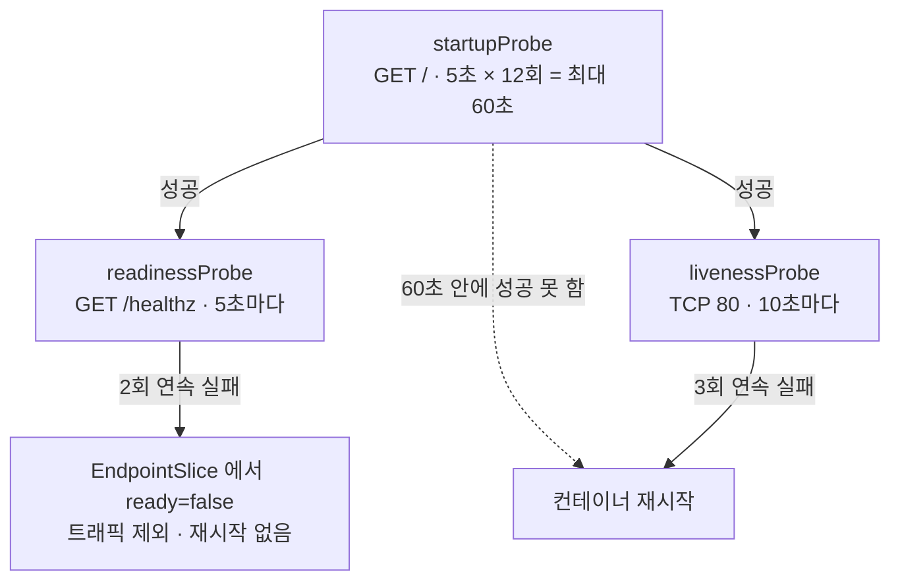
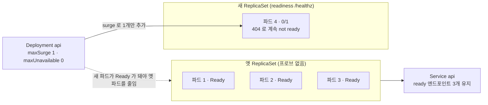
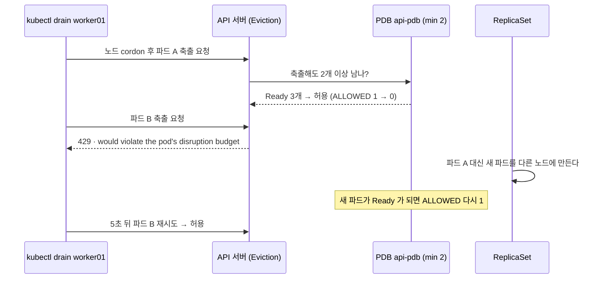

# q06 — Probes and a PodDisruptionBudget · 풀이

← 문제: **[question.md](question.md)**

## 문제 (해석)

**원문**

> Namespace `shop` contains Deployment `api` with 3 replicas of `nginx:1.27`, labelled
> `app=api`, serving on port 80.
>
> 1. Add a startup probe: HTTP GET `/` on port 80, allowed up to 60 seconds to come up,
>    probing every 5 seconds.
> 2. Add a readiness probe: HTTP GET `/healthz` on port 80, every 5 seconds,
>    `failureThreshold: 2`.
> 3. Add a liveness probe: TCP socket on port 80, `periodSeconds: 10`,
>    `failureThreshold: 3`.
> 4. Create a PodDisruptionBudget `api-pdb` for `app=api` that keeps at least 2 pods
>    available.
> 5. `/healthz` does not exist on the nginx image, so readiness will fail. Show what happens
>    to the rollout and to the Service `api` endpoints, then make readiness pass by pointing
>    the probe at a path that exists and let the rollout finish.
> 6. Attempt `kubectl drain` on the node holding two `api` pods and report what the PDB does.

**해석**

네임스페이스 `shop` 에 `nginx:1.27` 3 레플리카의 Deployment `api` 가 있다. 레이블은 `app=api`,
포트 80으로 서비스한다.

1. startup probe를 추가한다: 포트 80에 HTTP GET `/`, 기동에 최대 60초 허용, 5초마다 검사.
2. readiness probe를 추가한다: 포트 80에 HTTP GET `/healthz`, 5초마다, `failureThreshold: 2`.
3. liveness probe를 추가한다: 포트 80 TCP 소켓, `periodSeconds: 10`, `failureThreshold: 3`.
4. `app=api` 에 대해 최소 2개 파드를 유지하는 PodDisruptionBudget `api-pdb` 를 만든다.
5. nginx 이미지에 `/healthz` 가 없으므로 readiness는 실패한다. 롤아웃과 Service `api` 의
   엔드포인트에 무슨 일이 일어나는지 보이고, 존재하는 경로로 프로브를 바꿔 readiness를 통과시킨 뒤
   롤아웃을 끝낸다.
6. `api` 파드 2개가 있는 노드에 `kubectl drain` 을 시도하고 PDB가 무엇을 하는지 보고한다.

## 모범 풀이

```bash
kubectl -n shop edit deploy api
```

컨테이너 스펙에 넣습니다:

```yaml
        startupProbe:
          httpGet:
            path: /
            port: 80
          periodSeconds: 5
          failureThreshold: 12          # 5초 × 12 = 60초
        readinessProbe:
          httpGet:
            path: /healthz             # 5단계에서 / 로 고친다
            port: 80
          periodSeconds: 5
          failureThreshold: 2
        livenessProbe:
          tcpSocket:
            port: 80
          periodSeconds: 10
          failureThreshold: 3
```

"60초 허용"을 `initialDelaySeconds: 60` 으로 쓰면 안 됩니다. startup probe에서 총 허용 시간은
`periodSeconds × failureThreshold` 입니다. 60 ÷ 5 = 12.

### 그림 1 — 세 프로브가 하는 일



1. startup probe 가 성공하기 전까지 kubelet 은 readiness·liveness 를 돌리지 않습니다. 느리게 뜨는 앱이 liveness 에 걸려 죽는 것을 막는 장치입니다.
2. startup probe 가 성공하면 readiness 와 liveness 가 각자 주기대로 돌기 시작합니다.
3. readiness 가 실패하면 파드는 Service 의 EndpointSlice 에서 `ready=false` 가 되어 트래픽만 빠집니다. 컨테이너는 그대로 살아 있습니다.
4. liveness 나 startup 이 실패하면 kubelet 이 컨테이너를 죽이고 다시 띄워 `RESTARTS` 가 올라갑니다.

```bash
kubectl create poddisruptionbudget api-pdb -n shop --selector=app=api --min-available=2
```

**5) readiness 실패의 효과 — 롤아웃이 멈추고, 서비스는 멀쩡합니다**

파드 템플릿을 바꿨으므로 이것은 **롤링 업데이트**입니다. 기본 전략은 `maxSurge: 25%`,
`maxUnavailable: 25%` 이고, replica 3에서 maxSurge는 올림해서 1, maxUnavailable은 **내림해서 0**
이 됩니다. 그래서 컨트롤러는 새 파드를 1개만 띄우고, 그 파드가 Ready가 될 때까지 기존 파드를 하나도
죽이지 않습니다. 새 파드는 `/healthz` 가 404라 영원히 Ready가 되지 않으므로 롤아웃이 그 자리에서
멈춥니다.

```bash
kubectl -n shop rollout status deploy/api --timeout=30s
# Waiting for deployment "api" rollout to finish: 1 out of 3 new replicas have been updated...
# error: timed out waiting for the condition

kubectl -n shop get pods -l app=api
# api-<old>-xxxxx   1/1   Running   0   ...   ← 기존 3개는 그대로 Ready
# api-<new>-yyyyy   0/1   Running   0   ...   ← 새 파드만 READY 0/1, RESTARTS 0
kubectl -n shop get events --field-selector reason=Unhealthy
# ... Warning  Unhealthy  pod/api-<new>-yyyyy  Readiness probe failed: HTTP probe failed with statuscode: 404

kubectl -n shop get endpointslice -l kubernetes.io/service-name=api \
  -o jsonpath='{range .items[*].endpoints[*]}{.addresses[0]}{" ready="}{.conditions.ready}{"\n"}{end}'
# 10.244.1.5 ready=true
# 10.244.2.7 ready=true
# 10.244.2.8 ready=true
# 10.244.1.9 ready=false   ← 새 파드는 목록에 있지만 not ready 라 트래픽을 받지 않는다
```

readiness가 실패하면 컨테이너는 **재시작되지 않습니다**. 그 파드가 EndpointSlice에서 not-ready로
분류되어 트래픽을 받지 못할 뿐입니다. `RESTARTS` 가 0인데 `READY 0/1` 이면 readiness 문제이고,
liveness가 실패하면 kubelet이 컨테이너를 죽여 `RESTARTS` 가 올라갑니다. 그리고 잘못된 readiness가
**서비스 장애로 번지지 않은 이유가 롤링 업데이트의 `maxUnavailable`** 입니다. 멈춘 롤아웃은
`progressDeadlineSeconds`(기본 600초) 뒤 `Progressing=False, reason: ProgressDeadlineExceeded`
로 표시될 뿐 스스로 되돌아가지 않습니다.

### 그림 2 — 롤아웃이 멈추는 자리



1. replica 3 에서 `maxSurge 25%` 는 올림해 1, `maxUnavailable 25%` 는 내림해 0 입니다. 그래서 새 파드는 한 번에 1개만 생깁니다.
2. 새 파드는 startup probe(`/`)는 통과하지만 readiness(`/healthz`)가 404 라 Ready 가 되지 않습니다.
3. maxUnavailable 이 0 이므로 컨트롤러는 Ready 인 새 파드가 생기기 전까지 옛 파드를 하나도 줄이지 않습니다. 롤아웃은 여기서 멈춥니다.
4. 옛 파드 3개는 계속 Ready 라 Service 는 끊기지 않습니다. 새 파드는 EndpointSlice 에 `ready=false` 로만 올라갑니다.

경로를 고치면 새 ReplicaSet이 다시 만들어지고 롤아웃이 끝까지 진행됩니다.

```bash
kubectl -n shop patch deploy api --type=json -p='[
  {"op":"replace","path":"/spec/template/spec/containers/0/readinessProbe/httpGet/path","value":"/"}
]'
kubectl -n shop rollout status deploy/api          # successfully rolled out
```

(급할 때는 `kubectl -n shop rollout undo deploy/api` 로 먼저 되돌린 뒤 고치는 것도 방법입니다.)

**6) drain과 PDB**

```bash
kubectl get pods -n shop -l app=api -o wide       # api 파드 2개가 있는 노드 확인 (1개씩이면 아무 노드나)
kubectl -n shop get pdb api-pdb                   # ALLOWED DISRUPTIONS 1
kubectl drain worker01 --ignore-daemonsets --delete-emptydir-data
```

drain은 첫 파드를 축출한 뒤 두 번째에서 멈추고 다음을 반복 출력합니다:

```
error when evicting pods/"api-xxxxx" -n "shop" (will retry after 5s):
Cannot evict pod as it would violate the pod's disruption budget.
```

3개 중 1개를 내리면 2개가 남아 `minAvailable: 2` 를 만족하지만, 두 번째를 내리면 1개가 되어
위반합니다. 다른 노드에 대체 파드가 Ready가 되면 drain이 스스로 진행됩니다. 스케줄 가능한 다른
노드가 없으면 대체 파드가 Pending에 머물러 drain이 영구히 막히고, 그때는
`kubectl -n shop delete pdb api-pdb` 로 풀어야 합니다. 시험에서 보고할 내용은 "PDB가 두 번째 축출을
거부해 drain이 대체 파드가 Ready가 될 때까지 기다렸다(또는 막혔다)"입니다.

5번을 먼저 끝내는 이유: 롤아웃이 멈춘 상태에서는 파드가 4개(Ready 3 + not ready 1)라
`ALLOWED DISRUPTIONS` 계산과 drain 결과를 읽기가 헷갈립니다. 롤아웃을 끝내 Ready 3개로 만든 뒤
drain하면 위의 결과가 그대로 나옵니다.

### 그림 3 — drain 과 PDB



1. drain 은 먼저 노드를 cordon 하고, 파드를 지우는 대신 Eviction API 로 하나씩 축출을 요청합니다.
2. 첫 축출은 Ready 파드 3개 중 1개를 빼도 2개가 남으므로 허용되고, `ALLOWED DISRUPTIONS` 가 0 이 됩니다.
3. 두 번째 축출은 남는 파드가 1개가 되므로 API 서버가 429 로 거부하고, drain 은 5초마다 재시도합니다.
4. ReplicaSet 이 축출된 파드를 다른 노드에 다시 만들고 그 파드가 Ready 가 되면 허용치가 1 로 돌아와 두 번째 축출이 통과합니다.

## 검증

```bash
kubectl -n shop rollout status deploy/api  # successfully rolled out
kubectl -n shop get pods -l app=api        # 3개 모두 READY 1/1, RESTARTS 0
kubectl -n shop get endpointslice -l kubernetes.io/service-name=api   # ENDPOINTS 에 파드 IP 3개
kubectl -n shop get pdb api-pdb
# NAME     MIN AVAILABLE   MAX UNAVAILABLE   ALLOWED DISRUPTIONS   AGE
# api-pdb  2               N/A               1

kubectl -n shop get deploy api -o jsonpath='{.spec.template.spec.containers[0].startupProbe}{"\n"}'
kubectl uncordon worker01
```

## 오답 원인 / 배운 점

- **왜 틀렸나**:
- **기억할 것**: liveness = 재시작, readiness = 엔드포인트에서 not-ready로 분류, startup = 나머지 둘을 지연시킴. Deployment에 잘못된 readiness를 넣으면 서비스가 끊기는 게 아니라 **롤아웃이 멈춘다**(replica 3의 기본 maxUnavailable은 0).
- **헷갈리는 지점**: PDB는 **자발적 중단**(`drain`, eviction API)만 막습니다. 노드가 죽거나
  `kubectl delete pod` 로 직접 지우는 것은 PDB를 통과합니다. `ALLOWED DISRUPTIONS` 가 0이면
  drain이 무한 재시도하므로, 시험 중에 노드를 비워야 하는 문제와 PDB 문제가 겹치면 순서를 조심해야 합니다.

## 참고 문서

- 검색어: `configure liveness readiness startup probes`
- https://kubernetes.io/docs/tasks/configure-pod-container/configure-liveness-readiness-startup-probes/
- https://kubernetes.io/docs/concepts/workloads/controllers/deployment/#rolling-update-deployment
- https://kubernetes.io/docs/tasks/run-application/configure-pdb/

## 복습 기록

| 날짜 | 결과 | 메모 |
|---|---|---|
|  |  |  |
