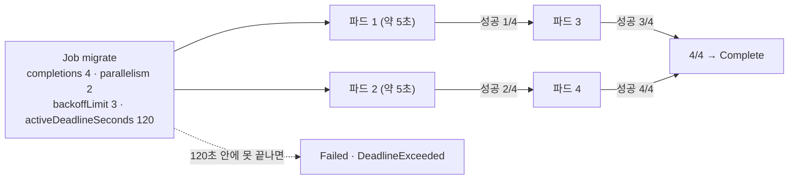
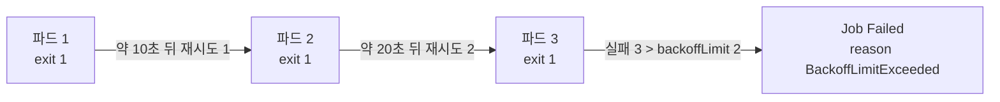
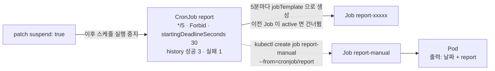

# q07 — Run work with a Job and a CronJob · 풀이

← 문제: **[question.md](question.md)**

## 문제 (해석)

**원문**

> All work goes in namespace `batch`.
>
> 1. Create a Job `migrate` using `busybox:1.36` that runs
>    `sh -c 'echo migrating; sleep 5; echo done'`. It must complete 4 times, with at most
>    2 pods running at once, retry failed pods at most 3 times, and be killed if the whole
>    Job exceeds 120 seconds.
> 2. Create a Job `broken` that runs `sh -c 'exit 1'` with `backoffLimit: 2`. Show its
>    final status and how many pods it created.
> 3. Create a CronJob `report` running `busybox:1.36` with
>    `sh -c 'date; echo report'` every 5 minutes. Keep 3 successful and 1 failed job in
>    history, forbid concurrent runs, and mark a run failed if it has not started within
>    30 seconds of its schedule.
> 4. Trigger `report` immediately without waiting for the schedule, and show the output of
>    that run.
> 5. Suspend the CronJob afterwards.

**해석**

모든 작업은 네임스페이스 `batch` 에서 한다.

1. `busybox:1.36` 으로 `sh -c 'echo migrating; sleep 5; echo done'` 을 실행하는 Job `migrate` 를
   만든다. 4번 완료해야 하고, 동시에 최대 2개 파드만 실행되며, 실패한 파드는 최대 3번까지만 재시도하고,
   전체 Job이 120초를 넘으면 종료된다.
2. `backoffLimit: 2` 로 `sh -c 'exit 1'` 을 실행하는 Job `broken` 을 만든다. 최종 상태와
   파드를 몇 개 만들었는지 보인다.
3. `busybox:1.36` 으로 `sh -c 'date; echo report'` 를 5분마다 실행하는 CronJob `report` 를
   만든다. 히스토리에 성공 3개, 실패 1개를 남기고, 동시 실행을 금지하며, 스케줄 시각으로부터
   30초 안에 시작하지 못하면 실패로 표시한다.
4. 스케줄을 기다리지 않고 `report` 를 즉시 실행시키고 그 실행의 출력을 보인다.
5. 그 후 CronJob을 suspend한다.

## 모범 풀이

```yaml
# q07.yaml
apiVersion: batch/v1
kind: Job
metadata:
  name: migrate
  namespace: batch
spec:
  completions: 4
  parallelism: 2
  backoffLimit: 3                 # 재시도 3번 = 실패는 최대 4번까지 ("3번 실패하면 포기"라면 2)
  activeDeadlineSeconds: 120
  template:
    spec:
      restartPolicy: Never            # Job에서는 Never 또는 OnFailure만 허용
      containers:
        - name: m
          image: busybox:1.36
          command: ["sh", "-c", "echo migrating; sleep 5; echo done"]
---
apiVersion: batch/v1
kind: Job
metadata:
  name: broken
  namespace: batch
spec:
  backoffLimit: 2
  template:
    spec:
      restartPolicy: Never
      containers:
        - name: b
          image: busybox:1.36
          command: ["sh", "-c", "exit 1"]
---
apiVersion: batch/v1
kind: CronJob
metadata:
  name: report
  namespace: batch
spec:
  schedule: "*/5 * * * *"
  concurrencyPolicy: Forbid
  startingDeadlineSeconds: 30
  successfulJobsHistoryLimit: 3
  failedJobsHistoryLimit: 1
  jobTemplate:
    spec:
      template:
        spec:
          restartPolicy: OnFailure
          containers:
            - name: r
              image: busybox:1.36
              command: ["sh", "-c", "date; echo report"]
```

```bash
kubectl apply -f q07.yaml
```

yaml 을 처음부터 쓰지 않고 뼈대를 명령으로 뽑으면 빠릅니다. `completions`, `concurrencyPolicy` 같은
필드는 플래그가 없으니 뽑은 yaml 에 위처럼 추가합니다. 플래그는 반드시 `--` 앞에 둡니다(뒤에 두면
컨테이너 명령의 인자가 됩니다).

```bash
kubectl -n batch create job migrate --image=busybox:1.36 --dry-run=client -o yaml \
  -- sh -c 'echo migrating; sleep 5; echo done' > migrate.yaml
kubectl -n batch create cronjob report --image=busybox:1.36 --schedule='*/5 * * * *' \
  --dry-run=client -o yaml -- sh -c 'date; echo report' > report.yaml
```

**1) `migrate` 의 필드**

| 문제 표현 | 필드 | 값 |
|---|---|---|
| 4번 완료 | `completions` | 4 |
| 동시에 최대 2개 | `parallelism` | 2 |
| 실패한 파드는 최대 3번 재시도 | `backoffLimit` | 3 |
| 전체 120초 넘으면 종료 | `activeDeadlineSeconds` | 120 |

`activeDeadlineSeconds` 와 `backoffLimit` 이 충돌하면 `activeDeadlineSeconds` 가 우선합니다 —
시간이 지나면 재시도가 남아 있어도 실행 중인 파드를 종료하고 `reason: DeadlineExceeded` 로 실패 처리합니다.

### 그림 1 — `migrate` 가 4번 완료되는 과정



1. Job 컨트롤러는 `parallelism` 만큼(2개) 파드를 동시에 띄웁니다.
2. 파드가 하나 성공할 때마다 성공 수가 늘고, 남은 완료 수가 있으면 빈 자리에 새 파드를 띄웁니다. 2개씩 두 번 돌아 약 10~15초면 `4/4` 가 됩니다.
3. 도중에 파드가 실패하면 새 파드로 다시 시도하고, 실패가 `backoffLimit`(3번)을 넘으면 Job 이 실패합니다.
4. 시작부터 120초가 지나면 성공·재시도 횟수와 관계없이 Job 이 종료됩니다.

**2) `broken` 의 최종 상태와 파드 수**

```bash
kubectl -n batch wait --for=condition=failed job/broken --timeout=120s
kubectl -n batch get job broken -o jsonpath='{.status.conditions[?(@.type=="Failed")].reason}{"\n"}'
# BackoffLimitExceeded
kubectl -n batch get pods -l job-name=broken          # Error 파드 3개
```

`backoffLimit: 2` 는 **재시도 횟수**이므로 총 파드는 3개(최초 1 + 재시도 2)입니다. 실패한 파드 수가
`backoffLimit` 을 넘으면 Job 에 `type: Failed`, `reason: BackoffLimitExceeded` 컨디션이 붙고 더 만들지
않습니다. 재시도 간격은 10초, 20초, 40초… 지수 백오프라 즉시 끝나지 않으므로 `wait` 로 기다린 뒤 봅니다.
`restartPolicy: Never` 라서 실패할 때마다 새 파드가 생깁니다. `OnFailure` 였다면 같은 파드 안에서
컨테이너가 재시작되므로 파드 수로 셀 수 없습니다.

### 그림 2 — `broken` 이 파드 3개를 만들고 멈추는 과정



1. 첫 파드가 `exit 1` 로 실패하면 컨트롤러는 백오프 시간을 두고 새 파드를 만듭니다.
2. 재시도는 `backoffLimit` 만큼(2번)만 합니다. 그래서 파드는 최초 1개 + 재시도 2개 = 3개입니다.
3. 세 번째 실패로 실패 수가 `backoffLimit` 을 넘으면 Job 이 `Failed` 가 되고 더는 파드를 만들지 않습니다.

**3) `report` 의 필드**

| 문제 표현 | 필드 | 값 |
|---|---|---|
| 5분마다 | `schedule` | `*/5 * * * *` |
| 성공 3개·실패 1개 보관 | `successfulJobsHistoryLimit` / `failedJobsHistoryLimit` | 3 / 1 |
| 동시 실행 금지 | `concurrencyPolicy` | `Forbid` |
| 30초 안에 시작 못 하면 실패 | `startingDeadlineSeconds` | 30 |

`startingDeadlineSeconds` 는 예정 시각에서 그 초가 지나도록 시작하지 못한 회차를 건너뛰고 실패로 셉니다.
이 필드들은 `jobTemplate` 이 아니라 CronJob 의 `spec` 바로 아래에 둡니다.

**4) 즉시 실행**

```bash
kubectl -n batch create job report-manual --from=cronjob/report
kubectl -n batch wait --for=condition=complete job/report-manual --timeout=60s
kubectl -n batch logs job/report-manual
# Sat Oct 17 11:30:02 UTC 2026
# report
```

`--from=cronjob/<name>` 은 CronJob 의 `jobTemplate` 을 그대로 복사해 Job 을 즉시 만듭니다.
스케줄을 임시로 `* * * * *` 로 바꿔 기다리는 것보다 빠르고 CronJob 설정을 건드리지 않습니다.
이것을 모르면 시간을 많이 낭비합니다. 만든 직후에는 파드가 아직 뜨지 않아 `logs` 가 실패할 수 있으니
`wait` 로 완료를 기다립니다. Job 이름은 자유이지만 문제에서 지정하면 그 이름을 씁니다.

**5) 중단**

```bash
kubectl -n batch patch cronjob report -p '{"spec":{"suspend":true}}'
```

suspend 는 이후의 스케줄 실행만 막습니다. 이미 실행 중인 Job 은 멈추지 않고, 기존 Job 기록도 남습니다.

### 그림 3 — CronJob `report` 와 수동 실행의 관계



1. CronJob 은 예정 시각마다 `jobTemplate` 으로 Job 을 만들고, 그 Job 이 파드를 만듭니다.
2. `Forbid` 는 이전 Job 이 아직 active 면 이번 회차를 건너뜁니다. 예정 시각에서 30초 안에 시작하지 못한 회차도 건너뛰고 실패로 셉니다.
3. `--from=cronjob/report` 는 같은 `jobTemplate` 을 복사해 스케줄과 관계없이 Job 하나를 바로 만듭니다. 이 Job 은 CronJob 을 owner 로 가집니다.
4. `suspend: true` 는 CronJob 이 새 Job 을 만들지 않게 할 뿐, 이미 있는 Job 은 그대로 둡니다.

## 검증

```bash
kubectl -n batch get jobs
# NAME     STATUS     COMPLETIONS   DURATION
# migrate  Complete   4/4           ~15s
# broken   Failed     0/1

kubectl -n batch get pods -l job-name=broken --no-headers | wc -l      # 3
kubectl -n batch get job broken -o jsonpath='{.status.conditions[?(@.type=="Failed")].reason}{"\n"}'
# BackoffLimitExceeded

kubectl -n batch get job migrate -o jsonpath='{.spec.completions} {.spec.parallelism} {.spec.backoffLimit} {.spec.activeDeadlineSeconds}{"\n"}'
# 4 2 3 120
kubectl -n batch get cj report -o jsonpath='{.spec.concurrencyPolicy} {.spec.startingDeadlineSeconds} {.spec.successfulJobsHistoryLimit} {.spec.failedJobsHistoryLimit}{"\n"}'
# Forbid 30 3 1

kubectl -n batch logs job/report-manual        # date 출력 + "report"

kubectl -n batch get cronjob report
# NAME    SCHEDULE      TIMEZONE   SUSPEND   ACTIVE   LAST SCHEDULE
# report  */5 * * * *   <none>     True      0
```

## 오답 원인 / 배운 점

- **왜 틀렸나**:
- **기억할 것**: CronJob을 즉시 돌리려면 `kubectl create job <이름> --from=cronjob/<크론잡>`.
- **헷갈리는 지점**: `completions` 는 총 몇 번 성공해야 하는지, `parallelism` 은 동시에 몇 개까지
  돌릴지입니다. `backoffLimit` 은 남은 실패 허용 **횟수**이지 파드 수가 아닙니다 (파드는 +1개).
  그리고 Job 파드의 `restartPolicy` 에 `Always` 를 쓰면 API 서버가 거부합니다 — Deployment yaml을
  베껴 쓸 때 자주 걸립니다. `--from=cronjob` 으로 만든 Job 도 CronJob 을 owner 로 가지므로, 나중에
  스케줄 실행이 쌓이면 히스토리 한도에 따라 정리될 수 있습니다. 출력이 필요하면 바로 확인해 둡니다.

## 참고 문서

- 검색어: `jobs run to completion`
- https://kubernetes.io/docs/concepts/workloads/controllers/job/
- https://kubernetes.io/docs/concepts/workloads/controllers/cron-jobs/
- https://kubernetes.io/docs/reference/kubectl/generated/kubectl_create/kubectl_create_job/

## 복습 기록

| 날짜 | 결과 | 메모 |
|---|---|---|
|  |  |  |
