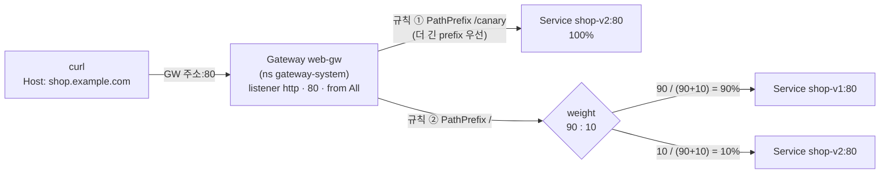
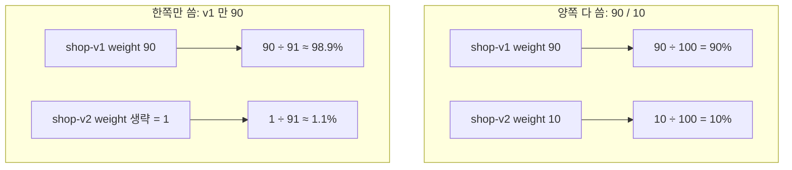

# q08 — Weighted traffic splitting with HTTPRoute · 풀이

← 문제: **[question.md](question.md)**

## 문제 (해석)

**원문**

> The Gateway API CRDs are installed and a Gateway named `web-gw` exists in namespace
> `gateway-system` with an HTTP listener named `http` on port 80 that allows routes from
> all namespaces.
>
> In namespace `shop`:
>
> 1. Confirm the Gateway API is available and report the API group and version of the
>    `HTTPRoute` resource.
> 2. Deployments `shop-v1` and `shop-v2` already exist. Create ClusterIP Services
>    `shop-v1` and `shop-v2`, port 80 targeting container port 80.
> 3. Create an HTTPRoute `shop-route` attached to `web-gw`, for hostname
>    `shop.example.com`, matching path prefix `/`, that sends 90% of requests to `shop-v1`
>    and 10% to `shop-v2`.
> 4. Add a second rule on path prefix `/canary` that sends **all** traffic to `shop-v2`,
>    regardless of the weighting above.
> 5. Confirm the route was accepted by the Gateway and that the parent reference resolved.
> 6. State in one line what the numbers in `weight` actually mean.

**해석**

Gateway API CRD가 설치되어 있고, 네임스페이스 `gateway-system` 에 Gateway `web-gw` 가 있다.
포트 80에 `http` 라는 HTTP 리스너가 있고 모든 네임스페이스의 라우트를 허용한다.

네임스페이스 `shop` 에서:

1. Gateway API가 사용 가능한지 확인하고 `HTTPRoute` 리소스의 API 그룹과 버전을 보고한다.
2. Deployment `shop-v1`, `shop-v2` 는 이미 있다. ClusterIP Service `shop-v1`, `shop-v2` 를
   만든다. 포트 80, 타깃 컨테이너 포트 80.
3. `web-gw` 에 연결된 HTTPRoute `shop-route` 를 만든다. 호스트네임 `shop.example.com`,
   경로 prefix `/` 매칭, 요청의 90%를 `shop-v1`, 10%를 `shop-v2` 로 보낸다.
4. 경로 prefix `/canary` 에 두 번째 규칙을 추가한다. 위의 가중치와 무관하게 **모든** 트래픽을
   `shop-v2` 로 보낸다.
5. 라우트가 Gateway에 수락되었고 부모 참조가 해결되었음을 확인한다.
6. `weight` 의 숫자가 실제로 무엇을 의미하는지 한 줄로 적는다.

## 모범 풀이

**1) 가용성 확인**

```bash
kubectl get crd | grep gateway.networking.k8s.io
kubectl api-resources | grep -i httproute
# httproutes   gateway.networking.k8s.io/v1   true   HTTPRoute
kubectl -n gateway-system get gateway web-gw
```

**2) 서비스**

```bash
kubectl -n shop expose deploy shop-v1 --name=shop-v1 --port=80 --target-port=80
kubectl -n shop expose deploy shop-v2 --name=shop-v2 --port=80 --target-port=80
```

**3~4) HTTPRoute**

```yaml
# shop-route.yaml
apiVersion: gateway.networking.k8s.io/v1
kind: HTTPRoute
metadata:
  name: shop-route
  namespace: shop
spec:
  parentRefs:
    - name: web-gw
      namespace: gateway-system      # Gateway가 다른 네임스페이스면 반드시 명시
      sectionName: http              # 리스너 이름
  hostnames:
    - shop.example.com
  rules:
    - matches:
        - path:
            type: PathPrefix
            value: /canary           # 더 구체적인 경로를 먼저 쓰는 편이 읽기 쉽다
      backendRefs:
        - name: shop-v2
          port: 80
    - matches:
        - path:
            type: PathPrefix
            value: /
      backendRefs:
        - name: shop-v1
          port: 80
          weight: 90
        - name: shop-v2
          port: 80
          weight: 10
```

```bash
kubectl apply -f shop-route.yaml
```

**`weight` 는 백분율이 아니라 상대 비율입니다.** 각 백엔드가 받는 몫은
`자기 weight ÷ 같은 규칙 내 weight 합` 입니다. 90/10은 합이 100이라 우연히 퍼센트처럼 보이지만
9/1로 써도 결과가 같습니다. weight를 생략하면 기본값 1입니다 — 그래서 한쪽에만 weight를 쓰면
(`shop-v1: 90` 만) 실제 비율이 90:1이 되어 의도와 크게 달라집니다. 양쪽 다 쓰거나 양쪽 다 빼야 합니다.

규칙 순서는 매칭 우선순위를 결정하지 않습니다. Gateway API는 **더 긴 경로 prefix를 먼저** 매칭하도록
스펙에 정해 두었으므로(Ingress v1도 가장 긴 경로 우선입니다), `/canary` 요청은 yaml 순서와 무관하게
`/canary` 규칙으로 갑니다. Gateway API는 여기서 더 나아가 동점일 때의 순서(Exact > 긴 Prefix >
메서드 > 헤더 수 > 쿼리 수)까지 규정합니다.

### 트래픽 흐름



1. 요청이 Gateway `web-gw` 의 listener `http` 로 들어오고, Host 가 `shop.example.com` 인 `shop-route` 가 선택됩니다. route 는 `shop` 에 있지만 listener 가 `from: All` 이라 붙을 수 있습니다.
2. 경로가 `/canary` 로 시작하면 규칙 ① 에 걸립니다. 이 규칙에는 backend 가 `shop-v2` 하나뿐이라 가중치와 상관없이 전부 v2 로 갑니다.
3. 그 밖의 경로는 규칙 ② 에 걸립니다. 가중치는 **규칙 하나 안에서만** 나뉩니다. 각 backend 의 몫은 `자기 weight ÷ 그 규칙의 weight 합` 이라 v1 이 90%, v2 가 10% 입니다.
4. 요청마다 독립적으로 고르므로 20번 보내면 정확히 18:2 가 아니라 그 근처로 나옵니다. 비율을 보려면 수십 번 이상 보냅니다.

### weight 를 잘못 쓰면



1. 양쪽에 다 쓰면 합으로 나눈 비율이 그대로 나옵니다. 9 와 1, 90 과 10 은 결과가 같습니다.
2. 한쪽만 쓰면 생략한 쪽이 기본값 1 이 되어, 의도한 10% 가 약 1% 로 줄어듭니다. route 상태는 정상이라 에러로 드러나지 않습니다.
3. 그림에는 없지만 weight 0 은 그 backend 로 보내지 않는다는 뜻입니다. 카나리를 잠시 끌 때 씁니다.

## 검증

```bash
kubectl -n shop get httproute shop-route
# HOSTNAMES 에 ["shop.example.com"]

kubectl -n shop describe httproute shop-route
# Parents:
#   Conditions:
#     Type: Accepted        Status: True
#     Type: ResolvedRefs    Status: True

kubectl -n shop get httproute shop-route \
  -o jsonpath='{.status.parents[0].conditions[*].type}:{.status.parents[0].conditions[*].status}{"\n"}'

kubectl -n gateway-system get gateway web-gw
# PROGRAMMED True, ADDRESS 에 IP

GW=$(kubectl -n gateway-system get gateway web-gw -o jsonpath='{.status.addresses[0].value}')
for i in $(seq 1 50); do curl -s -H "Host: shop.example.com" http://$GW/; done | sort | uniq -c
#   45 shop-v1      ← 대략 9:1. 매번 조금씩 다르다
#    5 shop-v2
for i in $(seq 1 5); do curl -s -H "Host: shop.example.com" http://$GW/canary/; done | sort | uniq -c
#    5 shop-v2      ← 항상 v2
# 주소에 닿지 않는 랩이면: kubectl -n gateway-system get svc web-gw-nginx 로 NodePort 확인 → <노드IP>:<NodePort> 로 같은 curl
```

## 오답 원인 / 배운 점

- **왜 틀렸나**:
- **기억할 것**: `weight` 는 상대값이고 생략 시 기본 1이다. 한쪽만 쓰면 비율이 망가진다.
- **헷갈리는 지점**: `ResolvedRefs: False` 는 거의 항상 `backendRefs` 의 서비스 이름이나
  포트가 틀린 것입니다. `Accepted: False` 는 `parentRefs` 문제(Gateway 이름·네임스페이스 오타,
  또는 Gateway의 `allowedRoutes` 가 이 네임스페이스를 허용하지 않음)입니다. 두 컨디션을 구분해서
  보면 어디를 고칠지 바로 나옵니다.

## 참고 문서

- 검색어: `gateway api HTTPRoute traffic splitting`
- https://kubernetes.io/docs/concepts/services-networking/gateway/
- https://gateway-api.sigs.k8s.io/guides/traffic-splitting/

## 복습 기록

| 날짜 | 결과 | 메모 |
|---|---|---|
|  |  |  |
