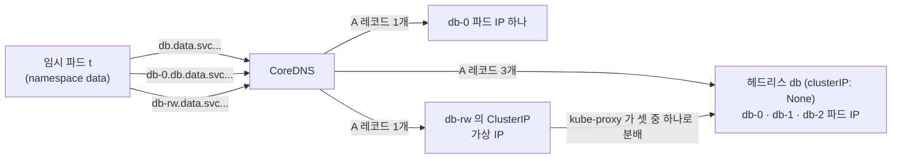
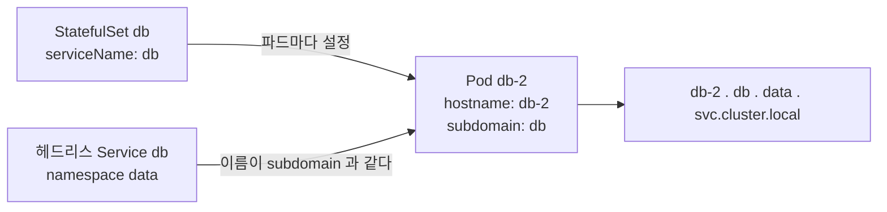

# q10 — Headless Service and StatefulSet pod DNS · 풀이

← 문제: **[question.md](question.md)**

## 문제 (해석)

**원문**

> In namespace `data`, build a stable per-pod addressing scheme.
>
> 1. Create a headless Service `db` selecting `app=db`, port 5432 named `pg`.
> 2. Create a StatefulSet `db` with 3 replicas of `nginx:1.27` (stand-in for the real
>    database), labelled `app=db`, container port 5432, governed by the `db` Service.
> 3. From a temporary pod in the same namespace, resolve:
>    - the Service name `db`
>    - the individual pod `db-0`
>    Record what each returns and how they differ.
> 4. Write the fully qualified DNS name of `db-2` into `/opt/course/q10/fqdn.txt`.
> 5. Create a second, normal ClusterIP Service `db-rw` on the same selector and port, and
>    show how its DNS answer differs from the headless one.
> 6. Explain why `db-0` is resolvable but a Deployment's pods are not resolvable by name.

**해석**

네임스페이스 `data` 에 파드별 고정 주소 체계를 만든다.

1. `app=db` 를 선택하는 헤드리스 Service `db` 를 만든다. 포트 5432, 이름 `pg`.
2. `nginx:1.27` (실제 DB 대역) 3 레플리카의 StatefulSet `db` 를 만든다. 레이블 `app=db`,
   컨테이너 포트 5432, `db` Service가 관리한다.
3. 같은 네임스페이스의 임시 파드에서 다음을 조회한다:
   - Service 이름 `db`
   - 개별 파드 `db-0`
   각각 무엇을 반환하고 어떻게 다른지 기록한다.
4. `db-2` 의 FQDN을 `/opt/course/q10/fqdn.txt` 에 쓴다.
5. 같은 셀렉터와 포트로 일반 ClusterIP Service `db-rw` 를 하나 더 만들고, DNS 응답이 헤드리스와
   어떻게 다른지 보인다.
6. `db-0` 은 이름으로 조회되는데 Deployment의 파드는 안 되는 이유를 설명한다.

## 모범 풀이

```yaml
# q10.yaml
apiVersion: v1
kind: Service
metadata:
  name: db
  namespace: data
spec:
  clusterIP: None              # 이것이 헤드리스로 만드는 유일한 조건
  selector:
    app: db
  ports:
    - name: pg
      port: 5432
      targetPort: 5432
---
apiVersion: apps/v1
kind: StatefulSet
metadata:
  name: db
  namespace: data
spec:
  serviceName: db              # 헤드리스 서비스 이름. DNS 서브도메인이 여기서 나온다
  replicas: 3
  selector:
    matchLabels:
      app: db
  template:
    metadata:
      labels:
        app: db
    spec:
      containers:
        - name: db
          image: nginx:1.27
          ports:
            - name: pg
              containerPort: 5432
```

```bash
kubectl apply -f q10.yaml

# db-rw — kubectl expose 는 StatefulSet 을 지원하지 않으므로 서비스를 만들고 셀렉터를 바꾼다
kubectl -n data create service clusterip db-rw --tcp=5432:5432    # 셀렉터가 app=db-rw 로 만들어진다
kubectl -n data set selector svc db-rw app=db
```

`kubectl expose` 가 받는 대상은 pod, service, rc, deployment, replicaset뿐입니다. `expose sts` 는
에러가 나므로 `create service` + `set selector` 로 만들거나 yaml을 씁니다.

**3) 조회**

```bash
kubectl -n data run t --rm -it --image=busybox:1.36 --restart=Never -- sh
nslookup db.data.svc.cluster.local
#   Name: db.data.svc.cluster.local
#   Address: 10.244.1.7
#   Address: 10.244.2.5
#   Address: 10.244.1.9      ← 파드 IP 3개가 그대로 나온다

nslookup db-0.db.data.svc.cluster.local
#   Address: 10.244.1.7      ← 그 파드 IP 하나만

nslookup db-rw.data.svc.cluster.local
#   Address: 10.96.211.4     ← ClusterIP 가상 IP 하나
```

- busybox 1.28 이후의 `nslookup` 은 `/etc/resolv.conf` 의 search 도메인을 제대로 붙이지 않는 경우가 있어,
  짧은 이름(`nslookup db`)이 실패하면 FQDN으로 조회합니다. 위처럼 처음부터 FQDN을 쓰면 안전합니다.
- 문제의 "`db-0` 조회"는 `db-0` 단독이 아니라 `db-0.db` (또는 FQDN) 입니다. 파드 레코드는 서비스 이름
  아래에 만들어지므로 `db-0` 만으로는 어떤 레코드도 없습니다.

헤드리스 서비스는 ClusterIP를 할당받지 않으므로 DNS가 가상 IP 대신 **Ready 상태인 백엔드 파드
IP 전부**를 A 레코드로 돌려줍니다. 일반 ClusterIP 서비스는 안정적인 가상 IP 하나만 돌려주고
그 뒤의 파드 선택은 kube-proxy가 합니다. 클라이언트가 어떤 인스턴스에 붙을지 스스로 결정해야
하는 데이터베이스 복제 구성에서 헤드리스가 필요한 이유입니다.

### 그림 1 — 헤드리스 Service 와 ClusterIP Service 의 DNS 응답



1. `db` 는 `clusterIP: None` 이라 가상 IP가 없습니다. CoreDNS 는 EndpointSlice 에 있는 Ready 파드 IP 를 그대로 A 레코드로 돌려줍니다.
2. `db-0.db` 는 그 서비스 아래에 만들어진 파드별 레코드라 그 파드 IP 하나만 나옵니다. 파드가 다시 만들어져 IP 가 바뀌어도 이름은 그대로입니다.
3. `db-rw` 는 일반 ClusterIP 서비스라 DNS 는 가상 IP 하나만 알려 주고, 실제로 어느 파드로 갈지는 연결할 때 kube-proxy 규칙이 정합니다.

**4) FQDN**

```bash
mkdir -p /opt/course/q10
echo "db-2.db.data.svc.cluster.local" > /opt/course/q10/fqdn.txt
```

형식은 `<파드이름>.<서비스이름>.<네임스페이스>.svc.cluster.local` 입니다. 서비스 이름 자리에
`serviceName` 값이 들어간다는 점이 핵심 — StatefulSet 이름이 아니라 `spec.serviceName` 입니다.
이 문제에서는 둘 다 `db` 라 구분이 안 되지만, 다르게 지정된 경우 여기서 틀립니다.

### 그림 2 — 파드 FQDN 이 만들어지는 곳



1. StatefulSet 컨트롤러가 파드를 만들 때 `spec.hostname` 에 파드 이름(`db-2`)을, `spec.subdomain` 에 `serviceName` 값(`db`)을 넣습니다.
2. 같은 namespace 에 그 subdomain 과 이름이 같은 헤드리스 Service 가 있으면, CoreDNS 가 `<hostname>.<subdomain>.<ns>.svc.cluster.local` 레코드를 만듭니다.
3. 그래서 FQDN 의 두 번째 칸은 StatefulSet 이름이 아니라 `serviceName` 이고, 그 이름의 헤드리스 Service 가 없으면 파드는 떠도 이 레코드는 생기지 않습니다.

**6) 왜 Deployment 파드는 안 되는가**: 파드별 A 레코드는 StatefulSet이 만들어 주는 것이 아니라
**헤드리스 서비스 + 파드의 안정적 `hostname`/`subdomain`** 조합에서 나옵니다. StatefulSet은 각
파드에 결정론적 이름(`db-0`)과 `spec.hostname`, `spec.subdomain` 을 자동으로 세팅합니다.
Deployment의 파드는 이름이 `web-7d9f-xk2mq` 처럼 매번 바뀌고 hostname/subdomain이 설정되지
않으므로 조회할 안정적인 이름 자체가 존재하지 않습니다. (Deployment 파드도 헤드리스 서비스 뒤에 있으면
`10-244-1-7.db.data.svc.cluster.local` 처럼 **IP를 대시로 바꾼 이름**은 생기지만, IP가 바뀌면 이름도 바뀌므로
고정 주소로 쓸 수 없습니다.)

참고로 `nginx:1.27` 은 실제로 80번에서 듣습니다. `containerPort: 5432` 는 정보용 표기라 DNS 조회에는 영향이 없지만,
`db-0.db:5432` 로 실제 접속하면 거부됩니다. 이 문제는 DNS만 보므로 그대로 둡니다.

## 검증

```bash
kubectl -n data get svc
# db      ClusterIP   None          <none>   5432/TCP
# db-rw   ClusterIP   10.96.211.4   <none>   5432/TCP

kubectl -n data get pods -l app=db -o wide     # db-0, db-1, db-2

kubectl -n data run v --rm -it --image=busybox:1.36 --restart=Never -- \
  nslookup db-2.db.data.svc.cluster.local      # db-2 의 IP 하나

kubectl -n data run v2 --rm -it --image=busybox:1.36 --restart=Never -- \
  nslookup db.data.svc.cluster.local | grep -c Address                # 파드 수 + 1 (서버 줄 포함)

cat /opt/course/q10/fqdn.txt
kubectl -n data get endpointslice -l kubernetes.io/service-name=db   # 파드 IP 3개 (헤드리스도 EndpointSlice는 만든다)
```

## 오답 원인 / 배운 점

- **왜 틀렸나**:
- **기억할 것**: 파드 DNS는 `<pod>.<serviceName>.<ns>.svc.cluster.local`. StatefulSet 이름이 아니라 `spec.serviceName` 이다.
- **헷갈리는 지점**: 헤드리스 서비스도 명령형으로 만들 수 있습니다 —
  `kubectl -n data create service clusterip db --clusterip=None --tcp=5432:5432` (셀렉터가 `app=<이름>` 으로
  자동 설정되므로 여기선 `app=db` 와 맞는다. Deployment가 대상이면 `expose deploy ... --cluster-ip=None`).
  다만 이 문제처럼 포트 이름(`pg`)까지 지정해야 하면 yaml이 확실합니다. 그리고 `serviceName` 에
  존재하지 않는 서비스를 적어도 StatefulSet은 정상적으로 생성되고 파드도 뜹니다. DNS만 조용히
  안 되므로 오브젝트 상태만 보면 발견되지 않습니다.

## 참고 문서

- 검색어: `dns for services and pods`
- https://kubernetes.io/docs/concepts/services-networking/dns-pod-service/
- https://kubernetes.io/docs/concepts/workloads/controllers/statefulset/#stable-network-id

---

[↑ 문항 목록](../README.md) · [← 문제로](question.md) · [다음 문제 q11 →](../q11_volumeclaimtemplates_statefulset/question.md)
