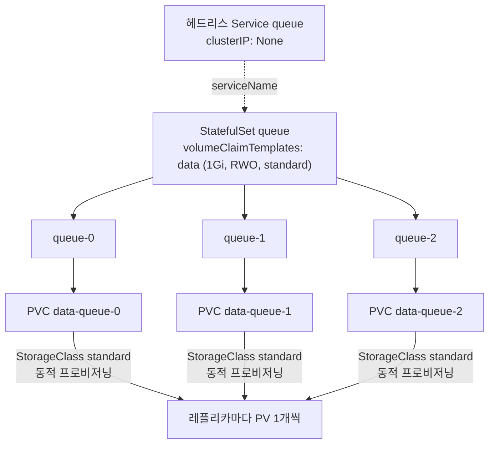
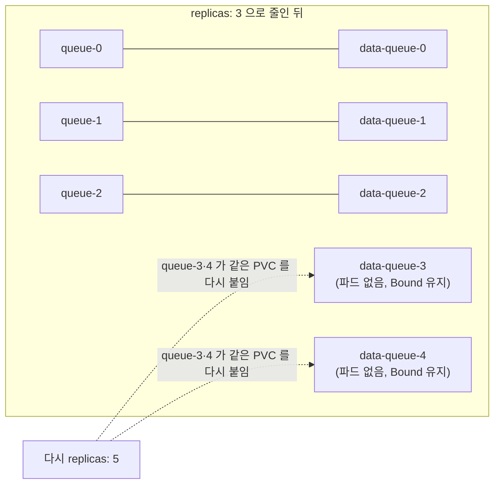

# q11 — Per-replica storage with volumeClaimTemplates · 풀이

← 문제: **[question.md](question.md)**

## 문제 (해석)

**원문**

> A StorageClass `standard` with dynamic provisioning already exists in the cluster.
>
> 1. In namespace `data`, create a StatefulSet `queue` with 3 replicas of `nginx:1.27`,
>    governed by a headless Service `queue` you also create.
> 2. Each replica must get its own 1Gi `ReadWriteOnce` volume from StorageClass
>    `standard`, mounted at `/var/lib/queue`, using a claim template named `data`.
> 3. List the PVCs that were created and record the exact naming pattern.
> 4. Write the file `/var/lib/queue/id` inside `queue-0` containing the text `zero`.
>    Delete pod `queue-0` and prove that the file survived.
> 5. Scale the StatefulSet to 5, then back to 3. Record how many PVCs exist afterwards and
>    explain the result.
> 6. Increase the claim template size to 2Gi and report what happens.

**해석**

동적 프로비저닝이 되는 StorageClass `standard` 가 이미 클러스터에 있다.

1. 네임스페이스 `data` 에 `nginx:1.27` 3 레플리카의 StatefulSet `queue` 를 만든다. 함께 만드는
   헤드리스 Service `queue` 가 관리한다.
2. 각 레플리카는 StorageClass `standard` 에서 자신만의 1Gi `ReadWriteOnce` 볼륨을 받아
   `/var/lib/queue` 에 마운트한다. 클레임 템플릿 이름은 `data` 다.
3. 생성된 PVC 목록을 보고 정확한 이름 규칙을 기록한다.
4. `queue-0` 안에서 `/var/lib/queue/id` 파일에 `zero` 를 쓴다. 파드 `queue-0` 을 삭제하고
   파일이 살아남았음을 증명한다.
5. StatefulSet을 5로 스케일한 뒤 다시 3으로 줄인다. 이후 PVC가 몇 개 남는지 기록하고 결과를 설명한다.
6. 클레임 템플릿 크기를 2Gi로 올리고 무슨 일이 일어나는지 보고한다.

## 모범 풀이

```yaml
# q11.yaml
apiVersion: v1
kind: Service
metadata:
  name: queue
  namespace: data
spec:
  clusterIP: None
  selector:
    app: queue
  ports:
    - port: 80
---
apiVersion: apps/v1
kind: StatefulSet
metadata:
  name: queue
  namespace: data
spec:
  serviceName: queue
  replicas: 3
  selector:
    matchLabels:
      app: queue
  template:
    metadata:
      labels:
        app: queue
    spec:
      containers:
        - name: q
          image: nginx:1.27
          volumeMounts:
            - name: data                 # 클레임 템플릿 이름과 정확히 같아야 한다
              mountPath: /var/lib/queue
  volumeClaimTemplates:                  # template 밖, spec 바로 아래
    - metadata:
        name: data
      spec:
        accessModes: ["ReadWriteOnce"]
        storageClassName: standard
        resources:
          requests:
            storage: 1Gi
```

```bash
kubectl apply -f q11.yaml
kubectl -n data get pvc
# data-queue-0, data-queue-1, data-queue-2
```

이름 규칙은 **`<클레임템플릿이름>-<스테이트풀셋이름>-<서수>`** 입니다. 순서를 헷갈리기 쉬운데
템플릿 이름이 앞입니다.

`volumeClaimTemplates` 는 `spec.template` 안이 아니라 `spec` 바로 아래입니다. 파드 템플릿 안에
넣으면 `kubectl apply` 가 `unknown field "spec.template.spec.volumeClaimTemplates"` 로 거부합니다
(kubectl 은 기본이 `--validate=strict`). 검증을 끄고 넣으면 그 필드는 버려지고, `data` 라는 볼륨이
없으므로 파드 생성 자체가 실패합니다.

### 그림 1 — 클레임 템플릿에서 레플리카별 PVC 가 생기는 과정



1. StatefulSet 컨트롤러는 파드 `queue-N` 을 만들기 전에 템플릿 `data` 로 PVC `data-queue-N` 을 먼저 만듭니다. 이름은 `<템플릿 이름>-<StatefulSet 이름>-<서수>` 입니다.
2. 각 PVC 는 StorageClass `standard` 로 자기만의 PV 를 받습니다. 레플리카끼리 볼륨을 공유하지 않습니다.
3. 파드 템플릿의 `volumeMounts[].name: data` 가 템플릿 이름과 같아서, 컨트롤러가 파드에 `data` 볼륨(= 그 서수의 PVC)을 넣어 줍니다.
4. 헤드리스 Service `queue` 는 `serviceName` 으로 연결되어 `queue-0.queue.data.svc` 같은 파드별 DNS 이름을 줍니다.

**4) 데이터 영속성**

```bash
kubectl -n data exec queue-0 -- sh -c 'echo zero > /var/lib/queue/id'
kubectl -n data delete pod queue-0
kubectl -n data wait --for=condition=Ready pod/queue-0 --timeout=90s
kubectl -n data exec queue-0 -- cat /var/lib/queue/id     # zero
```

재생성된 `queue-0` 은 같은 서수이므로 같은 PVC `data-queue-0` 을 다시 바인드합니다. 파드가
아니라 PVC가 데이터의 수명을 결정합니다.

**5) 스케일 다운 후 PVC**

```bash
kubectl -n data scale sts queue --replicas=5
kubectl -n data scale sts queue --replicas=3
kubectl -n data get pvc        # 5개 (data-queue-0 ~ data-queue-4)
kubectl -n data get pods       # 3개 (queue-0 ~ queue-2)
```

**PVC는 남습니다.** StatefulSet 컨트롤러는 PVC를 만들기만 하고 지우지 않습니다. 의도적인
설계입니다 — 스케일 다운이 데이터 삭제를 의미하면 실수 한 번으로 복구 불가능해집니다. 다시 5로
올리면 `queue-3`, `queue-4` 가 기존 PVC의 데이터를 그대로 다시 붙입니다. 정리는 수동
(`kubectl -n data delete pvc data-queue-3 data-queue-4`)입니다. StatefulSet 자체를 삭제해도
마찬가지로 PVC는 남습니다.

### 그림 2 — 5로 늘렸다가 3으로 줄였을 때



1. 5로 늘리면 `queue-3`, `queue-4` 와 함께 PVC `data-queue-3`, `data-queue-4` 가 생깁니다.
2. 3으로 줄이면 서수가 큰 `queue-4`, `queue-3` 순서로 파드만 지워지고, PVC 는 기본 `persistentVolumeClaimRetentionPolicy`(`whenScaled: Retain`) 때문에 남습니다. 그래서 PVC 는 5개입니다.
3. 다시 5로 늘리면 같은 이름의 PVC 를 그대로 다시 붙이므로 데이터가 이어집니다. 필요 없으면 직접 지웁니다.

**6) 템플릿 크기 변경**

```bash
kubectl -n data patch sts queue --type=json -p='[
  {"op":"replace","path":"/spec/volumeClaimTemplates/0/spec/resources/requests/storage","value":"2Gi"}
]'
# The StatefulSet "queue" is invalid: spec: Forbidden: updates to statefulset spec for
# fields other than 'replicas', 'ordinals', 'template', 'updateStrategy',
# 'revisionHistoryLimit', 'persistentVolumeClaimRetentionPolicy' and 'minReadySeconds' are forbidden
```

거부됩니다. `volumeClaimTemplates` 는 불변입니다. 실제로 늘리려면 StorageClass가
`allowVolumeExpansion: true` 인 상태에서 **각 PVC를 개별적으로** 수정합니다
(`kubectl -n data patch pvc data-queue-0 -p '{"spec":{"resources":{"requests":{"storage":"2Gi"}}}}'`).
템플릿을 바꾸고 싶으면 `kubectl delete sts queue --cascade=orphan` 으로 파드를 남긴 채
StatefulSet만 지우고 새 정의로 다시 만듭니다. 이때 새 템플릿은 **앞으로 새로 생기는 PVC** 에만
적용되고, 이미 있는 `data-queue-0~4` 는 1Gi 그대로입니다. 기존 PVC 는 위처럼 하나씩 늘려야 합니다.

## 검증

```bash
kubectl -n data get sts queue           # READY 3/3
kubectl -n data get pvc
# NAME           STATUS   VOLUME   CAPACITY   ACCESS MODES   STORAGECLASS
# data-queue-0   Bound    pvc-...  1Gi        RWO            standard
# ... data-queue-4 까지 5개

kubectl -n data exec queue-0 -- cat /var/lib/queue/id           # zero
kubectl -n data get pvc data-queue-0 -o jsonpath='{.status.capacity.storage}{"\n"}'   # 1Gi
# df -h 로는 확인하지 않는다 — local-path 같은 hostPath 기반 볼륨은 노드 디스크 크기가 보인다

kubectl -n data get pod queue-0 \
  -o jsonpath='{.spec.volumes[?(@.name=="data")].persistentVolumeClaim.claimName}{"\n"}'
# data-queue-0
```

## 오답 원인 / 배운 점

- **왜 틀렸나**:
- **기억할 것**: PVC 이름은 `<템플릿>-<sts>-<서수>`, 그리고 스케일 다운이나 sts 삭제로 PVC는 사라지지 않는다.
- **헷갈리는 지점**: `volumeMounts[].name` 과 `volumeClaimTemplates[].metadata.name` 이 같아야
  연결됩니다. 다르면 파드가 아예 만들어지지 않고, StatefulSet 이벤트에 `FailedCreate ...
  spec.containers[0].volumeMounts[0].name: Not found` 가 찍힙니다. 그리고 1.32 GA 인 `persistentVolumeClaimRetentionPolicy`
  (`whenScaled: Delete` / `whenDeleted: Delete`) 를 설정하면 위의 "PVC가 남는다" 동작을 바꿀 수 있습니다 — 기본값은 둘 다 `Retain` 입니다.

## 참고 문서

- 검색어: `statefulset volumeClaimTemplates`
- https://kubernetes.io/docs/concepts/workloads/controllers/statefulset/#stable-storage
- https://kubernetes.io/docs/tasks/run-application/scale-stateful-set/

---

[↑ 문항 목록](../README.md) · [← 문제로](question.md) · [다음 문제 q12 →](../q12_pvc_expand_reclaim_behavior/question.md)
