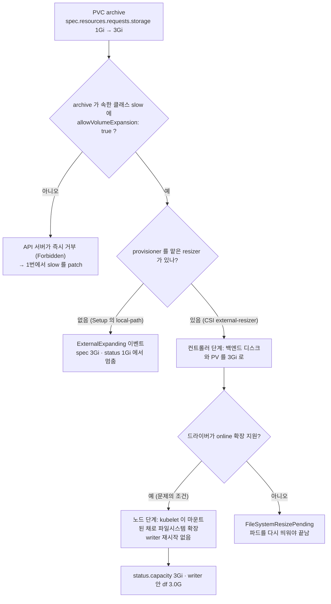
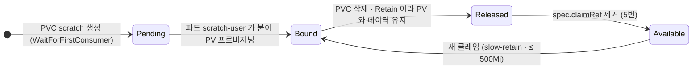

# q12 — Expand a PVC and observe reclaim behaviour · 풀이

← 문제: **[question.md](question.md)**

## 문제 (해석)

**원문**

> Namespace `files` has a PVC `archive` of 1Gi, `Bound`, using StorageClass `slow`, and a
> pod `writer` mounting it at `/data`. The CSI driver behind `slow` supports online
> expansion.
>
> 1. Check whether `slow` allows volume expansion. `archive` must be expanded where it is,
>    so if expansion is not allowed, change what is needed — a bound PVC cannot move to
>    another class.
> 2. Expand `archive` from 1Gi to 3Gi and confirm the filesystem inside `writer` sees the
>    new size, without restarting `writer`.
> 3. Attempt to shrink `archive` back to 1Gi and record the exact error.
> 4. Create StorageClass `slow-retain`, identical to `slow` except reclaim policy `Retain`.
>    Create a PVC `scratch` (500Mi) from it and make sure it actually gets a PV, then delete
>    the claim and report the state of that PV and why it is in that state.
> 5. Make that PV available for a new claim again without deleting it.

**해석**

네임스페이스 `files` 에 StorageClass `slow` 를 쓰는 1Gi `Bound` 상태 PVC `archive` 와,
그것을 `/data` 에 마운트한 파드 `writer` 가 있다. `slow` 뒤의 CSI 드라이버는 온라인 확장을 지원한다.

1. `slow` 가 볼륨 확장을 허용하는지 확인한다. `archive` 는 그 자리에서 확장해야 하므로, 허용하지 않으면
   필요한 것을 바꾼다 — 바인딩된 PVC는 다른 클래스로 옮길 수 없다.
2. `archive` 를 1Gi에서 3Gi로 확장하고, `writer` 를 재시작하지 않은 채 내부 파일시스템이 새 크기를
   인식하는지 확인한다.
3. `archive` 를 다시 1Gi로 줄이려 시도하고 정확한 오류를 기록한다.
4. `slow` 와 같되 reclaim 정책만 `Retain` 인 StorageClass `slow-retain` 을 만든다. 거기서 PVC
   `scratch`(500Mi)를 만들어 실제로 PV를 받게 한 뒤, 클레임을 지우고 그 PV의 상태와 이유를 보고한다.
5. 그 PV를 삭제하지 않고 다시 새 클레임에 쓸 수 있게 만든다.

## 모범 풀이

**1) 확장 허용 여부 — 클래스를 새로 만드는 것은 답이 아닙니다**

```bash
kubectl get sc slow                    # 아래는 Setup(local-path) 기준 출력
# NAME   PROVISIONER             RECLAIMPOLICY   VOLUMEBINDINGMODE      ALLOWVOLUMEEXPANSION   AGE
# slow   rancher.io/local-path   Delete          WaitForFirstConsumer   false                  2m
kubectl get sc slow -o jsonpath='{.allowVolumeExpansion}{"\n"}'     # 비어 있거나 false
kubectl -n files get pvc archive -o jsonpath='{.spec.storageClassName}{"\n"}'   # slow
```

PVC의 `storageClassName` 은 바인딩 후 바꿀 수 없으므로, 확장을 허용하는 새 클래스를 만들어도 `archive`
에는 아무 영향이 없습니다. 확장 허용 여부는 **그 PVC가 속한 클래스**가 정합니다. 다행히
`allowVolumeExpansion` 은 StorageClass에서 바꿀 수 있는 필드입니다(provisioner, parameters,
reclaimPolicy, volumeBindingMode 는 불변).

```bash
kubectl patch sc slow -p '{"allowVolumeExpansion":true}'
```

`allowVolumeExpansion` 은 "확장 요청을 받아 준다"는 허가일 뿐이고, **온라인으로(마운트된 채로) 늘릴 수
있는지는 CSI 드라이버의 능력**입니다. 클래스를 봐서는 알 수 없고 드라이버 문서로 확인합니다.

**2) 확장**

```bash
kubectl -n files patch pvc archive -p '{"spec":{"resources":{"requests":{"storage":"3Gi"}}}}'
kubectl -n files get pvc archive -w          # CAPACITY 가 3Gi 로 바뀔 때까지
kubectl -n files exec writer -- df -h /data  # 3.0G — writer 는 그대로 Running
```

`kubectl get pvc` 의 CAPACITY는 `status.capacity` 이고 요청값은 `spec.resources.requests` 라서,
두 값이 다르면 확장이 진행 중이라는 뜻입니다. 드라이버가 오프라인 확장만 지원한다면 PVC에
`FileSystemResizePending` 컨디션이 붙고 **파드를 재시작해야** 파일시스템이 늘어납니다.

`allowVolumeExpansion` 이 false인 상태로 패치하면 즉시 거부됩니다
(`Forbidden: only dynamically provisioned pvc can be resized and the storageclass that provisions the pvc must support resize`).

**이 레포의 Setup(local-path)에서는 여기서 멈춥니다.** local-path 는 확장을 지원하지 않아서 패치는 받아
들여지지만 늘려 줄 resizer 가 없습니다. 풀이가 틀린 것이 아니므로 패치가 들어갔는지만 확인합니다.

```bash
kubectl -n files get pvc archive -o jsonpath='{.spec.resources.requests.storage} {.status.capacity.storage}{"\n"}'
# 3Gi 1Gi
kubectl -n files describe pvc archive | grep -i ExternalExpanding
kubectl -n files exec writer -- df -h /data    # 볼륨이 아니라 노드 디스크 크기가 보인다
```

### 그림 1 — `archive` 확장이 끝나기까지



1. 확장은 PVC 의 요청값을 키우는 것으로 시작합니다. API 서버는 **그 PVC 의** 클래스(`slow`)에 `allowVolumeExpansion: true` 가 있는지만 봅니다. 그래서 새 클래스를 만들어서는 안 되고 `slow` 를 고칩니다.
2. 허용되면 실제 일은 드라이버 쪽 resizer 가 합니다. 먼저 스토리지의 디스크와 PV 크기를 키웁니다.
3. 이어서 `writer` 가 떠 있는 노드의 kubelet 이 파일시스템을 늘립니다. 문제는 드라이버가 online 확장을 지원한다고 했으므로 파드를 재시작하지 않고 끝납니다.
4. 두 단계가 끝나야 `status.capacity` 가 `3Gi` 가 되고 `df` 도 커집니다. local-path 처럼 resizer 가 없으면 2단계에서 멈춥니다.

**3) 축소 시도**

```bash
kubectl -n files patch pvc archive -p '{"spec":{"resources":{"requests":{"storage":"1Gi"}}}}'
# The PersistentVolumeClaim "archive" is invalid: spec.resources.requests.storage: Forbidden: field can not be less than status.capacity
```

1.34 이상(RecoverVolumeExpansionFailure 기본 활성)에서는 위 문구가, 그 이전 버전에서는
`Forbidden: field can not be less than previous value` 가 나옵니다.

실제 용량(`status.capacity`) 아래로 줄이는 것은 어떤 드라이버에서도 불가능하고 API server가 막습니다.
1.34부터 GA인 RecoverVolumeExpansionFailure 덕분에 **확장이 실패했을 때에 한해** 요청을
`status.capacity` 보다 큰 값까지는 낮출 수 있지만, 여기처럼 이미 3Gi로 늘어난 뒤에는 거부됩니다.
에러 문구는 버전에 따라 조금씩 다르므로 문제의 요구대로 **실제 출력**을 그대로 기록합니다. 줄이려면
새 작은 PVC를 만들어 데이터를 복사해야 합니다.

Setup(local-path)에서는 `status.capacity` 가 `1Gi` 에 머물러 있지만, 요청을 `status.capacity` 와
**같거나** 작게 만드는 것은 허용되지 않으므로 `1Gi` 로의 패치는 똑같은 문구로 거부됩니다(`2Gi` 처럼 그
사이 값은 받아 줍니다).

**4) Retain 클래스와 Released**

```bash
kubectl get sc slow -o yaml > /tmp/slow-retain.yaml
# name 을 slow-retain 으로, reclaimPolicy 를 Retain 으로 바꾸고
# metadata 의 uid, resourceVersion, creationTimestamp 와 어노테이션(default-class,
# kubectl.kubernetes.io/last-applied-configuration)은 지운다
kubectl apply -f /tmp/slow-retain.yaml
```

정리한 파일은 이렇게 됩니다(Setup 기준 provisioner). 1번에서 `slow` 에 켠 `allowVolumeExpansion` 도
"identical" 이므로 그대로 둡니다.

```yaml
apiVersion: storage.k8s.io/v1
kind: StorageClass
metadata:
  name: slow-retain
provisioner: rancher.io/local-path
reclaimPolicy: Retain
volumeBindingMode: WaitForFirstConsumer
allowVolumeExpansion: true
```

```bash
kubectl get sc slow-retain -o jsonpath='{.reclaimPolicy} {.volumeBindingMode}{"\n"}'
# Retain WaitForFirstConsumer    ← 이 경우 소비자 파드가 있어야 PV가 생긴다
```

**`WaitForFirstConsumer` 클래스는 파드가 PVC를 쓰기 전까지 PV를 만들지 않습니다.** PVC만 만들고
지우면 PV가 생긴 적이 없으니 관찰할 것이 없습니다. 그래서 잠깐 쓰는 파드를 붙입니다.

```bash
kubectl -n files apply -f - <<'EOF'
apiVersion: v1
kind: PersistentVolumeClaim
metadata: { name: scratch }
spec:
  accessModes: ["ReadWriteOnce"]
  storageClassName: slow-retain
  resources: { requests: { storage: 500Mi } }
---
apiVersion: v1
kind: Pod
metadata: { name: scratch-user }
spec:
  containers:
  - name: c
    image: busybox:1.36
    command: ["sleep", "3600"]
    volumeMounts: [{ name: v, mountPath: /data }]
  volumes:
  - name: v
    persistentVolumeClaim: { claimName: scratch }
EOF

kubectl -n files get pvc scratch -w                      # Bound 가 되면 Ctrl-C
PV=$(kubectl -n files get pvc scratch -o jsonpath='{.spec.volumeName}')
kubectl -n files delete pod scratch-user
kubectl -n files delete pvc scratch
kubectl get pv $PV
# STATUS = Released, RECLAIM POLICY = Retain
```

`Retain` 이므로 PVC가 사라져도 PV와 그 안의 데이터가 남습니다. 상태는 `Available` 이 아니라
`Released` 입니다 — PV의 `spec.claimRef` 가 이미 없어진 PVC를 아직 가리키고 있기 때문입니다.
이 필드가 남아 있는 동안 PV는 다른 클레임에 바인드되지 않습니다. 실수로 남의 데이터에 접근하는 것을
막는 안전장치입니다.

**5) 다시 Available 로**

```bash
kubectl patch pv $PV --type=json -p='[{"op":"remove","path":"/spec/claimRef"}]'
kubectl get pv $PV        # STATUS = Available
```

`claimRef` 만 지우는 것이므로 PV 오브젝트와 노드의 데이터는 그대로입니다. 새 클레임은 클래스가
`slow-retain` 이고 요청이 500Mi 이하여야 이 PV 에 바인딩됩니다. local-path PV 는 nodeAffinity 로
원래 노드에 묶여 있으므로 그 클레임을 쓰는 파드도 그 노드에 뜹니다.

### 그림 2 — `scratch` 의 PV 가 거치는 상태



1. `slow-retain` 은 `WaitForFirstConsumer` 라서 PVC 만으로는 `Pending` 이고 PV 도 없습니다. 파드가 PVC 를 쓰며 스케줄되어야 PV 가 만들어지고 `Bound` 가 됩니다.
2. PVC 를 지우면 `Retain` 정책 때문에 PV 는 지워지지 않고 `Released` 가 됩니다. `spec.claimRef` 가 사라진 PVC 를 아직 가리키고 있어 다른 클레임과 바인딩되지 않습니다.
3. `claimRef` 를 지우면 `Available` 이 되어 새 클레임을 받을 수 있습니다. 정책이 `Delete` 였다면 2단계에서 PV 와 데이터가 함께 삭제되어 이 경로가 없습니다.

## 검증

```bash
kubectl get sc slow -o jsonpath='{.allowVolumeExpansion}{"\n"}'      # true
kubectl get sc slow-retain                                           # RECLAIMPOLICY Retain

kubectl -n files get pvc archive
# NAME      STATUS   CAPACITY   STORAGECLASS
# archive   Bound    3Gi        slow
kubectl -n files exec writer -- df -h /data | tail -1     # 3.0G (Setup 의 local-path 에서는 1Gi 에 머물고 df 는 노드 디스크 크기)
kubectl -n files get pod writer                           # RESTARTS 그대로

kubectl get pv $PV -o jsonpath='{.status.phase}{"\t"}{.spec.persistentVolumeReclaimPolicy}{"\n"}'
# Available   Retain
kubectl get pv $PV -o jsonpath='{.spec.claimRef}{"\n"}'   # 빈 출력
```

## 오답 원인 / 배운 점

- **왜 틀렸나**:
- **기억할 것**: 확장 허용 여부는 PVC가 **속한** 클래스의 `allowVolumeExpansion` 이 정하고, 이 필드는 기존 클래스에서 패치할 수 있다. 온라인 확장 가능 여부는 드라이버 능력이다. 실제 용량 아래로 줄이는 것은 불가능하다.
- **헷갈리는 지점**: `Released` 와 `Available` 을 혼동하기 쉽습니다. `Available` 은 바로 쓸 수 있는
  상태, `Released` 는 "이전 클레임이 떠났지만 아직 회수되지 않음" 입니다. `Delete` 정책이면 보통 PV가
  곧 삭제되고, 삭제에 실패하면 `Failed` 로 남습니다(A-q12). 그리고 `WaitForFirstConsumer` 클래스에서는
  파드가 붙기 전까지 PVC가 `Pending` 이고 PV도 없습니다.

## 참고 문서

- 검색어: `expanding persistent volume claims`
- https://kubernetes.io/docs/concepts/storage/persistent-volumes/#expanding-persistent-volumes-claims
- https://kubernetes.io/docs/concepts/storage/persistent-volumes/#reclaiming
- https://kubernetes.io/docs/concepts/storage/storage-classes/#volume-binding-mode

---

[↑ 문항 목록](../README.md) · [← 문제로](question.md) · [다음 문제 q13 →](../q13_coredns_resolution_failure/question.md)
