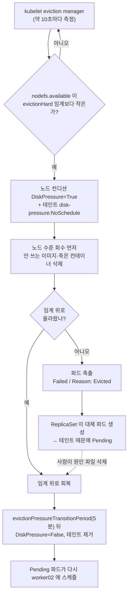

# q16 — Pods evicted under node disk pressure · 풀이

← 문제: **[question.md](question.md)**

## 문제 (해석)

**원문**

> Pods on `worker02` are disappearing. Several show status `Evicted`, and new pods stay
> `Pending` with no node chosen. Other nodes are unaffected.
>
> 1. Show the node condition that explains this and the message the kubelet attached to it.
> 2. Report the kubelet eviction thresholds in effect on `worker02` and which filesystem
>    signal crossed its threshold.
> 3. Find what is consuming the disk, distinguishing container images from container logs
>    from other data.
> 4. Reclaim space so the condition clears. Remove unused images through the container
>    runtime, not by deleting files under `/var/lib/containerd` by hand.
> 5. Confirm the node accepts pods again, and clean up the `Evicted` pod objects.
> 6. Note the difference between an evicted pod and an OOMKilled container in one line.

**해석**

`worker02` 의 파드들이 사라지고 있다. 여러 개가 `Evicted` 상태이고, 새 파드는 노드가 선택되지
않은 채 `Pending` 에 머문다. 다른 노드는 정상이다.

1. 이를 설명하는 노드 컨디션과 kubelet이 붙인 메시지를 보인다.
2. `worker02` 에 적용된 kubelet 축출 임계값과 어떤 파일시스템 시그널이 임계를 넘었는지 보고한다.
3. 디스크를 무엇이 소비하는지 찾는다. 컨테이너 이미지, 컨테이너 로그, 기타 데이터를 구분한다.
4. 컨디션이 해제되도록 공간을 회수한다. 사용하지 않는 이미지는 `/var/lib/containerd` 아래 파일을
   손으로 지우지 말고 컨테이너 런타임을 통해 제거한다.
5. 노드가 다시 파드를 받는지 확인하고 `Evicted` 파드 오브젝트를 정리한다.
6. 축출된 파드와 OOMKilled된 컨테이너의 차이를 한 줄로 적는다.

## 모범 풀이

**1) 노드 컨디션** — 위에서 아래로 내려갑니다.

```bash
kubectl get nodes
# worker02  Ready  (Ready 는 유지된다 — DiskPressure 만으로는 NotReady 가 아니다)

kubectl describe node worker02
# Conditions:
#   Type            Status  Reason                  Message
#   DiskPressure    True    KubeletHasDiskPressure  kubelet has disk pressure
# Taints: node.kubernetes.io/disk-pressure:NoSchedule
```

`DiskPressure=True` 가 되면 kubelet이 노드에 `node.kubernetes.io/disk-pressure:NoSchedule`
테인트를 자동으로 붙입니다. 그래서 스케줄러가 새 파드를 배치하지 않고 `Pending` 에 머무는 것입니다.
`describe pod <pending>` 의 Events에 `0/3 nodes are available: 1 node(s) had untolerated taint
{node.kubernetes.io/disk-pressure: }` 가 나옵니다.

```bash
kubectl get pods -A --field-selector=status.phase=Failed
kubectl describe pod <evicted-pod> | grep -A3 Status
# Status: Failed / Reason: Evicted
# Message: The node was low on resource: ephemeral-storage. ...
```

**2) 임계값** (worker02, root)

```bash
# 실제로 적용 중인 값 — 설정 파일에 안 적힌 기본값까지 포함해 보여 준다
kubectl get --raw "/api/v1/nodes/worker02/proxy/configz" | tr ',' '\n' | grep -A6 evictionHard
# 기본값이면: "evictionHard":{"imagefs.available":"15%" / "imagefs.inodesFree":"5%" /
#  "memory.available":"100Mi" / "nodefs.available":"10%" / "nodefs.inodesFree":"5%"}
# 이 실습(setup.sh)에서는 nodefs.available 이 퍼센트가 아니라 "NNNNMi" 같은 절댓값으로 보인다

grep -A10 evictionHard /var/lib/kubelet/config.yaml     # (worker02) 비어 있으면 기본값을 쓰는 중
df -h /var/lib/kubelet /var/lib/containerd /
df -i /                                                 # inode 소진도 같은 증상을 낸다
```

어느 시그널이 넘었는지는 추측하지 말고 kubelet이 남긴 기록에서 읽습니다.

```bash
kubectl describe pod <evicted-pod> | grep Message
# Message: The node was low on resource: ephemeral-storage. Threshold quantity: 5120Mi, available: 4012345Ki.
journalctl -u kubelet --no-pager | grep -i 'eviction manager' | tail -5
# "Eviction manager: attempting to reclaim" resourceName="ephemeral-storage"
# "Eviction manager: thresholds have been met" thresholds=[{Signal:nodefs.available ...}]
```

`ephemeral-storage` + `nodefs.available` 이면 kubelet 쪽 파일시스템의 **남은 용량**이 원인입니다.
`imagefs.available` 이면 이미지 쪽, `*.inodesFree` 면 용량이 아니라 inode 입니다.

kubeadm이 만든 `/var/lib/kubelet/config.yaml` 에는 보통 `evictionHard` 가 없습니다. 적지 않은 값은
kubelet 기본값이 적용되므로 `grep` 이 비어 있다고 "임계값이 없다"고 결론 내리면 안 됩니다. `configz`
엔드포인트는 kubelet이 **실제로 쓰고 있는** 설정 전체를 돌려주므로 이것이 확실합니다.

시그널이 여러 개라는 점이 중요합니다(메모리 외에 nodefs·imagefs 각각의 용량과 inode). `nodefs` 는 kubelet이 쓰는 파일시스템(emptyDir, 로그),
`imagefs` 는 런타임이 이미지와 컨테이너 쓰기 레이어를 두는 파일시스템입니다. 둘이 같은 디스크인
경우가 많지만 분리되어 있으면 어느 쪽이 찼는지에 따라 조치가 달라집니다. 그리고 용량이 넉넉한데도
`nodefs.inodesFree` 로 축출되는 경우가 있어 `df -h` 만 보면 원인을 놓칩니다.

**3) 소비원 찾기**

```bash
du -sh /var/lib/containerd /var/log/pods /var/lib/kubelet/pods 2>/dev/null
du -sh /var/log/pods/* | sort -h | tail -10
crictl images                                   # 이미지 목록
crictl imagefsinfo
journalctl --disk-usage

# 위 쿠버네티스 경로가 작다면 "기타 데이터" — 같은 파일시스템 전체에서 큰 것을 찾는다
du -xh --max-depth=3 / 2>/dev/null | sort -h | tail -15     # -x: 다른 파일시스템으로 넘어가지 않음
find / -xdev -type f -size +500M -exec ls -lh {} + 2>/dev/null
```

이 실습에서는 이미지·로그 경로가 모두 작고, `/var/lib/c16-dump/core.img` 같은 큰 파일 하나가 나옵니다.
세 가지를 구분하라는 요구는 결국 "이미지는 `crictl`, 로그는 `/var/log/pods`, 나머지는 `du -x`" 로
따로 재 보라는 뜻입니다.

| 소비원 | 확인 | 조치 |
|---|---|---|
| 사용하지 않는 이미지 | `crictl images` 가 많고 `du /var/lib/containerd` 가 큼 | `crictl rmi --prune` |
| 컨테이너 로그 누적 | `du -sh /var/log/pods/*` 에 큰 항목 | 해당 파드 재생성, kubelet `containerLogMaxSize` 설정 |
| 종료된 컨테이너 잔여물 | `crictl ps -a` 에 Exited 다수 | `crictl rm $(crictl ps -a -q --state exited)` |
| journald 로그 | `journalctl --disk-usage` 가 GB 단위 | `journalctl --vacuum-size=200M` |
| emptyDir에 쓰는 파드 | `du -sh /var/lib/kubelet/pods/*` | 해당 파드의 `sizeLimit` 설정 또는 삭제 |
| 쿠버네티스 밖의 큰 파일(덤프·백업) | `du -x` / `find -size +500M` 에 큰 항목 | 필요 없는 파일인지 확인한 뒤 삭제하거나 다른 디스크로 옮김 |

**4) 회수**

```bash
crictl rmi --prune                              # 어떤 컨테이너도 참조하지 않는 이미지 삭제
crictl rm $(crictl ps -a -q --state exited)     # 종료된 컨테이너 정리
journalctl --vacuum-size=200M
rm -f /var/lib/c16-dump/core.img                # 3) 에서 찾은 큰 파일 (이 실습의 실제 원인)
df -h /var/lib/kubelet                          # Avail 이 2) 의 nodefs.available 임계보다 커야 한다
```

`crictl rmi --prune` 은 문제가 요구하는 "런타임을 통한 이미지 정리" 이지만, 이 실습에서는 그것만으로
컨디션이 풀리지 않습니다. 아래 설명처럼 kubelet이 이미 같은 일을 먼저 했기 때문입니다.

`/var/lib/containerd` 를 직접 `rm` 하면 containerd의 메타데이터 DB와 실제 레이어가 어긋나
이후 모든 이미지 pull이 깨집니다. 반드시 `crictl rmi` 를 통해야 합니다.

디스크 압박이 오면 kubelet은 파드를 축출하기 **전에** 먼저 노드 수준 회수를 시도합니다 — 쓰지 않는
이미지와 죽은 컨테이너를 지웁니다. 그래도 임계 아래로 못 내려가면 그때 파드를 축출합니다. 그래서 파드가
축출되었다는 것은 kubelet이 지울 수 있는 것을 다 지워도 모자랐다는 뜻이고, 이미지보다는 컨테이너 로그·
emptyDir·노드의 다른 데이터가 원인일 가능성이 큽니다.

공간이 확보되면 kubelet이 다음 평가 주기(기본 10초)에 컨디션을 내리지만,
`evictionPressureTransitionPeriod` (기본 5분) 동안 플래핑 방지를 위해 유지되므로 즉시 사라지지
않습니다. 5분을 기다리거나 `systemctl restart kubelet` 으로 앞당깁니다.

임계값을 낮춰서 컨디션을 없애는 것은 답이 아닙니다. 문제는 공간을 회수하라고 했고, 임계값은 2) 에서
"보고" 만 하라고 했습니다.

**5) 정리**

```bash
kubectl get pods -A --field-selector=status.phase=Failed     # 먼저 무엇이 지워질지 본다
kubectl delete pods -A --field-selector=status.phase=Failed
```

`status.phase=Failed` 에는 축출된 파드 말고 실패한 Job 파드도 들어갑니다. 남겨야 할 것이 섞여 있으면
`-n <namespace>` 로 범위를 좁히거나 `get` 출력에서 `Evicted` 인 것만 골라 지웁니다.

`Evicted` 파드는 Failed 상태의 껍데기 오브젝트로 남습니다. 컨테이너는 이미 사라졌고 디스크를
차지하지 않으므로 급하지는 않지만, `get pods` 출력을 어지럽히고 ReplicaSet 파드라면 이미
대체 파드가 다른 노드에 떠 있습니다.

**6) 차이**: 축출(Eviction)은 **kubelet이 노드 자원 부족을 판단해 파드 전체를 종료**하고
파드가 `Failed/Evicted` 로 남는 것이며, OOMKilled는 **커널이 컨테이너의 cgroup 메모리 limit 초과를
보고 그 컨테이너 하나만 SIGKILL** 해서 파드는 유지되고 재시작 카운트가 오르는 것입니다.

### 그림 — 디스크 압박에서 축출까지, 그리고 풀리는 순서



1. kubelet 의 eviction manager 가 주기적으로 파일시스템 남은 공간을 재고 `evictionHard` 임계와 비교합니다. 2) 에서 확인한 임계값이 여기서 쓰입니다.
2. 임계 아래로 내려가면 노드에 `DiskPressure=True` 가 붙고, 그 컨디션 때문에 `disk-pressure:NoSchedule` 테인트가 자동으로 붙습니다. `Ready` 는 그대로라 `get nodes` 만 보면 놓칩니다.
3. kubelet 은 파드를 건드리기 전에 안 쓰는 이미지와 죽은 컨테이너부터 지웁니다. 그래서 축출까지 갔다면 이미지가 아닌 다른 것이 공간을 쥐고 있다는 신호입니다.
4. 그래도 모자라면 파드를 하나씩 축출합니다. 축출된 파드는 `Failed/Evicted` 껍데기로 남고, ReplicaSet 이 만든 대체 파드는 테인트 때문에 `Pending` 에 머뭅니다. 이것이 문제의 증상입니다.
5. 원인 파일을 지워 임계 위로 돌아와도 5분의 전환 기간이 지나야 컨디션과 테인트가 사라지고, 그때 `Pending` 파드가 다시 배치됩니다.

## 검증

```bash
kubectl describe node worker02 | grep -A6 Conditions
# DiskPressure  False  KubeletHasNoDiskPressure

kubectl describe node worker02 | grep -i taint      # disk-pressure 테인트 없음
df -h /                                             # Use% 가 임계 아래

kubectl run probe --image=nginx:1.27 \
  --overrides='{"spec":{"nodeSelector":{"kubernetes.io/hostname":"worker02"}}}'
kubectl get pod probe -o wide                       # Running, NODE=worker02 (스케줄러가 배치했다)
kubectl delete pod probe
kubectl -n diskload get pods -o wide                # (이 실습) Pending 이던 report-gen 파드도 Running

kubectl get pods -A --field-selector=status.phase=Failed    # No resources found
crictl images | wc -l                               # 줄어들었다
```

## 오답 원인 / 배운 점

- **왜 틀렸나**:
- **기억할 것**: `DiskPressure=True` → kubelet이 `NoSchedule` 테인트를 자동 부착 → 새 파드가 Pending.
- **헷갈리는 지점**: `nodefs.available` 과 `imagefs.available` 은 서로 다른 시그널이고 조치도 다릅니다.
  또 `df -h` 는 정상인데 축출되는 경우가 있는데, 이때는 거의 항상 `df -i` 의 inode 소진
  (`nodefs.inodesFree`)입니다. 그리고 공간을 비워도 컨디션이 바로 내려가지 않는 것은 버그가 아니라
  `evictionPressureTransitionPeriod` (기본 5분) 때문입니다 — 여기서 조급하게 다른 것을 건드리면 상황을 악화시킵니다.

## 참고 문서

- 검색어: `node-pressure eviction`
- https://kubernetes.io/docs/concepts/scheduling-eviction/node-pressure-eviction/
- https://kubernetes.io/docs/reference/node/node-status/#condition

## 복습 기록

| 날짜 | 결과 | 메모 |
|---|---|---|
|  |  |  |
