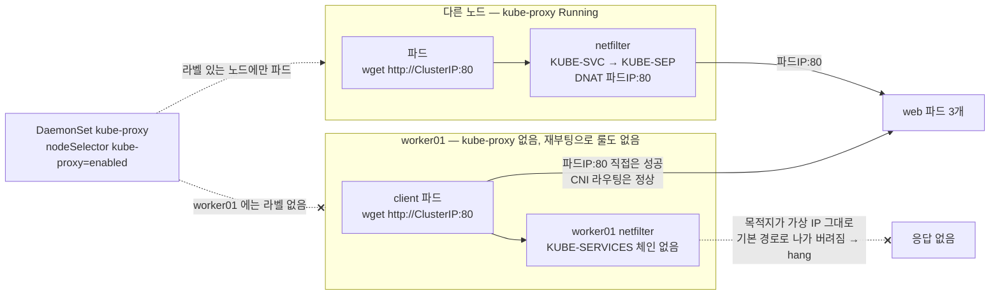

# q17 — Service traffic broken by kube-proxy · 풀이

← 문제: **[question.md](question.md)**

## 문제 (해석)

**원문**

> `worker01` was rebooted this morning after kernel maintenance. Since then, in namespace
> `app`, Service `web` (ClusterIP, port 80) still has 3 healthy endpoints, and from a pod
> **on `worker01`** `curl http://<pod-ip>:80` works for every backend pod, but
> `curl http://web.app.svc.cluster.local` and `curl http://<cluster-ip>:80` both hang.
> NodePort Service `web-np` is unreachable through `worker01`'s IP. Pods on other nodes are
> not affected.
>
> 1. Show that neither CoreDNS nor the Service's endpoints are the cause — one command each.
> 2. Identify the component responsible for ClusterIP translation and check its state on
>    `worker01`.
> 3. Inspect the node's NAT rules to show the Service chains are missing.
> 4. Find and fix the root cause. Do not recreate the Service.
> 5. Verify ClusterIP and NodePort both work again.

**해석**

`worker01` 이 오늘 아침 커널 점검 뒤 재부팅되었다. 그 뒤로 네임스페이스 `app` 의 Service `web`
(ClusterIP, 포트 80)에는 여전히 정상 엔드포인트 3개가 있고, **`worker01` 위의** 파드에서
`curl http://<파드IP>:80` 은 모든 백엔드 파드에 대해 동작하지만 `curl http://web.app.svc.cluster.local` 과
`curl http://<ClusterIP>:80` 은 둘 다 멈춘다. NodePort Service `web-np` 도 `worker01` 의 IP로는 접근되지
않는다. 다른 노드의 파드는 영향이 없다.

1. CoreDNS도 Service의 엔드포인트도 원인이 아님을 각각 명령 하나로 보인다.
2. ClusterIP 변환을 담당하는 컴포넌트를 특정하고 `worker01` 에서 상태를 확인한다.
3. 노드의 NAT 룰을 조사해 Service 체인이 없음을 보인다.
4. 근본 원인을 찾아 고친다. Service를 재생성하지 않는다.
5. ClusterIP와 NodePort가 모두 다시 동작하는지 확인한다.

## 모범 풀이

테스트는 **반드시 worker01 위의 파드에서** 합니다. 아무 노드에서나 하면 멀쩡한 노드에서 테스트하게 되어
"정상"으로 오판합니다. Setup 이 worker01 에 `client` 파드(busybox)를 미리 띄워 두었으니 그 안에서
`wget` 으로 확인합니다(busybox 에는 `curl` 이 없습니다).

```bash
kubectl -n app get pod client -o wide        # NODE 가 worker01 인지 확인
```

새 테스트 파드를 worker01 에 띄우려 하면 `ContainerCreating` 에서 멈출 수 있습니다. Calico 처럼 CNI 가
API 서버를 `kubernetes` Service 의 ClusterIP(`10.96.0.1`)로 부르는 경우, 이 노드에서는 그 ClusterIP 도
변환되지 않아 파드 IP 할당이 실패하기 때문입니다. 이것도 같은 원인의 증상이니, 이미 떠 있는 파드에서
`kubectl exec` 으로 확인하는 편이 확실합니다.

**1) CoreDNS와 엔드포인트 배제**

```bash
kubectl -n app get endpointslice -l kubernetes.io/service-name=web
# ENDPOINTS  10.244.1.5,10.244.2.7,10.244.2.8     ← 엔드포인트는 정상

DNSPOD=$(kubectl -n kube-system get pod -l k8s-app=kube-dns -o jsonpath='{.items[0].status.podIP}')
kubectl -n app exec client -- nslookup web.app.svc.cluster.local $DNSPOD
# Address: 10.96.88.21     ← CoreDNS 파드에 직접 물으면 정상 응답
```

worker01의 파드가 평소처럼 `nslookup web.app.svc.cluster.local` 을 하면 **이것도 멈춥니다.** 파드의
`nameserver` 인 `10.96.0.10` 도 kube-dns Service의 **ClusterIP** 라서, 변환 룰이 없는 노드에서는 DNS
질의조차 CoreDNS에 닿지 못하기 때문입니다. 그래서 "이름이 안 풀린다"만 보고 CoreDNS를 고치러 가면
헛수고입니다. CoreDNS **파드 IP**로 직접 물었을 때 정상 응답이 오면 CoreDNS와 레코드는 멀쩡하고,
고장 난 것은 이 노드의 **ClusterIP → 파드 IP 변환**뿐입니다. 파드 IP 직접 접속이 되므로 CNI와 파드 간
라우팅도 정상입니다.

엔드포인트가 비어 있었다면 kube-proxy가 넣은 거부 룰 때문에 `curl` 이 즉시 connection refused를 냈을
것입니다. 여기처럼 **멈추는(hang)** 것은 패킷이 어디로도 가지 못한다는 신호입니다.

**2) kube-proxy 상태**

ClusterIP는 실제 인터페이스가 없는 가상 IP입니다. 각 노드의 kube-proxy가 iptables(또는 nftables·IPVS)
룰을 심어 목적지를 파드 IP로 DNAT합니다. 그 룰이 없으면 패킷이 버려집니다.

```bash
kubectl get nodes --no-headers | wc -l                  # 3
kubectl -n kube-system get ds kube-proxy
# DESIRED 2  CURRENT 2  READY 2  ...  NODE SELECTOR  kube-proxy=enabled,kubernetes.io/os=linux
#   ← 노드는 3대인데 DESIRED 가 2 — worker01 에는 kube-proxy 가 아예 없다

kubectl -n kube-system get pods -l k8s-app=kube-proxy -o wide      # worker01 행이 없다
kubectl get nodes -L kube-proxy                                    # worker01 만 라벨이 비어 있다
```

kube-proxy는 kube-system의 **DaemonSet**입니다. 노드마다 정확히 하나 떠 있어야 하고, 한 노드에만 없으면
그 노드의 파드들만 서비스에 접근하지 못하는 이 문제의 증상과 정확히 일치합니다.

**왜 재부팅 뒤에야 터졌나.** kube-proxy는 종료될 때 자기가 만든 룰을 지우지 않습니다. 누군가 DaemonSet에
`nodeSelector` 를 넣어 worker01의 kube-proxy가 사라졌어도, 남아 있던 룰로 한동안 버텼습니다(새 서비스·
엔드포인트 변경만 반영되지 않는 상태). 재부팅으로 메모리에 있던 iptables 룰이 전부 사라지자, 룰을 다시 써
줄 kube-proxy가 없어서 서비스 체인이 통째로 비었습니다.

| 로그·증상 | 원인 | 조치 |
|---|---|---|
| DS `DESIRED` < 노드 수, 그 노드에 kube-proxy 파드 없음 | DaemonSet `nodeSelector`/affinity가 노드를 제외 | 셀렉터 원복 또는 노드 라벨 |
| 한 노드의 kube-proxy만 `CrashLoopBackOff`, 로그에 `iptables-restore` 실패 | 노드의 iptables 백엔드 혼용(nft/legacy), 커널 모듈 문제 | 노드에서 `iptables-save`, `nft list ruleset` 확인 |
| 모든 kube-proxy가 `open /var/lib/kube-proxy/config.conf: no such file` | ConfigMap `kube-proxy` 의 키 손상 | ConfigMap 복원 |
| `unable to load in-cluster configuration` / 401 | ServiceAccount·RBAC 문제 | `system:node-proxier` 바인딩 확인 |
| `iptables-save` 에 KUBE 체인이 없는데 kube-proxy 는 Running | 모드가 nftables·IPVS 라 다른 곳에 룰이 있음 | ConfigMap `mode` 확인 후 `nft list table ip kube-proxy` / `ipvsadm -Ln` |
| 노드에서 `net.ipv4.ip_forward=0` | 포워딩 비활성 | `sysctl -w net.ipv4.ip_forward=1` |

**3) NAT 룰 확인** (worker01, root)

먼저 kube-proxy가 어떤 모드인지 봅니다. `/var/lib/kube-proxy/config.conf` 는 **kube-proxy 파드 안**에
마운트된 경로라 노드에는 없습니다. 모드는 ConfigMap에서 읽습니다.

```bash
kubectl -n kube-system get cm kube-proxy -o yaml | grep -E '^\s+mode:'
# mode: ""        ← 비어 있으면 iptables (Linux 기본값)
```

```bash
# iptables 모드
iptables -t nat -L KUBE-SERVICES -n | head -20
# iptables: No chain/target/match by that name.  ← 체인 자체가 없다
iptables-save | grep -c KUBE-SVC                   # 0

# nftables 모드(1.33 GA)라면
nft list table ip kube-proxy                       # 테이블이 없다
# IPVS 모드(1.35부터 deprecated)라면
ipvsadm -Ln
```

정상 노드와 비교하면 차이가 명확합니다. 정상이라면:

```
KUBE-SVC-XXXXXXXX  tcp -- 0.0.0.0/0  10.96.88.21  tcp dpt:80
```

**4) 수정** — DaemonSet의 셀렉터를 원래대로 돌립니다.

```bash
kubectl -n kube-system get ds kube-proxy -o jsonpath='{.spec.template.spec.nodeSelector}{"\n"}'
# {"kube-proxy":"enabled","kubernetes.io/os":"linux"}      ← kubeadm 기본은 kubernetes.io/os 하나뿐

kubectl -n kube-system patch ds kube-proxy --type=json \
  -p='[{"op":"remove","path":"/spec/template/spec/nodeSelector/kube-proxy"}]'
kubectl -n kube-system rollout status ds kube-proxy
```

`kubectl label node worker01 kube-proxy=enabled` 로도 당장은 풀리지만, 새 노드가 들어올 때마다 같은
사고가 나므로 셀렉터를 원복하는 쪽이 근본 해결입니다. kube-proxy 파드가 worker01에 뜨면 시작하면서 룰을
전부 다시 씁니다. 룰을 손으로 복구할 필요는 없습니다 — 손으로 넣은 룰은 다음 동기화에서 지워집니다.

### 그림 — 같은 ClusterIP 인데 노드마다 결과가 다른 이유



1. 두 노드의 파드는 같은 ClusterIP 로 요청하지만, 그 IP 를 실제 파드 IP 로 바꾸는 일은 **패킷을 보낸 노드의 netfilter** 에서 일어납니다. 그 룰은 각 노드의 kube-proxy 가 씁니다.
2. 다른 노드에서는 kube-proxy 가 `KUBE-SERVICES → KUBE-SVC-… → KUBE-SEP-…` 체인을 만들어 두었으므로 ClusterIP:80 이 `파드IP:80` 으로 DNAT 되어 nginx 에 닿습니다.
3. DaemonSet 의 `nodeSelector` 에 라벨이 없는 worker01 에는 kube-proxy 파드가 없습니다. 이전 룰은 재부팅으로 사라졌고 다시 쓸 주체가 없으니, 패킷은 목적지가 가상 IP 인 채로 기본 경로로 나가 버려집니다. 아무도 거절하지 않으므로 `refused` 가 아니라 멈춥니다(hang). NodePort 도 같은 룰(`KUBE-NODEPORTS`)이 없어서 worker01 IP 로는 닿지 않습니다.
4. 파드 IP 로 직접 보내는 요청은 kube-proxy 를 거치지 않고 CNI 가 만든 경로만 쓰므로 worker01 에서도 성공합니다. 이 대비가 "CNI 는 정상, ClusterIP 변환만 고장" 이라는 결론의 근거입니다.
5. 셀렉터에서 `kube-proxy` 키를 지우면 DaemonSet 이 worker01 에 파드를 만들고, 그 파드가 시작하면서 모든 Service 룰을 다시 씁니다.

## 검증

```bash
kubectl -n kube-system get ds kube-proxy
# DESIRED 3  CURRENT 3  READY 3  UP-TO-DATE 3
kubectl -n kube-system get pods -l k8s-app=kube-proxy -o wide | grep worker01   # Running

# worker01 에서
iptables -t nat -L KUBE-SERVICES -n | grep 10.96.88.21     # 서비스 룰 존재

CIP=$(kubectl -n app get svc web -o jsonpath='{.spec.clusterIP}')
kubectl -n app exec client -- wget -qO- -T 3 http://$CIP:80 | head -4          # nginx HTML 응답
kubectl -n app exec client -- wget -qO- -T 3 http://web.app.svc.cluster.local | head -4

NP=$(kubectl -n app get svc web-np -o jsonpath='{.spec.ports[0].nodePort}')
W1=$(kubectl get node worker01 -o jsonpath='{.status.addresses[?(@.type=="InternalIP")].address}')
curl -s --max-time 3 http://$W1:$NP | head -4                                  # k8s-c1 에서
```

## 오답 원인 / 배운 점

- **왜 틀렸나**:
- **기억할 것**: 파드 IP는 되고 ClusterIP만 안 되면 kube-proxy. 노드별로 다르면 그 노드의 kube-proxy 파드(또는 그 노드에 파드가 아예 없는지 — DS의 DESIRED와 노드 수 비교). kube-proxy는 죽어도 룰을 지우지 않으므로, 룰이 "없다"면 재부팅이나 flush가 겹친 것이다.
- **헷갈리는 지점**: 세 가지 실패가 겉보기에 비슷합니다. 이름 해석 실패 = DNS(q13),
  EndpointSlice가 비어 있음 = 셀렉터·readiness 문제, 이름과 엔드포인트는 정상인데 ClusterIP 연결 불가 =
  kube-proxy. 그리고 `curl` 이 **즉시 refused** 면 누군가 거절한 것(목적지 파드가 그 포트를 안 듣거나,
  엔드포인트 없는 서비스에 kube-proxy가 넣은 거부 룰)이고, **hang** 이면 패킷이 버려진 것(룰 없음·정책 차단)입니다.
  테스트 파드를 문제 노드에 고정하지 않으면 멀쩡한 노드에서 테스트하게 됩니다.

## 참고 문서

- 검색어: `debug service`
- https://kubernetes.io/docs/tasks/debug/debug-application/debug-service/
- https://kubernetes.io/docs/reference/networking/virtual-ips/

---

[↑ 문항 목록](../README.md) · [← 문제로](question.md)
