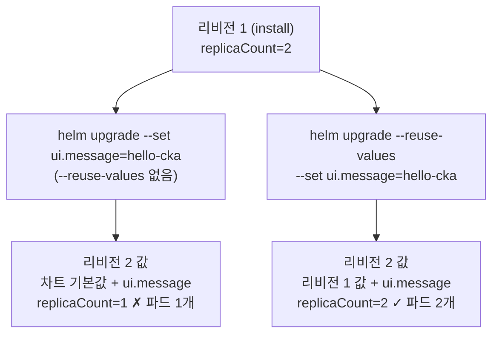

# q01 — Install and upgrade a Helm release · 풀이

← 문제: **[question.md](question.md)**

## 문제 (해석)

**원문**

> The team wants the `podinfo` demo application installed with Helm. The chart version must be
> pinned so that every later change uses exactly the same chart.
>
> 1. Add the chart repository `podinfo` at `https://stefanprodan.github.io/podinfo`, refresh the
>    repository index, and write the latest version of chart `podinfo/podinfo` shown by
>    `helm search repo` to `/opt/course/d01/version.txt`.
> 2. Install release `podinfo` from chart `podinfo/podinfo` into namespace `demo` (create the
>    namespace), passing exactly that version with `--version` and setting `replicaCount=2`.
> 3. Upgrade the release, with the same chart version, to set `ui.message=hello-cka` without
>    losing the `replicaCount` set in step 2.
> 4. Confirm that the release history shows 2 revisions and that the release's Deployment runs
>    2 ready pods.

**해석**

팀은 `podinfo` 데모 애플리케이션을 Helm으로 설치하려 한다. 이후의 모든 변경이 정확히 같은 차트를
쓰도록 차트 버전을 고정해야 한다.

1. `https://stefanprodan.github.io/podinfo` 를 `podinfo` 라는 이름의 차트 저장소로 추가하고 인덱스를
   갱신한 뒤, `helm search repo` 가 보여 주는 차트 `podinfo/podinfo` 의 최신 버전을
   `/opt/course/d01/version.txt` 에 적는다.
2. 차트 `podinfo/podinfo` 로 릴리스 `podinfo` 를 `demo` 네임스페이스(함께 생성)에 설치한다. 그 버전을
   `--version` 으로 정확히 넘기고 `replicaCount=2` 를 설정한다.
3. 같은 차트 버전으로 릴리스를 업그레이드해 `ui.message=hello-cka` 를 설정하되, 2번에서 준
   `replicaCount` 를 잃지 않게 한다.
4. 릴리스 히스토리에 리비전이 2개이고, 릴리스의 Deployment가 Ready 파드 2개로 도는지 확인한다.

## 모범 풀이

**1) 저장소 추가와 버전 기록**

```bash
mkdir -p /opt/course/d01
helm repo add podinfo https://stefanprodan.github.io/podinfo
helm repo update
helm search repo podinfo/podinfo
# NAME             CHART VERSION   APP VERSION   DESCRIPTION
# podinfo/podinfo  6.x.y           6.x.y         Podinfo Helm chart for Kubernetes

helm search repo podinfo/podinfo | awk 'NR==2{print $2}' > /opt/course/d01/version.txt
VER=$(cat /opt/course/d01/version.txt)
```

`helm search repo` 는 차트마다 최신 안정 버전 한 줄만 보여 줍니다(전체 목록은 `--versions`). 적을 값은
2행의 **CHART VERSION** 열입니다. APP VERSION(애플리케이션 버전)과 헷갈리지 않도록 합니다.

**2) 설치 — 버전 고정**

```bash
helm install podinfo podinfo/podinfo --version $VER \
  -n demo --create-namespace --set replicaCount=2
```

**3) 업그레이드 — `--reuse-values` 가 이 문제의 핵심입니다**

```bash
helm upgrade podinfo podinfo/podinfo --version $VER \
  -n demo --reuse-values --set ui.message=hello-cka
```

`helm upgrade` 에 값을 하나라도 새로 주면 Helm은 **이전 릴리스의 값을 버리고** 차트 기본값 위에 이번에
준 값만 얹습니다. `--reuse-values` 없이 `--set ui.message=...` 만 주면 `replicaCount` 가 기본값 1로
돌아가 파드가 하나 사라집니다. `--reuse-values` 는 이전 릴리스의 값을 가져와 그 위에 새 `--set` 을
합칩니다. (새 값을 전혀 주지 않은 upgrade만 이전 값을 그대로 씁니다.)

### 그림 — upgrade 할 때 값이 어떻게 정해지는가



1. install 때 준 `--set replicaCount=2` 는 리비전 1의 "사용자 값"으로 저장됩니다(`helm get values` 로 보이는 값).
2. 왼쪽 길: 새 `--set` 을 주면서 `--reuse-values` 를 빼면 Helm은 리비전 1의 사용자 값을 버리고 **차트 기본값**에서 다시 시작합니다. `replicaCount` 가 기본값 1로 돌아가 파드가 하나 줄어듭니다.
3. 오른쪽 길: `--reuse-values` 는 리비전 1의 사용자 값을 출발점으로 삼고 그 위에 `ui.message` 만 덮어씁니다. 두 값이 모두 남습니다.
4. 어느 길이든 `--version $VER` 을 다시 줘야 차트 버전이 리비전 1과 같게 유지됩니다.

`--version` 도 upgrade마다 다시 줍니다. 빼면 그 시점 저장소의 최신 차트로 올라가 버전 고정이 깨집니다.

## 검증

```bash
cat /opt/course/d01/version.txt            # 예: 6.x.y
helm history podinfo -n demo               # (일부 열 생략)
# REVISION  STATUS      CHART           DESCRIPTION
# 1         superseded  podinfo-6.x.y   Install complete
# 2         deployed    podinfo-6.x.y   Upgrade complete
helm get values podinfo -n demo
# USER-SUPPLIED VALUES:
# replicaCount: 2
# ui:
#   message: hello-cka
kubectl -n demo get deploy
# NAME      READY   UP-TO-DATE   AVAILABLE   AGE
# podinfo   2/2     2            2           1m
```

## 오답 원인 / 배운 점

- **왜 틀렸나**:
- **기억할 것**: `helm upgrade` 로 값을 바꿀 때는 `--reuse-values` 를 붙이고, `--version` 은 install과 upgrade 모두에 준다.
- **헷갈리는 지점**: `helm show values podinfo/podinfo` 는 **차트의 기본값**, `helm get values podinfo -n demo` 는 **이 릴리스에 준 값**입니다(`-a` 를 붙이면 기본값까지 합친 전체). `helm rollback` 도 새 리비전을 만들어 히스토리가 지워지지 않습니다. Helm 4(2025.11)에서도 이 명령과 플래그는 같고, `--atomic` 만 `--rollback-on-failure` 로 이름이 바뀌었습니다.

## 참고 문서

시험 중에는 kubernetes.io 문서와 함께 **helm.sh/docs** 도 열람할 수 있습니다.

- 검색어: `helm upgrade`, `helm search repo`
- https://helm.sh/docs/helm/helm_upgrade/
- https://helm.sh/docs/helm/helm_search_repo/

---

[↑ 문항 목록](../README.md) · [← 문제로](question.md) · [다음 문제 q02 →](../q02_rbac_pod_reader_serviceaccount/question.md)
