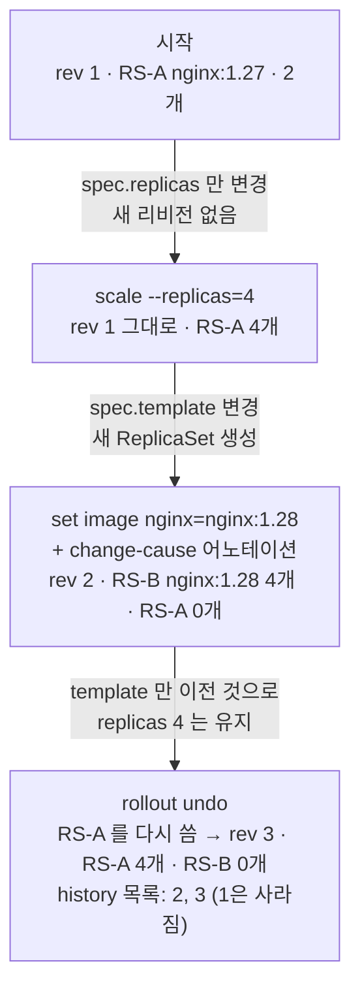

# q05 — Scale, update and roll back a Deployment · 풀이

← 문제: **[question.md](question.md)**

## 문제 (해석)

**원문**

> Namespace `shop` contains Deployment `web` (image `nginx:1.27`, 2 replicas).
>
> 1. Scale `web` to 4 replicas.
> 2. Update the image of its container to `nginx:1.28` and record the change cause
>    `upgrade to 1.28` on the Deployment so that it appears in the rollout history.
> 3. Roll `web` back to the previous revision.
> 4. Confirm that `web` runs image `nginx:1.27` again with 4 ready replicas.

**해석**

`shop` 네임스페이스에 Deployment `web`(image `nginx:1.27`, 레플리카 2)이 있다.

1. `web` 을 레플리카 4개로 스케일한다.
2. 컨테이너 이미지를 `nginx:1.28` 로 바꾸고, 롤아웃 히스토리에 보이도록 Deployment에 변경 사유
   `upgrade to 1.28` 을 기록한다.
3. `web` 을 직전 리비전으로 롤백한다.
4. `web` 이 다시 `nginx:1.27` 이미지로, Ready 레플리카 4개로 도는지 확인한다.

## 모범 풀이

```bash
kubectl -n shop scale deploy web --replicas=4

kubectl -n shop get deploy web -o jsonpath='{.spec.template.spec.containers[*].name}{"\n"}'   # nginx
kubectl -n shop set image deploy/web nginx=nginx:1.28
kubectl -n shop annotate deploy/web kubernetes.io/change-cause="upgrade to 1.28" --overwrite
kubectl -n shop rollout status deploy/web

kubectl -n shop rollout history deploy/web
# REVISION  CHANGE-CAUSE
# 1         <none>
# 2         upgrade to 1.28

kubectl -n shop rollout undo deploy/web
kubectl -n shop rollout status deploy/web
```

**컨테이너 이름은 Deployment 이름이 아닙니다.** `kubectl create deploy web --image=nginx:1.27` 로 만들었다면
컨테이너 이름은 이미지에서 딴 `nginx` 입니다. `set image deploy/web web=...` 은 컨테이너를 찾지 못해
실패하므로 먼저 jsonpath로 확인합니다. `--record` 는 deprecated이므로 변경 사유는
`kubernetes.io/change-cause` 어노테이션으로 직접 넣습니다. 어노테이션은 현재 리비전의 ReplicaSet에
복사되어 `rollout history` 의 CHANGE-CAUSE 열에 나옵니다.

**핵심: 리비전은 파드 템플릿(`spec.template`)이 바뀔 때만 생깁니다.**

- `scale` 은 `spec.replicas` 만 바꾸므로 새 리비전이 생기지 않습니다. 그래서 히스토리에 1, 2만 있습니다.
- `rollout undo` 는 **파드 템플릿만** 이전 ReplicaSet의 것으로 되돌리고 `replicas` 는 건드리지 않습니다.
  그래서 롤백 뒤에도 레플리카는 4개 그대로입니다.
- 롤백도 새 리비전 번호를 받습니다. 리비전 1의 내용이 리비전 3으로 다시 기록되고, 1은 목록에서 사라집니다.

특정 리비전으로 가려면 `kubectl -n shop rollout history deploy/web --revision=1` 로 내용을 본 뒤
`kubectl -n shop rollout undo deploy/web --to-revision=1` 을 씁니다.

### 그림 — 명령마다 리비전과 ReplicaSet 이 어떻게 바뀌는가



1. `scale` 은 `spec.replicas` 만 바꾸므로 같은 ReplicaSet(RS-A)의 파드 수만 늘어납니다. 리비전 번호는 그대로 1입니다.
2. `set image` 는 파드 템플릿을 바꾸므로 새 ReplicaSet(RS-B)이 생기고 롤링 업데이트로 파드가 옮겨 갑니다. 이때 붙인 `kubernetes.io/change-cause` 가 리비전 2의 CHANGE-CAUSE 로 보입니다.
3. `rollout undo` 는 새 ReplicaSet 을 만들지 않고 템플릿이 같은 RS-A 를 다시 키웁니다. RS-A 는 리비전 3 이라는 새 번호를 받으므로 히스토리에서 1이 빠지고 2, 3만 남습니다. 레플리카 수는 템플릿 밖의 값이라 4가 유지됩니다.

## 검증

```bash
kubectl -n shop get deploy web -o jsonpath='{.spec.replicas} {.spec.template.spec.containers[0].image}{"\n"}'
# 4 nginx:1.27
kubectl -n shop get deploy web            # READY 4/4
kubectl -n shop get rs -o wide            # nginx:1.27 ReplicaSet DESIRED 4, nginx:1.28 ReplicaSet 0
kubectl -n shop rollout history deploy/web
# REVISION  CHANGE-CAUSE
# 2         upgrade to 1.28
# 3         <none>          ← 리비전 1의 내용이 3으로 다시 기록됨
```

## 오답 원인 / 배운 점

- **왜 틀렸나**:
- **기억할 것**: `set image` 의 왼쪽은 **컨테이너 이름**이다. `rollout undo` 는 파드 템플릿만 되돌리고 레플리카 수는 그대로 둔다.
- **헷갈리는 지점**: `kubectl scale` 이나 `replicas` 변경은 히스토리에 남지 않습니다. 이미지, env, 리소스처럼 `spec.template` 아래가 바뀔 때만 새 ReplicaSet과 리비전이 생깁니다. 이전 ReplicaSet은 레플리카 0으로 남아 있다가 롤백 때 다시 쓰입니다(보관 개수는 `revisionHistoryLimit`, 기본 10).

## 참고 문서

- 검색어: `deployment rolling back`
- https://kubernetes.io/docs/concepts/workloads/controllers/deployment/#rolling-back-a-deployment
- https://kubernetes.io/docs/concepts/workloads/controllers/deployment/#scaling-a-deployment

## 복습 기록

| 날짜 | 결과 | 메모 |
|---|---|---|
|  |  |  |
