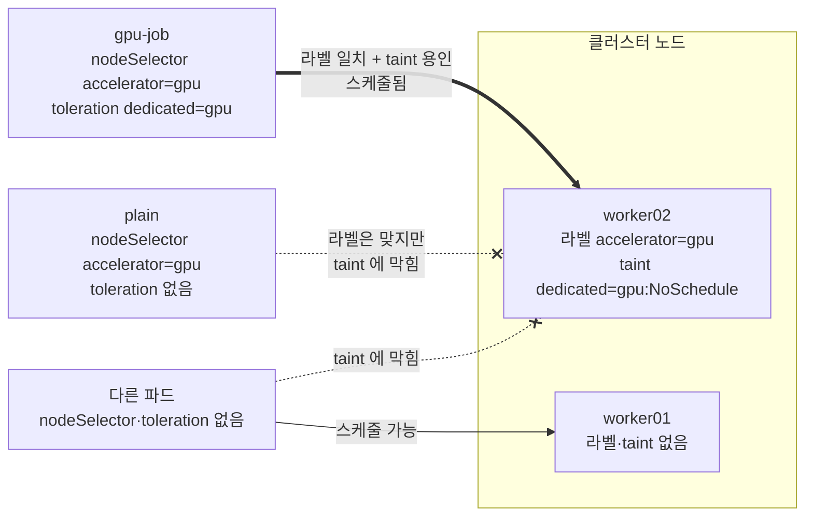

# q07 — Dedicate a node with a taint and a toleration · 풀이

← 문제: **[question.md](question.md)**

## 문제 (해석)

**원문**

> Node `worker02` is to be reserved for GPU workloads: other pods must stay off it, and GPU pods
> must land on it.
>
> 1. Taint node `worker02` with `dedicated=gpu:NoSchedule` and add the label `accelerator=gpu`
>    to it.
> 2. Create pod `gpu-job` in namespace `default` (image `nginx:1.27`) that tolerates this taint
>    and has the `nodeSelector` `accelerator: gpu`. Confirm it is running on `worker02`.
> 3. Create pod `plain` in `default` (image `nginx:1.27`) with the same `nodeSelector` but without
>    the toleration. Confirm it stays `Pending` and that its scheduling event mentions the
>    untolerated taint.

**해석**

노드 `worker02` 를 GPU 워크로드 전용으로 쓰려 한다. 다른 파드는 이 노드에 올라가지 않아야 하고, GPU
파드는 이 노드에 올라가야 한다.

1. 노드 `worker02` 에 taint `dedicated=gpu:NoSchedule` 을 걸고 라벨 `accelerator=gpu` 를 붙인다.
2. `default` 네임스페이스에 파드 `gpu-job`(image `nginx:1.27`)을 만든다. 이 taint를 용인(toleration)하고
   `nodeSelector` `accelerator: gpu` 를 갖는다. `worker02` 에서 도는지 확인한다.
3. `default` 에 파드 `plain`(image `nginx:1.27`)을 같은 `nodeSelector` 로, toleration **없이** 만든다.
   `Pending` 에 머물고 스케줄링 이벤트에 용인되지 않은 taint가 언급되는지 확인한다.

## 모범 풀이

```bash
kubectl taint node worker02 dedicated=gpu:NoSchedule
kubectl label node worker02 accelerator=gpu

kubectl run gpu-job --image=nginx:1.27 --dry-run=client -o yaml > gpu-job.yaml
vi gpu-job.yaml            # nodeSelector 와 tolerations 추가
kubectl apply -f gpu-job.yaml
```

```yaml
apiVersion: v1
kind: Pod
metadata:
  name: gpu-job
spec:
  nodeSelector:
    accelerator: gpu              # 라벨로 끌어당긴다
  tolerations:
  - key: dedicated                # taint 를 용인한다
    operator: Equal
    value: gpu
    effect: NoSchedule
  containers:
  - name: gpu-job
    image: nginx:1.27
```

`plain` 은 nodeSelector만 있으면 되므로 `--overrides` 한 줄로 만듭니다.

```bash
kubectl run plain --image=nginx:1.27 \
  --overrides='{"spec":{"nodeSelector":{"accelerator":"gpu"}}}'
```

**toleration은 "허락", nodeSelector는 "끌어당김"입니다 — 이 문제의 핵심입니다.**

- taint는 노드가 파드를 **밀어내는** 장치입니다. toleration은 그 밀어냄을 무시해도 된다는 **허가**일 뿐,
  파드를 그 노드로 보내지 않습니다. toleration만 있는 파드는 `worker01` 등 다른 노드에도 얼마든지 갑니다.
- nodeSelector는 라벨이 맞는 노드로 **끌어당기지만** taint를 통과시켜 주지는 않습니다. 그래서 `plain` 은
  갈 곳이 없어 `Pending` 입니다.
- 노드를 전용으로 만들려면 **taint(다른 파드는 막고) + 라벨/nodeSelector(GPU 파드는 모으고)** 둘 다
  필요합니다.

### 그림 — 파드마다 갈 수 있는 노드



1. `gpu-job` 은 nodeSelector 로 후보를 `worker02` 하나로 좁히고, toleration 으로 그 노드의 taint 를 통과합니다. 두 조건이 모두 맞는 노드는 `worker02` 뿐이고, `worker01` 은 라벨이 없어서 처음부터 후보가 아닙니다.
2. `plain` 은 nodeSelector 때문에 `worker02` 만 후보인데 taint 를 용인하지 못하므로 갈 곳이 없어 `Pending` 입니다. 이벤트에는 노드마다 떨어진 이유가 함께 나옵니다.
3. 아무 설정이 없는 다른 파드는 taint 때문에 `worker02` 에 못 가고 `worker01` 같은 일반 노드로 갑니다. 이것이 "다른 파드는 막고 GPU 파드만 모은다"는 전용 노드의 모양입니다(그림에서 `cp01` 은 생략).

## 검증

```bash
kubectl describe node worker02 | grep Taints        # Taints: dedicated=gpu:NoSchedule
kubectl get nodes -L accelerator                     # worker02 의 ACCELERATOR 열이 gpu
kubectl get pod gpu-job plain -o wide                # (일부 열 생략)
# NAME      READY   STATUS    NODE
# gpu-job   1/1     Running   worker02
# plain     0/1     Pending   <none>
kubectl describe pod plain | grep -A3 Events
# Warning  FailedScheduling  ...  0/3 nodes are available: 1 node(s) didn't match Pod's node affinity/selector,
#   1 node(s) had untolerated taint {dedicated: gpu}, 1 node(s) had untolerated taint {node-role.kubernetes.io/control-plane: }. ...
```

## 오답 원인 / 배운 점

- **왜 틀렸나**:
- **기억할 것**: taint는 막고 toleration은 허락할 뿐이다. 특정 노드로 보내려면 nodeSelector(또는 node affinity)가 따로 필요하다.
- **헷갈리는 지점**: `NoSchedule` 은 새 파드만 막고 이미 `worker02` 에서 돌던 파드는 그대로 둡니다. 기존 파드까지 내보내려면 `NoExecute` 입니다. taint 제거는 끝에 `-` 를 붙입니다(`kubectl taint node worker02 dedicated=gpu:NoSchedule-`). `operator: Exists` 는 값과 관계없이 키만 맞으면 용인합니다.

## 참고 문서

- 검색어: `taints and tolerations`
- https://kubernetes.io/docs/concepts/scheduling-eviction/taint-and-toleration/
- https://kubernetes.io/docs/concepts/scheduling-eviction/assign-pod-node/

## 복습 기록

| 날짜 | 결과 | 메모 |
|---|---|---|
|  |  |  |
