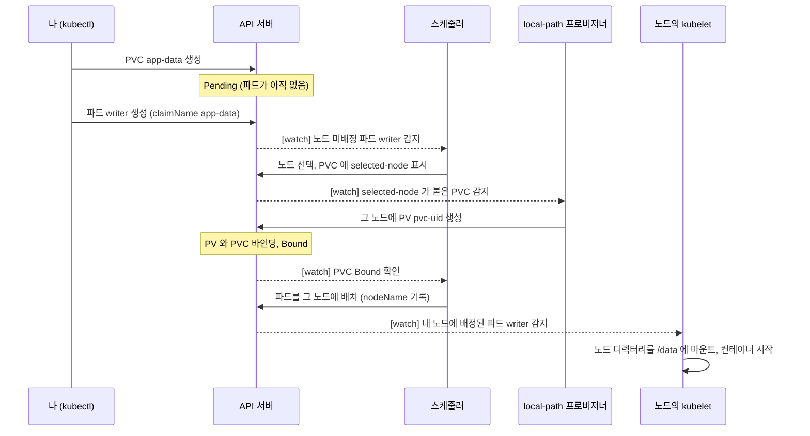

# q12 — Claim storage and mount it in a Pod · 풀이

← 문제: **[question.md](question.md)**

## 문제 (해석)

**원문**

> Namespace `data` exists. StorageClass `local-path` (provisioner `rancher.io/local-path`,
> volumeBindingMode `WaitForFirstConsumer`) is available.
>
> 1. Create a PersistentVolumeClaim `app-data` in `data` that requests `1Gi` with access mode
>    `ReadWriteOnce` from StorageClass `local-path`. Confirm that it is `Pending` while no pod
>    uses it.
> 2. Create pod `writer` in `data` (image `busybox:1.36`) that mounts the claim at `/data` and
>    runs `sh -c 'date > /data/out.txt; sleep 3600'`.
> 3. Confirm that the claim is now `Bound` and that `/data/out.txt` in the pod contains the date.

**해석**

`data` 네임스페이스가 있다. StorageClass `local-path`(provisioner `rancher.io/local-path`, volumeBindingMode
`WaitForFirstConsumer`)를 쓸 수 있다.

1. `data` 에 StorageClass `local-path` 에서 `1Gi` 를 access mode `ReadWriteOnce` 로 요청하는
   PersistentVolumeClaim `app-data` 를 만든다. 이 PVC를 쓰는 파드가 없는 동안 `Pending` 인지 확인한다.
2. `data` 에 파드 `writer`(image `busybox:1.36`)를 만든다. PVC를 `/data` 에 마운트하고
   `sh -c 'date > /data/out.txt; sleep 3600'` 을 실행한다.
3. PVC가 이제 `Bound` 이고 파드 안의 `/data/out.txt` 에 날짜가 들어 있는지 확인한다.

## 모범 풀이

**1) PVC — 파드가 없으면 `Pending`**

```yaml
# pvc.yaml
apiVersion: v1
kind: PersistentVolumeClaim
metadata:
  name: app-data
  namespace: data
spec:
  storageClassName: local-path
  accessModes: ["ReadWriteOnce"]
  resources:
    requests:
      storage: 1Gi
```

```bash
kubectl apply -f pvc.yaml
kubectl -n data get pvc app-data              # STATUS Pending
kubectl -n data describe pvc app-data | tail -2
# Normal  WaitForFirstConsumer  ...  waiting for first consumer to be created before binding
```

**`Pending` 은 고장이 아닙니다 — 이 문제의 핵심입니다.** `WaitForFirstConsumer` 클래스는 PVC를 쓰는 파드가
스케줄될 때까지 볼륨을 만들지 않습니다. 파드가 노드에 배치되면 프로비저너가 **그 노드에** PV(`pvc-<uid>`)를
만들고 PVC와 바인딩합니다. local-path의 PV는 그 노드의 디렉터리이므로 PV에 node affinity가 붙고, 이 PVC를
쓰는 파드는 이후에도 항상 그 노드로만 갑니다.

**2) PVC를 마운트하는 파드** — 아래 파일을 `kubectl apply -f writer.yaml` 로 만듭니다.

```yaml
# writer.yaml
apiVersion: v1
kind: Pod
metadata:
  name: writer
  namespace: data
spec:
  containers:
  - name: writer
    image: busybox:1.36
    command: ["sh", "-c", "date > /data/out.txt; sleep 3600"]
    volumeMounts:
    - name: app-data              # 아래 volumes 의 이름
      mountPath: /data
  volumes:
  - name: app-data
    persistentVolumeClaim:
      claimName: app-data         # PVC 이름
```

### 그림 1 — WaitForFirstConsumer 에서 PVC 가 Bound 되기까지



1. PVC 만 만들었을 때는 아무 일도 일어나지 않고 `Pending` 입니다. `describe pvc` 의 `WaitForFirstConsumer` 이벤트가 이 단계입니다.
2. 스케줄러는 API 서버를 watch 하다가 `nodeName` 이 비어 있는 파드 writer 를 발견합니다. 이 파드가 `WaitForFirstConsumer` PVC 를 쓰므로 스케줄러가 노드를 먼저 고르고, 그 노드 이름을 PVC 의 `volume.kubernetes.io/selected-node` 어노테이션에 적어 둡니다. 점선 화살표는 모두 이런 watch 알림이고, 각 컴포넌트는 그것을 보고 움직입니다.
3. 프로비저너는 이 어노테이션이 붙은 PVC 를 보고 그 노드의 디렉터리로 PV 를 만듭니다. 그러면 PVC 가 `Bound` 가 되고, 파드가 같은 노드에 배치됩니다. PV 에 node affinity 가 붙으므로 이 PVC 를 쓰는 파드는 앞으로도 그 노드로만 갑니다.
4. 파드의 `nodeName` 이 자기 노드로 채워진 것을 본 kubelet 이 볼륨을 `/data` 에 마운트한 뒤 컨테이너가 `date > /data/out.txt` 를 실행합니다.

## 검증

```bash
kubectl -n data get pod writer -o wide      # Running, NODE 열의 노드에 볼륨이 생겼다
kubectl -n data get pvc app-data
# NAME       STATUS   VOLUME        CAPACITY   ACCESS MODES   STORAGECLASS   ...
# app-data   Bound    pvc-3f1c...   1Gi        RWO            local-path     ...
kubectl get pv                              # CLAIM 열이 data/app-data, RECLAIM POLICY Delete
kubectl -n data exec writer -- cat /data/out.txt
# Sat Sep 26 10:30:00 UTC 2026
```

## 오답 원인 / 배운 점

- **왜 틀렸나**:
- **기억할 것**: `WaitForFirstConsumer` 클래스의 PVC는 파드가 생길 때까지 `Pending` 이 정상이다. 파드는 `volumes[].persistentVolumeClaim.claimName` 으로 PVC를 참조한다.
- **헷갈리는 지점**: `ReadWriteOnce` 는 "파드 하나"가 아니라 "**노드 하나**"에서 읽기·쓰기로 마운트할 수 있다는 뜻입니다. 같은 노드의 여러 파드는 함께 쓸 수 있고, 파드 하나로 제한하려면 `ReadWriteOncePod` 입니다. PVC는 파드와 같은 네임스페이스에 있어야 합니다.

## 참고 문서

- 검색어: `configure a pod to use a persistentvolume`
- https://kubernetes.io/docs/concepts/storage/persistent-volumes/
- https://kubernetes.io/docs/tasks/configure-pod-container/configure-persistent-volume-storage/

## 복습 기록

| 날짜 | 결과 | 메모 |
|---|---|---|
|  |  |  |
