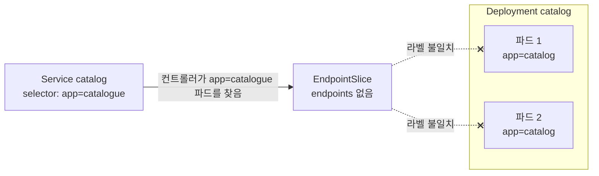
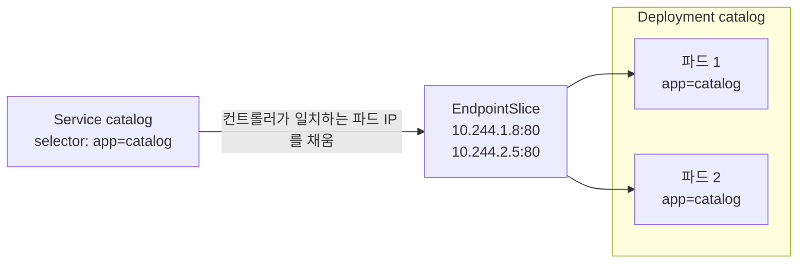

# q15 — A Service with no endpoints · 풀이

← 문제: **[question.md](question.md)**

## 문제 (해석)

**원문**

> In namespace `store`, requests to Service `catalog` (port 80) fail. Deployment `catalog`
> (2 replicas, image `nginx:1.27`) is running and its pods are `Ready`.
>
> 1. Show that the Service has no endpoints by looking at its EndpointSlice.
> 2. Find the reason by comparing the Service's selector with the labels of the `catalog` pods.
> 3. Fix the Service so that it selects the `catalog` pods. Do not change the Deployment or the
>    pods.
> 4. Confirm that the EndpointSlice now lists 2 pod addresses.

**해석**

`store` 네임스페이스에서 Service `catalog`(포트 80)로 보내는 요청이 실패한다. Deployment `catalog`
(레플리카 2, image `nginx:1.27`)는 돌고 있고 파드도 `Ready` 다.

1. Service의 EndpointSlice를 보고 endpoint가 없다는 것을 보인다.
2. Service의 selector와 `catalog` 파드의 라벨을 비교해 이유를 찾는다.
3. Service가 `catalog` 파드를 선택하도록 Service를 고친다. Deployment나 파드는 바꾸지 않는다.
4. EndpointSlice에 이제 파드 주소 2개가 나오는지 확인한다.

## 모범 풀이

**1) 증상 — 빈 EndpointSlice**

```bash
kubectl -n store get endpointslice -l kubernetes.io/service-name=catalog
# NAME            ADDRESSTYPE   PORTS     ENDPOINTS   AGE
# catalog-8xk2m   IPv4          <unset>   <unset>     15m
```

EndpointSlice는 Service 이름이 아니라 **라벨 `kubernetes.io/service-name`** 으로 찾습니다(슬라이스 이름에는
임의 접미사가 붙음). 옛 Endpoints API는 v1.33부터 deprecated이므로 EndpointSlice를 봅니다.

**2) 원인 — selector로 직접 조회해 봅니다**

```bash
kubectl -n store get svc catalog -o jsonpath='{.spec.selector}{"\n"}'   # {"app":"catalogue"}
kubectl -n store get pods -l app=catalogue      # No resources found in store namespace.
kubectl -n store get pods --show-labels         # catalog-xxxx   1/1   Running   ...   app=catalog,pod-template-hash=...
```

눈으로 대조하기보다 **Service의 selector를 그대로 `-l` 에 넣어 보는 것**이 가장 확실합니다. 결과가 0개면
selector가 틀린 것입니다. 여기서는 `catalogue` 와 `catalog` 의 철자 차이입니다.

**3) 수리 — Service를 고칩니다**

```bash
kubectl -n store set selector svc catalog app=catalog
```

`kubectl set selector` 는 selector 전체를 **교체**합니다. `kubectl edit svc catalog` 로 `spec.selector` 를
고쳐도 됩니다.

EndpointSlice는 사람이 채우는 것이 아니라, EndpointSlice 컨트롤러가 Service selector와 **일치하는 파드**의
IP를 자동으로 채우고 주소마다 `ready` 상태를 붙입니다(트래픽은 ready인 주소로만 감). 그래서 슬라이스가 **아예
비어 있다면** selector가 파드를 하나도 못 찾는 것입니다. 파드 라벨을 Service에 맞추는 것은 답이 아닙니다.
파드 라벨은 Deployment의 selector와 묶여 있어서, 바꾸면 ReplicaSet이 그 파드를 잃고 새 파드를 또 만듭니다.

### 그림 1 — 고치기 전: selector 가 아무 파드도 고르지 못한다



### 그림 2 — 고친 뒤: selector 가 Deployment 의 파드 라벨과 같다



1. Service 는 파드를 직접 가리키지 않습니다. EndpointSlice 컨트롤러가 Service 의 `selector` 와 라벨이 **모두** 일치하는 파드를 찾아 그 IP 를 EndpointSlice 에 적습니다.
2. 그림 1에서 selector 는 `app=catalogue`, 파드 라벨은 `app=catalog` 입니다. 일치하는 파드가 0개라 슬라이스가 비고, kube-proxy 는 보낼 곳이 없어 요청이 실패합니다.
3. 그림 2처럼 Service 쪽 selector 를 `app=catalog` 로 바꾸면 컨트롤러가 곧바로 파드 2개의 IP 를 채웁니다. 파드 라벨은 Deployment 의 selector 와 묶여 있으니 건드리지 않습니다.

## 검증

```bash
kubectl -n store get endpointslice -l kubernetes.io/service-name=catalog
# NAME            ADDRESSTYPE   PORTS   ENDPOINTS               AGE
# catalog-8xk2m   IPv4          80      10.244.1.8,10.244.2.5   16m
kubectl -n store run tmp --rm -i --image=busybox:1.36 --restart=Never -- \
  wget -qO- -T 3 http://catalog | head -4                       # nginx 환영 페이지
```

## 오답 원인 / 배운 점

- **왜 틀렸나**:
- **기억할 것**: endpoint가 비면 `kubectl get pods -l <Service selector>` 부터. 0개면 selector 불일치다. 파드가 잡히는데도 트래픽이 안 가면 EndpointSlice의 `conditions.ready` 로 readiness를 본다.
- **헷갈리는 지점**: `kubectl patch` 로 selector를 고치면 맵이 **병합**되어, 틀린 키가 다른 이름(예: `name: catalog`)이었다면 옛 키가 남아 여전히 아무것도 못 찾습니다. `set selector` 나 `edit` 로 전체를 바꾸는 편이 안전합니다. Service와 파드는 같은 네임스페이스에 있어야 합니다.

## 참고 문서

- 검색어: `debug services`, `endpointslices`
- https://kubernetes.io/docs/tasks/debug/debug-application/debug-service/
- https://kubernetes.io/docs/concepts/services-networking/endpoint-slices/

---

[↑ 문항 목록](../README.md) · [← 문제로](question.md) · [다음 문제 q16 →](../q16_sidecar_container_logs/question.md)
