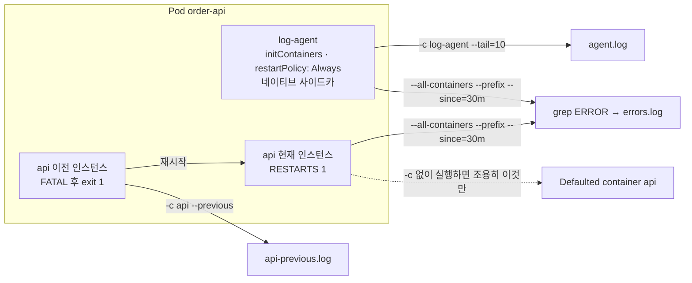

# q16 — Read logs from an app and its sidecar · 풀이

← 문제: **[question.md](question.md)**

## 문제 (해석)

**원문**

> Namespace `logs` contains pod `order-api` with an app container `api` and a native sidecar
> container `log-agent` (declared under `initContainers` with `restartPolicy: Always`).
>
> 1. Write the last 10 lines of the `log-agent` container's log to `/opt/course/d16/agent.log`.
> 2. Container `api` has restarted once. Write the log of its previous instance to
>    `/opt/course/d16/api-previous.log`.
> 3. Write every log line from the last 30 minutes, from all containers of the pod, that contains
>    `ERROR` to `/opt/course/d16/errors.log`. Each line must be prefixed with the name of the
>    container it came from.

**해석**

`logs` 네임스페이스에 파드 `order-api` 가 있다. 앱 컨테이너 `api` 와 네이티브 사이드카 컨테이너
`log-agent`(`initContainers` 아래에 `restartPolicy: Always` 로 선언됨)를 갖고 있다.

1. `log-agent` 컨테이너 로그의 마지막 10줄을 `/opt/course/d16/agent.log` 에 쓴다.
2. 컨테이너 `api` 가 한 번 재시작했다. 그 **이전 인스턴스**의 로그를 `/opt/course/d16/api-previous.log` 에 쓴다.
3. 파드의 모든 컨테이너에서 최근 30분 동안 나온 로그 중 `ERROR` 가 들어 있는 줄을 모두
   `/opt/course/d16/errors.log` 에 쓴다. 각 줄 앞에는 그 줄이 나온 컨테이너 이름이 붙어 있어야 한다.

## 모범 풀이

```bash
kubectl -n logs get pod order-api -o jsonpath=\
'containers: {.spec.containers[*].name}{"\n"}initContainers: {.spec.initContainers[*].name}{"\n"}'
# containers: api
# initContainers: log-agent

mkdir -p /opt/course/d16
kubectl -n logs logs order-api -c log-agent --tail=10 > /opt/course/d16/agent.log
kubectl -n logs logs order-api -c api --previous > /opt/course/d16/api-previous.log
kubectl -n logs logs order-api --all-containers --prefix --since=30m \
  | grep ERROR > /opt/course/d16/errors.log
```

**컨테이너가 둘 이상이면 `-c` 로 고릅니다 — 이 문제의 핵심입니다.** `-c` 를 빼도 에러가 나지 않는다는 것이
함정입니다.

```bash
kubectl -n logs logs order-api --tail=3
# Defaulted container "api" out of: api, log-agent (init)      ← stderr 로 한 줄만
# ... 이후는 api 의 로그 ...
```

kubectl은 `kubectl.kubernetes.io/default-container` 어노테이션이 가리키는 컨테이너, 없으면
`spec.containers` 의 **첫 번째 컨테이너**를 조용히 골라 보여 줍니다. 출력을 파일로 돌리면 이 안내 문구는
화면에만 남고 파일에는 `api` 의 로그가 들어가, `log-agent` 를 읽었다고 착각하기 쉽습니다. 사이드카가
`initContainers` 에 선언되어 있어도 읽는 방법은 같습니다(`-c log-agent`).

| 옵션 | 뜻 |
|---|---|
| `--tail=10` | 마지막 10줄 |
| `--previous` (`-p`) | 직전에 종료된 인스턴스의 로그 (한 세대 전까지만 보관) |
| `--all-containers` | init 컨테이너(사이드카 포함)까지 모든 컨테이너 |
| `--prefix` | 줄마다 `[pod/<파드>/<컨테이너>]` 를 붙임 |
| `--since=30m` | 최근 30분 (절대 시각은 `--since-time=<RFC3339>`) |

### 그림 — 어떤 옵션이 어떤 로그를 읽는가



1. 네이티브 사이드카 `log-agent` 는 `initContainers` 에 있지만 끝나지 않고 앱과 함께 계속 돕니다. 로그는 일반 컨테이너처럼 `-c log-agent` 로 읽습니다.
2. `api` 는 한 번 죽었다가 다시 시작했습니다. 죽은 인스턴스의 출력은 `--previous` 로만 볼 수 있고, 한 세대 전까지만 남습니다.
3. `--all-containers` 는 컨테이너마다 **현재 인스턴스**의 로그를 이어 붙입니다. `--prefix` 가 줄마다 `[pod/order-api/<컨테이너>]` 를 붙여 주므로 grep 뒤에도 출처가 남습니다. 죽은 인스턴스의 줄까지 필요하면 `-c api --previous` 를 따로 읽어야 합니다.
4. `-c` 를 빼면 kubectl 이 첫 번째 일반 컨테이너(`api`)를 골라 보여 주고 안내 문구는 stderr 로만 나옵니다. 파일로 돌리면 다른 컨테이너를 읽었다고 착각하기 쉽습니다.

## 검증

```bash
kubectl -n logs get pod order-api              # READY 2/2 — 네이티브 사이드카도 READY 에 포함, RESTARTS 1
wc -l < /opt/course/d16/agent.log              # 10
head -3 /opt/course/d16/api-previous.log
head -3 /opt/course/d16/errors.log
# [pod/order-api/api] 2026-09-26T10:12:03Z ERROR payment timeout ...
# [pod/order-api/log-agent] ... ERROR ...
```

## 오답 원인 / 배운 점

- **왜 틀렸나**:
- **기억할 것**: 멀티 컨테이너 파드는 항상 `-c <컨테이너>`. 재시작 전 로그는 `--previous`, 전체 컨테이너는 `--all-containers --prefix`.
- **헷갈리는 지점**: `-c` 와 `--all-containers` 를 함께 주면 에러입니다. 재시작한 적 없는 컨테이너에 `--previous` 를 주면 `previous terminated container ... not found` 가 납니다. 재시작 횟수는 앱 컨테이너는 `.status.containerStatuses`, 사이드카는 `.status.initContainerStatuses` 에 있습니다.

## 참고 문서

- 검색어: `logging architecture`, `sidecar containers`
- https://kubernetes.io/docs/concepts/cluster-administration/logging/
- https://kubernetes.io/docs/concepts/workloads/pods/sidecar-containers/

---

[↑ 문항 목록](../README.md) · [← 문제로](question.md) · [다음 문제 q17 →](../q17_top_pod_cpu/question.md)
