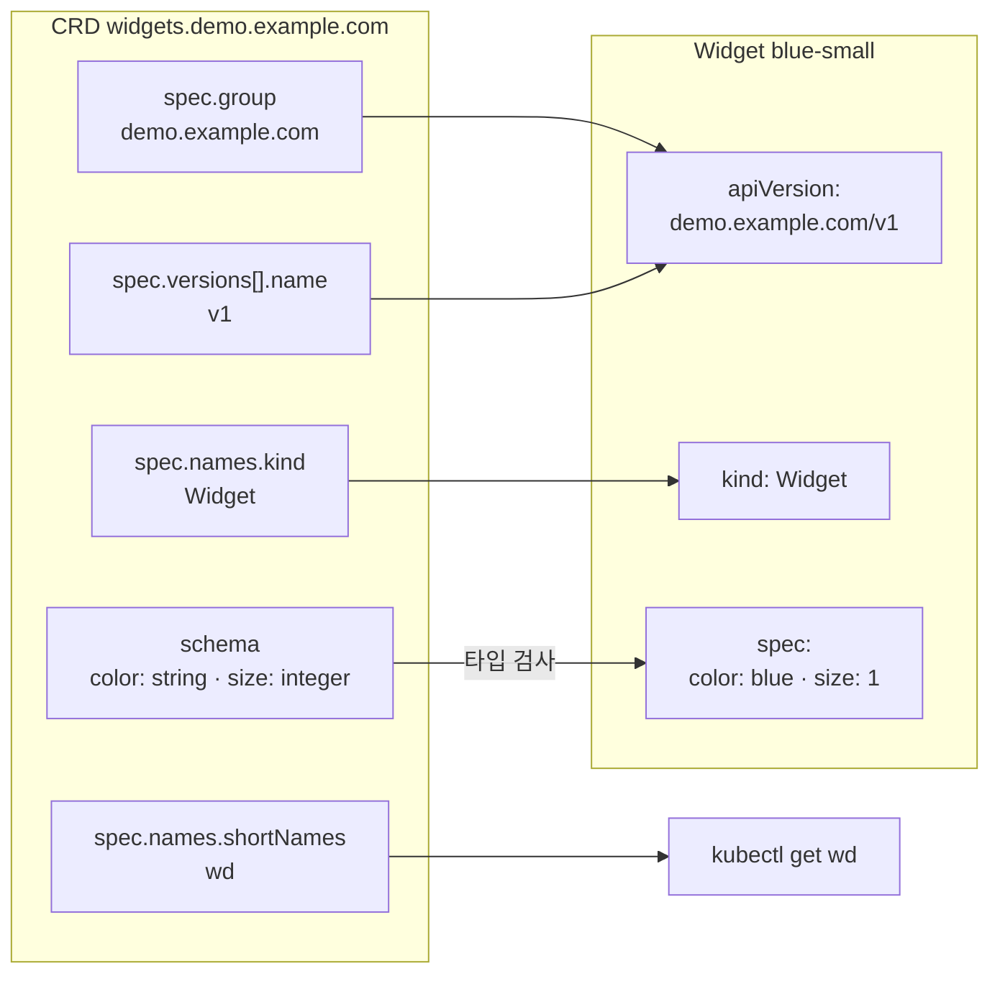

# q03 — Install a CRD and create a custom resource · 풀이

← 문제: **[question.md](question.md)**

## 문제 (해석)

**원문**

> The file `/opt/course/e03/crd.yaml` contains a CustomResourceDefinition for
> `widgets.demo.example.com`.
>
> 1. Install the CRD and confirm that the API server now serves the resource in API group
>    `demo.example.com`.
> 2. In namespace `default`, create a `Widget` named `blue-small` with `spec.color: blue` and
>    `spec.size: 1`.
> 3. List the Widgets in `default` using the resource's short name.
> 4. Write the `apiVersion` you used for the Widget to `/opt/course/e03/apiversion.txt`.

**해석**

`/opt/course/e03/crd.yaml` 파일에 `widgets.demo.example.com` 의 CustomResourceDefinition이 들어 있다.

1. CRD를 설치하고, API server가 이제 API 그룹 `demo.example.com` 에서 이 리소스를 서비스하는지
   확인한다.
2. `default` 네임스페이스에 `spec.color: blue`, `spec.size: 1` 인 `Widget` `blue-small` 을 만든다.
3. 리소스의 short name을 사용해 `default` 의 Widget 목록을 조회한다.
4. Widget에 사용한 `apiVersion` 을 `/opt/course/e03/apiversion.txt` 에 적는다.

## 모범 풀이

**먼저 파일을 읽습니다**(`cat /opt/course/e03/crd.yaml`). 커스텀 리소스에 필요한 값은 전부 CRD 안에 있습니다.

```yaml
apiVersion: apiextensions.k8s.io/v1
kind: CustomResourceDefinition
metadata:
  name: widgets.demo.example.com     # <plural>.<group>
spec:
  group: demo.example.com            # → apiVersion 의 앞부분
  scope: Namespaced
  names:
    plural: widgets
    singular: widget
    kind: Widget                     # → kind
    shortNames: ["wd"]               # → kubectl get wd
  versions:
  - name: v1                         # → apiVersion 의 뒷부분
    served: true
    storage: true
    schema:
      openAPIV3Schema:
        type: object
        properties:
          spec:
            type: object
            properties:
              color: {type: string}
              size: {type: integer}
```

**핵심은 CRD의 필드가 커스텀 리소스 매니페스트로 옮겨지는 방식입니다.** `apiVersion` 은
`<spec.group>/<versions[].name>` = `demo.example.com/v1`, `kind` 는 `spec.names.kind` = `Widget` 입니다.

### 그림 — CRD 필드가 Widget 매니페스트로 옮겨지는 방식



1. `apiVersion` 은 CRD 의 `spec.group` 과 `versions[].name` 을 `/` 로 이은 값입니다. 이 값이 그대로 `apiversion.txt` 의 답입니다.
2. `kind` 는 `spec.names.kind` 에서 대소문자까지 그대로 가져옵니다.
3. `spec` 아래 값은 스키마가 검사합니다. `size` 는 integer 라서 따옴표를 붙이면 거부됩니다.
4. `shortNames` 에 적힌 `wd` 가 `kubectl get` 에 쓸 수 있는 짧은 이름입니다.

**1) 설치와 확인**

```bash
kubectl apply -f /opt/course/e03/crd.yaml
kubectl wait --for=condition=Established crd/widgets.demo.example.com --timeout=30s
kubectl api-resources --api-group=demo.example.com
# NAME      SHORTNAMES   APIVERSION            NAMESPACED   KIND
# widgets   wd           demo.example.com/v1   true         Widget
```

**2~4) Widget 생성, 조회, 기록**

```bash
kubectl apply -f - <<'EOF'
apiVersion: demo.example.com/v1
kind: Widget
metadata:
  name: blue-small
  namespace: default
spec:
  color: blue
  size: 1
EOF
kubectl -n default get wd                  # NAME blue-small
echo demo.example.com/v1 > /opt/course/e03/apiversion.txt
```

스키마가 타입을 검사하므로 `size: "1"` 처럼 문자열을 넣으면 `must be of type integer` 로 거부됩니다.

## 검증

```bash
kubectl -n default get widget blue-small -o jsonpath='{.apiVersion} {.spec.color} {.spec.size}{"\n"}'
# demo.example.com/v1 blue 1
kubectl explain widget.spec            # color <string>, size <integer> — 필드가 헷갈릴 때도 이것으로 확인
cat /opt/course/e03/apiversion.txt     # demo.example.com/v1
```

## 오답 원인 / 배운 점

- **왜 틀렸나**:
- **기억할 것**: 커스텀 리소스의 `apiVersion` 은 CRD의 `spec.group` + `/` + `versions[].name`, `kind` 는 `spec.names.kind` 다.
- **헷갈리는 지점**: `apiVersion: v1` 만 쓰면 core 그룹에서 `Widget` 을 찾으므로 `no matches for kind "Widget" in version "v1"` 로 실패합니다. `kubectl get crd` 는 정의를, `kubectl get wd`(= `widgets`, `widget`, `widgets.demo.example.com`)는 그 정의로 만든 인스턴스를 보여 줍니다.

## 참고 문서

- 검색어: `custom resource definitions`
- https://kubernetes.io/docs/tasks/extend-kubernetes/custom-resources/custom-resource-definitions/
- https://kubernetes.io/docs/concepts/extend-kubernetes/api-extension/custom-resources/

---

[↑ 문항 목록](../README.md) · [← 문제로](question.md) · [다음 문제 q04 →](../q04_ha_control_plane_inspect/question.md)
