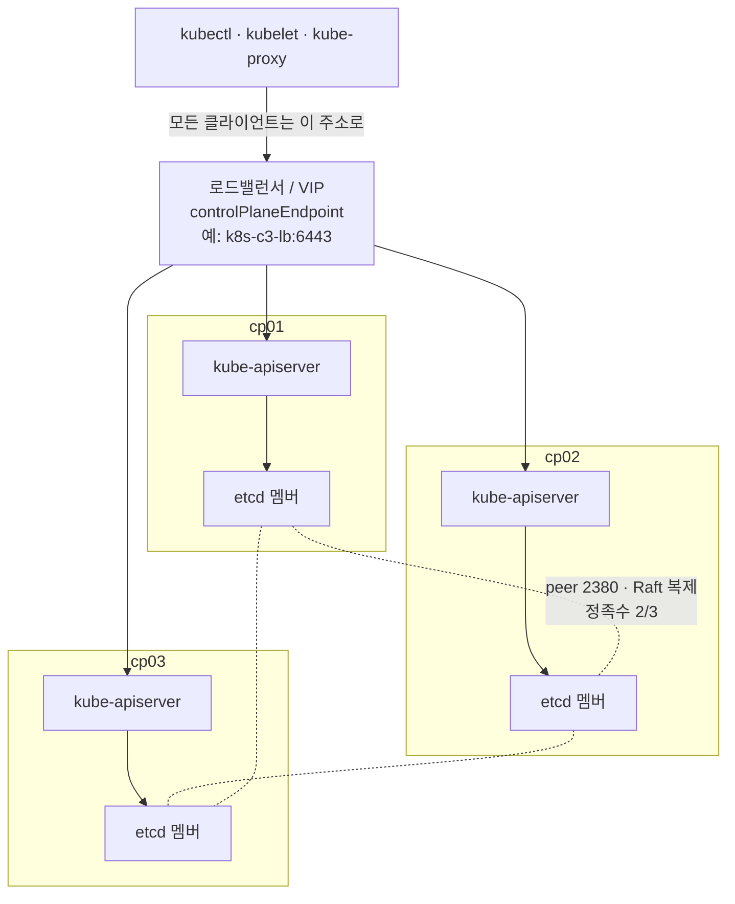

# q04 — Inspect a highly-available control plane · 풀이

← 문제: **[question.md](question.md)**

## 문제 (해석)

**원문**

> Cluster `k8s-c3` runs a stacked highly-available control plane (etcd runs on every control plane
> node) with three control plane nodes. Nothing is broken; you only need to collect facts.
>
> 1. Write the `controlPlaneEndpoint` value from ConfigMap `kubeadm-config` in namespace
>    `kube-system` to `/opt/course/e04/endpoint.txt`.
> 2. Write the names of all control plane nodes to `/opt/course/e04/cp-nodes.txt`, one per line.
> 3. On `cp01`, use `etcdctl` with the etcd server certificate files in `/etc/kubernetes/pki/etcd/`
>    to write the number of etcd members to `/opt/course/e04/members.txt`, and confirm that every
>    member reports healthy.

**해석**

`k8s-c3` 클러스터는 컨트롤 플레인 노드 3대로 된 stacked HA 컨트롤 플레인(모든 컨트롤 플레인 노드에서
etcd가 실행됨)이다. 고장 난 것은 없고 정보만 수집하면 된다.

1. `kube-system` 네임스페이스의 ConfigMap `kubeadm-config` 에서 `controlPlaneEndpoint` 값을
   `/opt/course/e04/endpoint.txt` 에 적는다.
2. 모든 컨트롤 플레인 노드의 이름을 한 줄에 하나씩 `/opt/course/e04/cp-nodes.txt` 에 적는다.
3. `cp01` 에서 `/etc/kubernetes/pki/etcd/` 의 etcd 서버 인증서 파일로 `etcdctl` 을 사용해 etcd 멤버
   수를 `/opt/course/e04/members.txt` 에 적고, 모든 멤버가 healthy로 응답하는지 확인한다.

## 모범 풀이

**HA 컨트롤 플레인의 두 기둥** — 컨트롤 플레인이 여러 대면 kubelet과 kubectl이 특정 노드 하나를
바라보면 안 됩니다. 그래서 kubeadm은 모두가 접속할 공통 주소(로드밸런서나 VIP)를
`controlPlaneEndpoint` 로 받습니다. 그리고 stacked 구성에서는 컨트롤 플레인 노드마다 etcd 멤버가
하나씩 돌고, 셋이 하나의 etcd 클러스터를 이룹니다.

```bash
mkdir -p /opt/course/e04
# root 에 kubeconfig 가 없으면: export KUBECONFIG=/etc/kubernetes/admin.conf
```

**1) controlPlaneEndpoint**

```bash
kubectl -n kube-system get cm kubeadm-config -o jsonpath='{.data.ClusterConfiguration}' | grep controlPlaneEndpoint
# controlPlaneEndpoint: k8s-c3-lb:6443          ← 예시 (로드밸런서 주소:포트)
kubectl -n kube-system get cm kubeadm-config -o jsonpath='{.data.ClusterConfiguration}' \
  | awk '/controlPlaneEndpoint/ {print $2}' > /opt/course/e04/endpoint.txt
grep server /etc/kubernetes/admin.conf        # kubeconfig 의 server: 도 보통 같은 주소
```

**2) 컨트롤 플레인 노드**

```bash
kubectl get nodes -l node-role.kubernetes.io/control-plane \
  -o jsonpath='{range .items[*]}{.metadata.name}{"\n"}{end}' > /opt/course/e04/cp-nodes.txt
```

**3) etcd 멤버와 health** — 매번 플래그를 붙이는 대신 환경 변수로 한 번 지정합니다.

```bash
export ETCDCTL_ENDPOINTS=https://127.0.0.1:2379 \
       ETCDCTL_CACERT=/etc/kubernetes/pki/etcd/ca.crt \
       ETCDCTL_CERT=/etc/kubernetes/pki/etcd/server.crt \
       ETCDCTL_KEY=/etc/kubernetes/pki/etcd/server.key
etcdctl member list -w table                    # cp01, cp02, cp03 — STATUS started
etcdctl member list | wc -l > /opt/course/e04/members.txt      # 3
etcdctl endpoint health --cluster -w table      # 세 엔드포인트 모두 HEALTH true
```

`--cluster` 는 member list에 등록된 **모든 멤버**의 주소로 health를 묻습니다. 빼면
`ETCDCTL_ENDPOINTS` 의 로컬 멤버 하나만 확인합니다. 호스트에 `etcdctl` 이 없으면 etcd 파드 안에서 같은
명령을 실행합니다(`kubectl -n kube-system exec etcd-cp01 -- etcdctl --endpoints=... --cacert=... --cert=... --key=... member list`).

**정족수(quorum)** — etcd는 멤버의 과반수 `floor(N/2)+1` 이 살아 있어야 쓰기를 받습니다. 멤버 3개면
정족수 2, 즉 **1대 장애까지 견딥니다**. 4개로 늘려도 정족수가 3이라 여전히 1대만 견디므로 멤버 수는
3, 5처럼 홀수로 맞춥니다.

| 멤버 수 | 정족수 | 견딜 수 있는 장애 |
|---|---|---|
| 1 | 1 | 0 |
| 3 | 2 | 1 |
| 5 | 3 | 2 |

### 그림 — stacked HA 컨트롤 플레인



1. 클라이언트는 노드 하나가 아니라 `controlPlaneEndpoint`(로드밸런서) 로 접속합니다. 컨트롤 플레인 한 대가 죽어도 로드밸런서가 남은 API 서버로 보내 줍니다. 1번 답이 이 주소입니다.
2. stacked 구성에서는 컨트롤 플레인 노드마다 etcd 멤버가 하나씩 있고, 각 API 서버는 보통 자기 노드의 etcd(`127.0.0.1:2379`) 에 붙습니다. 그래서 2번(컨트롤 플레인 노드 수)과 3번(etcd 멤버 수)이 같은 3이 됩니다.
3. 세 etcd 멤버는 2380 포트로 서로 데이터를 복제합니다. 쓰기는 과반(2) 이 받아야 확정되므로 한 대까지 죽어도 클러스터가 동작합니다.
4. `etcdctl endpoint health --cluster` 는 member list 에 있는 세 멤버 각각에 health 를 묻습니다. `--cluster` 가 없으면 `ETCDCTL_ENDPOINTS` 에 적은 로컬 멤버 하나만 확인합니다.

## 검증

```bash
cat /opt/course/e04/endpoint.txt     # k8s-c3-lb:6443 (예시)
cat /opt/course/e04/cp-nodes.txt     # cp01 / cp02 / cp03
cat /opt/course/e04/members.txt      # 3
etcdctl endpoint status --cluster -w table                  # IS LEADER 가 true 인 멤버가 정확히 하나
kubectl -n kube-system get pods -l component=etcd -o wide   # etcd-cp01/02/03 Running
```

## 오답 원인 / 배운 점

- **왜 틀렸나**:
- **기억할 것**: HA 클러스터의 클라이언트는 `controlPlaneEndpoint`(LB)로 접속한다. etcd 3멤버는 정족수 2 → 1대 장애까지 견딘다. 모든 멤버를 보려면 `endpoint health --cluster`.
- **헷갈리는 지점**: etcdctl의 CA는 클러스터 CA(`/etc/kubernetes/pki/ca.crt`)가 아니라 etcd 전용 CA(`/etc/kubernetes/pki/etcd/ca.crt`)입니다. 잘못 주면 TLS 검증에 실패해 보통 `context deadline exceeded` 로 끝납니다. 컨트롤 플레인 노드 레이블은 `node-role.kubernetes.io/control-plane` 이고, 옛 `master` 레이블은 더 이상 붙지 않습니다.

## 참고 문서

- 검색어: `options for highly available topology`, `operating etcd clusters`
- https://kubernetes.io/docs/setup/production-environment/tools/kubeadm/ha-topology/
- https://kubernetes.io/docs/setup/production-environment/tools/kubeadm/high-availability/
- https://kubernetes.io/docs/tasks/administer-cluster/configure-upgrade-etcd/

## 복습 기록

| 날짜 | 결과 | 메모 |
|---|---|---|
|  |  |  |
