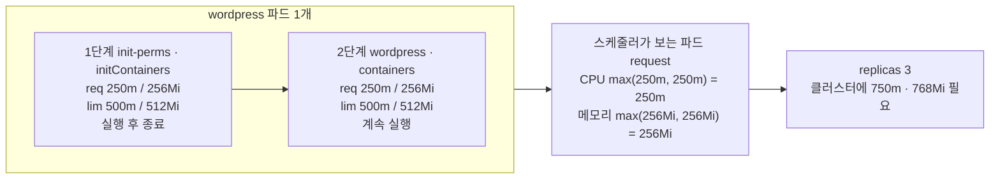
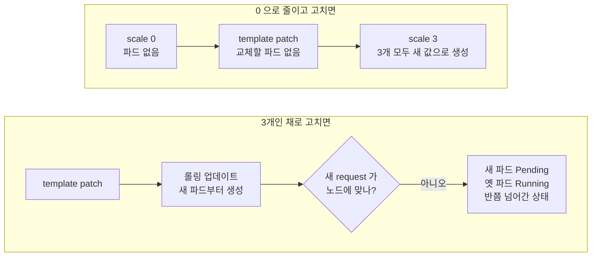

# q06 — Set resources on every container, including init · 풀이

← 문제: **[question.md](question.md)**

## 문제 (해석)

**원문**

> Deployment `wordpress` in namespace `wp` has an init container `init-perms` and an app container
> `wordpress`. Neither of them has resource requests or limits.
>
> 1. Scale Deployment `wordpress` to `0` replicas before you change it.
> 2. Set exactly these resources on **both** the init container `init-perms` and the container
>    `wordpress`: requests `cpu: 250m`, `memory: 256Mi`; limits `cpu: 500m`, `memory: 512Mi`.
> 3. Scale the Deployment to `3` replicas. Confirm that all 3 pods are `Running` and ready, and that
>    both containers in the pod template carry the new resources.

**해석**

`wp` 네임스페이스의 Deployment `wordpress` 에는 init 컨테이너 `init-perms` 와 앱 컨테이너
`wordpress` 가 있다. 둘 다 리소스 request나 limit이 없다.

1. 변경하기 전에 Deployment `wordpress` 를 레플리카 `0` 으로 줄인다.
2. init 컨테이너 `init-perms` 와 컨테이너 `wordpress` **둘 다**에 정확히 다음 리소스를 설정한다:
   requests `cpu: 250m`, `memory: 256Mi`; limits `cpu: 500m`, `memory: 512Mi`.
3. Deployment를 레플리카 `3` 으로 늘린다. 파드 3개가 모두 `Running` 이고 Ready인지, 파드 템플릿의
   두 컨테이너에 새 리소스가 들어갔는지 확인한다.

## 모범 풀이

**1) 먼저 0으로 줄입니다**

```bash
kubectl -n wp scale deploy wordpress --replicas=0
kubectl -n wp get deploy wordpress -o jsonpath=\
'{.spec.template.spec.initContainers[*].name}{" | "}{.spec.template.spec.containers[*].name}{"\n"}'
# init-perms | wordpress          ← 각각 인덱스 0
```

파드 템플릿을 바꿀 때마다 롤링 업데이트가 일어납니다. 3개가 돌 때 고치면 새 request가 노드에 맞지
않는 경우 새 파드는 `Pending`, 옛 파드는 `Running` 인 **반쯤 넘어간 상태**가 됩니다. 0에서 고치면
변경은 파드 없이 끝나고, 3으로 올릴 때 3개가 모두 새 값으로 한 번에 만들어집니다.

**2) 두 컨테이너에 리소스** — `kubectl -n wp edit deploy wordpress` 로 두 곳에 같은 블록을 넣습니다.

```yaml
    spec:
      initContainers:
      - name: init-perms
        # image, command 는 그대로
        resources:
          requests: {cpu: 250m, memory: 256Mi}
          limits:   {cpu: 500m, memory: 512Mi}
      containers:
      - name: wordpress
        resources:
          requests: {cpu: 250m, memory: 256Mi}
          limits:   {cpu: 500m, memory: 512Mi}
```

```bash
# 편집기 대신 JSON patch 한 번으로도 된다 (경로의 0 은 위에서 확인한 인덱스)
kubectl -n wp patch deploy wordpress --type=json -p='[
 {"op":"add","path":"/spec/template/spec/initContainers/0/resources",
  "value":{"requests":{"cpu":"250m","memory":"256Mi"},"limits":{"cpu":"500m","memory":"512Mi"}}},
 {"op":"add","path":"/spec/template/spec/containers/0/resources",
  "value":{"requests":{"cpu":"250m","memory":"256Mi"},"limits":{"cpu":"500m","memory":"512Mi"}}}]'
```

**핵심은 init 컨테이너가 `initContainers` 라는 별도 목록에 있다는 점입니다.** `kubectl set resources`
가 init 컨테이너까지 바꿨다고 가정하지 말고, 경로를 지정해 넣은 뒤 두 목록을 모두 확인합니다. 파드의
실효 request는 `max(가장 큰 init 컨테이너, 앱 컨테이너 합)` = `250m`/`256Mi` 이고, requests ≠ limits
이므로 QoS는 **Burstable** 입니다(Guaranteed는 모든 컨테이너에서 cpu·memory 모두 requests = limits).

**3) 다시 3으로**

```bash
kubectl -n wp scale deploy wordpress --replicas=3
kubectl -n wp rollout status deploy wordpress
```

### 그림 1 — 파드 하나의 컨테이너와 실효 request



1. init 컨테이너는 앱 컨테이너보다 먼저 혼자 실행되고 끝납니다. 그래서 두 값을 더하지 않고, "가장 큰 init 컨테이너"와 "앱 컨테이너 합" 중 큰 쪽이 파드의 request 가 됩니다.
2. 두 컨테이너가 같은 값이므로 파드 request 는 `250m`/`256Mi` 이고, 3개면 클러스터 전체에 `750m`/`768Mi` 여유가 있어야 모두 `Running` 이 됩니다.
3. 두 컨테이너는 `initContainers` 와 `containers` 라는 서로 다른 목록에 있으므로 리소스도 두 경로에 각각 넣어야 합니다.

### 그림 2 — 왜 0 으로 줄이고 고치는가



1. 파드가 떠 있는 상태에서 템플릿을 바꾸면 Deployment 는 새 파드를 먼저 만들고 옛 파드를 지웁니다. 새 request 가 노드에 맞지 않으면 그 중간에서 멈춥니다.
2. 0 에서 고치면 바뀌는 것은 템플릿뿐이고, 3 으로 늘릴 때 만들어지는 파드는 모두 새 값을 가집니다. 문제의 1~3번 순서가 바로 이 흐름입니다.

## 검증

```bash
kubectl -n wp get deploy,pods               # deploy READY 3/3, 파드 3개 모두 Running 1/1
kubectl -n wp get deploy wordpress -o jsonpath=\
'{.spec.template.spec.initContainers[0].resources}{"\n"}{.spec.template.spec.containers[0].resources}{"\n"}'
# {"limits":{"cpu":"500m","memory":"512Mi"},"requests":{"cpu":"250m","memory":"256Mi"}}   ← 두 줄이 같아야 한다
kubectl -n wp get pods -o jsonpath='{range .items[*]}{.metadata.name}{"  "}{.status.qosClass}{"\n"}{end}'
# wordpress-...  Burstable   (3줄)
```

## 오답 원인 / 배운 점

- **왜 틀렸나**:
- **기억할 것**: init 컨테이너는 `spec.template.spec.initContainers` 에 따로 있다 — 리소스를 넣은 뒤 `initContainers` 와 `containers` 를 둘 다 jsonpath로 확인한다. 템플릿을 고칠 때는 0으로 줄이고, 고치고, 다시 늘린다.
- **헷갈리는 지점**: 파드의 READY 칸(`1/1`)에는 일반 init 컨테이너가 세지지 않으므로, READY만 보고는 init 컨테이너 설정이 들어갔는지 알 수 없습니다. 파드가 `Pending` 이고 이벤트에 `Insufficient cpu/memory` 가 보이면 request 합이 노드 여유보다 큰 것입니다(`kubectl describe node` 의 `Allocated resources`).

## 참고 문서

- 검색어: `resource management for pods and containers`
- https://kubernetes.io/docs/concepts/configuration/manage-resources-containers/
- https://kubernetes.io/docs/concepts/workloads/pods/init-containers/
- https://kubernetes.io/docs/concepts/workloads/pods/pod-qos/

---

[↑ 문항 목록](../README.md) · [← 문제로](question.md) · [다음 문제 q07 →](../q07_native_sidecar_log_shipper/question.md)
