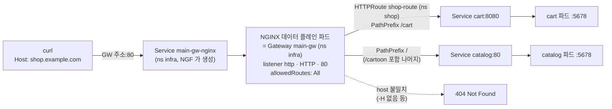
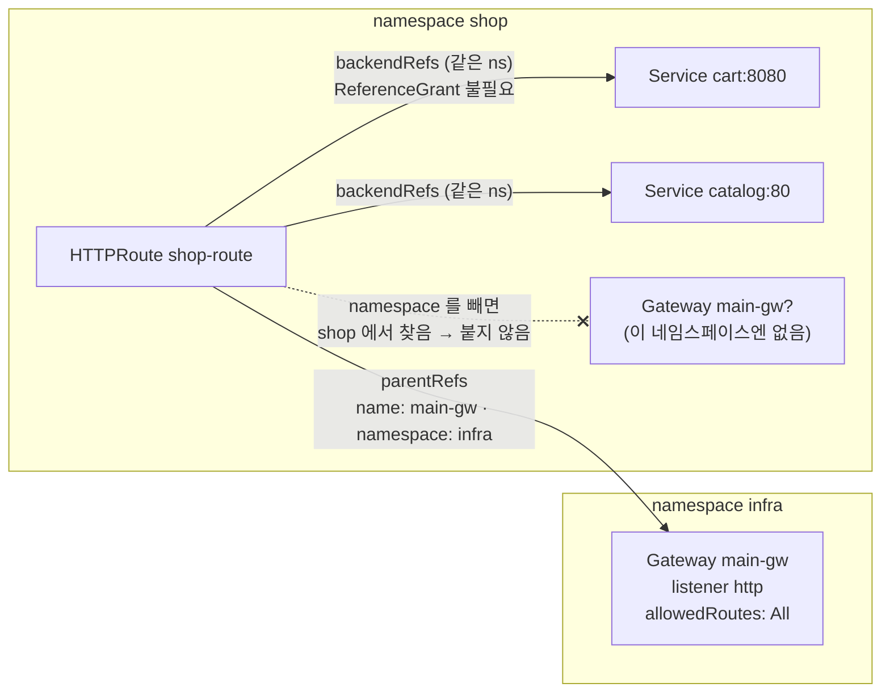

# q08 — Route two paths with one HTTPRoute · 풀이

← 문제: **[question.md](question.md)**

## 문제 (해석)

**원문**

> Gateway `main-gw` in namespace `infra` has a listener named `http` (HTTP, port 80) that accepts
> routes from all namespaces. Namespace `shop` contains Service `catalog` (port 80) and Service
> `cart` (port 8080). Both backends answer any path with a short text that contains their own name.
>
> 1. Create an HTTPRoute named `shop-route` in namespace `shop`, attached to listener `http` of
>    Gateway `main-gw`, for hostname `shop.example.com`.
> 2. Requests with path prefix `/cart` must go to Service `cart` on port `8080`; all other requests
>    (prefix `/`) must go to Service `catalog` on port `80`.
> 3. Confirm that the Gateway accepted the route, and test both paths with `curl` using the header
>    `Host: shop.example.com`.

**해석**

`infra` 네임스페이스의 Gateway `main-gw` 에는 모든 네임스페이스의 route를 받는 listener `http`
(HTTP, 포트 80)가 있다. `shop` 네임스페이스에는 Service `catalog`(포트 80)와 Service `cart`(포트
8080)가 있다. 두 백엔드 모두 어떤 경로로 요청해도 자기 이름이 들어간 짧은 텍스트로 응답한다.

1. `shop` 네임스페이스에 HTTPRoute `shop-route` 를 만든다. Gateway `main-gw` 의 listener `http` 에
   붙고, hostname은 `shop.example.com` 이다.
2. 경로 prefix가 `/cart` 인 요청은 Service `cart` 의 포트 `8080` 으로, 나머지 모든 요청(prefix `/`)은
   Service `catalog` 의 포트 `80` 으로 보낸다.
3. Gateway가 route를 받아들였는지 확인하고, `Host: shop.example.com` 헤더를 붙인 `curl` 로 두 경로를
   테스트한다.

## 모범 풀이

```bash
kubectl -n infra get gateway main-gw
# NAME      CLASS   ADDRESS         PROGRAMMED   AGE
# main-gw   nginx   192.168.1.240   True         5d
kubectl -n shop get svc catalog cart          # PORT(S) 80/TCP, 8080/TCP
```

```yaml
apiVersion: gateway.networking.k8s.io/v1
kind: HTTPRoute
metadata:
  name: shop-route
  namespace: shop
spec:
  parentRefs:
  - name: main-gw
    namespace: infra          # Gateway 가 다른 네임스페이스에 있으므로 필수
    sectionName: http         # listener 이름
  hostnames:
  - shop.example.com
  rules:
  - matches:
    - path: {type: PathPrefix, value: /cart}
    backendRefs:
    - name: cart
      port: 8080              # Service 의 port
  - matches:
    - path: {type: PathPrefix, value: /}
    backendRefs:
    - name: catalog
      port: 80
```

```bash
kubectl apply -f shop-route.yaml
```

**핵심은 `parentRefs[].namespace` 입니다.** 생략하면 route 자신의 네임스페이스(`shop`)에서
`main-gw` 를 찾습니다. 그런 Gateway는 없으므로 route는 어디에도 붙지 않고, 대부분의 구현에서는
`status.parents` 가 빈 채로(`Accepted` 조건 없이) 트래픽만 오지 않습니다. route가 다른 네임스페이스의 Gateway에 붙는 것은 listener의
`allowedRoutes.namespaces.from: All` 이 허락하므로 ReferenceGrant가 필요 없습니다. ReferenceGrant는
route가 **다른 네임스페이스의 Service**를 backendRef로 가리킬 때 필요합니다.

`backendRefs[].port` 는 컨테이너 포트가 아니라 Service의 `port` 입니다. 경로는 **가장 긴 prefix가
이기므로** `/cart/items` 는 `cart` 로, 나머지는 `catalog` 로 갑니다. 규칙을 적는 순서는 상관없습니다.
`PathPrefix` 는 경로 요소 단위로 비교해서 `/cartoon` 은 `/cart` 에 맞지 않고 `catalog` 로 갑니다.

### 트래픽 흐름



1. 클라이언트가 Gateway 주소(`status.addresses`)의 80 포트로 요청을 보냅니다. NodePort 설치에서는 이 주소가
   `infra` 의 `main-gw-nginx` Service ClusterIP 입니다. 클러스터 밖에서는 `<노드IP>:<NodePort>` 로 같은 Service 에 들어옵니다.
2. 요청은 Gateway `main-gw` 의 실체인 NGINX 파드에 도착하고, listener `http`(HTTP/80)가 받습니다. 이 listener 는
   `allowedRoutes.namespaces.from: All` 이라 `shop` 네임스페이스의 route 도 붙을 수 있습니다.
3. NGINX 는 Host 가 `shop.example.com` 인지 본 뒤 경로를 비교합니다. 가장 긴 prefix 가 이기므로 `/cart`, `/cart/items` 는
   Service `cart` 포트 8080으로, 그 밖의 경로는 Service `catalog` 포트 80으로 갑니다. Host 가 다르면 404를 직접 돌려줍니다.
4. 각 Service 가 `targetPort` 5678 의 파드로 요청을 넘기고, 응답이 같은 길로 돌아옵니다. 경로는 바뀌지 않고 그대로 전달됩니다.

### 네임스페이스를 넘는 참조



1. route 는 `shop` 에, Gateway 는 `infra` 에 있습니다. `parentRefs[].namespace: infra` 가 있어야 Gateway 를 찾습니다.
2. `namespace` 를 빼면 route 자신의 네임스페이스 `shop` 에서 `main-gw` 를 찾습니다. 그런 Gateway 는 없으므로 route 는
   어디에도 붙지 않고 트래픽도 오지 않습니다.
3. Gateway 쪽에서 다른 네임스페이스의 route 를 받아 주는 것은 listener 의 `allowedRoutes.namespaces.from: All` 입니다.
   route 와 Gateway 양쪽이 서로를 허락해야 붙습니다.
4. backend Service 두 개는 route 와 같은 `shop` 에 있으므로 ReferenceGrant 가 필요 없습니다. Service 가 다른
   네임스페이스에 있을 때만 그쪽에 ReferenceGrant 를 만듭니다.

## 검증

```bash
kubectl -n shop get httproute shop-route -o jsonpath=\
'{range .status.parents[*].conditions[*]}{.type}={.status}{"\n"}{end}'
# Accepted=True
# ResolvedRefs=True
GW=$(kubectl -n infra get gateway main-gw -o jsonpath='{.status.addresses[0].value}')
# 비어 있으면(LoadBalancer 없음) 데이터플레인 Service 를 kubectl get svc -A 로 찾아 <노드IP>:<NodePort> 로 보낸다
curl -s -H 'Host: shop.example.com' http://$GW/cart/items   # cart 가 응답
curl -s -H 'Host: shop.example.com' http://$GW/cartoon      # catalog 가 응답
curl -s -H 'Host: shop.example.com' http://$GW/             # catalog 가 응답
```

## 오답 원인 / 배운 점

- **왜 틀렸나**:
- **기억할 것**: 다른 네임스페이스의 Gateway에 붙일 때는 `parentRefs` 에 `namespace` 를 쓴다. `sectionName` 은 listener 이름, `backendRefs[].port` 는 Service 포트.
- **헷갈리는 지점**: route가 실제로 붙었는지는 `kubectl get httproute` 목록만으로는 알 수 없고 `status.parents[].conditions` 의 `Accepted` 를 봐야 합니다. HTTPRoute는 경로를 바꾸지 않고 그대로 넘기므로 백엔드는 `/cart/items` 를 그대로 받습니다 — 백엔드가 `/cart` 경로를 모르고 루트에서만 서비스한다면 prefix를 떼어 내는 `URLRewrite` 필터가 필요합니다.

## 참고 문서

- 검색어: `gateway api httproute`
- https://kubernetes.io/docs/concepts/services-networking/gateway/
- https://gateway-api.sigs.k8s.io/api-types/httproute/
- https://gateway-api.sigs.k8s.io/guides/multiple-ns/

## 복습 기록

| 날짜 | 결과 | 메모 |
|---|---|---|
|  |  |  |
